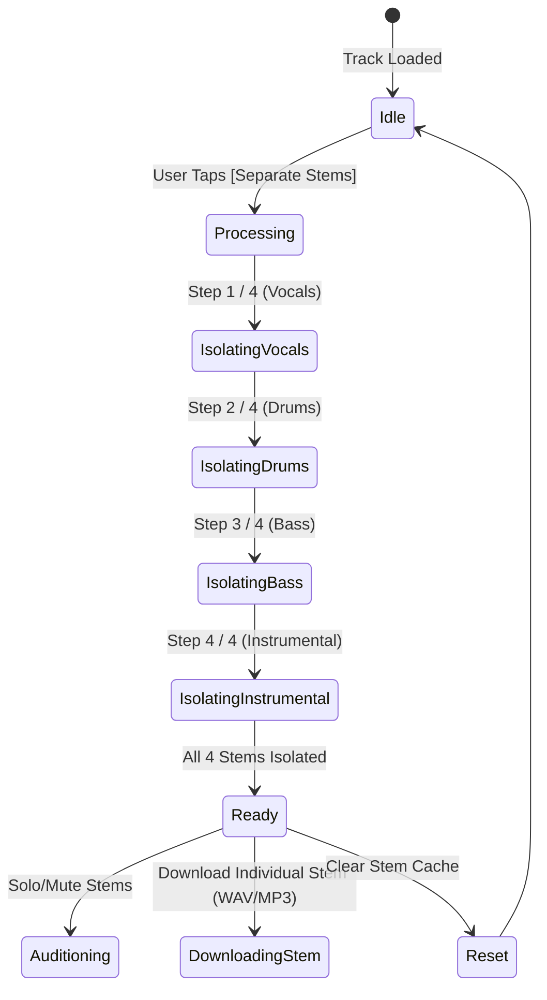
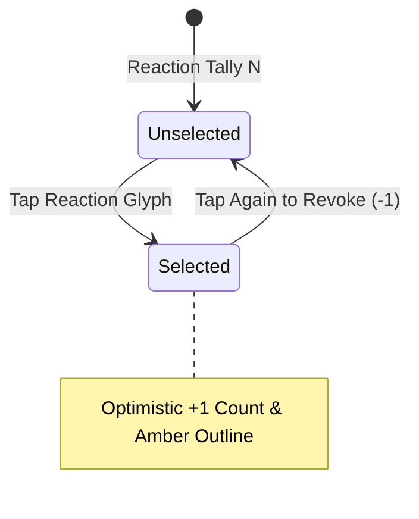

# Phase 7 Blueprint: Track Details & Creator Profiles (`/track/:id`, `/profile/:id`, `/profile/me`)

> **Target Platform:** Flutter 3.x+ / Dart 3.x+ (Cross-Platform Mobile, Desktop & Web)  
> **Route Paths:**  
> - `/track/:id` (Track Details Cockpit & Audio Dissection)  
> - `/profile/:id` (Public Artist Profile & Supporter Leaderboard)  
> - `/profile/me` (Account Owner Creator Studio & Release Manager)  
> **State Management:** Flutter Riverpod 2.x+  
> **Source Origin:** Production Web Client (`https://vhunambi.com/track/:id`, `https://vhunambi.com/profile/:id`)  
> **Parent Blueprint:** [`docs/foundation_blueprints/06_TRACK_AND_CREATOR_PROFILES_SPEC.md`](file:///c:/Users/Ndugelo/VHUNAMBI/monorepo/docs/foundation_blueprints/06_TRACK_AND_CREATOR_PROFILES_SPEC.md)

---

## 1. Executive Vision & Scope

Phase 7 implements deep musical interaction and creator identity across Vhunambi:
1. **Track Details Cockpit (`/track/:id`):** Provides a comprehensive audio generation dissection suite featuring a 1:1 artwork showcase with ambient amber glow, royalty ownership notice, personal/commercial license badges, social engagement metrics, an interactive 5-glyph cultural reaction deck (`🔥`, `❤️`, `🎵`, `🙌`, `🌍`), amplitude waveform scrubber, synchronized lyrics teleprompter, 4-stem separation lab (`Vocals`, `Drums`, `Bass`, `Instrumental`), prompt reverse-engineering with Studio remix routing, and a real-time discussion thread.
2. **Public Artist Profile (`/profile/:id`):** Visual showcase of an artist's identity, featuring an ambient cover banner with musical watermark glyphs, 84px monogram avatar, 5-metric statistical grid (`Songs`, `Likes`, `Plays`, `Followers`, `Day Streak`), top songs shelf, 🏆 Top Supporters leaderboard (`Gold 🥇`, `Silver 🥈`, `Bronze 🥉`), and recent activity feed.
3. **Account Owner Creator Studio Profile (`/profile/me`):** Authenticated artist management cockpit equipped with profile editing triggers, highlight track pinning, top genres distribution analytics chips, a structured discography releases manager (`Albums`, `EPs`, `Singles`), a 2-tab tip history ledger (`Received` vs `Sent`), and a one-tap profile referral copy card.

---

## 2. Track Details Cockpit Architecture (`/track/:id`)

### 2.1 Visual Layout Geometry

```
Desktop Track Details Cockpit (> 1024px, Centered Max-Width 860px):
┌──────────────────────────────────────────────────────────────────────────────────────────────────┐
│ [ < Back ] (🎵) VHUNAMBI                                                         [ 🔗 Share ]    │ <-- Top App Bar
├──────────────────────────────────────────────────────────────────────────────────────────────────┤
│                                                                                                  │
│                                  ┌────────────────────────┐                                      │
│                                  │                        │                                      │
│                                  │      🎹 AMAPIANO       │ <-- 1:1 Artwork Showcase             │
│                                  │   (280x280px Card)     │     Ambient Amber Glow Shadow        │
│                                  │                        │                                      │
│                                  └────────────────────────┘                                      │
│                                                                                                  │
│                                      Ndo Mufuna Matibe                                           │ <-- Title (28px Bold)
│                                  Amapiano • Tshivenḓa • 3:18                                     │ <-- Metadata Row
│                                      [ 🛡️ Personal Use ]                                         │ <-- License Badge
│                 This track is 100% royalty-free and owned by you. Commercial usage              │ <-- Royalty Notice
│                           depends on your subscription plan and licensing.                       │
│                                          👤 Fifi                                                 │ <-- Creator Link
│                                                                                                  │
│                   [ ❤️ 1 ]        [ ▶ 5 ]        [ 🔀 Remix ]        [ 💰 Tip ]                  │ <-- Primary Actions
│                                                                                                  │
│   [ ⬇ Download ] [ ➕ Playlist ] [ 📻 Radio ] [ 📝 Lyrics ] [ 🔀 Variation ] [ 💬 0 ] [ </> Embed ]│ <-- Utility Bar
│                                                                                                  │
│               [ 🔥 0 ]      [ ❤️ 1 ]      [ 🎵 0 ]      [ 🙌 0 ]      [ 🌍 0 ]                    │ <-- Reaction Deck
│                                                                                                  │
│   ┌──────────────────────────────────────────────────────────────────────────────────────────┐   │
│   │ ılılıllı|ı|ı|lılıl|lılıllı|ı|ı|lılıl|lılıllı|ı|ı|lılıl|lılıllı|ı|ı|lılıllı|ı|ı|lılıllı|   │   │ <-- Waveform
│   └──────────────────────────────────────────────────────────────────────────────────────────┘   │     Scrubber
│   0:00                                                                                   3:18    │
│                                                                                                  │
│   LYRICS                                                                                         │ <-- Lyrics Section
│   [Verse 1]                                                                                      │
│   Moonlight falls on your shoulder, Tshikona drums sound deep...                                │
│   [Chorus]                                                                                       │
│   Ndo mufuna Matibe, mbilu yanga yo vhuya...                                                    │
│                                                                                                  │
│   ┌──────────────────────────────────────────────────────────────────────────────────────────┐   │
│   │ 🎵 Stem Separation                                                    [ 🎛️ Separate Stems ]│   │ <-- 4-Stem Lab
│   │ Split this song into individual stems — vocals, instrumentals, drums, and bass.          │   │
│   └──────────────────────────────────────────────────────────────────────────────────────────┘   │
│                                                                                                  │
│   PROMPT                                                                                         │ <-- Prompt Card
│   ┌──────────────────────────────────────────────────────────────────────────────────────────┐   │
│   │ "Ndo mufuna Matibe deep amapiano with atmospheric Rhodes and heavy log drums" [Remix ✨] │   │
│   └──────────────────────────────────────────────────────────────────────────────────────────┘   │
│                                                                                                  │
│   💬 Comments (0)                                                                                │ <-- Comments
│   ┌──────────────────────────────────────────────────────────────────────────────┬───────────┐   │
│   │ Add a comment...                                                             │    ✈️     │   │
│   └──────────────────────────────────────────────────────────────────────────────┴───────────┘   │
│                               No comments yet. Be the first!                                     │
│                                                                                                  │
│   More Like This (Amapiano)                                                                      │ <-- Recommendations
│   [ 🎹 ] Grateful in the Light • Sigwa & Inaf • Amapiano • 3:29                          ❤️ 1002 │
│   [ 🥁 ] Durban Sunset • DJ Vibe • Gqom • 4:12                                            ❤️ 452 │
└──────────────────────────────────────────────────────────────────────────────────────────────────┘
```

```
Mobile Track Details Viewport (< 768px):
┌────────────────────────────────────────────────────────────────────────┐
│ [ < ] (🎵) VHUNAMBI                                            [ 🔗 ]  │
├────────────────────────────────────────────────────────────────────────┤
│                                                                        │
│                              ┌──────────┐                              │
│                              │ 🎹 220px │  <-- 220x220px Artwork Card  │
│                              └──────────┘                              │
│                                                                        │
│                          Ndo Mufuna Matibe                             │
│                      Amapiano • Tshivenḓa • 3:18                       │
│                          [ 🛡️ Personal Use ]                            │
│           This track is 100% royalty-free and owned by you.            │
│                              👤 Fifi                                   │
│                                                                        │
│    [❤️ 1]          [▶ 5]          [🔀 Remix]          [💰 Tip]        │
│                                                                        │
│ ┌────────────────────────────────────────────────────────────────────┐ │
│ │ [⬇ Down] [➕ List] [📻 Radio] [📝 Lyrics] [🔀 Variant] [💬 0]      │ │ <-- Horizontal Scroll
│ └────────────────────────────────────────────────────────────────────┘ │
│                                                                        │
│            [🔥 0]    [❤️ 1]    [🎵 0]    [🙌 0]    [🌍 0]              │ <-- 5-Emoji Dock
│                                                                        │
│    [ ılılıllı|ı|ı|lılıl|lılıllı|ı|ı|lılıl|lılıllı|ı|ı|lılıllı|ı|ı ]    │ <-- Scrubber
│    0:00                                                           3:18 │
│                                                                        │
│    LYRICS                                                              │
│    [Verse 1]                                                           │
│    Moonlight falls on your shoulder...                                 │
│                                                                        │
│ ┌────────────────────────────────────────────────────────────────────┐ │
│ │ 🎵 Stem Separation                                [ Separate ]     │ │
│ └────────────────────────────────────────────────────────────────────┘ │
│                                                                        │
│    PROMPT                                                              │
│    "Ndo mufuna Matibe"                                                 │
│                                                                        │
│    💬 Comments                                                         │
│    [ Add a comment...                                             ✈️ ] │
└────────────────────────────────────────────────────────────────────────┘
```

---

## 3. Public Artist Profile View (`/profile/:id`)

### 3.1 Visual Layout Geometry

```
Desktop Artist Profile Viewport (> 1024px):
┌──────────────────────────────────────────────────────────────────────────────────────────────────┐
│ [ < Back ] (🎵) VHUNAMBI                                                           [🔔] [👤]     │
├──────────────────────────────────────────────────────────────────────────────────────────────────┤
│ ┌──────────────────────────────────────────────────────────────────────────────────────────────┐ │
│ │  🎵            🎹                  🎸                  🥁                  🎷                │ │ <-- Ambient Cover
│ │                                                                                              │ │     Banner (180px)
│ │  ┌──────────────┐                                                                            │ │
│ │  │      FI      │                                                                            │ │ <-- 84px Monogram
│ └──┴──────────────┴────────────────────────────────────────────────────────────────────────────┘ │
│                                                                                                  │
│ Fifi  [✓ Verified Artist]                                                                        │
│ Modern Amapiano songstress blending Tshivenḓa poetry with private school piano log drums.        │
│                                                                                                  │
│ [ Follow ]               [ 💰 Tip Artist ]               [ 🔗 Share ]               [ 🏳️ Report ] │ <-- Action Strip
│                                                                                                  │
│ ┌────────────────┐ ┌────────────────┐ ┌────────────────┐ ┌────────────────┐ ┌────────────────┐ │
│ │    🎵 8        │ │    ❤️ 1,240    │ │    ▶ 45.2K     │ │    👥 1,820    │ │    🔥 4        │ │ <-- 5-Metric Grid
│ │    Songs       │ │    Likes       │ │    Plays       │ │    Followers   │ │    Day Streak  │ │
│ └────────────────┘ └────────────────┘ └────────────────┘ └────────────────┘ └────────────────┘ │
│                                                                                                  │
│ Top Songs                                                                               View all │
│ [ 🎹 ] 1. Ndo Mufuna Matibe • Amapiano • 3:18                                  ▶ 12.4K  ❤️ 840   │
│ [ 🎵 ] 2. Tshikona Morning • Amapiano • 3:45                                   ▶ 9.1K   ❤️ 412   │
│                                                                                                  │
│ 🏆 Top Supporters                                                                                │
│ ┌───────────────────────────┐  ┌───────────────────────────┐  ┌───────────────────────────┐     │
│ │ 🥇 Sipho_M (500 credits)  │  │ 🥈 LeratoK (350 credits)  │  │ 🥉 DJThabo (200 credits)  │     │
│ └───────────────────────────┘  └───────────────────────────┘  └───────────────────────────┘     │
│                                                                                                  │
│ Recent Activity                                                                                  │
│ [ 🎹 ] Ndo Mufuna Matibe • Released 2 days ago • Amapiano                                        │
│ [ 🎸 ] Venda Nights • Released 1 week ago • Maskandi                                             │
└──────────────────────────────────────────────────────────────────────────────────────────────────┘
```

---

## 4. Account Owner Creator Studio Profile (`/profile/me`)

### 4.1 Visual Layout Geometry

```
Creator Studio Cockpit Viewport:
┌──────────────────────────────────────────────────────────────────────────────────────────────────┐
│ [ < Back ] (🎵) VHUNAMBI                                                           [🔔] [👤]     │
├──────────────────────────────────────────────────────────────────────────────────────────────────┤
│ ┌──────────────┐                                                                                 │
│ │      CE      │   cern                                                                          │
│ └──────────────┘   [ ✏️ Edit Profile ]      [ 📌 Pin Song ]      [ 📊 Studio Analytics ]          │
│                                                                                                  │
│ TOP GENRES                                                                                       │
│ [ 🎵 House (1) ]    [ 🎹 Amapiano (4) ]    [ 🎸 Maskandi (2) ]                                   │
│                                                                                                  │
│ Your Songs                                                                               7 total │
│ ┌──────────────────────────────────────────────────────────────────────────────────────────────┐ │
│ │ [1] [ 🎵 ] ZaYN • House • 3:20 • ▶ 4 • ❤️ 0                       [ 🌐 Public ]  [ ⋯ More ] │ │
│ ├──────────────────────────────────────────────────────────────────────────────────────────────┤ │
│ │ [2] [ 🎹 ] Ndo Mufuna • Amapiano • 3:18 • ▶ 12 • ❤️ 3             [ 🌐 Public ]  [ ⋯ More ] │ │
│ └──────────────────────────────────────────────────────────────────────────────────────────────┘ │
│                                                                                                  │
│ 💿 Discography Releases                                                         [ + New Release ]│
│ ┌──────────────────────────────────────────────────────────────────────────────────────────────┐ │
│ │ ( 💿 ) Group your songs into an Album, EP, or Single.                                        │ │
│ │ Build your official artist discography on Vhunambi.                                          │ │
│ │ [ Create First Release ]                                                                     │ │
│ └──────────────────────────────────────────────────────────────────────────────────────────────┘ │
│                                                                                                  │
│ 💰 Tip History                                                                  Tips on: [ ● ]   │
│ [ Received (120 Credits) ]    [ Sent (35 Credits) ]                                              │
│ • @fan_jabu tipped 50 credits on "Ndo Mufuna Matibe" • 2 hours ago                              │
│ • @sarah_music tipped 70 credits on "ZaYN" • Yesterday                                           │
│                                                                                                  │
│ ┌──────────────────────────────────────────────────────────────────────────────────────────────┐ │
│ │ Share your creator profile                                            [ 🔗 Copy Profile Link ]│ │
│ │ Let fans and collaborators discover your music and support your craft                        │ │
│ └──────────────────────────────────────────────────────────────────────────────────────────────┘ │
└──────────────────────────────────────────────────────────────────────────────────────────────────┘
```

---

## 5. State Machine & Workflow Models

### 5.1 4-Stem Separation State Machine



### 5.2 Emoji Reaction Pill State



---

## 6. Design Token Mappings

| Component Element | Semantic Token | Exact Value / Asset |
|---|---|---|
| Background Canvas | `AppColors.surfaceCanvas` | `#0A0A0C` |
| Primary Card Surface | `AppColors.surfaceElevated` | `#141418` |
| Inset Container / Pill | `AppColors.surfaceSecondary` | `#1B1B22` |
| Modal Bottom Sheet | `AppColors.surfaceModal` | `#16161C` |
| Brand Amber Accent | `AppColors.brandPrimary` | `#F97316` |
| Coin Gold Accent | `AppColors.coinGold` | `#F59E0B` |
| Card & Divider Border | `AppColors.borderSubtle` | `#2D2D38` |
| Primary Typography | `AppColors.textPrimary` | `#FFFFFF` (Inter) |
| Secondary Typography | `AppColors.textSecondary` | `#9CA3AF` |
| Muted Typography | `AppColors.textTertiary` | `#6B7280` |
| Ambient Glow Shadow | Drop Shadow | `BoxShadow(color: Color(0x3DF97316), blurRadius: 40, spreadRadius: -8)` |
| Genre Artwork Gradient | `AppGradients.forGenre(genre)` | Regional 12-genre palette |
| Card Border Radius | `AppRadius.cardBorder` | `16px` |
| Pill Border Radius | `AppRadius.pillBorder` | `9999px` |
