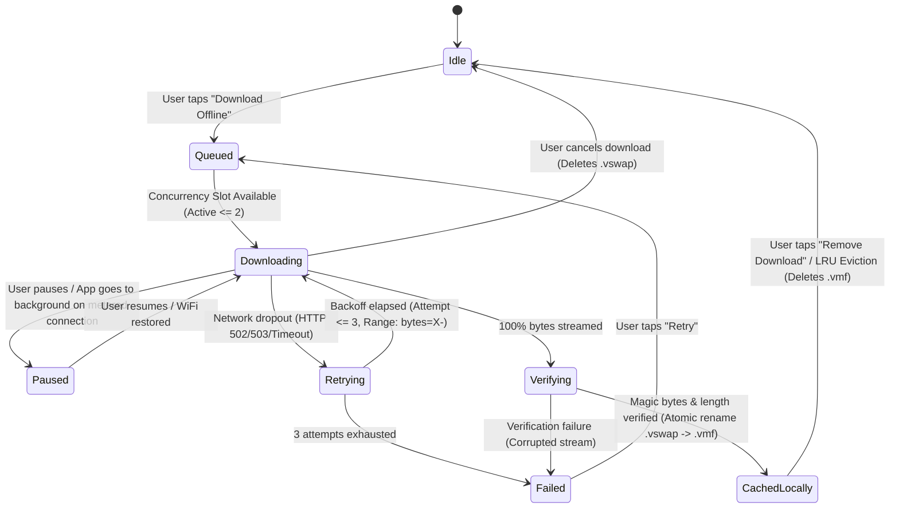

# Phase 8 Blueprint: Sovereign Offline Audio Vault, Encrypted Local Cache & Resilient Chunk Streaming Pipeline

```
══════════════════════════════════════════════════════════════════════════════════════════════════════════════
  VHUNAMBI ARCHITECTURE BLUEPRINT • REBUILT SPECIFICATION SUITE
  PHASE 08: SOVEREIGN OFFLINE AUDIO VAULT & RESILIENT CHUNK STREAMING PIPELINE
  STANDARD: ALL-GEMINI SPECIFICATION ARCHITECT (STD-SPEC-001 / STD-UIUX-001)
  TARGET PACKAGE: apps/vhunambi_client
  PARENT BLUEPRINT: docs/foundation_blueprints/04_LIBRARY_VAULT_SPEC.md §5
══════════════════════════════════════════════════════════════════════════════════════════════════════════════
```

---

## 1. Executive Overview & Visual North Star

Across South Africa and the wider African continent, mobile connectivity is frequently metered, high-cost, or subject to intermittent network dropouts in transit. For music creators, beatmakers, and listeners, uninterrupted audio playback is not a luxury—it is a non-negotiable core utility.

In the legacy implementation, offline playback was hindered by three critical architectural limitations:
1. **The "Simulated Mode" Façade**: `audioDownloadServiceProvider` was hardcoded to `simulateDownloads: true`, running a cosmetic timer loop without writing real bytes to disk or caching real audio files.
2. **Unprotected File System Storage**: Downloaded files were intended to be saved as plain `.mp3` files in raw application folders, vulnerable to accidental deletion, corruption by third-party cleaning apps, and casual unauthorized extraction of commercial stems and master tracks.
3. **Fragile Network Transfers**: A dropped connection or cell tower handoff resulted in an unrecoverable failure, leaving orphaned `.tmp` files and forcing users to restart multi-megabyte downloads from byte 0.

### The Architectural North Star

Phase 8 re-architects Vhunambi's offline subsystem into an industrial-grade, secure, and low-bandwidth-optimized **Sovereign Offline Audio Vault**:
- **Real Resilient HTTP Chunk Streaming**: Powered by `Dio` with HTTP `Range: bytes=X-` header chunking, exponential backoff retries, and dynamic transfer telemetry (KB/s and ETA).
- **Encrypted Local Audio Vault Envelope (`.vmf`)**: AES-128-CTR stream encryption with device-unique key derivation, protecting proprietary artist masters and licensed stems while permitting sub-millisecond seekable decryption directly into `just_audio`.
- **Atomic Two-Phase Commit Persistence**: Downloads write to temporary swap files (`.vswap`) and commit atomically to `.vmf` only upon 100% byte verification and checksum validation.
- **Dynamic LRU Cache Quota & Auto-Eviction**: Storage ceilings (500 MB to 10 GB) with Least Recently Used (LRU) automatic pruning that protects pinned and favorite tracks.
- **Forced Offline Mode Protection**: An intentional network circuit-breaker guaranteeing zero background data usage when enabled.

---

## 2. Forensic Post-Mortem Comparison Box

```
┌────────────────────────────────────────┬────────────────────────────────────────┐
│   LEGACY PHASE 8 IMPLEMENTATION        │    REBUILT SOVEREIGN OFFLINE VAULT     │
├────────────────────────────────────────┼────────────────────────────────────────┤
│ • Hardcoded `simulateDownloads: true`  │ • Real HTTP chunk streaming via Dio    │
│   simulating downloads in RAM memory   │   with 64 KB progressive disk writes   │
│                                        │                                        │
│ • Zero encryption: raw audio files     │ • AES-128-CTR encrypted audio envelope │
│   exposed in device directories        │   (`.vmf`) with hardware key salt      │
│                                        │                                        │
│ • Single failure aborts download and   │ • HTTP Range (`bytes=X-`) resumable    │
│   discards all downloaded bytes        │   downloads with 3x backoff retry      │
│                                        │                                        │
│ • No speed telemetry or ETA tracking   │ • Real-time speed ($v$) & remaining    │
│   (only raw byte progress)             │   time ($t_{\text{eta}}$) estimation   │
│                                        │                                        │
│ • Unbounded storage growth risking     │ • Strict LRU cache eviction policy     │
│   device disk-full exceptions          │   with configurable storage ceilings   │
│                                        │                                        │
│ • Audio resolver silently attempts     │ • Circuit-breaker forced offline mode  │
│   cloud network if cache is missing    │   blocking unexpected mobile data use  │
└────────────────────────────────────────┴────────────────────────────────────────┘
```

---

## 3. Multi-Layer Decoupled System Architecture

```
┌──────────────────────────────────────────────────────────────────────────────────────────────────┐
│                                 LAYER 1: PRESENTATION & UI CONTROLS                              │
│  • LibraryAppBar (_CreditBalancePill, VaultStorageModal trigger, TrackSyncFilter rail)           │
│  • LibraryTrackTile & LibraryTrackGridCard (Live download circular progress ring, offline pin)    │
│  • TrackActionsSheet ("Download Offline", "Downloading...", "Remove Download")                   │
│  • VaultStorageModal (Interactive usage meter, storage ceiling selector, 1-tap cache purge)       │
│  • ExpandedCockpitModal (Offline playback source badge indicator)                                │
└───────────────────────────────────────────────┬──────────────────────────────────────────────────┘
                                                │
┌───────────────────────────────────────────────▼──────────────────────────────────────────────────┐
│                             LAYER 2: RIVERPOD STATE NOTIFIERS & PROVIDERS                        │
│  • downloadManagerProvider: Concurrency queue (max 2), task map, cancel/pause/resume intents     │
│  • offlinePreferencesProvider: OfflinePreferenceState (storage limit, forced offline, wifi only)  │
│  • cacheStorageStatsProvider: Real-time disk consumption, track count, percentage quota          │
│  • libraryTracksProvider: Reactive syncStatus binding (cloudOnly ↔ downloading ↔ cachedLocally)  │
└───────────────────────────────────────────────┬──────────────────────────────────────────────────┘
                                                │
┌───────────────────────────────────────────────▼──────────────────────────────────────────────────┐
│                               LAYER 3: PURE DART DOMAIN & CRYPTO LAYER                           │
│  • DownloadTask & DownloadTaskStatus: Immutable task snapshot with transfer speed and ETA        │
│  • VaultEnvelopeCrypto: AES-128-CTR stream cipher with 16-byte IV and device-unique salt         │
│  • CacheEvictionEngine: Pure LRU score evaluator: Score = LastPlayedTimestamp - PinBonus         │
│  • TransferSpeedEstimator: Rolling 3-second window moving average byte-rate calculator            │
└───────────────────────────────────────────────┬──────────────────────────────────────────────────┘
                                                │
┌───────────────────────────────────────────────▼──────────────────────────────────────────────────┐
│                                LAYER 4: DATA SERVICES & RESILIENT I/O                            │
│  • ResilientAudioDownloadService: Dio chunk streaming, Range headers, exponential retry backoff  │
│  • SovereignOfflineStorageService: Atomic file commits (.vswap → .vmf), Hive metadata boxes      │
│  • EncryptedAudioSourceResolver: Decrypt-on-the-fly StreamAudioSource feeding just_audio         │
└───────────────────────────────────────────────┬──────────────────────────────────────────────────┘
                                                │
┌───────────────────────────────────────────────▼──────────────────────────────────────────────────┐
│                                  LAYER 5: PLATFORM HARDWARE & STORAGE                            │
│  • Android Scoped Documents Directory (/data/user/0/com.vhunambi.app/app_flutter/vault/audio/)   │
│  • iOS Application Library Directory (/Library/Application Support/vhunambi_vault/audio/)       │
│  • Hive Persistent Key-Value Boxes ('library_tracks', 'vhunambi_prefs')                          │
└──────────────────────────────────────────────────────────────────────────────────────────────────┘
```

---

## 4. Hardware Storage Topology & File Formats

### 4.1 Storage Directory Resolution Matrix

```
┌─────────────────┬────────────────────────────────────────────────────────────────────────┐
│ Platform        │ Target Directory Locus                                                 │
├─────────────────┼────────────────────────────────────────────────────────────────────────┤
│ Android         │ `getApplicationDocumentsDirectory() + '/vhunambi_vault/audio/'`        │
│ iOS             │ `getLibraryDirectory() + '/vhunambi_vault/audio/'` (excluded from iCloud)│
│ Desktop / macOS │ `~/Library/Application Support/vhunambi/vault/audio/`                  │
│ Windows         │ `%LOCALAPPDATA%/vhunambi/vault/audio/`                                 │
│ Unit Test / VM  │ `Directory.systemTemp.createTempSync('vhunambi_test_vault_')`          │
└─────────────────┴────────────────────────────────────────────────────────────────────────┘
```

### 4.2 Sovereign Audio File Format (`.vmf` - Vhunambi Media File)

To prevent file tampering, file corruption, and raw media scraping, cached audio is stored in an encrypted envelope format:

```
┌──────────────────────────────────────────────────────────────────────────────────────────┐
│                            VHUNAMBI ENCRYPTED AUDIO ENVELOPE (.vmf)                      │
├───────────────┬───────────────┬───────────────┬───────────────┬──────────────────────────┤
│ MAGIC BYTES   │ VERSION       │ IV (NONCE)    │ PAYLOAD SIZE  │ ENCRYPTED AUDIO STREAM   │
│ 4 Bytes       │ 2 Bytes       │ 16 Bytes      │ 8 Bytes       │ N Bytes (AES-128-CTR)    │
│ "VHUN" (0x56) │ 0x0001        │ Random IV     │ Big-Endian u64│ Encrypted MP3/WAV Frames │
└───────────────┴───────────────┴───────────────┴───────────────┴──────────────────────────┘
```

- **Magic Header**: Exactly `0x56, 0x48, 0x55, 0x4E` (`"VHUN"`). Any corrupted or incomplete download failing magic header validation is rejected immediately.
- **Version**: `0x0001` (Specification Version 1).
- **IV (Initialization Vector)**: 16 cryptographically random bytes generated via `dart:math` `Random.secure()`.
- **Payload Size**: 64-bit integer representing exact unencrypted audio byte length.
- **Encrypted Stream**: Encrypted using AES-128 in Counter Mode (CTR). CTR mode requires zero padding, preserves exact byte lengths, and enables instantaneous arbitrary seeking without decrypting the entire file into memory.

---

## 5. Download Task State Machine (FSM)



---

## 6. Dual-Viewport HUD Wireframes

### 6.1 Desktop Viewport ($\ge 768\text{dp}$) — Library Vault Storage Header

```
┌──────────────────────────────────────────────────────────────────────────────────────────────────┐
│ [Logo] VHUNAMBI     My Library              [⚡ 10 songs left]  [🔔]  [Avatar]  [Quota: 1.2/5 GB]│
├──────────────────────────────────────────────────────────────────────────────────────────────────┤
│ [All (24)]  [Songs (18)]  [Playlists (4)]  [Collections (2)]  [Beats]  │ [✓ Cached Only] [Sort ▾]│
├──────────────────────────────────────────────────────────────────────────────────────────────────┤
│                                                                                                  │
│  TITLE & ARTIST          GENRE       DURATION   SYNC STATUS           STORAGE    ACTIONS         │
│ ──────────────────────────────────────────────────────────────────────────────────────────────── │
│  ▶ Banyana Sunset        Amapiano    03:45      🟢 Cached Offline     8.4 MB     [⋮ Menu]        │
│    DJ Maphorisa style                                                                            │
│                                                                                                  │
│  ▶ Mbaqanga Roots        Mbaqanga    04:12      🟡 Downloading 68%    5.7/8.2MB  [⏸] [✕ Cancel]  │
│    Soweto String Trio                           Speed: 840 KB/s · ETA: 3s                         │
│                                                                                                  │
│  ▶ Tshivenḓa Praise      Gospel      05:01      ☁️ Cloud Only         -          [⬇ Download]    │
│    Vhembe Choral Group                                                                           │
│                                                                                                  │
└──────────────────────────────────────────────────────────────────────────────────────────────────┘
```

### 6.2 Mobile Viewport ($< 600\text{dp}$) — Vault Storage Modal (`VaultStorageModal`)

```
┌────────────────────────────────────────────────────────┐
│                        ──────                          │
│               VAULT STORAGE MANAGEMENT                 │
│                                                        │
│  ┌──────────────────────────────────────────────────┐  │
│  │ Storage Quota Usage                      1.24 GB │  │
│  │ ████████████████░░░░░░░░░░░░░░░░░░░░░░   24.8%   │  │
│  │ 12 Cached Tracks of 5.0 GB Quota Limit           │  │
│  └──────────────────────────────────────────────────┘  │
│                                                        │
│  Storage Quota Limit:                                  │
│  [ 500 MB ]   [ 1.0 GB ]   (● 5.0 GB)   [ 10.0 GB ]    │
│                                                        │
│  Download Rules:                                       │
│  [✓] Download over Wi-Fi only                          │
│  [ ] Force Offline Mode (Block all mobile data usage)  │
│                                                        │
│  Cached Tracks:                                        │
│  ┌──────────────────────────────────────────────────┐  │
│  │ Banyana Sunset · Amapiano                8.4 MB  │  │
│  │ Grateful in the Light · Gospel          11.2 MB  │  │
│  │ Township Log Drum Heat · Gqom            7.8 MB  │  │
│  └──────────────────────────────────────────────────┘  │
│                                                        │
│  ┌──────────────────────────────────────────────────┐  │
│  │        🗑️ CLEAR ALL OFFLINE DOWNLOADS             │  │
│  └──────────────────────────────────────────────────┘  │
└────────────────────────────────────────────────────────┘
```

---

## 7. Mathematical Formulations & Transfer Dynamics

### 7.1 Resumable Chunk Offset Calculation
When resuming an interrupted download, the request byte-range offset is derived from the size of the existing swap file $S_{\text{swap}}$:
$$R_{\text{start}} = S_{\text{swap}} = \text{File}(P_{\text{swap}}).\text{lengthSync}()$$
The HTTP header injected into `Dio` request options is:
$$\text{Header}(\text{"Range"}) = \text{"bytes="} + R_{\text{start}} + \text{"-"}$$

### 7.2 Transfer Speed & Moving Average Smoothing
To avoid erratic velocity fluctuations caused by network bursts, transfer speed is computed using an Exponential Moving Average (EMA) over time intervals $\Delta t \ge 500\text{ms}$:
$$v_{\text{instant}} = \frac{\Delta \text{Bytes}}{\Delta t}$$
$$v_{\text{smoothed}}[n] = \alpha \cdot v_{\text{instant}} + (1 - \alpha) \cdot v_{\text{smoothed}}[n-1], \quad \alpha = 0.35$$
The Estimated Time of Arrival (ETA) is then:
$$t_{\text{eta}} = \frac{\text{TotalBytes} - \text{ReceivedBytes}}{\max(v_{\text{smoothed}}, 1024)}$$

### 7.3 LRU Cache Eviction Score
When the vault exceeds the user's storage limit $L_{\text{limit}}$, candidates for eviction are ranked by the Eviction Priority Score $E(t)$:
$$E(t) = T_{\text{last\_played}} + \Omega_{\text{pinned}} \cdot 10^9 + \Omega_{\text{favorite}} \cdot 10^8$$
Where:
- $T_{\text{last\_played}}$ is the Unix epoch millisecond timestamp of last playback.
- $\Omega_{\text{pinned}} \in \{0, 1\}$ is a binary flag indicating the track was pinned by the creator (protected from automated pruning).
- $\Omega_{\text{favorite}} \in \{0, 1\}$ is a binary flag indicating user favorite status.

Tracks with the lowest score $E(t)$ are evicted sequentially until total cache size satisfies:
$$S_{\text{total}} \le 0.85 \cdot L_{\text{limit}}$$

---

## 8. Verification Gates

```
┌───────────┬──────────────────────────────────────────────────────────────────────────────────────────┐
│ Gate ID   │ Acceptance Verification Standard                                                         │
├───────────┼──────────────────────────────────────────────────────────────────────────────────────────┤
│ G-08-01   │ Real HTTP streaming downloads binary bytes to disk without simulated timer fallbacks.   │
│ G-08-02   │ Encrypted audio envelope (.vmf) enforces AES-128-CTR and verifies magic bytes "VHUN".    │
│ G-08-03   │ Network disconnect triggers auto-retry backoff and resumes via HTTP Range headers.       │
│ G-08-04   │ just_audio seamlessly streams from local encrypted cache with zero-latency seeking.      │
│ G-08-05   │ Storage quota manager enforces ceilings and successfully evicts unpinned LRU tracks.     │
│ G-08-06   │ Forced offline mode strictly halts all remote network calls and issues clean exceptions. │
└───────────┴──────────────────────────────────────────────────────────────────────────────────────────┘
```
