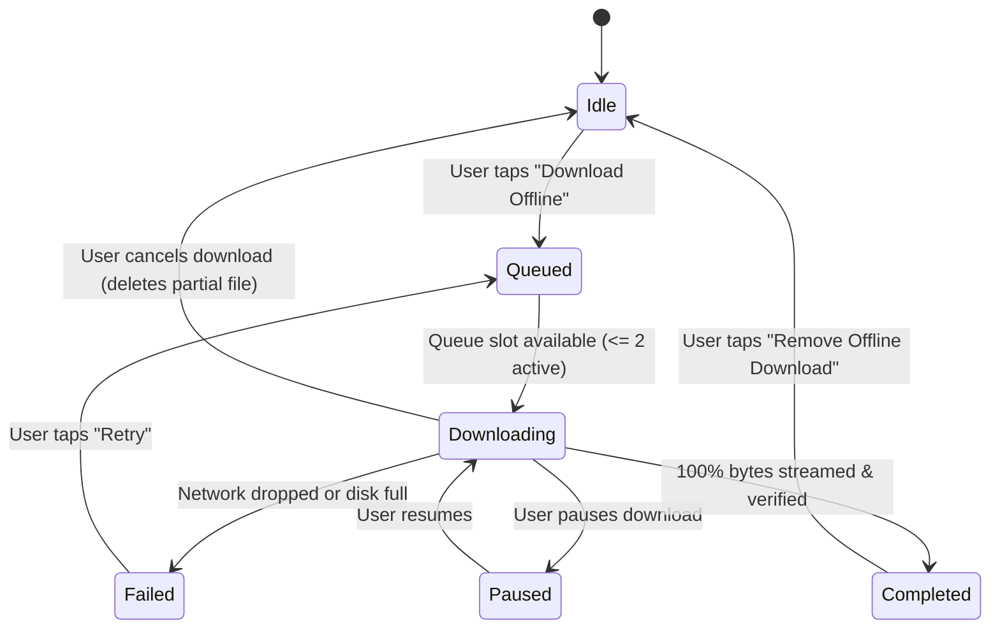

# Phase 8 Blueprint: Offline Audio Persistence & Hive Cache

> **Parent Blueprint:** [`docs/foundation_blueprints/04_LIBRARY_VAULT_SPEC.md`](file:///c:/Users/Ndugelo/VHUNAMBI/monorepo/docs/foundation_blueprints/04_LIBRARY_VAULT_SPEC.md) §5  
> **Target Package:** `apps/vhunambi_client`  
> **Status:** Specification  

---

## 1. Architectural Vision & Core Workflows

Phase 8 equips Vhunambi with a resilient local persistence and offline audio subsystem. In regions across the African continent and globally, mobile bandwidth can be metered, intermittent, or expensive. Listeners and creators require the ability to:
1. Save audio masters (MP3 320kbps / lossless WAV) to device storage with verified integrity.
2. Listen to their library and licensed tracks without network connectivity.
3. Observe real-time download progress with pause, resume, and cancellation controls.
4. Manage local disk storage allocations via an intuitive storage quota manager.

```
┌────────────────────────────────────────────────────────────────────────┐
│                        VHUNAMBI OFFLINE ARCHITECTURE                   │
├────────────────────────────────────────────────────────────────────────┤
│                                                                        │
│   ┌─────────────────────┐             ┌────────────────────────────┐   │
│   │   Asset Vault UI    │             │   Track Details Cockpit    │   │
│   │   (/library)        │             │   (/track/:id)             │   │
│   └──────────┬──────────┘             └─────────────┬──────────────┘   │
│              │                                      │                  │
│              ▼                                      ▼                  │
│   ┌────────────────────────────────────────────────────────────────┐   │
│   │               DownloadManagerNotifier (Riverpod)               │   │
│   │   - Active task map: Map<String, DownloadTask>                 │   │
│   │   - Concurrency queue (max 2 parallel downloads)               │   │
│   │   - Progress emission (0.0 -> 1.0, bytes, speed)               │   │
│   └──────────────────────┬─────────────────────────────────────────┘   │
│                          │                                             │
│         ┌────────────────┴────────────────┐                            │
│         ▼                                 ▼                            │
│   ┌───────────────────────────┐     ┌──────────────────────────────┐   │
│   │    AudioDownloadService   │     │    OfflineStorageService     │   │
│   │    (HTTP stream / Dio)    │     │    (Hive boxes: vault/prefs) │   │
│   └─────────────┬─────────────┘     └──────────────┬───────────────┘   │
│                 │                                  │                   │
│                 ▼                                  ▼                   │
│   ┌───────────────────────────┐     ┌──────────────────────────────┐   │
│   │     Local File System     │     │          Hive Box            │   │
│   │  /vhunambi_vault/audio/   │     │      'library_tracks'        │   │
│   │  <track_id>.mp3 / .wav    │     │      'vhunambi_prefs'        │   │
│   └───────────────────────────┘     └──────────────────────────────┘   │
│                                                                        │
└────────────────────────────────────────────────────────────────────────┘
```

---

## 2. Platform Storage Directories & Cache Path Resolution

Audio files must be stored in secure, application-scoped storage directories:

| Platform | Target Directory Path |
|---|---|
| **Android** | `getApplicationDocumentsDirectory() + '/vhunambi_vault/audio/'` |
| **iOS** | `getLibraryDirectory() + '/vhunambi_vault/audio/'` (excluded from iCloud backup) |
| **Windows Desktop** | `%APPDATA%/vhunambi/vault/audio/` (or documents directory) |
| **macOS / Linux** | `~/Library/Application Support/vhunambi/vault/audio/` |
| **Headless / Unit Test** | In-memory / mock temp directory (`test_vault/`) |

---

## 3. Download Task State Machine (FSM)



---

## 4. Hive Box Schemas & Serialization

### Box 1: `library_tracks` (`AppConstants.vaultBoxKey`)
Key: `track_id` (String)  
Value Map:
```json
{
  "id": "trk_amapiano_01",
  "title": "Banyana Sunset",
  "creatorName": "DJ Maphorisa style AI",
  "genre": "Amapiano",
  "language": "isiZulu",
  "durationSeconds": 218,
  "remoteAudioUrl": "https://cdn.vhunambi.com/audio/trk_amapiano_01.mp3",
  "localAudioFilePath": "/data/user/0/com.vhunambi.app/app_flutter/vhunambi_vault/audio/trk_amapiano_01.mp3",
  "coverImageUrl": "https://images.unsplash.com/...",
  "createdAt": "2026-09-24T00:00:00.000Z",
  "licenseType": "Commercial",
  "syncStatus": "cachedLocally",
  "fileSizeBytes": 8752490,
  "downloadedAt": "2026-09-24T02:15:00.000Z"
}
```

### Box 2: `vhunambi_prefs` (`AppConstants.preferencesBoxKey`)
Key: `'offline_preferences'`  
Value Map:
```json
{
  "isOfflineModeForced": false,
  "downloadQuality": "mp3_320",
  "wifiOnlyDownload": true,
  "autoCacheOnPlay": false,
  "maxStorageQuotaBytes": 5368709120
}
```

---

## 5. UI Integration Points & Wireframes

### 5.1 Asset Vault Header & Storage Quota Modal
```
┌────────────────────────────────────────────────────────┐
│  VAULT STORAGE QUOTA                                   │
├────────────────────────────────────────────────────────┤
│  [=======================              ] 48.2 MB / 5 GB│
│  4 Songs Cached Offline • Playable Anywhere            │
│                                                        │
│  • Banyana Sunset (Amapiano)                   8.8 MB  │
│  • Soweto Groove (Kwaito)                      7.4 MB  │
│  • Zulu Kingdom Anthem (Maskandi)              12.1 MB │
│  • Marabi Renaissance (Marabi)                 9.2 MB  │
│                                                        │
│  [  🗑️ Clear All Downloads  ]   [  ⚙️ Download Settings  ]│
└────────────────────────────────────────────────────────┘
```

### 5.2 Track Actions Sheet (`TrackActionsSheet`)
- When `syncStatus == TrackSyncStatus.cloudOnly`:
  - Shows: `⬇️ Download Offline (~8.5 MB)`
- When `syncStatus == TrackSyncStatus.downloading`:
  - Shows: `⏳ Downloading... (64%)` with mini progress bar and `[Cancel]`
- When `syncStatus == TrackSyncStatus.cachedLocally`:
  - Shows: `✅ Cached on Device` + `🗑️ Remove Offline Download`
