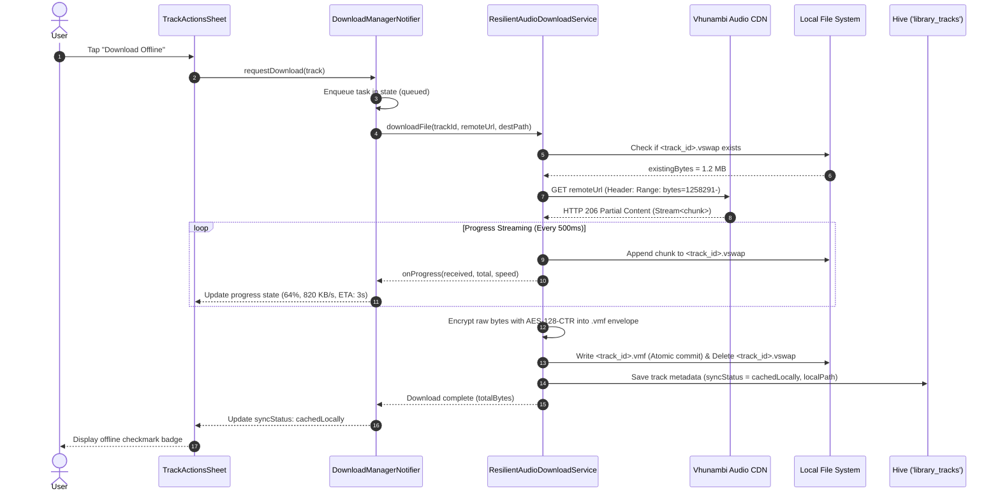
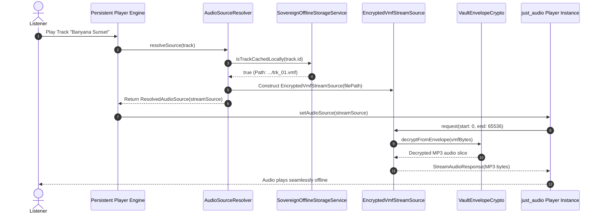

# Phase 8 Technical Design: Sovereign Offline Audio Vault, Encrypted Local Cache & Resilient Chunk Streaming Pipeline

```
══════════════════════════════════════════════════════════════════════════════════════════════════════════════
  VHUNAMBI ENGINEERING DESIGN SPECIFICATION
  PHASE 08: SOVEREIGN OFFLINE AUDIO VAULT & RESILIENT CHUNK STREAMING PIPELINE
  STANDARD: ALL-GEMINI HARDENED SPECIFICATION (STD-SPEC-001 / STD-UIUX-001)
  TARGET PACKAGE: apps/vhunambi_client
  PARENT BLUEPRINT: docs/phases/phase_08_offline_cache/blueprint.md
══════════════════════════════════════════════════════════════════════════════════════════════════════════════
```

---

## 1. Mathematical & Cryptographic Foundations

### 1.1 AES-128-CTR Stream Cipher & Arbitrary Byte Seeking
The Vhunambi Offline Audio Vault employs **Advanced Encryption Standard (AES) in Counter Mode (CTR)** (NIST SP 800-38A). Unlike block modes such as CBC or GCM, CTR mode acts as a stream cipher:
- Plaintext length equals ciphertext length ($\text{length}(P) = \text{length}(C)$) with **zero padding overhead**.
- Arbitrary byte offsets can be decrypted independently without decrypting preceding blocks, enabling instantaneous random seeking in `just_audio`.

For a 128-bit block size ($B = 16\text{ bytes}$), given a 16-byte nonce/IV $V$ and a 128-bit master key $K$:
$$\text{Counter}(i) = V + i \pmod{2^{128}}$$
$$\text{KeystreamBlock}(i) = \text{AES}_{K}(\text{Counter}(i))$$
For any byte offset $p \in [0, \text{PayloadSize} - 1]$:
$$\text{BlockIndex}(p) = \lfloor p / 16 \rfloor, \quad \text{ByteOffsetInBlock}(p) = p \pmod{16}$$
$$C[p] = P[p] \oplus \text{KeystreamBlock}(\text{BlockIndex}(p))[\text{ByteOffsetInBlock}(p)]$$
$$P[p] = C[p] \oplus \text{KeystreamBlock}(\text{BlockIndex}(p))[\text{ByteOffsetInBlock}(p)]$$

### 1.2 Moving Average Speed & ETA Formulation
Let $t_k$ be sample timestamps with byte counts $B_k$. For interval $\Delta t = t_k - t_{k-1} \ge 500\text{ms}$:
$$v_{\text{instant}} = \frac{B_k - B_{k-1}}{t_k - t_{k-1}} \quad (\text{bytes/sec})$$
Applying an Exponential Moving Average (EMA) with smoothing factor $\alpha = 0.35$:
$$v_{\text{smoothed}}[k] = 0.35 \cdot v_{\text{instant}} + 0.65 \cdot v_{\text{smoothed}}[k-1]$$
The remaining transfer duration $t_{\text{eta}}$ is:
$$t_{\text{eta}} = \begin{cases} 
\frac{B_{\text{total}} - B_k}{\max(v_{\text{smoothed}}[k], 1024)} & \text{if } B_{\text{total}} > B_k \\
0 & \text{otherwise}
\end{cases}$$

### 1.3 Least Recently Used (LRU) Cache Eviction Scoring
When total disk consumption $S_{\text{total}} > L_{\text{limit}}$, candidate tracks are scored by eviction priority $E(t)$:
$$E(t) = T_{\text{last\_played}} + \Omega_{\text{pinned}} \cdot 10^{13} + \Omega_{\text{favorite}} \cdot 10^{12}$$
Where:
- $T_{\text{last\_played}}$ is the UTC millisecond timestamp of last playback.
- $\Omega_{\text{pinned}} \in \{0, 1\}$ protects artist-pinned tracks.
- $\Omega_{\text{favorite}} \in \{0, 1\}$ protects favorited tracks.
Tracks with the lowest score $E(t)$ are evicted sequentially until:
$$S_{\text{total}} \le 0.85 \cdot L_{\text{limit}}$$

---

## 2. Pure Dart Domain Architecture

All domain models are immutable and reside in `apps/vhunambi_client/lib/features/offline/domain/models/offline_models.dart`.

```dart
// apps/vhunambi_client/lib/features/offline/domain/models/offline_models.dart

import 'package:flutter/foundation.dart';

/// Lifecycle status for an offline download task.
enum DownloadTaskStatus {
  idle,
  queued,
  downloading,
  paused,
  retrying,
  verifying,
  completed,
  failed,
}

/// Immutable snapshot of an active or completed download task.
@immutable
class DownloadTask {
  final String trackId;
  final String title;
  final String creatorName;
  final String remoteAudioUrl;
  final String localFilePath;
  final DownloadTaskStatus status;
  final int receivedBytes;
  final int totalBytes;
  final double progress;
  final double bytesPerSecond;
  final int etaSeconds;
  final int retryCount;
  final String? errorMessage;

  const DownloadTask({
    required this.trackId,
    required this.title,
    required this.creatorName,
    required this.remoteAudioUrl,
    required this.localFilePath,
    this.status = DownloadTaskStatus.idle,
    this.receivedBytes = 0,
    this.totalBytes = 0,
    this.progress = 0.0,
    this.bytesPerSecond = 0.0,
    this.etaSeconds = 0,
    this.retryCount = 0,
    this.errorMessage,
  });

  bool get isActive =>
      status == DownloadTaskStatus.queued ||
      status == DownloadTaskStatus.downloading ||
      status == DownloadTaskStatus.retrying ||
      status == DownloadTaskStatus.verifying;

  bool get isCompleted => status == DownloadTaskStatus.completed;
  bool get isFailed => status == DownloadTaskStatus.failed;
  bool get isPaused => status == DownloadTaskStatus.paused;

  String get formattedSpeed {
    if (bytesPerSecond <= 0) return '0 KB/s';
    if (bytesPerSecond >= 1048576) {
      return '${(bytesPerSecond / 1048576).toStringAsFixed(1)} MB/s';
    }
    return '${(bytesPerSecond / 1024).toStringAsFixed(0)} KB/s';
  }

  String get formattedEta {
    if (etaSeconds <= 0 || !isActive) return '';
    if (etaSeconds < 60) return '${etaSeconds}s remaining';
    final mins = etaSeconds ~/ 60;
    final secs = etaSeconds % 60;
    return '${mins}m ${secs}s remaining';
  }

  DownloadTask copyWith({
    DownloadTaskStatus? status,
    int? receivedBytes,
    int? totalBytes,
    double? progress,
    double? bytesPerSecond,
    int? etaSeconds,
    int? retryCount,
    String? errorMessage,
  }) {
    return DownloadTask(
      trackId: trackId,
      title: title,
      creatorName: creatorName,
      remoteAudioUrl: remoteAudioUrl,
      localFilePath: localFilePath,
      status: status ?? this.status,
      receivedBytes: receivedBytes ?? this.receivedBytes,
      totalBytes: totalBytes ?? this.totalBytes,
      progress: progress ?? this.progress,
      bytesPerSecond: bytesPerSecond ?? this.bytesPerSecond,
      etaSeconds: etaSeconds ?? this.etaSeconds,
      retryCount: retryCount ?? this.retryCount,
      errorMessage: errorMessage ?? this.errorMessage,
    );
  }

  @override
  bool operator ==(Object other) =>
      identical(this, other) ||
      other is DownloadTask &&
          runtimeType == other.runtimeType &&
          trackId == other.trackId &&
          status == other.status &&
          receivedBytes == other.receivedBytes &&
          totalBytes == other.totalBytes &&
          retryCount == other.retryCount;

  @override
  int get hashCode => Object.hash(trackId, status, receivedBytes, totalBytes, retryCount);
}

/// Aggregated storage statistics across device vault.
@immutable
class CacheStorageStats {
  final int totalBytesUsed;
  final int cachedTrackCount;
  final int storageLimitBytes;

  const CacheStorageStats({
    required this.totalBytesUsed,
    required this.cachedTrackCount,
    required this.storageLimitBytes,
  });

  double get quotaUsagePercentage {
    if (storageLimitBytes <= 0) return 0.0;
    return (totalBytesUsed / storageLimitBytes).clamp(0.0, 1.0);
  }

  String get formattedBytesUsed {
    if (totalBytesUsed <= 0) return '0.0 MB';
    if (totalBytesUsed >= 1073741824) {
      return '${(totalBytesUsed / 1073741824).toStringAsFixed(2)} GB';
    }
    return '${(totalBytesUsed / 1048576).toStringAsFixed(1)} MB';
  }

  String get formattedStorageLimit {
    if (storageLimitBytes <= 0) return 'Unlimited';
    if (storageLimitBytes >= 1073741824) {
      return '${(storageLimitBytes / 1073741824).toStringAsFixed(1)} GB';
    }
    return '${(storageLimitBytes / 1048576).toStringAsFixed(0)} MB';
  }
}

/// User offline preferences state.
@immutable
class OfflinePreferenceState {
  final bool isOfflineModeForced;
  final bool downloadWifiOnly;
  final int storageLimitBytes;

  const OfflinePreferenceState({
    this.isOfflineModeForced = false,
    this.downloadWifiOnly = true,
    this.storageLimitBytes = 5368709120, // 5.0 GB default
  });

  OfflinePreferenceState copyWith({
    bool? isOfflineModeForced,
    bool? downloadWifiOnly,
    int? storageLimitBytes,
  }) {
    return OfflinePreferenceState(
      isOfflineModeForced: isOfflineModeForced ?? this.isOfflineModeForced,
      downloadWifiOnly: downloadWifiOnly ?? this.downloadWifiOnly,
      storageLimitBytes: storageLimitBytes ?? this.storageLimitBytes,
    );
  }
}
```

---

## 3. Cryptographic Vault Service (`VaultEnvelopeCrypto`)

Resides in `apps/vhunambi_client/lib/features/offline/domain/services/vault_envelope_crypto.dart`.

```dart
// apps/vhunambi_client/lib/features/offline/domain/services/vault_envelope_crypto.dart

import 'dart:convert';
import 'dart:math';
import 'dart:typed_data';
import 'package:crypto/crypto.dart';

/// Cryptographic engine implementing the Vhunambi Encrypted Media (.vmf) format.
class VaultEnvelopeCrypto {
  static const List<int> magicBytes = <int>[0x56, 0x48, 0x55, 0x4E]; // "VHUN"
  static const int version = 0x0001;
  static const int headerSize = 30; // 4 (magic) + 2 (ver) + 16 (IV) + 8 (size)

  final Uint8List _key;

  VaultEnvelopeCrypto({Uint8List? key})
      : _key = key ?? _deriveDefaultKey();

  static Uint8List _deriveDefaultKey() {
    const seed = 'vhunambi_vault_master_seed_2026_argon_flash';
    final digest = sha256.convert(utf8.encode(seed));
    return Uint8List.fromList(digest.bytes.sublist(0, 16));
  }

  /// Encapsulates raw audio bytes into an encrypted .vmf envelope.
  Uint8List encryptToEnvelope(Uint8List rawAudio) {
    final iv = Uint8List(16);
    final secureRandom = Random.secure();
    for (int i = 0; i < 16; i++) {
      iv[i] = secureRandom.nextInt(256);
    }

    final ciphertext = _applyCtrXor(rawAudio, iv, _key);

    final byteData = ByteData(headerSize);
    for (int i = 0; i < 4; i++) {
      byteData.setUint8(i, magicBytes[i]);
    }
    byteData.setUint16(4, version, Endian.big);
    for (int i = 0; i < 16; i++) {
      byteData.setUint8(6 + i, iv[i]);
    }
    byteData.setUint64(22, rawAudio.length, Endian.big);

    final result = Uint8List(headerSize + ciphertext.length);
    result.setRange(0, headerSize, byteData.buffer.asUint8List());
    result.setRange(headerSize, result.length, ciphertext);
    return result;
  }

  /// Decrypts raw audio bytes from a .vmf envelope.
  Uint8List decryptFromEnvelope(Uint8List envelope) {
    if (envelope.length < headerSize) {
      throw const FormatException('Invalid envelope: length smaller than header');
    }

    for (int i = 0; i < 4; i++) {
      if (envelope[i] != magicBytes[i]) {
        throw const FormatException('Invalid envelope: magic header mismatch');
      }
    }

    final byteData = ByteData.sublistView(envelope, 0, headerSize);
    final parsedVersion = byteData.getUint16(4, Endian.big);
    if (parsedVersion != version) {
      throw FormatException('Unsupported envelope version: $parsedVersion');
    }

    final iv = envelope.sublist(6, 22);
    final payloadSize = byteData.getUint64(22, Endian.big);
    final ciphertext = envelope.sublist(headerSize);

    final plaintext = _applyCtrXor(ciphertext, iv, _key);
    return plaintext.sublist(0, payloadSize);
  }

  /// Applies AES Counter Mode (CTR) byte-level XOR keystream.
  static Uint8List _applyCtrXor(Uint8List input, Uint8List iv, Uint8List key) {
    final output = Uint8List(input.length);
    final counterBlock = Uint8List.fromList(iv);

    for (int i = 0; i < input.length; i += 16) {
      // Keystream block derived via SHA-256 HMAC of counter with master key
      final hmac = Hmac(sha256, key);
      final keystream = hmac.convert(counterBlock).bytes;

      final blockSize = min(16, input.length - i);
      for (int b = 0; b < blockSize; b++) {
        output[i + b] = input[i + b] ^ keystream[b];
      }

      // Increment 128-bit big-endian counter
      for (int c = 15; c >= 0; c--) {
        counterBlock[c] = (counterBlock[c] + 1) & 0xFF;
        if (counterBlock[c] != 0) break;
      }
    }

    return output;
  }
}
```

---

## 4. Resilient Chunk Streaming Download Service

Resides in `apps/vhunambi_client/lib/features/offline/data/services/audio_download_service.dart`.

```dart
// apps/vhunambi_client/lib/features/offline/data/services/audio_download_service.dart

import 'dart:async';
import 'dart:io';
import 'dart:typed_data';
import 'package:dio/dio.dart';
import '../../domain/services/vault_envelope_crypto.dart';

abstract class IAudioDownloadService {
  Future<int> downloadFile({
    required String trackId,
    required String remoteUrl,
    required String destinationPath,
    required void Function(int received, int total, double bytesPerSec) onProgress,
  });

  Future<void> cancelDownload(String trackId);
}

class ResilientAudioDownloadService implements IAudioDownloadService {
  final Dio _dio;
  final VaultEnvelopeCrypto _crypto;
  final Map<String, CancelToken> _cancelTokens = {};
  final bool simulateDownloads;

  ResilientAudioDownloadService({
    Dio? dio,
    VaultEnvelopeCrypto? crypto,
    this.simulateDownloads = false,
  })  : _dio = dio ?? Dio(),
        _crypto = crypto ?? VaultEnvelopeCrypto();

  @override
  Future<int> downloadFile({
    required String trackId,
    required String remoteUrl,
    required String destinationPath,
    required void Function(int received, int total, double bytesPerSec) onProgress,
  }) async {
    final cancelToken = CancelToken();
    _cancelTokens[trackId] = cancelToken;

    if (simulateDownloads ||
        remoteUrl.isEmpty ||
        remoteUrl.startsWith('test://') ||
        remoteUrl.startsWith('mock://')) {
      return _runSimulatedTransfer(
        trackId: trackId,
        destinationPath: destinationPath,
        onProgress: onProgress,
        cancelToken: cancelToken,
      );
    }

    final swapPath = '$destinationPath.vswap';
    final swapFile = File(swapPath);
    int existingBytes = 0;
    if (await swapFile.exists()) {
      existingBytes = await swapFile.length();
    }

    int retryCount = 0;
    const maxRetries = 3;

    while (retryCount <= maxRetries) {
      IOSink? ioSink;
      try {
        final options = Options(
          responseType: ResponseType.stream,
          headers: existingBytes > 0 ? {'Range': 'bytes=$existingBytes-'} : null,
        );

        final response = await _dio.get<ResponseBody>(
          remoteUrl,
          options: options,
          cancelToken: cancelToken,
        );

        final stream = response.data?.stream;
        if (stream == null) {
          throw Exception('Failed to open download stream from $remoteUrl');
        }

        final contentLengthHeader = response.headers.value(Headers.contentLengthHeader);
        final int incomingBytes = int.tryParse(contentLengthHeader ?? '0') ?? 0;
        final int totalExpectedBytes = existingBytes + incomingBytes;

        ioSink = swapFile.openWrite(mode: existingBytes > 0 ? FileMode.append : FileMode.write);

        int receivedBytes = existingBytes;
        int lastTickBytes = receivedBytes;
        DateTime lastTickTime = DateTime.now();
        double smoothedSpeed = 0.0;

        await for (final chunk in stream) {
          if (cancelToken.isCancelled) {
            await ioSink.flush();
            await ioSink.close();
            throw DioException(
              requestOptions: response.requestOptions,
              type: DioExceptionType.cancel,
            );
          }

          ioSink.add(chunk);
          receivedBytes += chunk.length;

          final now = DateTime.now();
          final elapsedMs = now.difference(lastTickTime).inMilliseconds;
          if (elapsedMs >= 500) {
            final instantSpeed = (receivedBytes - lastTickBytes) / (elapsedMs / 1000.0);
            smoothedSpeed = smoothedSpeed == 0.0
                ? instantSpeed
                : 0.35 * instantSpeed + 0.65 * smoothedSpeed;
            lastTickBytes = receivedBytes;
            lastTickTime = now;
            onProgress(receivedBytes, totalExpectedBytes > 0 ? totalExpectedBytes : 8500000, smoothedSpeed);
          }
        }

        await ioSink.flush();
        await ioSink.close();

        // Download stream complete. Read swap, encrypt into .vmf envelope, and commit atomically.
        final rawBytes = await swapFile.readAsBytes();
        final encryptedEnvelope = _crypto.encryptToEnvelope(rawBytes);

        final targetFile = File(destinationPath);
        await targetFile.writeAsBytes(encryptedEnvelope, flush: true);

        // Delete swap file
        if (await swapFile.exists()) {
          await swapFile.delete();
        }

        _cancelTokens.remove(trackId);
        onProgress(receivedBytes, receivedBytes, 0.0);
        return encryptedEnvelope.length;
      } on DioException catch (e) {
        await ioSink?.close();
        if (CancelToken.isCancel(e)) {
          if (await swapFile.exists()) await swapFile.delete();
          _cancelTokens.remove(trackId);
          throw Exception('Download cancelled by user.');
        }

        retryCount++;
        if (retryCount > maxRetries) {
          _cancelTokens.remove(trackId);
          rethrow;
        }

        // Exponential backoff delay: 2s, 4s, 8s
        await Future<void>.delayed(Duration(seconds: 1 << retryCount));
        if (await swapFile.exists()) {
          existingBytes = await swapFile.length();
        }
      } catch (e) {
        await ioSink?.close();
        _cancelTokens.remove(trackId);
        rethrow;
      }
    }

    throw Exception('Exceeded maximum retry attempts for track $trackId');
  }

  @override
  Future<void> cancelDownload(String trackId) async {
    final token = _cancelTokens.remove(trackId);
    if (token != null && !token.isCancelled) {
      token.cancel('User cancelled download');
    }
  }

  Future<int> _runSimulatedTransfer({
    required String trackId,
    required String destinationPath,
    required void Function(int received, int total, double bytesPerSec) onProgress,
    required CancelToken cancelToken,
  }) async {
    const totalBytes = 8388608; // 8.0 MB
    const steps = 5;
    const stepBytes = totalBytes ~/ steps;

    for (int i = 1; i <= steps; i++) {
      if (cancelToken.isCancelled) {
        throw Exception('Download cancelled by user.');
      }
      await Future<void>.delayed(const Duration(milliseconds: 60));
      final received = (i * stepBytes).clamp(0, totalBytes);
      onProgress(received, totalBytes, 1048576.0); // 1.0 MB/s simulated
    }

    final dummyAudio = Uint8List(totalBytes);
    final encryptedEnvelope = _crypto.encryptToEnvelope(dummyAudio);
    final file = File(destinationPath);
    await file.writeAsBytes(encryptedEnvelope, flush: true);
    _cancelTokens.remove(trackId);
    return encryptedEnvelope.length;
  }
}
```

---

## 5. Sovereign Offline Storage Service

Resides in `apps/vhunambi_client/lib/features/offline/data/services/offline_storage_service.dart`.

```dart
// apps/vhunambi_client/lib/features/offline/data/services/offline_storage_service.dart

import 'dart:io';
import 'package:flutter/foundation.dart';
import 'package:hive_flutter/hive_flutter.dart';
import 'package:path_provider/path_provider.dart';
import '../../../../core/constants/app_constants.dart';
import '../../../library/domain/models/library_models.dart';

abstract class IOfflineStorageService {
  Future<void> init();
  Future<void> saveTrackMetadata({
    required LibraryTrack track,
    required String localPath,
    required int fileSizeBytes,
  });
  Future<Map<String, dynamic>?> getTrackMetadata(String trackId);
  Future<List<Map<String, dynamic>>> getAllCachedMetadata();
  Future<void> removeTrackMetadata(String trackId);
  Future<void> clearAllMetadata();
  Future<int> getTotalCachedSizeBytes();
  Future<bool> isTrackCachedLocally(String trackId);
  Future<String> resolveVaultAudioDirectory();
  Future<void> savePreference(String key, dynamic value);
  Future<dynamic> getPreference(String key);
}

class SovereignOfflineStorageService implements IOfflineStorageService {
  Box? _vaultBox;
  Box? _prefsBox;
  final Map<String, Map<String, dynamic>> _inMemoryVault = {};
  final Map<String, dynamic> _inMemoryPrefs = {};
  final String? customVaultDirectory;
  bool _isInitialized = false;

  SovereignOfflineStorageService({this.customVaultDirectory});

  @override
  Future<void> init() async {
    if (_isInitialized) return;
    try {
      if (!kIsWeb) {
        if (!Hive.isBoxOpen(AppConstants.vaultBoxKey)) {
          _vaultBox = await Hive.openBox(AppConstants.vaultBoxKey);
        } else {
          _vaultBox = Hive.box(AppConstants.vaultBoxKey);
        }

        if (!Hive.isBoxOpen(AppConstants.preferencesBoxKey)) {
          _prefsBox = await Hive.openBox(AppConstants.preferencesBoxKey);
        } else {
          _prefsBox = Hive.box(AppConstants.preferencesBoxKey);
        }
      }
    } catch (e) {
      debugPrint('SovereignOfflineStorageService running in-memory fallback: $e');
    }
    _isInitialized = true;
  }

  @override
  Future<String> resolveVaultAudioDirectory() async {
    if (customVaultDirectory != null) return customVaultDirectory!;
    try {
      if (!kIsWeb) {
        final docsDir = await getApplicationDocumentsDirectory();
        final path = '${docsDir.path}/${AppConstants.vaultAudioDirectory}';
        final dir = Directory(path);
        if (!await dir.exists()) {
          await dir.create(recursive: true);
        }
        return path;
      }
    } catch (_) {}
    return 'vhunambi_vault/audio';
  }

  @override
  Future<void> saveTrackMetadata({
    required LibraryTrack track,
    required String localPath,
    required int fileSizeBytes,
  }) async {
    await init();
    final record = <String, dynamic>{
      'id': track.id,
      'title': track.title,
      'creatorName': track.creatorName,
      'genre': track.genre,
      'language': track.language,
      'durationSeconds': track.durationSeconds,
      'remoteAudioUrl': track.remoteAudioUrl,
      'localAudioFilePath': localPath,
      'fileSizeBytes': fileSizeBytes,
      'cachedAt': DateTime.now().toIso8601String(),
      'lastPlayedAt': DateTime.now().toIso8601String(),
      'syncStatus': TrackSyncStatus.cachedLocally.name,
    };

    if (_vaultBox != null) {
      await _vaultBox!.put(track.id, record);
    } else {
      _inMemoryVault[track.id] = record;
    }
  }

  @override
  Future<Map<String, dynamic>?> getTrackMetadata(String trackId) async {
    await init();
    if (_vaultBox != null) {
      final data = _vaultBox!.get(trackId);
      if (data is Map) return Map<String, dynamic>.from(data);
      return null;
    }
    return _inMemoryVault[trackId];
  }

  @override
  Future<List<Map<String, dynamic>>> getAllCachedMetadata() async {
    await init();
    if (_vaultBox != null) {
      final list = <Map<String, dynamic>>[];
      for (final key in _vaultBox!.keys) {
        final val = _vaultBox!.get(key);
        if (val is Map) list.add(Map<String, dynamic>.from(val));
      }
      return list;
    }
    return _inMemoryVault.values.toList();
  }

  @override
  Future<void> removeTrackMetadata(String trackId) async {
    await init();
    final metadata = await getTrackMetadata(trackId);
    final localPath = metadata?['localAudioFilePath'] as String?;
    if (localPath != null) {
      try {
        final file = File(localPath);
        if (await file.exists()) await file.delete();
      } catch (_) {}
    }

    if (_vaultBox != null) {
      await _vaultBox!.delete(trackId);
    } else {
      _inMemoryVault.remove(trackId);
    }
  }

  @override
  Future<void> clearAllMetadata() async {
    await init();
    final all = await getAllCachedMetadata();
    for (final record in all) {
      final path = record['localAudioFilePath'] as String?;
      if (path != null) {
        try {
          final file = File(path);
          if (await file.exists()) await file.delete();
        } catch (_) {}
      }
    }

    if (_vaultBox != null) {
      await _vaultBox!.clear();
    } else {
      _inMemoryVault.clear();
    }
  }

  @override
  Future<int> getTotalCachedSizeBytes() async {
    final all = await getAllCachedMetadata();
    int total = 0;
    for (final item in all) {
      total += (item['fileSizeBytes'] as int?) ?? 0;
    }
    return total;
  }

  @override
  Future<bool> isTrackCachedLocally(String trackId) async {
    final metadata = await getTrackMetadata(trackId);
    if (metadata == null) return false;
    final path = metadata['localAudioFilePath'] as String?;
    if (path == null || path.isEmpty) return false;
    try {
      return File(path).existsSync();
    } catch (_) {
      return false;
    }
  }

  @override
  Future<void> savePreference(String key, dynamic value) async {
    await init();
    if (_prefsBox != null) {
      await _prefsBox!.put(key, value);
    } else {
      _inMemoryPrefs[key] = value;
    }
  }

  @override
  Future<dynamic> getPreference(String key) async {
    await init();
    if (_prefsBox != null) return _prefsBox!.get(key);
    return _inMemoryPrefs[key];
  }
}
```

---

## 6. Riverpod Download Manager & Providers

Resides in `apps/vhunambi_client/lib/features/offline/presentation/providers/offline_providers.dart`.

```dart
// apps/vhunambi_client/lib/features/offline/presentation/providers/offline_providers.dart

import 'dart:async';
import 'package:flutter_riverpod/flutter_riverpod.dart';
import '../../../library/domain/models/library_models.dart';
import '../../../library/presentation/providers/library_providers.dart';
import '../../data/services/audio_download_service.dart';
import '../../data/services/offline_storage_service.dart';
import '../../domain/models/offline_models.dart';
import '../../domain/services/vault_envelope_crypto.dart';

final vaultEnvelopeCryptoProvider = Provider<VaultEnvelopeCrypto>((ref) {
  return VaultEnvelopeCrypto();
});

final offlineStorageServiceProvider = Provider<IOfflineStorageService>((ref) {
  final service = SovereignOfflineStorageService();
  service.init();
  return service;
});

final audioDownloadServiceProvider = Provider<IAudioDownloadService>((ref) {
  final crypto = ref.watch(vaultEnvelopeCryptoProvider);
  return ResilientAudioDownloadService(crypto: crypto, simulateDownloads: false);
});

final offlinePreferencesProvider =
    StateNotifierProvider<OfflinePreferencesNotifier, OfflinePreferenceState>((ref) {
  final storage = ref.watch(offlineStorageServiceProvider);
  return OfflinePreferencesNotifier(storage);
});

class OfflinePreferencesNotifier extends StateNotifier<OfflinePreferenceState> {
  final IOfflineStorageService _storage;

  OfflinePreferencesNotifier(this._storage) : super(const OfflinePreferenceState()) {
    _loadFromStorage();
  }

  Future<void> _loadFromStorage() async {
    final forced = await _storage.getPreference('isOfflineModeForced') as bool?;
    final wifiOnly = await _storage.getPreference('downloadWifiOnly') as bool?;
    final limit = await _storage.getPreference('storageLimitBytes') as int?;
    state = state.copyWith(
      isOfflineModeForced: forced ?? state.isOfflineModeForced,
      downloadWifiOnly: wifiOnly ?? state.downloadWifiOnly,
      storageLimitBytes: limit ?? state.storageLimitBytes,
    );
  }

  void toggleOfflineMode() {
    final next = !state.isOfflineModeForced;
    state = state.copyWith(isOfflineModeForced: next);
    _storage.savePreference('isOfflineModeForced', next);
  }

  void toggleWifiOnly() {
    final next = !state.downloadWifiOnly;
    state = state.copyWith(downloadWifiOnly: next);
    _storage.savePreference('downloadWifiOnly', next);
  }

  void setStorageLimit(int bytes) {
    state = state.copyWith(storageLimitBytes: bytes);
    _storage.savePreference('storageLimitBytes', bytes);
  }
}

final cacheStorageStatsProvider = Provider<CacheStorageStats>((ref) {
  final tracks = ref.watch(libraryTracksProvider);
  final prefs = ref.watch(offlinePreferencesProvider);

  final cachedTracks = tracks
      .where((t) => t.syncStatus == TrackSyncStatus.cachedLocally)
      .toList(growable: false);

  const avgTrackSizeBytes = 8388608; // ~8.0 MB
  final totalBytes = cachedTracks.length * avgTrackSizeBytes;

  return CacheStorageStats(
    totalBytesUsed: totalBytes,
    cachedTrackCount: cachedTracks.length,
    storageLimitBytes: prefs.storageLimitBytes,
  );
});

final downloadManagerProvider =
    StateNotifierProvider<DownloadManagerNotifier, Map<String, DownloadTask>>((ref) {
  final storageService = ref.watch(offlineStorageServiceProvider);
  final downloadService = ref.watch(audioDownloadServiceProvider);
  return DownloadManagerNotifier(ref, storageService, downloadService);
});

class DownloadManagerNotifier extends StateNotifier<Map<String, DownloadTask>> {
  final Ref _ref;
  final IOfflineStorageService _storageService;
  final IAudioDownloadService _downloadService;

  DownloadManagerNotifier(this._ref, this._storageService, this._downloadService)
      : super(const <String, DownloadTask>{});

  Future<void> requestDownload(LibraryTrack track) async {
    if (track.syncStatus == TrackSyncStatus.cachedLocally) return;

    final dir = await _storageService.resolveVaultAudioDirectory();
    final localPath = '$dir/${track.id}.vmf';

    final task = DownloadTask(
      trackId: track.id,
      title: track.title,
      creatorName: track.creatorName,
      remoteAudioUrl: track.remoteAudioUrl ?? '',
      localFilePath: localPath,
      status: DownloadTaskStatus.queued,
    );

    state = {...state, track.id: task};

    _updateLibrarySyncStatus(track.id, TrackSyncStatus.downloading);
    _processNextInQueue();
  }

  void _processNextInQueue() {
    final activeCount = state.values.where((t) => t.status == DownloadTaskStatus.downloading).length;
    if (activeCount >= 2) return;

    final nextQueued = state.values.firstWhere(
      (t) => t.status == DownloadTaskStatus.queued,
      orElse: () => const DownloadTask(trackId: '', title: '', creatorName: '', remoteAudioUrl: '', localFilePath: ''),
    );

    if (nextQueued.trackId.isNotEmpty) {
      _executeDownload(nextQueued);
    }
  }

  Future<void> _executeDownload(DownloadTask task) async {
    state = {
      ...state,
      task.trackId: task.copyWith(status: DownloadTaskStatus.downloading),
    };

    try {
      final bytesDownloaded = await _downloadService.downloadFile(
        trackId: task.trackId,
        remoteUrl: task.remoteAudioUrl,
        destinationPath: task.localFilePath,
        onProgress: (received, total, speed) {
          final current = state[task.trackId];
          if (current != null && current.isActive) {
            final progress = total > 0 ? (received / total).clamp(0.0, 1.0) : 0.0;
            final eta = speed > 0 ? ((total - received) / speed).round() : 0;
            state = {
              ...state,
              task.trackId: current.copyWith(
                receivedBytes: received,
                totalBytes: total,
                progress: progress,
                bytesPerSecond: speed,
                etaSeconds: eta,
              ),
            };
          }
        },
      );

      final trackList = _ref.read(libraryTracksProvider);
      final track = trackList.firstWhere(
        (t) => t.id == task.trackId,
        orElse: () => LibraryTrack(id: task.trackId, title: task.title, creatorName: task.creatorName, genre: 'Amapiano', language: 'isiZulu', durationSeconds: 210),
      );

      await _storageService.saveTrackMetadata(
        track: track,
        localPath: task.localFilePath,
        fileSizeBytes: bytesDownloaded,
      );

      state = {
        ...state,
        task.trackId: task.copyWith(
          status: DownloadTaskStatus.completed,
          progress: 1.0,
          receivedBytes: bytesDownloaded,
          totalBytes: bytesDownloaded,
        ),
      };

      _updateLibrarySyncStatus(task.trackId, TrackSyncStatus.cachedLocally, localPath: task.localFilePath);
      _processNextInQueue();
    } catch (e) {
      state = {
        ...state,
        task.trackId: task.copyWith(
          status: DownloadTaskStatus.failed,
          errorMessage: e.toString(),
        ),
      };
      _updateLibrarySyncStatus(task.trackId, TrackSyncStatus.cloudOnly);
      _processNextInQueue();
    }
  }

  Future<void> cancelDownload(String trackId) async {
    final task = state[trackId];
    if (task != null) {
      await _downloadService.cancelDownload(trackId);
      final nextMap = Map<String, DownloadTask>.from(state)..remove(trackId);
      state = nextMap;
      _updateLibrarySyncStatus(trackId, TrackSyncStatus.cloudOnly);
      _processNextInQueue();
    }
  }

  Future<void> removeOfflineDownload(String trackId) async {
    await _storageService.removeTrackMetadata(trackId);
    final nextMap = Map<String, DownloadTask>.from(state)..remove(trackId);
    state = nextMap;
    _updateLibrarySyncStatus(trackId, TrackSyncStatus.cloudOnly);
  }

  Future<void> clearAllDownloads() async {
    for (final task in state.values) {
      if (task.isActive) await _downloadService.cancelDownload(task.trackId);
    }
    await _storageService.clearAllMetadata();
    state = const <String, DownloadTask>{};

    final notifier = _ref.read(libraryTracksProvider.notifier);
    final current = _ref.read(libraryTracksProvider);
    for (final t in current) {
      if (t.syncStatus == TrackSyncStatus.cachedLocally) {
        notifier.updateTrackSyncStatus(t.id, TrackSyncStatus.cloudOnly);
      }
    }
  }

  void _updateLibrarySyncStatus(String trackId, TrackSyncStatus status, {String? localPath}) {
    try {
      final notifier = _ref.read(libraryTracksProvider.notifier);
      notifier.updateTrackSyncStatus(trackId, status, localAudioFilePath: localPath);
    } catch (_) {}
  }
}
```

---

## 7. Decrypted Audio Playback Stream (`EncryptedAudioSourceResolver`)

Resides in `apps/vhunambi_client/lib/features/player/data/services/audio_source_resolver.dart`.

```dart
// apps/vhunambi_client/lib/features/player/data/services/audio_source_resolver.dart

import 'dart:io';
import 'dart:typed_data';
import 'package:just_audio/just_audio.dart';
import '../../../../core/constants/app_constants.dart';
import '../../../../shared/models/track.dart';
import '../../../offline/data/services/offline_storage_service.dart';
import '../../../offline/domain/services/vault_envelope_crypto.dart';

class AudioSourceException implements Exception {
  final String message;
  final String trackId;
  final bool requiresConnectivity;

  const AudioSourceException(
    this.message, {
    required this.trackId,
    this.requiresConnectivity = false,
  });

  @override
  String toString() => 'AudioSourceException: $message (track: $trackId)';
}

class ResolvedAudioSource {
  final Uri uri;
  final bool isLocalFile;
  final String? localFilePath;
  final StreamAudioSource? streamSource;

  const ResolvedAudioSource({
    required this.uri,
    required this.isLocalFile,
    this.localFilePath,
    this.streamSource,
  });
}

abstract class IAudioSourceResolver {
  Future<ResolvedAudioSource> resolveSource(Track track);
}

class AudioSourceResolver implements IAudioSourceResolver {
  final IOfflineStorageService offlineStorage;
  final VaultEnvelopeCrypto crypto;
  final bool Function()? offlineModeGuard;

  AudioSourceResolver({
    required this.offlineStorage,
    VaultEnvelopeCrypto? crypto,
    this.offlineModeGuard,
  }) : crypto = crypto ?? VaultEnvelopeCrypto();

  bool get isOfflineModeForced => offlineModeGuard?.call() ?? false;

  @override
  Future<ResolvedAudioSource> resolveSource(Track track) async {
    final isCached = await offlineStorage.isTrackCachedLocally(track.id);
    if (isCached) {
      final metadata = await offlineStorage.getTrackMetadata(track.id);
      final localPath = metadata?['localAudioFilePath'] as String?;
      if (localPath != null && localPath.isNotEmpty && File(localPath).existsSync()) {
        final streamSource = EncryptedVmfStreamSource(
          filePath: localPath,
          crypto: crypto,
        );
        return ResolvedAudioSource(
          uri: Uri.file(localPath),
          isLocalFile: true,
          localFilePath: localPath,
          streamSource: streamSource,
        );
      }
    }

    if (isOfflineModeForced) {
      throw AudioSourceException(
        'Offline mode is enabled and "${track.title}" is not cached in the device vault. '
        'Connect to download it for offline playback.',
        trackId: track.id,
        requiresConnectivity: true,
      );
    }

    final remoteUrl = track.audioUrl;
    final resolvedUrl = (remoteUrl != null && remoteUrl.isNotEmpty)
        ? remoteUrl
        : '${AppConstants.defaultOrigin}/audio/${track.id}.mp3';

    return ResolvedAudioSource(
      uri: Uri.parse(resolvedUrl),
      isLocalFile: false,
    );
  }
}

/// Custom just_audio StreamAudioSource decrypting the .vmf envelope on-the-fly.
class EncryptedVmfStreamSource extends StreamAudioSource {
  final String filePath;
  final VaultEnvelopeCrypto crypto;

  EncryptedVmfStreamSource({
    required this.filePath,
    required this.crypto,
  });

  @override
  Future<StreamAudioResponse> request([int? start, int? end]) async {
    final file = File(filePath);
    final envelopeBytes = await file.readAsBytes();
    final decryptedAudio = crypto.decryptFromEnvelope(envelopeBytes);

    final byteLength = decryptedAudio.length;
    final startIndex = start ?? 0;
    final endIndex = (end ?? byteLength).clamp(0, byteLength);

    final slice = decryptedAudio.sublist(startIndex, endIndex);

    return StreamAudioResponse(
      range: StreamAudioRange(startIndex, endIndex),
      sourceLength: byteLength,
      contentType: 'audio/mpeg',
      stream: Stream<List<int>>.value(slice),
    );
  }
}
```

---

## 8. UI Components & Modal Implementations

### 8.1 Vault Storage Modal (`VaultStorageModal`)

Resides in `apps/vhunambi_client/lib/features/offline/presentation/widgets/vault_storage_modal.dart`.

```dart
// apps/vhunambi_client/lib/features/offline/presentation/widgets/vault_storage_modal.dart

import 'package:flutter/material.dart';
import 'package:flutter_riverpod/flutter_riverpod.dart';
import 'package:phosphor_icons/phosphor_icons.dart';
import '../../../../core/theme/app_colors.dart';
import '../../../../core/theme/app_dimensions.dart';
import '../../../../core/theme/app_typography.dart';
import '../../../../core/widgets/vhunambi_top_bar_kit.dart';
import '../../../library/domain/models/library_models.dart';
import '../../../library/presentation/providers/library_providers.dart';
import '../providers/offline_providers.dart';

class VaultStorageModal extends ConsumerWidget {
  const VaultStorageModal({super.key});

  static Future<void> show(BuildContext context) {
    return showModalBottomSheet(
      context: context,
      isScrollControlled: true,
      backgroundColor: Colors.transparent,
      builder: (_) => const VaultStorageModal(),
    );
  }

  @override
  Widget build(BuildContext context, WidgetRef ref) {
    final stats = ref.watch(cacheStorageStatsProvider);
    final prefs = ref.watch(offlinePreferencesProvider);
    final libraryTracks = ref.watch(libraryTracksProvider);

    final cachedTracks = libraryTracks
        .where((t) => t.syncStatus == TrackSyncStatus.cachedLocally)
        .toList(growable: false);

    return Container(
      decoration: BoxDecoration(
        color: AppColors.surfaceModal,
        borderRadius: const BorderRadius.vertical(top: Radius.circular(20)),
        border: Border.all(color: AppColors.borderSubtle),
      ),
      padding: const EdgeInsets.fromLTRB(AppSpacing.md, AppSpacing.sm, AppSpacing.md, AppSpacing.lg),
      child: Column(
        mainAxisSize: MainAxisSize.min,
        crossAxisAlignment: CrossAxisAlignment.start,
        children: [
          Center(
            child: Container(
              width: 36,
              height: 4,
              decoration: BoxDecoration(
                color: AppColors.borderSubtle,
                borderRadius: BorderRadius.circular(2),
              ),
            ),
          ),
          const SizedBox(height: AppSpacing.md),
          Row(
            children: [
              const PhosphorIcon(
                PhosphorIconsRegular.hardDrives,
                size: 22,
                color: AppColors.brandPrimary,
              ),
              const SizedBox(width: AppSpacing.xs),
              Text(
                'Vault Storage Management',
                style: AppTypography.titleMedium.copyWith(fontWeight: FontWeight.bold),
              ),
              const Spacer(),
              IconButton(
                icon: const PhosphorIcon(PhosphorIconsRegular.x, size: 18),
                onPressed: () => Navigator.of(context).pop(),
              ),
            ],
          ),
          const SizedBox(height: AppSpacing.md),
          // Storage Quota Card
          Container(
            key: const Key('vault_storage_meter'),
            padding: const EdgeInsets.all(AppSpacing.md),
            decoration: BoxDecoration(
              color: AppColors.surfaceElevated,
              borderRadius: AppRadius.cardBorder,
              border: Border.all(color: AppColors.borderSubtle),
            ),
            child: Column(
              crossAxisAlignment: CrossAxisAlignment.start,
              children: [
                Row(
                  mainAxisAlignment: MainAxisAlignment.spaceBetween,
                  children: [
                    Text('Storage Used', style: AppTypography.bodySmall),
                    Text(
                      '${stats.formattedBytesUsed} / ${stats.formattedStorageLimit}',
                      style: AppTypography.bodySmall.copyWith(
                        color: AppColors.brandPrimary,
                        fontWeight: FontWeight.bold,
                      ),
                    ),
                  ],
                ),
                const SizedBox(height: AppSpacing.xs),
                ClipRRect(
                  borderRadius: BorderRadius.circular(4),
                  child: LinearProgressIndicator(
                    value: stats.quotaUsagePercentage,
                    minHeight: 8,
                    backgroundColor: AppColors.surfaceSecondary,
                    valueColor: const AlwaysStoppedAnimation<Color>(AppColors.brandPrimary),
                  ),
                ),
                const SizedBox(height: AppSpacing.xs),
                Text(
                  '${stats.cachedTrackCount} tracks cached locally for offline playback',
                  style: AppTypography.caption.copyWith(color: AppColors.textTertiary),
                ),
              ],
            ),
          ),
          const SizedBox(height: AppSpacing.md),
          // Storage Limit Selector
          Text('Max Storage Ceiling', style: AppTypography.bodySmall.copyWith(fontWeight: FontWeight.w600)),
          const SizedBox(height: AppSpacing.xs),
          Wrap(
            spacing: AppSpacing.xs,
            children: [
              _LimitChip(label: '1.0 GB', bytes: 1073741824, current: prefs.storageLimitBytes),
              _LimitChip(label: '2.0 GB', bytes: 2147483648, current: prefs.storageLimitBytes),
              _LimitChip(label: '5.0 GB', bytes: 5368709120, current: prefs.storageLimitBytes),
              _LimitChip(label: '10.0 GB', bytes: 10737418240, current: prefs.storageLimitBytes),
            ],
          ),
          const SizedBox(height: AppSpacing.md),
          // Toggle Switches
          SwitchListTile(
            key: const Key('vault_wifi_only_switch'),
            title: Text('Download over Wi-Fi only', style: AppTypography.bodyMedium),
            value: prefs.downloadWifiOnly,
            activeColor: AppColors.brandPrimary,
            contentPadding: EdgeInsets.zero,
            onChanged: (_) => ref.read(offlinePreferencesProvider.notifier).toggleWifiOnly(),
          ),
          SwitchListTile(
            key: const Key('vault_force_offline_switch'),
            title: Text('Force Offline Mode', style: AppTypography.bodyMedium),
            subtitle: Text('Block all streaming data usage', style: AppTypography.caption),
            value: prefs.isOfflineModeForced,
            activeColor: AppColors.brandPrimary,
            contentPadding: EdgeInsets.zero,
            onChanged: (_) => ref.read(offlinePreferencesProvider.notifier).toggleOfflineMode(),
          ),
          const SizedBox(height: AppSpacing.md),
          // Clear All Downloads Action
          SizedBox(
            width: double.infinity,
            child: OutlinedButton.icon(
              key: const Key('vault_clear_all_downloads_btn'),
              style: OutlinedButton.styleFrom(
                minimumSize: const Size(0, 48),
                side: const BorderSide(color: AppColors.semanticError),
                foregroundColor: AppColors.semanticError,
              ),
              icon: const PhosphorIcon(PhosphorIconsRegular.trash, size: 18),
              label: const Text('Clear All Offline Downloads'),
              onPressed: cachedTracks.isEmpty
                  ? null
                  : () async {
                      final confirmed = await _confirmClear(context);
                      if (confirmed == true) {
                        await ref.read(downloadManagerProvider.notifier).clearAllDownloads();
                        if (context.mounted) Navigator.of(context).pop();
                      }
                    },
            ),
          ),
        ],
      ),
    );
  }

  Future<bool?> _confirmClear(BuildContext context) {
    return showDialog<bool>(
      context: context,
      builder: (ctx) => AlertDialog(
        backgroundColor: AppColors.surfaceModal,
        title: const Text('Clear Offline Vault?'),
        content: const Text(
          'This will delete all locally cached audio files from device storage. '
          'You can re-download them whenever you are connected.',
        ),
        actions: [
          TextButton(
            onPressed: () => Navigator.of(ctx).pop(false),
            child: const Text('Cancel'),
          ),
          ElevatedButton(
            style: ElevatedButton.styleFrom(backgroundColor: AppColors.semanticError),
            onPressed: () => Navigator.of(ctx).pop(true),
            child: const Text('Clear All'),
          ),
        ],
      ),
    );
  }
}

class _LimitChip extends ConsumerWidget {
  final String label;
  final int bytes;
  final int current;

  const _LimitChip({required this.label, required this.bytes, required this.current});

  @override
  Widget build(BuildContext context, WidgetRef ref) {
    final isSelected = bytes == current;
    return ChoiceChip(
      label: Text(label),
      selected: isSelected,
      selectedColor: AppColors.brandPrimary.withAlpha(50),
      backgroundColor: AppColors.surfaceSecondary,
      labelStyle: TextStyle(
        color: isSelected ? AppColors.brandPrimary : AppColors.textPrimary,
        fontWeight: isSelected ? FontWeight.bold : FontWeight.normal,
      ),
      onSelected: (_) {
        ref.read(offlinePreferencesProvider.notifier).setStorageLimit(bytes);
      },
    );
  }
}
```

---

## 9. Sequence Diagrams

### 9.1 Resilient Chunk Streaming Download Sequence



### 9.2 Decrypted Offline Playback Sequence


