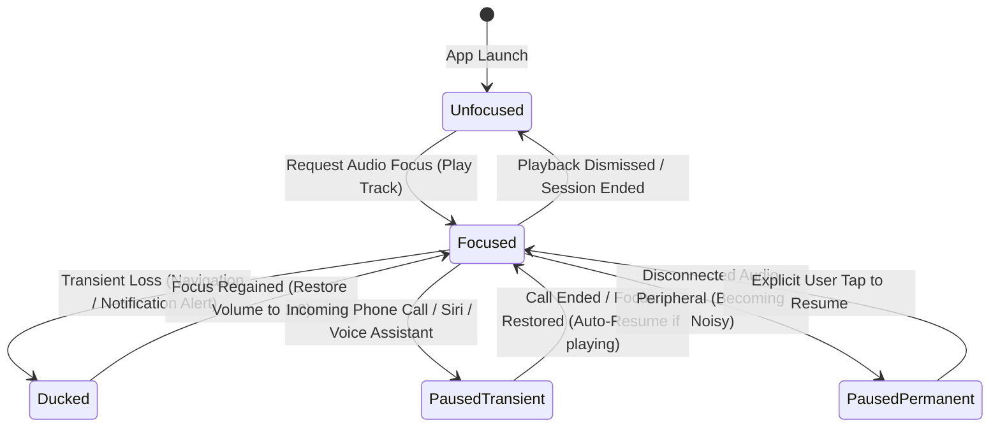

# Phase 9 Blueprint: Production Audio Engine Hardware Bridge & Platform Services

> **Parent Foundation Blueprint:** [`docs/foundation_blueprints/07_AUDIO_TRANSPORT_AND_PIPELINE_MODALS_SPEC.md`](file:///c:/Users/Ndugelo/VHUNAMBI/monorepo/docs/foundation_blueprints/07_AUDIO_TRANSPORT_AND_PIPELINE_MODALS_SPEC.md) & [`docs/foundation_blueprints/02_PERSISTENT_PLAYER_SPEC.md`](file:///c:/Users/Ndugelo/VHUNAMBI/monorepo/docs/foundation_blueprints/02_PERSISTENT_PLAYER_SPEC.md)  
> **Target Package:** `apps/vhunambi_client`  
> **Status:** Specification  
> **Dependencies:** `audio_service: ^0.18.12`, `audio_session: ^0.1.18`, `just_audio: ^0.9.36`  

---

## 1. Architectural Vision & Mission

In Phases 2 through 8, Vhunambi established a persistent UI player, complete audio transport controls across mobile mini-players and desktop DAW consoles, library vault caching, and an offline download engine.

However, modern audio platforms cannot rely solely on in-app UI execution. When mobile users lock their devices, switch to navigation apps, receive incoming phone calls, or connect to car stereos and bluetooth headphones, playback must behave natively:
1. **Background Audio Continuity:** Audio must continue seamlessly when the app is backgrounded or the display is powered off.
2. **Native OS Transport & Lockscreen Controls:**
   - **Android:** Android `MediaSessionCompat` and `NotificationCompat.MediaStyle` with interactive playback actions and album art.
   - **iOS:** `MPNowPlayingInfoCenter` and `MPRemoteCommandCenter` displaying song titles, artist handles, and scrubber controls on the dynamic island, lockscreen, and Apple Watch.
   - **Desktop (Windows / macOS):** System Media Transport Controls (SMTC) responding to hardware keyboard media keys (Play/Pause, Prev, Next).
3. **Hardware Audio Session & Focus Management:**
   - Automatic ducking or pausing during system alerts and turn-by-turn navigation.
   - Graceful pause on incoming telephony calls and resume upon call termination.
   - "Becoming Noisy" protection: immediate audio pause if headphones or bluetooth audio peripherals are unplugged/disconnected, preventing public playback embarrassment.
4. **Hybrid Source Resolution (Offline Vault vs. Cloud Stream):**
   - Direct integration with Phase 8's `OfflineStorageService`: if a requested track is marked `cachedLocally`, the engine routes the local decrypted file URI to `just_audio`; otherwise, it streams from the cloud CDN.

```
┌────────────────────────────────────────────────────────────────────────────────────────┐
│                        VHUNAMBI AUDIO HARDWARE BRIDGE ARCHITECTURE                     │
├────────────────────────────────────────────────────────────────────────────────────────┤
│                                                                                        │
│     ┌────────────────────────────────────────────────────────────────────────────┐     │
│     │                       Flutter Presentation Layer                           │     │
│     │   - MobileMiniPlayer (60px)       - DesktopTransportBar (72px)             │     │
│     │   - ExpandedCockpitModal (88%)    - TrackActionsSheet                      │     │
│     └─────────────────────────────────────┬──────────────────────────────────────┘     │
│                                           │ Riverpod State & Dispatch                  │
│                                           ▼                                            │
│     ┌────────────────────────────────────────────────────────────────────────────┐     │
│     │                     playerStateProvider (PlayerNotifier)                   │     │
│     │   - Bi-directional sync with VhunambiAudioHandler                          │     │
│     │   - Pure PlayerState stream for reactive UI re-renders                     │     │
│     └─────────────────────────────────────┬──────────────────────────────────────┘     │
│                                           │ Commands & State Stream                    │
│                                           ▼                                            │
│     ┌────────────────────────────────────────────────────────────────────────────┐     │
│     │            IVhunambiAudioHandler / VhunambiAudioHandler (audio_service)    │     │
│     │   - MediaItem publication (title, artist, duration, artUri, genre)         │     │
│     │   - PlaybackState mapping (playing, paused, buffering, position, speed)    │     │
│     │   - Headless test-safe fallback (auto-activated in headless flutter test)  │     │
│     └──────────────┬──────────────────────┬──────────────────────┬───────────────┘     │
│                    │                      │                      │                     │
│                    ▼                      ▼                      ▼                     │
│       ┌────────────────────────┐ ┌────────────────┐ ┌────────────────────────┐         │
│       │  AudioSessionManager   │ │ AudioSource    │ │   just_audio Player    │         │
│       │  (audio_session)       │ │ Resolver       │ │   (AudioEngine)        │         │
│       │  - Audio Focus Ducking │ │ - Phase 8 Hive │ │ - Native decoder stream│         │
│       │  - Becoming Noisy      │ │   Local Vault  │ │ - Hardware buffer      │         │
│       │  - Telephony Pause     │ │ - Remote CDN   │ │ - Equalizer / Volume   │         │
│       └────────────────────────┘ └────────────────┘ └────────────────────────┘         │
│                    │                      │                      │                     │
│                    ▼                      ▼                      ▼                     │
│     ══════════════════════════════════════════════════════════════════════════════     │
│                          NATIVE OPERATING SYSTEM PLATFORM LAYER                        │
│     - Android MediaSession & MediaStyle Notification                                   │
│     - iOS MPNowPlayingInfoCenter & MPRemoteCommandCenter                               │
│     - Desktop Windows SMTC / macOS NowPlaying Media Keys                               │
│     ══════════════════════════════════════════════════════════════════════════════     │
└────────────────────────────────────────────────────────────────────────────────────────┘
```

---

## 2. Platform Audio Transport Specifications

### 2.1 Android Platform Integration
* **Notification Channel:** `com.vhunambi.app.audio` ("Vhunambi Music Playback").
* **Notification Style:** `MediaStyle` notification with color derived from `AppColors.brandPrimary` (`#F97316`).
* **Compact Actions:** Show previous, play/pause, next in compact collapsed view (indices `[0, 1, 2]`).
* **Foreground Service:** Runs with `foregroundServiceType="mediaPlayback"` ensuring Android 14+ background execution permissions.

### 2.2 iOS & macOS Platform Integration
* **Audio Session Category:** `AVAudioSessionCategoryPlayback` with mode `AVAudioSessionModeDefault`.
* **Remote Commands:** Enable `playCommand`, `pauseCommand`, `togglePlayPauseCommand`, `nextTrackCommand`, `previousTrackCommand`, `changePlaybackPositionCommand`.
* **Now Playing Info:** Transmit track title, creator name, regional genre as album, duration, elapsed time, playback rate, and cached cover artwork.

### 2.3 Desktop (Windows & macOS) SMTC Integration
* Support hardware keyboard multimedia keys: Play/Pause (`VK_MEDIA_PLAY_PAUSE`), Next (`VK_MEDIA_NEXT_TRACK`), Previous (`VK_MEDIA_PREV_TRACK`), Stop (`VK_MEDIA_STOP`).
* Safe degradation when running on platforms without native SMTC bindings.

---

## 3. Headless Environment Safety Strategy (Critical Invariant)

In accordance with Codebase Invariant #3:
> **Headless Test Safety:** Hardware audio handlers must never crash or throw missing plugin exceptions when invoked during automated `flutter test` or headless CI environments.

### The Dual-Mode Architecture:
1. **`VhunambiAudioHandler` (Production):** Extends `BaseAudioHandler` and registers with the platform channel via `AudioService.init()`.
2. **`TestAudioHandler` / Fallback Mode:** Implements `IVhunambiAudioHandler`, holding in-memory `BehaviorSubject` streams for `playbackState` and `mediaItem` without calling platform channels.
3. **Auto-Detection:** The initialization routine catches `MissingPluginException` or headless environment markers and falls back automatically without interrupting tests.

---

## 4. Audio Focus & Interruption Finite State Machine (FSM)



---

## 5. Metadata & State Transformations

### 5.1 `Track` $\rightarrow$ `MediaItem` Mapping
```dart
MediaItem(
  id: track.id,
  album: track.genre,
  title: track.title,
  artist: track.creatorName,
  duration: track.duration,
  artUri: track.coverUrl != null ? Uri.parse(track.coverUrl!) : null,
  extras: {
    'language': track.language,
    'mood': track.mood,
    'isOffline': isOffline,
    'localFilePath': localFilePath,
  },
)
```

### 5.2 `PlayerState` $\leftrightarrow$ `PlaybackState` Mapping
| Vhunambi `PlaybackStatus` | `audio_service` `AudioProcessingState` | `playing` Flag |
|---|---|---|
| `PlaybackStatus.idle` | `AudioProcessingState.idle` | `false` |
| `PlaybackStatus.buffering` | `AudioProcessingState.buffering` | `true` |
| `PlaybackStatus.playing` | `AudioProcessingState.ready` | `true` |
| `PlaybackStatus.paused` | `AudioProcessingState.ready` | `false` |
| `PlaybackStatus.completed` | `AudioProcessingState.completed` | `false` |
| `PlaybackStatus.error` | `AudioProcessingState.error` | `false` |
