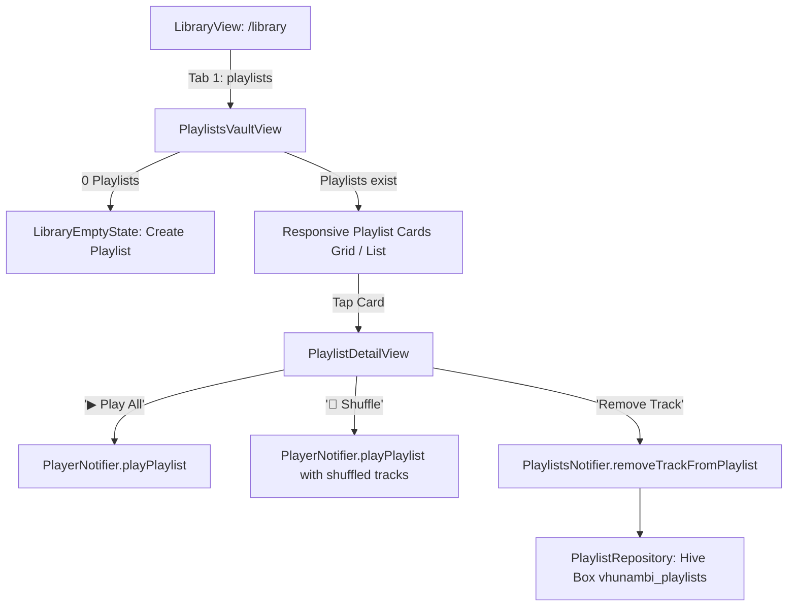

# Phase 12.1 · Blueprint — Playlists Vault Views & Hive Persistence

> **Phase:** 12.1 (Phase 12 Completion Patch)  
> **Codename:** `playlists-vault`  
> **Target Framework:** Flutter 3.x+ / Dart 3.x+  
> **Parent Blueprints:**  
> - [`docs/foundation_blueprints/04_LIBRARY_VAULT_SPEC.md`](file:///c:/Users/Ndugelo/VHUNAMBI/monorepo/docs/foundation_blueprints/04_LIBRARY_VAULT_SPEC.md) (§2.1 Tab 1: Playlists Vault & CRUD Engine)  
> - [`docs/foundation_blueprints/02_PERSISTENT_PLAYER_SPEC.md`](file:///c:/Users/Ndugelo/VHUNAMBI/monorepo/docs/foundation_blueprints/02_PERSISTENT_PLAYER_SPEC.md) (§2: Persistent Audio Queue Integration)  
> **State Management:** Flutter Riverpod 2.x+  
> **Storage Engine:** Hive Box (`vhunambi_playlists`) with in-memory test store fallback  

---

## 1. Executive Vision & Architecture

Phase 12.1 delivers the final UI and persistence layer for Subsystem B from Phase 12:

1. **Hive-Backed `PlaylistRepository` (Production Persistence):**  
   Declares `AppConstants.playlistsBoxKey = 'vhunambi_playlists'` and implements `PlaylistRepository` backed by Hive with graceful in-memory degradation for headless tests.
2. **Library Vault Playlists View (`PlaylistsVaultView`):**  
   Mounted at `/library?tab=playlists` (`LibraryCategory.playlists`). Renders user playlists in a responsive 2/3/4-column square card grid or dense list matching the vault design tokens. If 0 playlists exist, renders `LibraryEmptyState` with a `"Create your first playlist"` CTA that opens the creation dialog.
3. **Playlist Detail Cockpit (`PlaylistDetailView`):**  
   A dedicated playlist screen featuring:
   - Dynamic 4-track artwork mosaic / genre-gradient header.
   - Metadata stack (title, description, track count, cumulative formatted playtime).
   - Playback triggers: `"▶ Play All"` (loads all playlist tracks into the player queue and plays index 0) and `"🔀 Shuffle"` (shuffles playlist tracks into queue).
   - Management actions: Rename playlist, delete playlist, and remove individual tracks.



---

## 2. Visual Layout & Responsive Scaffolding

### 2.1 Playlists Vault View (`PlaylistsVaultView`)

Mounted inside `LibraryView` when `ref.watch(libraryCategoryProvider) == LibraryCategory.playlists`:

```
┌────────────────────────────────────────────────────────────────────────┐
│ [ ♪ Songs ]  ─[ ≡♪ Playlists ]─  [ 💿 Collections ]  [ 🛍️ Beats ] ...  │
├────────────────────────────────────────────────────────────────────────┤
│ [ 🔍 Search playlists...         ]    [ + New Playlist ] [ ⊞ Grid / ☰ ]│
├────────────────────────────────────────────────────────────────────────┤
│ ┌──────────────────────┐  ┌──────────────────────┐                     │
│ │ ┌──────────────────┐ │  │ ┌──────────────────┐ │                     │
│ │ │ 🎹 💿            │ │  │ │ 🎸 🥁            │ │                     │
│ │ │ 💥 🎷   (MOSAIC) │ │  │ │ 🪕 🎺   (MOSAIC) │ │                     │
│ │ └──────────────────┘ │  │ └──────────────────┘ │                     │
│ │ Late Night Amapiano  │  │ Weekend Braai Mix    │                     │
│ │ 14 songs • 54 mins   │  │ 8 songs • 31 mins    │                     │
│ └──────────────────────┘  └──────────────────────┘                     │
└────────────────────────────────────────────────────────────────────────┘
```

* **Grid Card Styling (`PlaylistCard`):**
  - Container: `#141418` (`surfaceElevated`), border `1px solid #2D2D38`, border-radius `16px`.
  - Leading Artwork: 1:1 Aspect ratio square container. Renders 2x2 artwork mosaic of the first 4 tracks if available, or a dynamic genre gradient with playlist icon (`Icons.queue_music_rounded`).
  - Title: `AppTypography.titleSmall` (`#FFFFFF`, maxLines: 1).
  - Subtitle: `"${playlist.trackCount} songs • $formattedDuration"` (`#9CA3AF`).
  - Trailing Action: `[⋮]` Context menu (Rename, Delete).

---

### 2.2 Playlist Detail View (`PlaylistDetailView`)

Pushed to navigation stack when tapping a playlist card:

```
┌────────────────────────────────────────────────────────────────────────┐
│ [ < Back ]                 Playlist Details                      [ ⋮ ] │
├────────────────────────────────────────────────────────────────────────┤
│ ┌──────────────┐                                                       │
│ │ 🎹 💿        │  Late Night Amapiano                                  │
│ │ 💥 🎷 (1:1)  │  Soulful log drum deep cuts for late-night listening  │
│ └──────────────┘  14 songs • 54 mins • Created by You                  │
│                                                                        │
│ [ ▶ Play All ]       [ 🔀 Shuffle ]                 [ + Add Songs ]    │
├────────────────────────────────────────────────────────────────────────┤
│ #   TITLE & ARTIST                           GENRE      DURATION  ACT  │
│ 1   Grateful in the Light • Sigwa & Inaf    Amapiano   3:36      [✕]  │
│ 2   Ndo Mufuna Matibe • Fifi                 Amapiano   3:18      [✕]  │
│ 3   Township Log Drum Heat • Sipho           Amapiano   3:00      [✕]  │
└────────────────────────────────────────────────────────────────────────┘
```

* **Primary Actions:**
  - `"▶ Play All"`: Solid `#F97316` pill button with pure black icon and text. Calls `PlayerNotifier.playPlaylist(playlist, resolvedTracks)`.
  - `"🔀 Shuffle"`: Inset `#1B1B22` pill button with border `#2D2D38`. Shuffles tracks before playing.
  - Track Removal (`[✕]`): Removes track from the playlist via `PlaylistsNotifier.removeTrackFromPlaylist(...)`.
