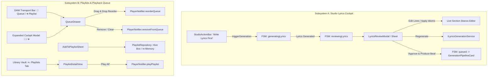

# Phase 12 · Blueprint — Studio Lyrics Review Cockpit & Playlists Queue Management

> **Phase:** 12  
> **Codename:** `lyrics-and-playlists`  
> **Target Framework:** Flutter 3.x+ / Dart 3.x+  
> **Parent Blueprints:**  
> - [`docs/foundation_blueprints/03_CREATE_STUDIO_SPEC.md`](file:///c:/Users/Ndugelo/VHUNAMBI/monorepo/docs/foundation_blueprints/03_CREATE_STUDIO_SPEC.md) (§3 & §4: `reviewingLyrics` State & Synthesis Handoff)  
> - [`docs/foundation_blueprints/02_PERSISTENT_PLAYER_SPEC.md`](file:///c:/Users/Ndugelo/VHUNAMBI/monorepo/docs/foundation_blueprints/02_PERSISTENT_PLAYER_SPEC.md) (§1.2 & §2: Queue Management & Headless Synchronization)  
> - [`docs/foundation_blueprints/04_LIBRARY_VAULT_SPEC.md`](file:///c:/Users/Ndugelo/VHUNAMBI/monorepo/docs/foundation_blueprints/04_LIBRARY_VAULT_SPEC.md) (§2.1 Tab 1: Playlists Vault & CRUD Engine)  
> - [`docs/foundation_blueprints/07_AUDIO_TRANSPORT_AND_PIPELINE_MODALS_SPEC.md`](file:///c:/Users/Ndugelo/VHUNAMBI/monorepo/docs/foundation_blueprints/07_AUDIO_TRANSPORT_AND_PIPELINE_MODALS_SPEC.md) (§1.3: Queue Drawer `📑` & Add to Playlist `➕`)  
> **State Management:** Flutter Riverpod 2.x+  

---

## 1. Executive Summary & Dual-System Architecture

Phase 12 delivers two high-impact, foundational capabilities scheduled across earlier milestones:

1. **Studio Lyrics Review & Editing Cockpit (Subsystem A):**  
   Closes the deferred loop from Phase 10. When a creator generates music with `LyricsMode.aiWrite`, the primary CTA triggers `"📄 Write Lyrics First"`. The synthesis FSM pauses in `GenerationPhase.reviewingLyrics`, opening an interactive review sheet/modal. Creators can inspect culturally authentic stanzas (Intro, Verse, Chorus, Bridge, Hook, Outro), edit lines in place, apply regional dialect idioms (Tshivenḓa, isiZulu, Sepedi, Swahili, Yoruba), re-roll with variation, and confirm before queuing beat production to backend GPU workers.

2. **Playlists & Playback Queue Drawer Management (Subsystem B):**  
   Completes the persistent audio engine and library vault capabilities. Implements full user playlist CRUD (Create, Read, Update, Delete, Add/Remove tracks), integrates the interactive sliding **Queue Drawer** (`📑`) on both the Desktop Transport Bar and Mobile Cockpit, and provides the persistent `➕ Add to Playlist` bottom sheet.



---

## 2. Subsystem A: Studio Lyrics Review & Editing Cockpit

### 2.1 Visual Layout & Responsive Scaffolding

The Lyrics Review Cockpit mounts as a centered elevated modal on Desktop (> 1024px, max width `780px`) and as an expandable 90% bottom sheet on Mobile (< 768px):

```
┌────────────────────────────────────────────────────────────────────────┐
│  (📄) Review & Polish Lyrics                     [Amampondo] [ isiZulu ]│ <-- Header Bar
│  Generated from: "Late-night log drum session in Soweto..."       [ ✕ ]│
├────────────────────────────────────────────────────────────────────────┤
│ ┌────────────────────────────────────────────────────────────────────┐ │
│ │ [Intro] • 4 bars                                       [ ✏️ Edit ] │ │
│ │ (Log drum rolls in, gentle keys)                                   │ │
│ │ Yebo, sesifikile ebusuku bonke...                                  │ │
│ └────────────────────────────────────────────────────────────────────┘ │
│ ┌────────────────────────────────────────────────────────────────────┐ │
│ │ [Verse 1] • 8 bars                                     [ ✏️ Edit ] │ │
│ │ Izibani zedolobha zikhanya kamnandi                                 │ │
│ │ Umsindo wamapiano ungiphakamisa moya                               │ │
│ │ Siyazenzela, asisabi lutho                                         │ │
│ │ Lalela log drum uma liphuma kule ndawo                             │ │
│ └────────────────────────────────────────────────────────────────────┘ │
│ ┌────────────────────────────────────────────────────────────────────┐ │
│ │ [Chorus] • Energetic Belt                              [ ✏️ Edit ] │ │
│ │ Vhunambi lolu, umculo wenhliziyo!                                  │ │
│ │ Sihamba sonke, asishiyi muntu emuva                                │ │
│ └────────────────────────────────────────────────────────────────────┘ │
│                                                                        │
│ 💡 Regional Idiom Suggestions (isiZulu):                               │
│ [ + "Woza nazo!" ]  [ + "Khuphuka lapho!" ]  [ + "Ayeye mahala!" ]     │
├────────────────────────────────────────────────────────────────────────┤
│ [ 🔄 Regenerate ]      [ ✍️ Raw Editor ]     [ ✨ Approve & Produce Beat ➔ ]│
└────────────────────────────────────────────────────────────────────────┘
```

### 2.2 Section Structure & Stanza Taxonomy

Lyrics are parsed and presented as structured stanzas:

| Section Type | Tag Representation | Musical Function | Visual Accent |
| :--- | :--- | :--- | :--- |
| `intro` | `[Intro]` | Atmospheric buildup, spoken hook, tempo intro | `#9CA3AF` (Muted) |
| `verse` | `[Verse 1]`, `[Verse 2]` | Rhythmic narrative, vernacular storytelling | `#38BDF8` (Sky) |
| `chorus` | `[Chorus]` | Main melodic hook, layered harmonies | `#F97316` (Brand Amber) |
| `hook` | `[Hook]` | Repetitive dance vocal or log-drum cadence | `#F59E0B` (Gold) |
| `bridge` | `[Bridge]` | Dynamic shift or key transition | `#A855F7` (Purple) |
| `outro` | `[Outro]` | Fadeout, ad-libs, instrumental vamp | `#6B7280` (Muted) |

### 2.3 Cultural Rhyme & Vernacular Ad-Lib System

Provides one-tap cultural chips based on the selected language:
* **Tshivenḓa**: `"Ndi matsheloni"`, `"Zwivhuya zwashu"`, `"Hu do luga"`, `"Tshilidzi"`, `"Kha zwi bvele phanḓa"`.
* **isiZulu / isiXhosa**: `"Woza nazo!"`, `"Khuphuka lapho!"`, `"Ayeye!"`, `"Siyabangena"`, `"Asambeni!"`.
* **Sepedi / Setswana**: `"Ke nako"`, `"Re a leboha"`, `"Tsamaya hantle"`, `"Pula!"`.
* **Swahili**: `"Twende kazi"`, `"Pamoja milele"`, `"Hakuna matata"`, `"Muziki mzuri"`.
* **Amapiano Ad-Libs**: `"Tararara!"`, `"Hao kante!"`, `"Danko!"`, `"Chomi!"`.

---

## 3. Subsystem B: Playlists & Playback Queue Drawer

### 3.1 Playback Queue Drawer (`QueueDrawer`)

Mounted on the right side on Desktop (`400px` width) or as a draggable bottom sheet on Mobile:

```
┌──────────────────────────────────────────────────┐
│  📑 Playback Queue            [ 4 Tracks ] [ ✕ ] │
│  Playing from: Amapiano Vault                    │
├──────────────────────────────────────────────────┤
│ NOW PLAYING                                      │
│ ┌────┬─────────────────────────────┬───────────┐ │
│ │ 🎹 │ Grateful in the Light       │ [ılıl|lı] │ │
│ │    │ Sigwa & Inaf • 3:36         │           │ │
│ └────┴─────────────────────────────┴───────────┘ │
├──────────────────────────────────────────────────┤
│ UP NEXT                               [ Clear ]  │
│ ┌─┬────┬─────────────────────────────┬─────────┐ │
│ │≡│ 💿 │ Kwaito Nights               │ 4:10 [✕]│ │
│ │ │    │ DJ Mbuso • Kwaito           │         │ │
│ ├─┼────┼─────────────────────────────┼─────────┤ │
│ │≡│ 💥 │ Durban Bass Storm           │ 3:45 [✕]│ │
│ │ │    │ Gqom Queen • Gqom           │         │ │
│ ├─┼────┼─────────────────────────────┼─────────┤ │
│ │≡│ 🎸 │ Venda Sun                   │ 3:15 [✕]│ │
│ │ │    │ Makhadzi • Maskandi         │         │ │
│ └─┴────┴─────────────────────────────┴─────────┘ │
└──────────────────────────────────────────────────┘
```

* **Header:** Title `"Playback Queue"`, item counter badge `[ 4 Tracks ]`, close button.
* **Now Playing Card:** Active track card with live equalizer animation, matching `AppColors.brandPrimary`.
* **Up Next List:** `ReorderableListView` supporting vertical drag reordering via `Icons.drag_handle_rounded`.
* **Row Actions:** Tap to jump directly to track; trailing `✕` removes from queue.
* **Header Action:** `"Clear"` empties remaining queue while keeping current track playing.

### 3.2 Add to Playlist Sheet (`AddToPlaylistSheet`)

Invoked via `➕ Add to Playlist` from:
1. `DesktopTransportBar` utility group.
2. `ExpandedCockpitModal` utility tray.
3. `TrackActionsSheet` in Library and Explore.

```
┌──────────────────────────────────────────────────┐
│  ➕ Add to Playlist                        [ ✕ ] │
│  "Grateful in the Light"                         │
├──────────────────────────────────────────────────┤
│  [ 🔍 Search playlists...                     ]  │
│                                                  │
│  [ + Create New Playlist ]                       │
│                                                  │
│  ┌────────────────────────────────────────────┐  │
│  │ [💿] Late Night Amapiano       12 songs [✓]│  │
│  │ [💿] Roadtrip Bangers           8 songs [ ]│  │
│  │ [💿] Chill Tshivenḓa Acoustic   4 songs [ ]│  │
│  └────────────────────────────────────────────┘  │
├──────────────────────────────────────────────────┤
│                                       [ Done ]   │
└──────────────────────────────────────────────────┘
```

### 3.3 Library Vault `Playlists` Tab (`/library?tab=playlists`)

* Renders user playlists in responsive 2/3/4-column square cards or dense list.
* Shows playlist title, track count, total duration, and updated date.
* Primary empty state when 0 playlists exist with `"Create your first playlist"` CTA.
* Clicking a playlist opens `PlaylistDetailView`:
  * Ambient header banner with 4-track mosaic artwork.
  * `"▶ Play All"` (loads entire playlist into queue and plays track 0).
  * `"🔀 Shuffle"` (shuffles playlist into queue).
  * Actions: Rename, Add tracks, Delete playlist.

---

## 4. Design Tokens & Styling Invariants

Strict adherence to Vhunambi design system:

* **Surfaces:**
  - Canvas: `AppColors.surfaceCanvas` (`#0A0A0C`)
  - Elevated Container / Cards: `AppColors.surfaceElevated` (`#141418`)
  - Inset Controls & Chips: `AppColors.surfaceSecondary` (`#1B1B22`)
  - Modals & Sheets: `AppColors.surfaceModal` (`#16161C`)
* **Brand Accents:**
  - Active Fill / Primary CTA: `AppColors.brandPrimary` (`#F97316`)
  - Button Text / Glyph on Brand: `AppColors.brandContrast` (`#000000`)
  - Amber Glow: `AppColors.amberGlow` (`Color(0x26F97316)`)
* **Borders & Radii:**
  - Border: `AppColors.borderSubtle` (`#2D2D38`)
  - Pill Border: `AppRadius.pillBorder` (`BorderRadius.circular(9999)`)
  - Card Border: `AppRadius.cardBorder` (`BorderRadius.circular(16)`)
  - Modal Border: `AppRadius.modalBorder` (`BorderRadius.vertical(top: Radius.circular(24))`)
