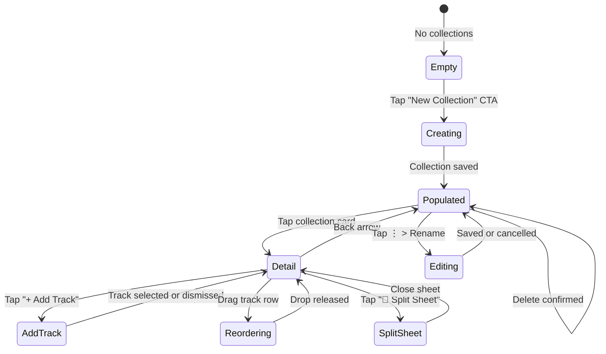

# Phase 13 · Blueprint — Collections & EP/Album Concept Bundler

> **Phase:** 13
> **Codename:** `collections-bundler`
> **References:** `docs/foundation_blueprints/04_LIBRARY_VAULT_SPEC.md`, `LibraryCategory.collections`
> **Authored By:** Antigravity (Dual-Agent Symbiosis Protocol)
> **Date:** 2026-09-27

---

## 1. Mission Statement

Phase 13 closes the `/library?tab=collections` deferred loop from Phase 4. It delivers a full Collections Bundler — a structured content creation layer that lets artists group their generated tracks into EPs, albums, and concept projects with unified artwork, release metadata (genre, BPM, language, release date), and split-sheet participant attribution.

Users can:
- Create named EPs or Albums from saved Library tracks.
- Set unified cover artwork (placeholder squircle) per collection.
- Add/remove tracks from a collection with drag-to-reorder.
- Assign a collection type: `EP` (1–7 tracks), `Album` (8–20 tracks), `Single`, or `Concept Project`.
- Define split-sheet participants (Name + role + percentage split per collaborator).
- Navigate to a `CollectionDetailView` to review and manage the collection.
- Generate a human-readable **Split Sheet Summary** presented in a scrollable modal.

---

## 2. Responsive Layout Geometry

### 2.1 Collections Vault Tab (`/library?tab=collections`)

```
Mobile  (<768px)                    Desktop (≥1024px)
┌──────────────────────────────┐    ┌──────────────────────────────────────────────┐
│  [Action Bar: Search │ New ▼]│    │  [Action Bar: Search ──────────── New ▼] │
│  ──────────────────────────  │    │  ─────────────────────────────────────────── │
│  ┌────────┐  ┌────────┐      │    │  ┌──────┐ ┌──────┐ ┌──────┐ ┌──────┐        │
│  │ EP Cvr │  │ EP Cvr │      │    │  │Cover │ │Cover │ │Cover │ │Cover │        │
│  │        │  │        │      │    │  │      │ │      │ │      │ │      │        │
│  │ Title  │  │ Title  │      │    │  │Title │ │Title │ │Title │ │Title │        │
│  │ 3 trks │  │ EP     │      │    │  │N trk │ │Album │ │EP    │ │ EP   │        │
│  └────────┘  └────────┘      │    │  └──────┘ └──────┘ └──────┘ └──────┘        │
└──────────────────────────────┘    └──────────────────────────────────────────────┘
Grid: 2 cols (mobile) / 4 cols (desktop)
childAspectRatio: 0.85 (portrait card with title below artwork)
```

### 2.2 Collection Detail View

```
┌──────────────────────────────────────────────────────────────────┐
│  ← [Back]              "Ẓe Amapiano EP"         [⋮ Actions]     │
├──────────────────────────────────────────────────────────────────┤
│  ┌──────────────────┐  Title: "Ẓe Amapiano EP"                   │
│  │ [Unified Artwork │  Type:  EP  •  Genre: Amapiano              │
│  │  Placeholder]    │  Tracks: 5  •  Duration: 18 mins            │
│  │  140×140px        │  Release: 2026-09-27                        │
│  └──────────────────┘  [▶ Play All]  [🔀 Shuffle]  [📄 Split Sheet]│
├──────────────────────────────────────────────────────────────────┤
│  TRACKS (drag-to-reorder)                                        │
│  ┌────────────────────────────────────────────────────────────┐  │
│  │ ≡ 1.  Grateful in the Light     cern • 3:28      [×]     │  │
│  │ ≡ 2.  Imali ye Umuntu           cern • 4:12      [×]     │  │
│  │ ≡ 3.  Umthandazo                cern • 2:56      [×]     │  │
│  └────────────────────────────────────────────────────────────┘  │
│  [+ Add Track from Library]                                      │
├──────────────────────────────────────────────────────────────────┤
│  SPLIT SHEET PARTICIPANTS                                        │
│  ┌────────────────────────────────────────────────────────────┐  │
│  │  Ndugelo Makwela    Producer    50%      [Edit] [×]       │  │
│  │  MusiQ AI           Composer    50%      [Edit] [×]       │  │
│  └────────────────────────────────────────────────────────────┘  │
│  [+ Add Collaborator]                                            │
└──────────────────────────────────────────────────────────────────┘
```

### 2.3 Create Collection Dialog

```
┌──────────────────────────────────────────────────────┐
│  Create New Collection                               │
│  ─────────────────────────────────────────────────── │
│  [Collection Title             ]                     │
│  [Collection Type ▼ EP / Album / Single / Concept]   │
│  [Genre          ▼ Amapiano / Gqom / Kwaito / ...]   │
│  [Release Date   📅 date picker or free text]         │
│  [Optional description                       ]       │
│  ─────────────────────────────────────────────────── │
│            [Cancel]          [Create]                │
└──────────────────────────────────────────────────────┘
```

### 2.4 Split Sheet Summary Modal

```
┌────────────────────────────────────────────────────────────┐
│  📄 Split Sheet — "Ẓe Amapiano EP"                        │
│  ──────────────────────────────────────────────────────── │
│  Project:    Ẓe Amapiano EP                               │
│  Type:       EP                                           │
│  Genre:      Amapiano                                     │
│  Tracks:     5                                            │
│  Duration:   18 mins                                      │
│  Created:    27 Sep 2026                                  │
│                                                           │
│  PARTICIPANTS                                             │
│  ┌───────────────────────────────────────────────────┐   │
│  │ Name              Role           Share            │   │
│  │ Ndugelo Makwela   Producer       50%              │   │
│  │ MusiQ AI          Composer       50%              │   │
│  └───────────────────────────────────────────────────┘   │
│                                                           │
│  ⚠ Shares must sum to 100%                               │
│                                                           │
│            [Close]     [Copy to Clipboard]               │
└────────────────────────────────────────────────────────────┘
```

---

## 3. State Machine



---

## 4. Visual Design Tokens

| Element | Token |
| :--- | :--- |
| Page canvas | `AppColors.surfaceCanvas` |
| Card surface | `AppColors.surfaceElevated` |
| Card border | `AppColors.borderSubtle` |
| Modal surface | `AppColors.surfaceModal` |
| Primary CTA | `AppColors.brandPrimary` |
| Type badge (EP) | `AppColors.badgeCyanBg` + `AppColors.badgeCyan` |
| Type badge (Album) | `AppColors.amberInset` + `AppColors.brandPrimary` |
| Split total error | `AppColors.error` |
| Split total ok | `AppColors.success` |
| Artwork placeholder gradient | `AppColors.surfaceSecondary` → `AppColors.surfaceElevated` |
| Title typography | `AppTypography.bodyLarge.copyWith(fontWeight: FontWeight.w600)` |
| Metadata typography | `AppTypography.caption.copyWith(color: AppColors.textSecondary)` |
| Section header | `AppTypography.bodyLarge.copyWith(color: AppColors.textSecondary)` |

---

## 5. Collection Type Constraints

| Type | Track Range | Icon |
| :--- | :--- | :--- |
| `Single` | 1 | `Icons.music_note_rounded` |
| `EP` | 2–7 | `Icons.album_rounded` |
| `Album` | 8–20 | `Icons.library_music_rounded` |
| `Concept Project` | 1–30 | `Icons.auto_awesome_mosaic_rounded` |

The `CollectionEntity.typeLabel` getter derives the human label. A validation warning (non-blocking) appears in the detail view when track count is outside the type's recommended range.

---

## 6. Artwork Placeholder

A squircle container (`AppRadius.cardBorder`) using a mosaic of up to 4 track cover artwork placeholders arranged in a 2×2 grid using `AppColors.surfaceSecondary` and `AppColors.surfaceElevated` with a centered `Icons.album_outlined` glyph in `AppColors.brandPrimary` when no artwork is set.

---

## 7. Breakpoints & Grid

| Viewport | Grid Columns | Card `childAspectRatio` |
| :--- | :--- | :--- |
| Mobile `<768px` | 2 | `0.85` |
| Tablet `768–1023px` | 3 | `0.85` |
| Desktop `≥1024px` | 4 | `0.85` |

Determined by `ResponsiveUtils.gridColumns(context)` from `lib/core/utils/responsive_utils.dart`.
