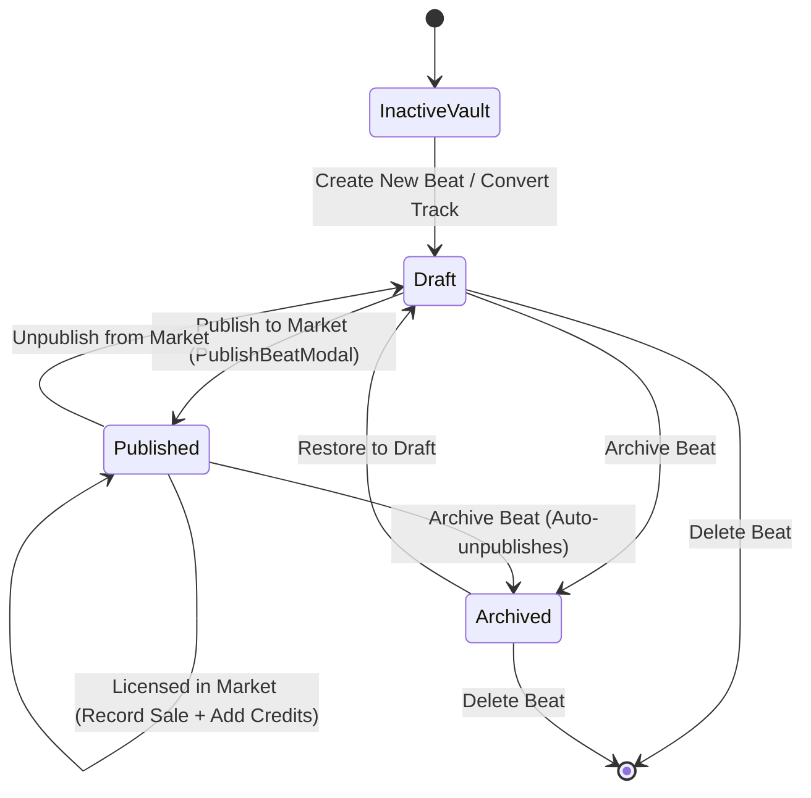

# Phase 14 · Blueprint — Producer Beats Vault & Beatstore Listing Cockpit

> **Phase:** 14  
> **Codename:** `beats-vault`  
> **References:** `docs/foundation_blueprints/04_LIBRARY_VAULT_SPEC.md` §2.1 (Tab 3), `docs/foundation_blueprints/05_MARKETPLACE_AND_LANDING_SPEC.md` §1.2  
> **Commercial Checkout & Stem Delivery Extension:** [`docs/phases/phase_58_sovereign_beatstore_licensing/`](file:///c:/Users/Ndugelo/VHUNAMBI/monorepo/docs/phases/phase_58_sovereign_beatstore_licensing/blueprint.md) *(adds multi-tier Coin/ZAR checkout, FIPS 180-4 SHA-256 license deeds, exclusive sold buyout locks, and automated 44.1 kHz master + 4-stem Vault delivery)*.  
> **Authored By:** Antigravity (Dual-Agent Symbiosis Protocol)  
> **Date:** 2026-09-27  

---

## 1. Mission Statement

Phase 14 closes the `/library?tab=beats` deferred loop from Phase 4 and completes the two-sided marketplace seller loop initiated in Phase 6.

In Phase 6, the Beats Marketplace (`/market`) delivered beat discovery, preview auditioning, credit licensing, and a seller callout banner explicitly prompting creators to:
> *"Sell your beats: Create instrumental beats and list them here. Every time someone licenses your beat, credits go straight to your balance. [Go to Library -> ?tab=beats]"*

Until now, navigating to `/library?tab=beats` yielded a generic track filter. Phase 14 delivers a dedicated **Producer Beats Vault & Beatstore Listing Cockpit** enabling creators and producers to:
1. **Catalog & Audition Instrumental Beats:** Organize user-generated and imported instrumentals in a high-density vault with BPM, musical key, genre gradients, and live waveform previews.
2. **Convert & Author Beat Listings:** Author complete beat profiles (Title, African Genre, BPM, Musical Key, Descriptive Tags, Pricing in Credits, and Licensing Tier).
3. **Bi-directional Marketplace Synchronization:** One-tap Publish / Unpublish toggle that injects or removes the listing directly from the live public Beats Marketplace (`marketplaceBeatsProvider`).
4. **Stems Package Management:** Track, inspect, and export multi-track stems (Drums, Bass, Melody, Other) as ready-to-license producer packages.
5. **Producer Sales & Royalty Ledger:** Track license purchases, buyer handles, credit royalties earned, and audition counts per beat with a visual summary analytics banner.
6. **Seamless Library & Audio Integration:** Mounted in `LibraryView` at `/library?tab=beats`, responsive across Mobile (<768px), Tablet (768–1024px), and Desktop (>1024px), and bridging directly into the persistent audio player dock.

---

## 2. Responsive Layout Geometry

### 2.1 Beats Vault Tab (`/library?tab=beats`)

```
Mobile (<768px):
┌────────────────────────────────────────────────────────┐
│ [ ⚡ 45 Credits Earned • 12 Beats Listed • 8 Sold ]    │ <-- Producer Stats Bar
├────────────────────────────────────────────────────────┤
│ [ 🔍 Search my beats... ]  [ Filter ▼ ]  [ ⊞ / ☰ ]     │ <-- Action Strip
│ [ All (12) ]  [ Published (8) ]  [ Draft (4) ]         │ <-- Status Filter Chips
├────────────────────────────────────────────────────────┤
│ ┌──────────────────┐  ┌──────────────────┐             │
│ │ [Gradient Art]   │  │ [Gradient Art]   │             │
│ │ 112 BPM • F# Min │  │ 128 BPM • C Maj  │             │
│ │ [🟢 Published]   │  │ [🟡 Draft]       │             │
│ │ Soshanguve Pulse │  │ Bacardi Bounce   │             │
│ │ ⚡ 10 Cr • 5 Sold │  │ ⚡ 15 Cr • 0 Sold │             │
│ │ [▶ Play]     [⋮] │  │ [▶ Play]     [⋮] │             │
│ └──────────────────┘  └──────────────────┘             │
└────────────────────────────────────────────────────────┘

Desktop (≥1024px):
┌──────────────────────────────────────────────────────────────────────────────────────────┐
│ ┌──────────────────────────────────────────────────────────────────────────────────────┐ │
│ │  PRODUCER BEATS COCKPIT                                                              │ │
│ │  [ 🎵 12 Total Beats ]  [ 🛍️ 8 Live on Market ]  [ 🤝 14 Licenses Sold ]  [ ⚡ 140 Cr ]│ │
│ └──────────────────────────────────────────────────────────────────────────────────────┘ │
│                                                                                          │
│ [ 🔍 Search my beats... ] [ Status: All ▼ ] [ Genre: All ▼ ] [ Sort: Newest ▼ ] [+ New] │
├──────────────────────────────────────────────────────────────────────────────────────────┤
│ ┌──────────────┐ ┌──────────────┐ ┌──────────────┐ ┌──────────────┐                      │
│ │[Gradient Art]│ │[Gradient Art]│ │[Gradient Art]│ │[Gradient Art]│                      │
│ │112 BPM•F# Min│ │128 BPM•C Maj │ │118 BPM•A Min │ │124 BPM•Eb Min│                      │
│ │🟢 Published  │ │🟡 Draft      │ │🟢 Published  │ │🟢 Published  │                      │
│ │Soshanguve    │ │Bacardi Bounce│ │Pretoria Vibe │ │Maputo Groove │                      │
│ │⚡ 10 Cr•5 Sold│ │⚡ 15 Cr•0 Sold│ │⚡ 20 Cr•2 Sold│ │⚡ 10 Cr•7 Sold│                      │
│ │[▶ Play]  [⋮] │ │[▶ Play]  [⋮] │ │[▶ Play]  [⋮] │ │[▶ Play]  [⋮] │                      │
│ └──────────────┘ └──────────────┘ └──────────────┘ └──────────────┘                      │
└──────────────────────────────────────────────────────────────────────────────────────────┘
```

Grid Breakpoints:
- Mobile (<768px): 2 columns, `childAspectRatio: 0.78`
- Tablet (768–1024px): 3 columns, `childAspectRatio: 0.82`
- Desktop (≥1024px): 4 columns, `childAspectRatio: 0.85`

---

### 2.2 Beat Detail Cockpit View (`BeatDetailCockpitView`)

Accessed by tapping any beat card/tile from the vault:

```
┌──────────────────────────────────────────────────────────────────────────────────────────┐
│ ← [Back to Vault]               "Soshanguve Pulse"                          [⋮ More]     │
├──────────────────────────────────────────────────────────────────────────────────────────┤
│ ┌───────────────────┐  Title: Soshanguve Pulse                                           │
│ │ [Artwork Squircle │  Producer: @ndugelo (You) • Created 2 days ago                     │
│ │  with Key/BPM]    │  Genre: Amapiano • Key: F# Minor • Tempo: 112 BPM                  │
│ │  160×160px        │  Tags: [Log Drum] [Private School] [Soulful]                       │
│ └───────────────────┘  [▶ Audition Preview]   [🎛️ Stem Separation Lab]  [✏️ Edit]         │
├──────────────────────────────────────────────────────────────────────────────────────────┤
│ 🛍️ MARKETPLACE LISTING STATUS                                                            │
│ ┌──────────────────────────────────────────────────────────────────────────────────────┐ │
│ │ Status: 🟢 Published to Marketplace                           [ Switch to Draft ]    │ │
│ │ Price: ⚡ 10 Credits  •  Tier: Non-Exclusive Commercial  •  Total Sales: 5            │ │
│ │ Royalties Earned: ⚡ 50 Credits  •  Audition Previews: 48                              │ │
│ └──────────────────────────────────────────────────────────────────────────────────────┘ │
├──────────────────────────────────────────────────────────────────────────────────────────┤
│ 🎛️ STEMS PACKAGE (4 STEMS)                                                               │
│ ┌──────────────────────────────────────────────────────────────────────────────────────┐ │
│ │  [🥁 Drums: Ready]  [🎸 Bass: Ready]  [🎹 Melody: Ready]  [✨ FX/Other: Ready]       │ │
│ │  [⭳ Export Stems Bundle (ZIP)]                   [ Audition Individual Stems ]        │ │
│ └──────────────────────────────────────────────────────────────────────────────────────┘ │
├──────────────────────────────────────────────────────────────────────────────────────────┤
│ 📜 RECENT LICENSE TRANSACTIONS (5)                                                       │
│ ┌──────────────────────────────────────────────────────────────────────────────────────┐ │
│ │ 2026-09-26 • Licensed by @sipho_music • Non-Exclusive Commercial • +⚡ 10 Credits     │ │
│ │ 2026-09-25 • Licensed by @kwaito_king • Non-Exclusive Commercial • +⚡ 10 Credits     │ │
│ │ 2026-09-24 • Licensed by @amapiano_fan • Non-Exclusive Commercial • +⚡ 10 Credits    │ │
│ └──────────────────────────────────────────────────────────────────────────────────────┘ │
└──────────────────────────────────────────────────────────────────────────────────────────┘
```

---

### 2.3 Beat Authoring / Conversion Dialog (`BeatFormDialog`)

Allows converting an existing generated track from the Library or creating a new beat:

```
┌────────────────────────────────────────────────────────────────┐
│  🛍️ Configure Beat Listing                                    │
│  ────────────────────────────────────────────────────────────  │
│  Beat Title:        [ Soshanguve Pulse                      ]  │
│  Genre:             [ Amapiano                             ▼]  │
│  Tempo (BPM):       [ 112 ]  [ Tap Tempo ]  (Slider 60–180)    │
│  Musical Key:       [ F# Minor                             ▼]  │
│  Tags (comma-sep):  [ Log Drum, Private School, Deep Bass   ]  │
│  Price in Credits:  [ ⚡ 10 Credits                         ▼]  │
│  Licensing Tier:    [ Non-Exclusive Commercial             ▼]  │
│  Initial Status:    (•) Draft (Vault Only)   ( ) Publish Now   │
│  ────────────────────────────────────────────────────────────  │
│                   [Cancel]          [Save Beat]                │
└────────────────────────────────────────────────────────────────┘
```

---

### 2.4 Publish Confirmation Modal (`PublishBeatModal`)

Educates the producer on terms before public marketplace injection:

```
┌────────────────────────────────────────────────────────────────┐
│  🚀 Publish Beat to Live Marketplace                           │
│  ────────────────────────────────────────────────────────────  │
│  Listing:           Soshanguve Pulse (Amapiano • 112 BPM)      │
│  Listing Price:     ⚡ 10 Credits                              │
│  Producer Royalty:  100% of credits credited on each license   │
│  Preview Length:    180 seconds preview streaming enabled      │
│  Public Route:      Visible immediately at /market             │
│  ────────────────────────────────────────────────────────────  │
│          [Keep as Draft]          [Confirm & Publish]          │
└────────────────────────────────────────────────────────────────┘
```

---

## 3. Visual Design Tokens Mapping

| Component Element | Token / Asset | Fallback / Raw Ref |
| :--- | :--- | :--- |
| **Canvas Background** | `AppColors.surfaceCanvas` | `#0A0A0C` |
| **Cockpit / Card Surface** | `AppColors.surfaceElevated` | `#141418` |
| **Inset Chips & Rows** | `AppColors.surfaceSecondary` | `#1B1B22` |
| **Modal Sheets & Dialogs** | `AppColors.surfaceModal` | `#16161C` |
| **Borders & Dividers** | `AppColors.borderSubtle` | `#2D2D38` |
| **Primary Brand Amber** | `AppColors.brandPrimary` | `#F97316` |
| **Contrast Text** | `AppColors.brandContrast` | `#000000` |
| **Status: Published** | `AppColors.success` | `#10B981` |
| **Status: Draft** | `AppColors.brandPrimary` / `AppColors.amberInset` | `#F59E0B` / `#3A2508` |
| **Status: Archived** | `AppColors.textTertiary` | `#6B7280` |
| **BPM / Key Badges** | `AppColors.badgeCyan` / `badgeCyanBg` | `#06B6D4` / `rgba(6,182,212,0.12)` |
| **Headings** | `AppTypography.titleLarge`, `titleMedium` | Inter Bold |
| **Body & Labels** | `AppTypography.bodyLarge`, `bodySmall`, `caption`| Inter Regular/Medium |
| **Card Radii** | `AppRadius.card` / `AppRadius.cardBorder` | `16px` |
| **Input Radii** | `AppRadius.input` / `AppRadius.inputBorder`| `12px` |
| **Pill Radii** | `AppRadius.pill` / `AppRadius.pillBorder` | `9999px` |
| **Squircle Badges** | `AppRadius.squircle` | `14px` |

---

## 4. State Machine & Architecture



### 4.1 Marketplace Synchronization Protocol
1. When a beat transitions to `published`, `BeatsNotifier` automatically creates or updates a matching `BeatListingEntity` and calls `marketplaceBeatsProvider.notifier.addListing(...)`.
2. When a beat transitions to `draft` or `archived`, `BeatsNotifier` unpublishes it from `marketplaceBeatsProvider`.
3. When a user in the marketplace licenses a beat via `licenseBeat()`, `marketplaceBeatsProvider.notifier.registerSale(beatId)` is triggered and `beatsProvider.notifier.recordSale(beatId, buyerHandle, credits)` updates the producer's sales ledger and credited balance.

---

## 5. Architectural Constraints & Non-Negotiables

1. **Zero Raw Hex Values:** All colors must resolve through `AppColors.*`, typography through `AppTypography.*`, dimensions through `AppSpacing.*` and `AppRadius.*`.
2. **Strict Riverpod 2.x State Management:** Use `StateNotifierProvider` and pure `Provider`. No Riverpod 3 or code-gen notifiers.
3. **Headless Safety:** Repository must inspect `Hive.isBoxOpen(AppConstants.beatsBoxKey)` and gracefully fall back to an in-memory map during test execution so `flutter test` runs with 0 unhandled zone errors.
4. **ListTile Material Wrapper:** Background-colored `ListTile` items must be wrapped in `Material(color: AppColors.surfaceElevated, shape: RoundedRectangleBorder(borderRadius: AppRadius.cardBorder, side: BorderSide(color: AppColors.borderSubtle)))` to avoid ink splash assertions.
5. **Responsive Column Resolution:** Compute columns using `ResponsiveUtils.isMobile(context) ? 2 : ResponsiveUtils.isTablet(context) ? 3 : 4` rather than `ResponsiveUtils.gridColumns()` (which returns 6/2).
6. **No Breaking Regressions:** Full test suite must maintain 100% pass rate (baseline: 541/541 passing).
