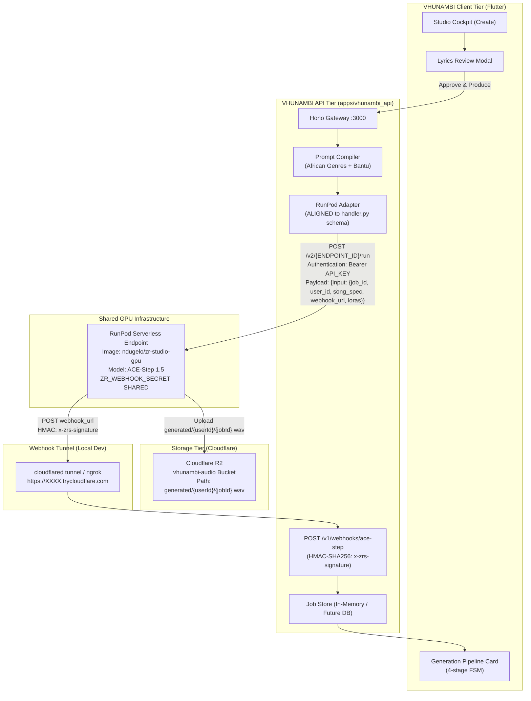

# Phase 16 · Blueprint — Live Cloud & GPU Infrastructure Integration

> **Phase:** 16  
> **Codename:** `cloud-gpu-bridge`  
> **Status:** 🟡 SPECIFICATION  
> **Repository Root:** `c:\Users\Ndugelo\VHUNAMBI\monorepo\`  
> **Target App:** `apps/vhunambi_api` (Backend Gateway)  
> **Architecture Standard:** Dual-Agent Pair Programming Standard ([`docs/VHUNAMBI_AGENT_WORKFLOW_STANDARD.md`](file:///c:/Users/Ndugelo/VHUNAMBI/monorepo/docs/VHUNAMBI_AGENT_WORKFLOW_STANDARD.md))  
> **Upstream Source of Truth:**  
> — `C:\Users\Ndugelo\Zania-Explore-v2.5\Zania-Explore\runpod-zr-studio\handler.py` (RunPod GPU Worker)  
> — `C:\Users\Ndugelo\Zania-Explore-v2.5\Zania-Explore\runpod-zr-studio\r2_uploader.py` (R2 Storage Client)  

---

## 1. Executive Summary & Purpose

Phase 16 promotes VHUNAMBI from a locally-simulated synthesis pipeline into a **live, cloud-powered audio synthesis platform** using production infrastructure that already exists in the ZR Studio ecosystem.

### Core Principle: Reuse, Don't Rebuild
The RunPod endpoint (`ndugelo/zr-studio-gpu`) hosting **ACE-Step 1.5** is already deployed and operational for ZR Studio. VHUNAMBI will **share this same GPU endpoint** — it only costs money when a request is actively running, so there is zero additional idle cost. The Docker image, model weights, and RunPod network volume are all pre-provisioned.

The only new infrastructure needed for VHUNAMBI is:
1. A dedicated **Cloudflare R2 bucket** (`vhunambi-audio`) to store generated masters and stems.
2. Correct **environment credentials** wired into `apps/vhunambi_api/.env`.
3. A **webhook tunnel** (Cloudflare Tunnel or ngrok) so the RunPod GPU worker can reach VHUNAMBI's local-dev or deployed gateway.

---

## 2. Architecture: Shared GPU, Separate Storage



---

## 3. Payload Contract — CRITICAL ALIGNMENT

This is the most important section. The existing `runpod-zr-studio/handler.py` `runpod_handler()` function expects a **specific JSON schema** in `input`. Our `runpod_adapter.ts` **MUST** match this exactly.

### 3.1 RunPod API Call Shape

```
POST https://api.runpod.ai/v2/{RUNPOD_ENDPOINT_ID}/run
Authorization: Bearer {RUNPOD_API_KEY}
Content-Type: application/json

{
  "input": {
    "job_id":     "vhunambi_{generationId}",         // string — must be unique
    "user_id":    "{userId}",                         // string — creator identity
    "song_spec":  {                                   // Dict[str, Any] consumed by generate_music()
      "genre":    "amapiano",                         // string — genre key
      "tempo":    116,                                // int    — BPM
      "mood":     "energetic",                        // string — mood key
      "duration": 30,                                 // int    — seconds (max 120)
      "lyrics":   "[INTRO]\nNdi khou fhirisea...",   // string — full bracketed stanza text
      "language": "tshivenda",                        // string — language identifier
      "title":    "Vhubvo Hanga"                     // string — track title (optional)
    },
    "webhook_url": "https://tunnel.example.com/v1/webhooks/ace-step",  // string — publicly reachable HTTPS URL
    "loras": [                                        // optional array
      { "path": "loras/amapiano_v1.safetensors", "weight": 0.8 }
    ]
  }
}
```

### 3.2 Webhook Callback Shape (from handler.py `send_webhook_notification`)

RunPod worker sends back to `webhook_url`:

```json
{
  "job_id":    "vhunambi_{generationId}",
  "status":    "processing | uploading | completed | failed",
  "audio_url": "https://{R2_ENDPOINT}/generated/{userId}/{jobId}.wav",
  "error":     null,
  "progress":  75.0,
  "message":   "Generating audio track..."
}
```

**Authentication Header:**  
`x-zrs-signature: {hmac_sha256_hex}` — computed as:
```
HMAC-SHA256(key=ZR_WEBHOOK_SECRET, message=JSON.stringify(payload, sorted keys, compact))
```

### 3.3 R2 Storage Path Convention (from `r2_uploader.py`)

```
Bucket: vhunambi-audio
Key:    generated/{user_id}/{job_id}.wav
URL:    https://{R2_ACCOUNT_ID}.r2.cloudflarestorage.com/vhunambi-audio/generated/{userId}/{jobId}.wav
```

---

## 4. Component Responsibilities

| Component | File | Responsibility |
|:---|:---|:---|
| **RunPod Adapter** | `apps/vhunambi_api/src/modules/synthesis/runpod_adapter.ts` | Align `input` payload to `handler.py` schema: `job_id`, `user_id`, `song_spec`, `webhook_url`, `loras` |
| **Webhook Handler** | `apps/vhunambi_api/src/routes/webhooks.ts` | Verify `x-zrs-signature` HMAC header; update `jobStore` on `completed`, `failed`, `processing` |
| **R2 Storage** | `apps/vhunambi_api/src/modules/synthesis/r2_storage.ts` | Use bucket `vhunambi-audio`, path `generated/{userId}/{jobId}.wav` |
| **Job Store** | `apps/vhunambi_api/src/modules/jobs/job_store.ts` | Track `audioUrl` upon `completed` webhook; expose via `GET /v1/generations/:id` |
| **Env Config** | `apps/vhunambi_api/.env` | All 7 real credentials + `WEBHOOK_BASE_URL` for tunnel |
| **Tunnel** | External (`cloudflared` or `ngrok`) | Expose `localhost:3000` publicly for RunPod callbacks |
| **R2 CORS Policy** | Cloudflare Dashboard | Allow GET from `https://vhunambi.com` and `localhost:*` for audio playback |

---

## 5. Infrastructure Setup Sequence

```
Step 1: Create Cloudflare R2 bucket "vhunambi-audio"
   └── Apply CORS policy (allow GET from vhunambi.com + localhost)
   └── Generate R2 API token with Object Read & Write permissions

Step 2: Populate apps/vhunambi_api/.env
   └── RUNPOD_API_KEY, RUNPOD_ENDPOINT_ID (from existing ZR Studio RunPod account)
   └── R2_ACCESS_KEY_ID, R2_SECRET_ACCESS_KEY, R2_ENDPOINT, R2_BUCKET=vhunambi-audio
   └── ZR_WEBHOOK_SECRET (SAME secret ZR Studio GPU worker uses — no new deployment needed)
   └── WEBHOOK_BASE_URL=https://{tunnel_subdomain}.trycloudflare.com (filled during dev)
   └── ANTHROPIC_API_KEY or GROK_API_KEY

Step 3: Align runpod_adapter.ts payload to handler.py schema

Step 4: Start cloudflared tunnel
   └── cloudflared tunnel --url http://localhost:3000

Step 5: End-to-end test
   └── Submit generation from Flutter
   └── RunPod GPU synthesizes audio (30s clip)
   └── Audio uploaded to vhunambi-audio R2 bucket
   └── Webhook fires to tunnel → VHUNAMBI gateway → pipeline card update → auto-play
```

---

## 6. Key Decisions & Constraints

1. **Same RunPod Endpoint**: VHUNAMBI uses the same `RUNPOD_ENDPOINT_ID` as ZR Studio. The GPU worker is stateless; job isolation is via `job_id`.
2. **Same `ZR_WEBHOOK_SECRET`**: Since the Docker image reads `ZR_WEBHOOK_SECRET` from its environment at startup, VHUNAMBI must use the same value — no Docker re-deployment needed.
3. **Separate R2 Bucket**: While the same Cloudflare account can be used, a dedicated `vhunambi-audio` bucket provides clean asset separation, independent billing visibility, and no risk of collisions with ZR Studio user assets.
4. **No Stem ZIP Today**: The ZR Studio GPU worker currently uploads a single WAV file. The stem download feature in VHUNAMBI's `_ReadyTrackCard` will gracefully degrade (hide/disable the "Download Stems" button) until a Phase 17 Docker update exposes multi-stem output.
5. **HMAC Header Naming**: The GPU worker sends `x-zrs-signature` (note the `zrs` prefix for ZR Studio). VHUNAMBI's webhook route already uses this header name from Phase 15 implementation.
