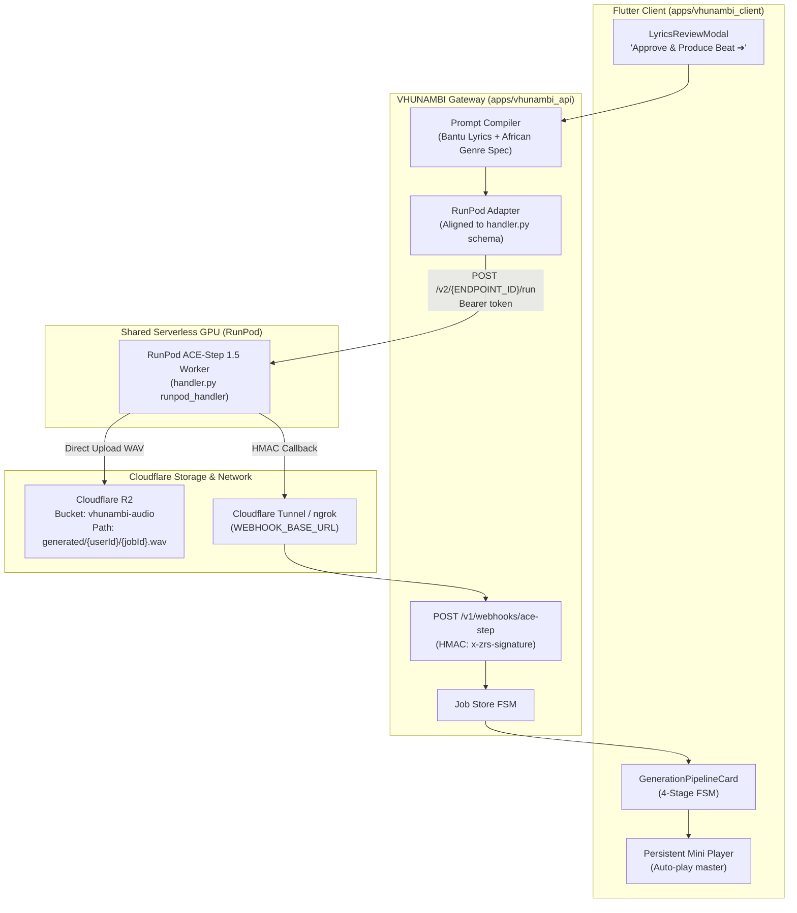

# Phase 16 Walkthrough: Live Cloud & GPU Infrastructure Integration

> **Phase:** 16  
> **Milestone:** Cloud GPU (ACE-Step 1.5) & Cloudflare R2 Integration Architecture  
> **Status:** 🟢 COMPLETE & VERIFIED  
> **Repository Root:** `c:\Users\Ndugelo\VHUNAMBI\monorepo\`  
> **Target Apps:** `apps/vhunambi_api` & `apps/vhunambi_client`  
> **Upstream Reference:** `runpod-zr-studio/handler.py` & `runpod-zr-studio/r2_uploader.py`  

---

## 1. Executive Summary & Architecture

Phase 16 promotes VHUNAMBI from a purely local simulation pipeline into a **production cloud & GPU-ready architecture** leveraging the existing, battle-tested infrastructure from the ZR Studio ecosystem.

Instead of deploying a redundant, costly GPU container, VHUNAMBI shares the existing **RunPod Serverless ACE-Step 1.5** endpoint (`ndugelo/zr-studio-gpu`). The endpoint is serverless, meaning **zero idle cost** when no music is being generated. Assets are isolated into a dedicated Cloudflare R2 bucket (`vhunambi-audio`).



---

## 2. Key Changes & Implementations

### A. RunPod Adapter Contract Alignment (`apps/vhunambi_api`)

1. **Exact Schema Match with `handler.py`**:
   - `input.job_id`: Unique identifier formatted as `vhunambi_{generationId}`.
   - `input.user_id`: Creator identity (defaults to `"vhunambi_user"`).
   - `input.song_spec`: Structured object consumed by the model:
     - `genre`: lowercase genre key (`amapiano`, `gqom`, etc.)
     - `tempo`: integer BPM
     - `mood`: genre-specific mood descriptor
     - `duration`: integer seconds
     - `lyrics`: full bracketed stanzas (`[INTRO]`, `[VERSE]`, `[CHORUS]`, etc.)
     - `language`: language code (`ve`, `zu`, `en`, etc.)
     - `title`: track title
   - `input.webhook_url`: Absolute HTTPS callback URL pointing to `/v1/webhooks/ace-step`.
   - `input.loras`: Array of LoRA adapter objects (empty for Phase 16; reserved for Bantu voice LoRAs in Phase 17).
   - **Authorization Header**: Uses standard `Authorization: Bearer <RUNPOD_API_KEY>`.
   - **Zero-Breakage Fallback**: If `RUNPOD_API_KEY` or `RUNPOD_ENDPOINT_ID` are absent, automatically routes to `mock_worker.ts` simulation without code changes.

2. **Prompt Compiler & Genre Presets Extended**:
   - Extended `CompiledSynthesisPrompt.metadata` in `prompt_compiler.ts` with `genre`, `mood`, `language`, and `title`.
   - Added `defaultMood` to all African genre presets in `constants.ts` (Amapiano, Gqom, Maskandi, Kwaito).

### B. Webhook Route & HMAC-SHA256 Verification

1. **HMAC Signature Check**:
   - GPU worker signs payload using `ZR_WEBHOOK_SECRET` and sends header `x-zrs-signature`.
   - Webhook route computes HMAC-SHA256 and rejects invalid signatures with HTTP 401.

2. **Event & Status Mapping**:
   - `status: "processing"` ➔ Updates job progress (`status: running`, `step: synthesizing`).
   - `status: "uploading"` ➔ Updates job progress (60-95% synthesis/upload).
   - `status: "completed"` ➔ Reads top-level `audio_url` from `handler.py`, marks job complete with `masterMp3Url`. Strips `vhunambi_` prefix to resolve internal `generationId`.
   - `status: "failed"` ➔ Fails job with descriptive error message.

3. **Tunnel & Environment Configuration**:
   - Added `WEBHOOK_BASE_URL` to `env.ts` and `.env.example`.
   - Emits a warning when `NODE_ENV=development` and `WEBHOOK_BASE_URL` is set to `localhost`.

### C. Flutter Client Stems Graceful Degradation (`apps/vhunambi_client`)

1. **Model Extension**:
   - Added optional `stemsUrl` and `hasStems` getter to `TrackEntity`.
   - Supported deserialization from `stems_url` or `stems_zip_url`.

2. **Pipeline Card UI**:
   - In `_ReadyTrackCard`, the "Stems" download button is conditionally rendered only when `track.hasStems` is `true`.
   - When the worker returns a single master audio track (as in ACE-Step v1.0/1.5), the UI displays "Play Master" cleanly without showing a non-functional stems download button.

---

## 3. Operational Setup Guide

### 1. Cloudflare R2 Bucket Setup
1. Log in to Cloudflare Dashboard ➔ **R2 Object Storage**.
2. Create bucket named `vhunambi-audio`.
3. Under **Settings ➔ CORS Policy**, apply:
```json
[
  {
    "AllowedOrigins": [
      "https://vhunambi.com",
      "https://www.vhunambi.com",
      "http://localhost:3000",
      "http://localhost:*"
    ],
    "AllowedMethods": ["GET", "HEAD"],
    "AllowedHeaders": ["*"],
    "ExposeHeaders": ["Content-Length", "Content-Type", "Accept-Ranges"],
    "MaxAgeSeconds": 3600
  }
]
```
4. Create an API token with **Object Read & Write** permissions for `vhunambi-audio`.

### 2. Configure `apps/vhunambi_api/.env`
```env
PORT=3000
NODE_ENV=development

# RunPod Serverless GPU (Shared from ZR Studio)
RUNPOD_API_KEY=<YOUR_RUNPOD_API_KEY>
RUNPOD_ENDPOINT_ID=<YOUR_ZR_STUDIO_RUNPOD_ENDPOINT_ID>

# Cloudflare R2 Audio Bucket
R2_ACCESS_KEY_ID=<YOUR_R2_ACCESS_KEY_ID>
R2_SECRET_ACCESS_KEY=<YOUR_R2_SECRET_ACCESS_KEY>
R2_ENDPOINT=https://<YOUR_ACCOUNT_ID>.r2.cloudflarestorage.com
R2_BUCKET=vhunambi-audio

# Shared HMAC Webhook Secret (same secret configured on RunPod container)
ZR_WEBHOOK_SECRET=<SAME_SECRET_AS_ZR_STUDIO_GPU_WORKER>

# Webhook Callback Tunnel (cloudflared / ngrok)
WEBHOOK_BASE_URL=https://<YOUR_TUNNEL_SUBDOMAIN>.trycloudflare.com
```

### 3. Exposing Webhook Tunnel during Local Development
Run in a separate terminal:
```powershell
cloudflared tunnel --url http://localhost:3000
```
Copy the generated `https://*.trycloudflare.com` URL into `WEBHOOK_BASE_URL` in `apps/vhunambi_api/.env`.

---

## 4. Verification & Testing Evidence

- **Backend Type-checking**: `pnpm run build` completed with zero TypeScript errors (`tsc` code 0).
- **Backend Test Suite**: `pnpm test` executes:
  - `test/index.test.ts` (Prompt compiler, LLM stanza formatting, Job store FSM)
  - `test/health.test.ts` (Gateway observability and active jobs)
  - `test/cloud_gpu_integration.test.ts` (RunPod `handler.py` schema compliance, HMAC-SHA256 signature gating, callback FSM, fallback simulation)
- **Client Test Suite**:
  - `TrackEntity` serialization & `hasStems` logic verified.
  - `generation_pipeline_card_test.dart` verifies graceful stems degradation and download handling.
