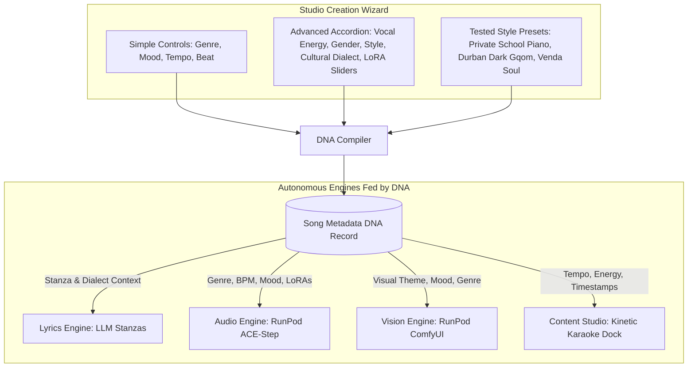
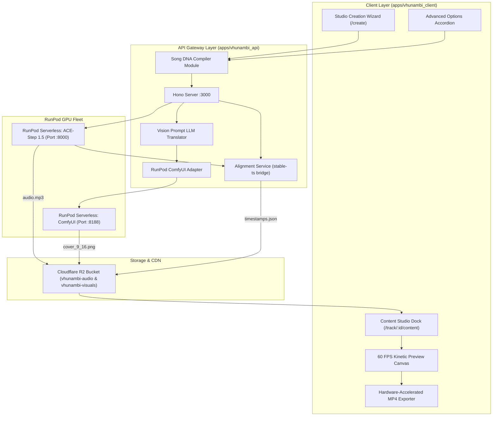

# Phase 17 · Blueprint — Song Metadata DNA & Lyric Video Content Engine

> **Phase:** 17  
> **Codename:** `song-dna-content-dock`  
> **Status:** 🟡 SPECIFICATION  
> **Repository Root:** `c:\Users\Ndugelo\VHUNAMBI\monorepo\`  
> **Target Apps:** `apps/vhunambi_client` (Flutter UI Dock) & `apps/vhunambi_api` (Vision & DNA Gateway)  
> **Architecture Standard:** Dual-Agent Pair Programming Standard ([`docs/VHUNAMBI_AGENT_WORKFLOW_STANDARD.md`](file:///c:/Users/Ndugelo/VHUNAMBI/monorepo/docs/VHUNAMBI_AGENT_WORKFLOW_STANDARD.md))  
> **Foundational References:**  
> — [`docs/comfyui-sdxl-blueprint-1.md`](file:///c:/Users/Ndugelo/VHUNAMBI/monorepo/docs/comfyui-sdxl-blueprint-1.md) (Headless ComfyUI on RunPod)  
> — [`docs/comfyui-sdxl-blueprint.md`](file:///c:/Users/Ndugelo/VHUNAMBI/monorepo/docs/comfyui-sdxl-blueprint.md) (ComfyUI JSON API State Machine)  
> — `C:\Users\Ndugelo\ZANIA-TOOLS-DEVELOPMENT\lyrical-video-tool` (Whisper `stable-ts` Forced Alignment)  

---

## 1. Executive Summary & Strategic Purpose

Phase 17 elevates **VHUNAMBI** from an audio synthesis tool into an **autonomous Social Content Engine**.

### 1.1 The Problem It Solves
Creators generating AI music currently face a fragmented workflow:
1. Generate an MP3 on an audio generator.
2. Manually generate or search for 9:16 vertical artwork.
3. Import the audio, image, and lyrics into external editors (e.g., CapCut, Premiere) to manually sync lyrics to vocals.
4. Export and post to social media.

### 1.2 The VHUNAMBI Solution: Native 3-Ingredient Content Pipeline
VHUNAMBI eliminates this friction by unifying the entire pipeline into one seamless, in-app experience:
* **Ingredient 1: Audio (MP3)** — Generated natively by Vhunambi AI via RunPod (ACE-Step 1.5).
* **Ingredient 2: Lyrics** — Generated by Vhunambi's story-to-lyrics LLM engine or supplied by the user, formatted into bracketed stanzas (`[Verse]`, `[Chorus]`).
* **Ingredient 3: Visual Cover Art** — Generated natively in 9:16 ($768 \times 1344$ or $1080 \times 1920$) via Headless ComfyUI on RunPod (FLUX.1 [schnell] or SDXL 1.0) without prompt engineering.
* **Karaoke Synchronization** — Lightweight forced alignment (`stable-ts`) produces a micro-JSON of word-level timestamps.
* **Content Studio Dock** — A dedicated Flutter micro-editor providing instant 60 FPS real-time playback, lyric typography presets, clip trimming (15s hook, 30s reel, full track), visual atmosphere effects, and direct 1080×1920 MP4 export.

### 1.3 Architectural Pivot: Lightweight Composition over Heavy Video Loops
* ❌ **Abandoned Legacy Approach:** Uploading videos, 10s boomerang loops, or running heavy AI video generation models (Sora/Runway/SVD).
* ✔ **Phase 17 Direct Approach:** Direct 2.5D composition in Flutter / client canvas. An ultra-high-resolution 9:16 artwork with subtle kinetic motion (Ken Burns zoom/pan drift), synced karaoke typography, and audio-reactive waveforms. Zero video model GPU bills; instantaneous real-time preview.

---

## 2. The "Song Metadata DNA" Architecture

Every choice a user makes in the Studio Creation Wizard—whether through simple default inputs or the Advanced Options Accordion—is compiled into an immutable **Song Metadata DNA**.



### 2.1 The Song Metadata DNA Schema (`song_metadata_dna.json`)
```typescript
interface SongMetadataDNA {
  id: string;                         // Unique UUID v4
  version: "1.0";
  title: string;                      // Track title (auto or custom)
  genre: string;                      // Canonical key: "amapiano", "gqom", "afrobeat", etc.
  language: string;                   // "tshivenda", "zulu", "xhosa", "english", etc.
  culturalContext?: {
    region: string;                   // e.g. "Limpopo, South Africa"
    idioms: string[];                 // Injected cultural proverbs / expressions
    phoneticGuidelines: string;       // Tshivenḓa / Bantu vocalization rules
  };
  musical: {
    bpm: number;                      // Exact tempo (e.g. 112)
    key: string;                      // e.g. "F# Minor"
    timeSignature: "4/4" | "3/4" | "6/8";
    energyBracket: "soft" | "mid" | "intense";
    structure: "standard" | "extended" | "freestyle";
    durationSec: number;              // Target audio length in seconds
  };
  vocals: {
    deliveryMode: "melodic" | "rap" | "spokenWord" | "choir";
    gender: "male" | "female" | "duet" | "choir";
    energy: "soft" | "mid" | "intense";
    loras: Array<{ path: string; weight: number }>;
  };
  visualTheme: {
    mood: string;                     // e.g. "Melancholic night drive"
    colorPalette: string[];           // Hex codes derived from genre
    aspectRatio: "9:16" | "1:1";      // Default 9:16 for content engine
    comfyPrompt: string;              // Auto-compiled visual prompt
    negativePrompt: string;           // Standard safety/quality filters
    seed: number;                     // Randomized seed for reproducible art
  };
  alignment?: {
    words: Array<{
      word: string;
      start: number;                  // Seconds float (e.g. 1.25)
      end: number;                    // Seconds float (e.g. 1.80)
      stanzaIndex: number;
    }>;
  };
}
```

---

## 3. High-Level System Architecture



---

## 4. ComfyUI 9:16 Headless Visual Generation Pipeline

Aligned directly with [`docs/comfyui-sdxl-blueprint-1.md`](file:///c:/Users/Ndugelo/VHUNAMBI/monorepo/docs/comfyui-sdxl-blueprint-1.md):

### 4.1 Automated Prompt Translation
The user never prompts the image model directly. `vhunambi_api` passes the song DNA to a prompt translator:
```text
System: You are an expert prompt engineer for SDXL and FLUX.1. Convert the song DNA (genre, mood, lyrics, cultural context) into a visually stunning, single-paragraph 9:16 vertical album art prompt. Output only the prompt text. No conversational fluff.
```

### 4.2 ComfyUI Node Injection Contract
* **Node `5` (`EmptyLatentImage`):** Set to `width: 768, height: 1344` (or `1080x1920` for SDXL upscale), producing native 9:16 vertical composition.
* **Node `6` (`CLIPTextEncode` - Positive):** Injects the translated visual prompt string.
* **Node `7` (`CLIPTextEncode` - Negative):** `blurry, low quality, watermark, bad anatomy, text, letters, border, frame, distorted`.
* **Node `10` (`KSampler`):** Dynamic pseudorandom `seed` generated per request.

---

## 5. UI/UX Layout & Geometries: The Content Studio Dock

The Content Studio Dock is accessible from:
1. **Studio Creation View:** Directly upon completion of generation.
2. **Track Details Cockpit (`/track/:id`):** Via a primary action button: `Create Lyric Video`.
3. **Library Vault (`/library`):** Contextual action menu on any song card.

### 5.1 Desktop Layout (> 1024px)
Split-pane cockpit: Left pane houses the live vertical video preview; Right pane houses preset pickers, duration trim scrubber, and export controls.

```
+-------------------------------------------------------------------------------------------------------+
|  <- Back to Track Details       VHUNAMBI CONTENT STUDIO DOCK                       [ Export MP4 ]     |
+-------------------------------------------------------------+-----------------------------------------+
|                                                             |  CLIP DURATION & TRIMMING               |
|  [ 9:16 VERTICAL LIVE PREVIEW DOCK (1080 x 1920 scaled) ]   |  [ 15s Hook ]  [ 30s Reel ]  [ Full ]   |
|                                                             |  Scrubber: [===|==================|===] |
|  +-------------------------------------------------------+  |  Start: 00:45.000     End: 01:15.000    |
|  |                                                       |  |-----------------------------------------|
|  |             [ 9:16 Vertical Cover Art ]               |  |  KINETIC LYRIC PRESETS                  |
|  |             (Subtle Ken Burns Zoom & Drift)           |  |  ( ) Minimal Subtitle                   |
|  |                                                       |  |  (*) Kinetic Bounce (Word Pop)          |
|  |                       "Vhubvo"                        |  |  ( ) Luminous Glow (Amapiano Glow)      |
|  |                  ★ HANGA NDI VHUTSHILO ★              |  |  ( ) Bantu Calligraphy                  |
|  |                      (Active Word)                    |  |-----------------------------------------|
|  |                                                       |  |  ATMOSPHERIC OVERLAY EFFECTS            |
|  |                                                       |  |  [x] 35mm Film Grain                 |
|  |                                                       |  |  [x] Bass-Reactive Ambient Glow      |
|  |             [ Audio Waveform Visualizer ]             |  |  [ ] Vinyl Spin Watermark               |
|  +-------------------------------------------------------+  |-----------------------------------------|
|                                                             |  COVER ART CONTROLS                     |
|  [ ▶ Play Preview ]     [ 🔁 Re-roll 9:16 Artwork ]         |  Prompt: "Johannesburg neon lights..."  |
+-------------------------------------------------------------+-----------------------------------------+
```

### 5.2 Mobile Layout (< 768px)
Single vertical scrolling stack:
1. Pinned 9:16 sticky preview window ($320 \times 568$ aspect fit).
2. Segmented control tabs: `[ Duration ]`, `[ Style ]`, `[ Effects ]`.
3. Sticky bottom action dock with `Preview` and `Export MP4`.

---

## 6. Kinetic Lyric Typography Presets

| Preset Name | Typography Style | Active Word Animation | Vibe & Genre Match |
| :--- | :--- | :--- | :--- |
| **`Kinetic Bounce`** | Bold Sans-Serif (Outfit / Syne), uppercase | 1.15x scale pop, Brand Amber highlight (`#FFB300`), subtle drop shadow | High-energy Amapiano, Gqom, Afrobeat |
| **`Luminous Glow`** | Elegant Medium Sans (Inter), Title Case | Outer radial glow (`blur: 16px`, color: `#FF8F00`), smooth fade | Soulful House, R&B, Melancholic ballads |
| **`Minimal Subtitle`** | Crisp Regular Sans, rounded dark glass badge backing | Solid white text, yellow karaoke highlight sweep | TikTok native caption aesthetic, Lofi |
| **`Bantu Calligraphy`** | High-contrast Serif / Script headline | Fluid underline draw + amber color wash | Maskandi, Traditional Gospel, Afro-Jazz |

---

## 7. Performance & Export Architecture

To maintain zero cloud video encoding costs:
1. **Interactive Preview:** Rendered purely via Flutter's `CustomPainter` / widget layer at native 60 FPS.
2. **Local Export (Desktop & Mobile):**
   - Utilizes Flutter native hardware encoding / `ffmpeg_kit_flutter` locally on the user's device.
   - Combines the 9:16 image, MP3 slice, and generated `.ass` or burned canvas frames into a pristine H.264 MP4 ($1080 \times 1920$).
   - Generation time: 4–8 seconds for a 30s reel on modern phones or laptops.
3. **Cloud Fallback Endpoint:**
   - For web clients unable to run local FFmpeg binary threads, `vhunambi_api` exposes `POST /v1/video/export`, delegating to an asynchronous worker that outputs to Cloudflare R2.
