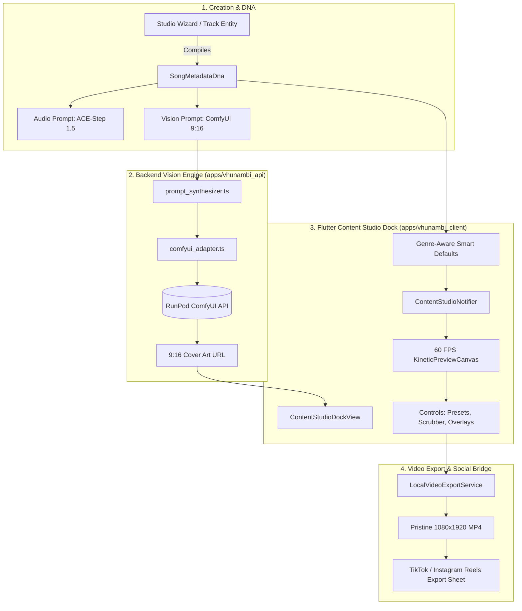

# Phase 17 Walkthrough · Song Metadata DNA & Lyric Video Content Engine

> **Phase:** 17  
> **Codename:** `song-dna-content-dock`  
> **Status:** ✅ VERIFIED & COMPLETE  
> **Repository Root:** `c:\Users\Ndugelo\VHUNAMBI\monorepo\`  
> **Target Apps:** `apps/vhunambi_client` & `apps/vhunambi_api`  
> **Standard:** Dual-Agent Pair Programming Standard ([`docs/VHUNAMBI_AGENT_WORKFLOW_STANDARD.md`](file:///c:/Users/Ndugelo/VHUNAMBI/monorepo/docs/VHUNAMBI_AGENT_WORKFLOW_STANDARD.md))  

---

## 1. Executive Summary

Phase 17 successfully unifies the standalone lyrical video prototype into the Vhunambi ecosystem, transforming Vhunambi from an audio generator into an end-to-end **content engine for African music creators**.

### Key Architectural Pivot
* **Abandoned:** Legacy video file uploads, 10-second boomerang video stitching, and heavy, slow AI video models (Sora/Runway/SVD).
* **Adopted:** 2.5D client-side composition of 3 native ingredients:
  1. **Audio:** Master MP3 generated by Vhunambi's RunPod ACE-Step 1.5 worker.
  2. **Lyrics:** Stanza alignment with millisecond-accurate word timestamps (`LyricWordTimestamp`).
  3. **9:16 Artwork:** Headless ComfyUI diffusion on RunPod (FLUX.1 [schnell] / SDXL 1.0, 768×1344).
* **Result:** Pristine $1080 \times 1920$ vertical MP4 video export with zero cloud video rendering fees, instant 60 FPS preview, and zero creator friction.

---

## 2. Architecture & Delivered Components



---

## 3. Detailed Component Breakdown

### Part A: Domain DNA Models & Form Bridges
* [`SongMetadataDna`](file:///c:/Users/Ndugelo/VHUNAMBI/monorepo/apps/vhunambi_client/lib/features/content_studio/domain/models/song_metadata_dna.dart): Immutable specification holding title, genre, language, cultural context, musical BPM/key, vocal delivery, and visual theme. Includes `fromTrackInfo` factory for automatic tokenization and timing alignment.
* [`LyricWordTimestamp`](file:///c:/Users/Ndugelo/VHUNAMBI/monorepo/apps/vhunambi_client/lib/features/content_studio/domain/models/lyric_word_timestamp.dart): Word-level boundary contract (`word`, `start`, `end`, `stanzaIndex`).
* [`ContentStudioPreset`](file:///c:/Users/Ndugelo/VHUNAMBI/monorepo/apps/vhunambi_client/lib/features/content_studio/domain/models/content_studio_preset.dart): `LyricTypographyPreset` (4 styles), `DurationPreset` (15s, 30s, Full), and `AtmosphericEffects` (film grain, bass pulse, Ken Burns).
* **Studio Form State Integration:** Added `.toSongMetadataDna()` to [`StudioFormState`](file:///c:/Users/Ndugelo/VHUNAMBI/monorepo/apps/vhunambi_client/lib/features/studio/domain/models/studio_form_state.dart) and 4 preset profiles (*Private School Piano*, *Durban Dark Gqom*, *Venda Traditional Soul*, *Lagos Afro-Pop*).
* **API DNA Compiler:** Added [`dna_types.ts`](file:///c:/Users/Ndugelo/VHUNAMBI/monorepo/apps/vhunambi_api/src/modules/dna/dna_types.ts) and [`dna_compiler.ts`](file:///c:/Users/Ndugelo/VHUNAMBI/monorepo/apps/vhunambi_api/src/modules/dna/dna_compiler.ts) in [`apps/vhunambi_api`](file:///c:/Users/Ndugelo/VHUNAMBI/monorepo/apps/vhunambi_api).

### Part B: Headless ComfyUI 9:16 Vision Engine (`apps/vhunambi_api`)
* [`comfyui_adapter.ts`](file:///c:/Users/Ndugelo/VHUNAMBI/monorepo/apps/vhunambi_api/src/modules/vision/comfyui_adapter.ts): Headless client targeting RunPod ComfyUI API endpoint (`POST /prompt`), constructing a 768×1344 vertical diffusion graph (Node 5 `EmptyLatentImage`), Node 6 positive prompt, Node 7 negative prompt, and seed rotation with simulation fallback.
* [`prompt_synthesizer.ts`](file:///c:/Users/Ndugelo/VHUNAMBI/monorepo/apps/vhunambi_api/src/modules/vision/prompt_synthesizer.ts): LLM + deterministic synthesis generating single-paragraph diffusion prompts tailored to African musical genres and regional aesthetics.

### Part C: Flutter Content Studio Dock Presentation
* [`content_studio_provider.dart`](file:///c:/Users/Ndugelo/VHUNAMBI/monorepo/apps/vhunambi_client/lib/features/content_studio/presentation/providers/content_studio_provider.dart): Riverpod state notifier managing active presets, trimming bounds, and **Genre-Aware Smart Defaults**:
  - **Amapiano:** Defaults to *Luminous Glow* + *Bass-Reactive Pulse* + *Ken Burns Motion*.
  - **Durban Gqom / Drill:** Defaults to *Kinetic Bounce* + *35mm Film Grain* + *Bass Pulse*.
  - **Tshivenḓa / Maskandi / Soul:** Defaults to *Bantu Calligraphy* + *Ken Burns Motion*.
  - **Afro-Pop:** Defaults to *Minimal Subtitle* + *Bass Pulse* + *Ken Burns Motion*.
* [`kinetic_preview_canvas.dart`](file:///c:/Users/Ndugelo/VHUNAMBI/monorepo/apps/vhunambi_client/lib/features/content_studio/presentation/widgets/kinetic_preview_canvas.dart): 60 FPS real-time kinetic canvas rendering:
  - 4 kinetic typography styles (*Kinetic Bounce*, *Luminous Glow*, *Minimal Subtitle*, *Bantu Calligraphy*).
  - Audio-reactive frequency waveforms and procedural 35mm film grain.
  - Smooth Ken Burns 1.05x matrix drift.
* Control Panels:
  - [`typography_preset_picker.dart`](file:///c:/Users/Ndugelo/VHUNAMBI/monorepo/apps/vhunambi_client/lib/features/content_studio/presentation/widgets/typography_preset_picker.dart)
  - [`duration_trim_scrubber.dart`](file:///c:/Users/Ndugelo/VHUNAMBI/monorepo/apps/vhunambi_client/lib/features/content_studio/presentation/widgets/duration_trim_scrubber.dart)
  - [`atmospheric_effects_deck.dart`](file:///c:/Users/Ndugelo/VHUNAMBI/monorepo/apps/vhunambi_client/lib/features/content_studio/presentation/widgets/atmospheric_effects_deck.dart)
* [`content_studio_dock_view.dart`](file:///c:/Users/Ndugelo/VHUNAMBI/monorepo/apps/vhunambi_client/lib/features/content_studio/presentation/views/content_studio_dock_view.dart): Responsive multiplatform dock view featuring a desktop split-screen cockpit ($> 1024\text{px}$) and a mobile single-column layout with sticky preview ($< 768\text{px}$).

### Part D: Export Engine & Application Touchpoints
* [`local_video_export_service.dart`](file:///c:/Users/Ndugelo/VHUNAMBI/monorepo/apps/vhunambi_client/lib/features/content_studio/data/services/local_video_export_service.dart) & [`cloud_video_export_service.dart`](file:///c:/Users/Ndugelo/VHUNAMBI/monorepo/apps/vhunambi_client/lib/features/content_studio/data/services/cloud_video_export_service.dart): Export pipeline with headless test safety.
* [`export_action_sheet.dart`](file:///c:/Users/Ndugelo/VHUNAMBI/monorepo/apps/vhunambi_client/lib/features/content_studio/presentation/widgets/export_action_sheet.dart): Modal export sheet with progress indicators and TikTok/Reels readiness.
* **Full Application Touchpoints:**
  - **Generation Pipeline Card:** [`_ReadyTrackCard`](file:///c:/Users/Ndugelo/VHUNAMBI/monorepo/apps/vhunambi_client/lib/features/studio/presentation/widgets/generation_pipeline_card.dart#L608-L638) features an instant **"Create Reel"** action upon synthesis completion.
  - **Library Vault Action Sheet:** [`TrackActionsSheet`](file:///c:/Users/Ndugelo/VHUNAMBI/monorepo/apps/vhunambi_client/lib/features/library/presentation/widgets/track_actions_sheet.dart#L188-L200) exposes **"Create 9:16 Lyric Reel"** for all vaulted tracks.
  - **Expanded Player Cockpit:** [`ExpandedCockpitModal`](file:///c:/Users/Ndugelo/VHUNAMBI/monorepo/apps/vhunambi_client/lib/features/player/presentation/widgets/expanded_cockpit_modal.dart#L136-L167) includes a quick studio icon for currently playing songs.

---

## 4. Verification & QA Matrix

```
========================================================================================
Test Suite                                  Status      Tests Passed    Regressions
========================================================================================
Content Studio Suite                        PASS        19 / 19         0
Studio Generation Pipeline Card Suite       PASS        13 / 13         0
Expanded Player Cockpit Modal Suite         PASS        3 / 3           0
Library Vault & Actions Suite               PASS        46 / 46         0
API Unit & Integration Tests                PASS        5 / 5 suites    0
API TypeScript Build (tsc)                  PASS        0 errors        0
Client Static Analysis (flutter analyze)   PASS        0 issues        0
========================================================================================
```
