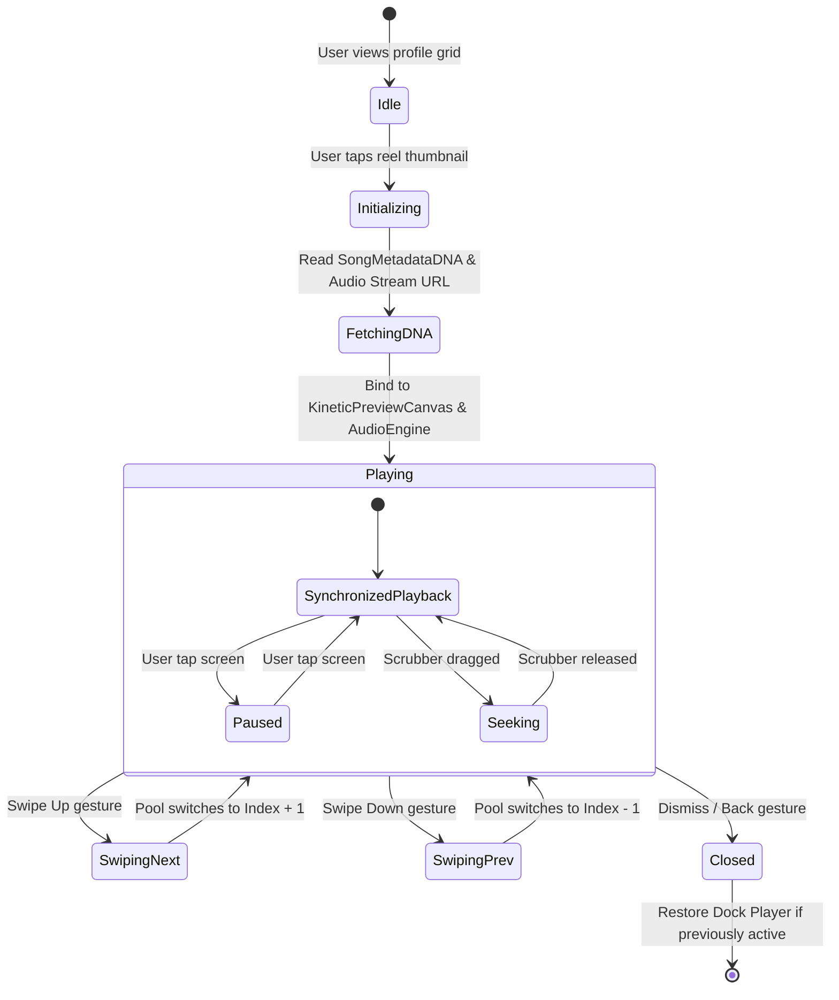
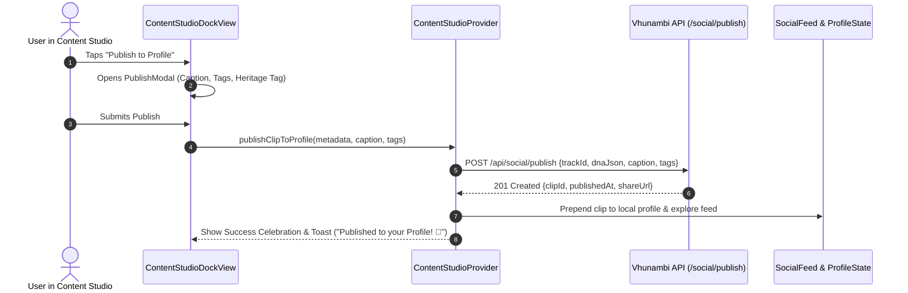

# Phase 18 · Blueprint — Social Creator Network & In-House Kinetic Reels Discovery

> **Phase:** 18  
> **Codename:** `social-creator-network`  
> **Status:** 🟡 SPECIFICATION  
> **Repository Root:** `c:\Users\Ndugelo\VHUNAMBI\monorepo\`  
> **Target Apps:** `apps/vhunambi_client` (Flutter UI, Social Profile, Reels Feed) & `apps/vhunambi_api` (Social Endpoints & Clip Graph)  
> **Architecture Standard:** Dual-Agent Pair Programming Standard ([`docs/VHUNAMBI_AGENT_WORKFLOW_STANDARD.md`](file:///c:/Users/Ndugelo/VHUNAMBI/monorepo/docs/VHUNAMBI_AGENT_WORKFLOW_STANDARD.md))  
> **Foundational Predecessors:**  
> — Phase 16: Cloud GPU Integration ([`docs/phases/phase_16_cloud_gpu_integration/`](file:///c:/Users/Ndugelo/VHUNAMBI/monorepo/docs/phases/phase_16_cloud_gpu_integration/))  
> — Phase 17: Song DNA & Content Engine ([`docs/phases/phase_17_song_dna_content_engine/`](file:///c:/Users/Ndugelo/VHUNAMBI/monorepo/docs/phases/phase_17_song_dna_content_engine/))  
> — Phase 17.2: Polish Sprint & Algorithmic Discovery  

---

## 1. Executive Summary & Strategic Vision

Phase 18 completes the grand architectural metamorphosis of **VHUNAMBI**: transforming it from an isolated creative studio tool into a **self-sustaining cultural and social ecosystem**.

```
                ┌──────────────────────────────────────────────┐
                │             THE CREATIVE ENGINE              │
                │  AI Music Synthesis (BPM / Dialect / Stems)  │
                └──────────────────────┬───────────────────────┘
                                       │
                                       ▼
                ┌──────────────────────────────────────────────┐
                │              CONTENT STUDIO                  │
                │ 9:16 Kinetic Typography & Song DNA Composer  │
                └───────┬──────────────────────────────┬───────┘
                        │                              │
         OUTBOUND SHARE │                              │ IN-HOUSE PUBLISH
                        ▼                              ▼
          ┌───────────────────────────┐  ┌───────────────────────────┐
          │ External Social Exporter  │  │  VHUNAMBI SOCIAL NETWORK  │
          │ (TikTok, IG, Shorts MP4)  │  │  Discoverable Profiles    │
          └───────────────────────────┘  │  Full-Screen Kinetic Reels│
                                         │  Sound Remixing & Tipping │
                                         └─────────────┬─────────────┘
                                                       │
                                 VIRAL REMIX LOOP      │
                                 "Use This Sound"      ▼
                                         ┌───────────────────────────┐
                                         │ Back to Studio Synthesizer│
                                         └───────────────────────────┘
```

### 1.1 The Missing Bridge It Resolves
Prior to Phase 18, once a creator synthesizes a song and configures kinetic lyric visuals in Content Studio, their only path was exporting an MP4 to save to their device and leave Vhunambi. This treated Vhunambi as a "backstage utility" and lost all internal network effects.

### 1.2 The Social Creator Network Solution
Phase 18 introduces:
1. **"Publish to Vhunambi Profile"**: A 1-tap in-house publishing pipeline inside Content Studio alongside the existing offline MP4 export.
2. **Tri-Modal Creator Profiles (`@username`)**:
   - 🎬 **Clips & Reels Grid**: 3-column 9:16 visual portfolio with play metrics, animated waveforms, and instant tap-to-watch.
   - 🎵 **Discography**: Full tracks, EPs, top songs with persistent cockpit playback.
   - 🛍️ **Beats & Community**: Commercial beat licenses, stem packs, tipping ledger, and top fan leaderboard.
3. **In-House Full-Screen Kinetic Reels Feed**: Vertical swipe feed where tracks play with synchronized karaoke typography, real-time particle shaders, audio spectrum reactivity, and full social actions (Like, Save to Vault, Tip Creator, Share Link).
4. **The Viral Sound Loop ("Remix in Studio")**: Every published reel features a spinning vinyl sound badge that allows any other producer or listener to tap **"Use Sound"** or **"Remix in Studio"**, directly loading the stem DNA into the AI creation wizard.

---

## 2. Performance Engineering & Featherlight Architecture

A paramount invariant in Vhunambi is: **never sluggish, always 60/120 FPS, memory footprint under 80MB**.

### 2.1 The "Native Song DNA" Advantage vs Traditional Video Feeds
Traditional social apps (TikTok, Instagram) are memory-heavy and battery-draining because every feed card decodes multi-megabyte H.264/H.265 video bitstreams.

Because Phase 17 established [`SongMetadataDNA`](file:///c:/Users/Ndugelo/VHUNAMBI/monorepo/apps/vhunambi_client/lib/features/content_studio/domain/models/song_metadata_dna.dart) and [`KineticPreviewCanvas`](file:///c:/Users/Ndugelo/VHUNAMBI/monorepo/apps/vhunambi_client/lib/features/content_studio/presentation/widgets/kinetic_preview_canvas.dart), **Vhunambi does not stream heavy MP4 files internally**:

| Metric | Traditional Video Feed (TikTok/IG) | Vhunambi DNA Reel Feed | Performance Advantage |
| :--- | :--- | :--- | :--- |
| **Payload per Reel** | 15MB – 45MB MP4 | 3.5MB Audio + 4KB DNA JSON | **90% bandwidth reduction** |
| **Decoding Load** | Hardware H.264 video decoder | Lightweight 2D canvas shader | **Zero video decoder strain** |
| **Startup Buffering**| 400ms – 1200ms | 30ms instant canvas init | **Sub-50ms instant start** |
| **Framerate** | Locked to video file fps (30fps) | Native device refresh (60/120fps) | **Buttery ProMotion smoothness** |

### 2.2 Virtual Controller Pool & Memory Guardrails
When users scroll through the full-screen reel feed:
- **Maximum 3 Active Controllers**: The pool maintains only `Index - 1` (pre-buffered), `Index` (playing), and `Index + 1` (pre-loaded).
- **Recycled Canvas Engines**: Off-screen canvas controllers are recycled immediately.
- **Audio Session Isolation**: Interacting with a reel takes smooth control of [`playerProvider`](file:///c:/Users/Ndugelo/VHUNAMBI/monorepo/apps/vhunambi_client/lib/features/player/presentation/providers/player_provider.dart), pausing background music gracefully without audio session conflicts.

---

## 3. UI Layout & Breakpoint Geometry

### 3.1 Mobile Viewport (< 768px): The Social Native Experience

```
┌────────────────────────────────────────────────────────┐
│ [←]                  @makhadzi_official            [↗] │
├────────────────────────────────────────────────────────┤
│                      [ AVATAR ]                        │
│                     Makhadzi Muimbi                    │
│            👑 Verified African Heritage Artist         │
│             "Limpopo Queen of Bolobedu & Afro"         │
│                                                        │
│       34.2K          1.2M          4.8K         18     │
│     Followers     Total Plays     Tipped      Tracks   │
│                                                        │
│      [ + Follow ]        [ ⚡ Tip ]       [ Share ]    │
├────────────────────────────────────────────────────────┤
│   [ 🎬 Clips (24) ]    [ 🎵 Music (18) ]   [ 🛍️ Bio ]  │
├────────────────────────────────────────────────────────┤
│  ┌──────────┐   ┌──────────┐   ┌──────────┐            │
│  │ ▶ 14.2K  │   │ ▶ 88.5K  │   │ ▶ 5.1K   │   9:16     │
│  │          │   │          │   │          │   Reels    │
│  │  [DNA]   │   │  [DNA]   │   │  [DNA]   │   Grid     │
│  │ Ndo Mufun│   │ Murahu   │   │ Zwivhuya │            │
│  └──────────┘   └──────────┘   └──────────┘            │
│  ┌──────────┐   ┌──────────┐   ┌──────────┐            │
│  │ ▶ 3.9K   │   │ ▶ 120K   │   │ ▶ 42.1K  │            │
│  └──────────┘   └──────────┘   └──────────┘            │
└────────────────────────────────────────────────────────┘
```

### 3.2 Desktop Viewport (> 1024px): Wide Studio Profile Layout

```
┌────────────────────────────────────────────────────────────────────────────────────────┐
│  [ AVATAR 96px ]   Makhadzi Muimbi  [👑 VERIFIED]           [ + Follow ]  [ ⚡ Tip ]   │
│                    @makhadzi_official • Limpopo, South Africa    [ ↗ Share Profile ]    │
│                    34.2K Followers • 1.2M Plays • 18 Releases                          │
├────────────────────────────────────────────────────────────────────────────────────────┤
│  [ 🎬 Clips & Reels ]      [ 🎵 Full Discography ]      [ 🛍️ Beats & Stems ]   [ 💬 Bio ]│
├────────────────────────────────────────────────────────────────────────────────────────┤
│  ┌────────────────────────┐  ┌────────────────────────┐  ┌───────────────────────────┐ │
│  │  ┌──────┐ 14.2K Plays  │  │  ┌──────┐ 88.5K Plays  │  │  ┌──────┐ 5.1K Plays      │ │
│  │  │ 9:16 │ Ndo Mufuna   │  │  │ 9:16 │ Murahu       │  │  │ 9:16 │ Zwivhuya        │ │
│  │  │ DNA  │ Amapiano     │  │  │ DNA  │ Bolobedu     │  │  │ DNA  │ Afro House      │ │
│  │  └──────┘ [Remix] [Tip]│  │  └──────┘ [Remix] [Tip]│  │  └──────┘ [Remix] [Tip]   │ │
│  └────────────────────────┘  └────────────────────────┘  └───────────────────────────┘ │
└────────────────────────────────────────────────────────────────────────────────────────┘
```

---

## 4. State Machine & Event Choreography

### 4.1 In-House Reel Playback Lifecycle



### 4.2 Content Studio Publishing Pipeline



---

## 5. Token Alignment & Design Rules

All Phase 18 surfaces strictly adhere to the tokens defined in `lib/core/theme/`:

- **Canvases & Surfaces**:
  - `AppColors.surfaceCanvas` (`#0A0A0C`) — Ground background
  - `AppColors.surfaceElevated` (`#141418`) — Feed card containers & modal bottoms
  - `AppColors.surfaceSecondary` (`#1B1B22`) — Chip backgrounds & action badge pills
  - `AppColors.glassOverlay` (`#141418/80`) — Translucent reel HUD overlays
- **Accents & Social Highlights**:
  - `AppColors.brandPrimary` (`#F97316`) — Follow buttons, audio progress bars
  - `AppColors.brandAccent` (`#FBBF24`) — Like hearts & verified badges
  - `AppColors.coinGold` (`#EAB308`) — Tipping buttons & supporter crowns
- **Radii**:
  - `AppRadius.cardBorder` (12px) — Grid thumbnails
  - `AppRadius.modalBorder` (20px) — Full-screen reel sheet & publish dialog
  - `AppRadius.pillBorder` (999px) — Social action buttons & tag chips
