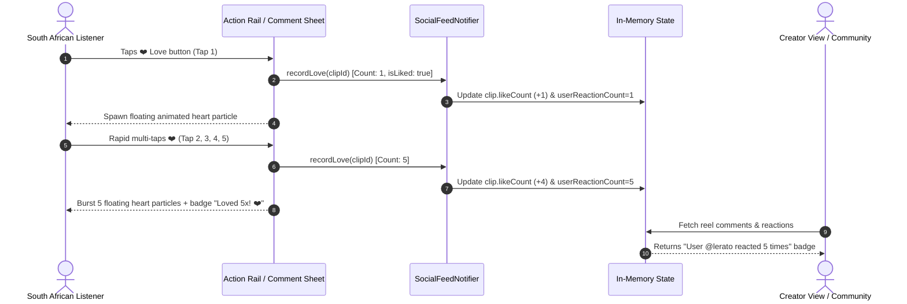

# Phase 19 · Blueprint — Trending Reels Discovery & TikTok Community Engagement

> **Phase:** 19  
> **Codename:** `trending-reels-and-social-engagement`  
> **Status:** 🟡 SPECIFICATION  
> **Target App:** `apps/vhunambi_client`  
> **Architecture Standard:** Dual-Agent Pair Programming Standard ([`docs/VHUNAMBI_AGENT_WORKFLOW_STANDARD.md`](file:///c:/Users/Ndugelo/VHUNAMBI/monorepo/docs/VHUNAMBI_AGENT_WORKFLOW_STANDARD.md))  

---

## 1. Executive Vision & Cultural Context

Vhunambi transforms from a creator studio and playback client into a bustling, honest African social music ecosystem. South African youth culture thrives on high-energy, rapid social discovery and honest community feedback — pioneered by platforms like TikTok, but grounded uniquely in South African soundscapes (#Amapiano, #Gqom, #Maskandi, #AfroHouse).

Phase 19 delivers two symbiotic experiences:
1. **The Global "Trending Reels" Discovery Hero Shelf**: Placed right at the front doorsteps of discovery in `ExploreView` and `HomeDashboardView`. Visitors encounter 9:16 kinetic preview cards filterable by African genre pills (#Amapiano, #Gqom, #Maskandi, #AfroHouse). Tapping any card launches directly into the zero-video infinite swipe feed in `KineticReelsModal`.
2. **TikTok-Style Community Comments & Multi-Tap Love Reactions Drawer**: In `KineticReelsModal`, the 💬 comment button slides up a sleek, spring-animated bottom sheet (`ReelsCommentSheet`).
   - TikTok-familiar comment list with commenter avatar, handle, verified badge, relative timestamp, and 1-tap comment-level hearts.
   - **Multi-Tap Honest Community Love Bursts**: Unlike binary switches, users can tap love repeatedly (up to 20x per session), generating floating heart particle bursts. The community and creator view prominently highlights honest engagement (e.g., *"Lerato loved 5 times ❤️"*).
   - **1-Tap African Cultural Reactions**: Instant emoji badges (🔥 Fire, 👑 Royalty, 🇿🇦 Heritage, 🎹 Log Drum, 🐐 GOAT, ❤️ Love) and quick praise chips (*"This log drum hits different!", "Makhado sunrise vibe 🌅"*).

---

## 2. Visual Layouts & Wireframes

### 2.1 Trending Reels Shelf in Explore & Home
```
+-----------------------------------------------------------------------------------+
|  TRENDING KINETIC REELS  🎬                                   View all ->        |
|  [ All ]  [ #Amapiano ]  [ #Gqom ]  [ #Maskandi ]  [ #AfroHouse ]                |
|                                                                                   |
|  +--------------+  +--------------+  +--------------+  +--------------+           |
|  | [Genre Grad] |  | [Genre Grad] |  | [Genre Grad] |  | [Genre Grad] |           |
|  |              |  |              |  |              |  |              |  ...      |
|  |  ( ) @fifi   |  |  ( ) @makhad |  |  ( ) @kabza  |  |  ( ) @djmaph | (H-Scroll)|
|  |  Makhado Sun |  |  Soweto Drum |  |  Log Drum V2 |  |  Gqom Wave   |           |
|  |  ▶ 14.2K     |  |  ▶ 28.5K     |  |  ▶ 45.1K     |  |  ▶ 9.8K      |           |
|  |  ❤️ 1.2K     |  |  ❤️ 3.4K     |  |  ❤️ 5.8K     |  |  ❤️ 820      |           |
|  +--------------+  +--------------+  +--------------+  +--------------+           |
+-----------------------------------------------------------------------------------+
```

### 2.2 TikTok-Style Reaction & Comment Drawer (`ReelsCommentSheet`)
```
+-----------------------------------------------------------------------------------+
|  === (Drag Handle) ===                                                            |
|  Comments (24)                                                          [X] Close |
|  [ Top Supporter: @lerato_piano reacted 5x ❤️ ]                                   |
|-----------------------------------------------------------------------------------|
|  (Avatar)  @kgothatso • 2h ago                                              [❤️ 14]|
|            This log drum hits directly in the soul! 🎹🔥                          |
|            Reply                                                                  |
|                                                                                   |
|  (Avatar)  @thabo_beats [Loved 5x ❤️] • 4h ago                              [❤️ 32]|
|            Tshivenḓa vocal delivery is elite here.                                |
|            Reply                                                                  |
|                                                                                   |
|  (Avatar)  @makhadzi [Creator] • 5h ago                                     [❤️ 89]|
|            Thank you guys for the love! New sound drop Friday.                     |
|            Reply                                                                  |
|-----------------------------------------------------------------------------------|
|  Quick Reactions: [ 🔥 Fire ] [ 👑 Royalty ] [ 🇿🇦 SA ] [ 🎹 Log Drum ] [ 🐐 GOAT ]|
|  Quick Praise:    [ "Hits different! 🎹" ] [ "Makhado sunrise 🌅" ]               |
|-----------------------------------------------------------------------------------|
|  [ Add a comment for @creator...                              ]  [ (^) Send ]     |
+-----------------------------------------------------------------------------------+
```

---

## 3. Responsive Geometries

| Viewport | Trending Shelf Height | Reel Card Width | Reel Card Ratio | Bottom Sheet Max Height |
|---|---|---|---|---|
| **Mobile (< 768px)** | 270px | 130px | 9:16 | 75% screen height |
| **Tablet (768px - 1024px)** | 290px | 145px | 9:16 | 65% screen height |
| **Desktop (> 1024px)** | 310px | 160px | 9:16 | 60% screen height / modal drawer |

---

## 4. Multi-Tap Love Bursts & Honest Community Engine



---

## 5. Token System Integration

All UI components strictly resolve colors, typography, border radii, and spacing from `package:vhunambi_client/core/theme/`:
- **Backdrops & Surfaces**: `AppColors.surfaceCanvas`, `AppColors.surfaceModal`, `AppColors.surfaceElevated`.
- **Accents & Reactions**: `AppColors.brandPrimary` (electric lime/gold), `AppColors.error` (TikTok-style red heart burst), `AppColors.coinGold`.
- **Radii**: `AppRadius.cardBorder` (12px), `AppRadius.pillBorder` (999px), `AppRadius.inputBorder` (10px).
- **Typography**: `AppTypography.titleMedium`, `AppTypography.bodyMedium`, `AppTypography.caption`.
