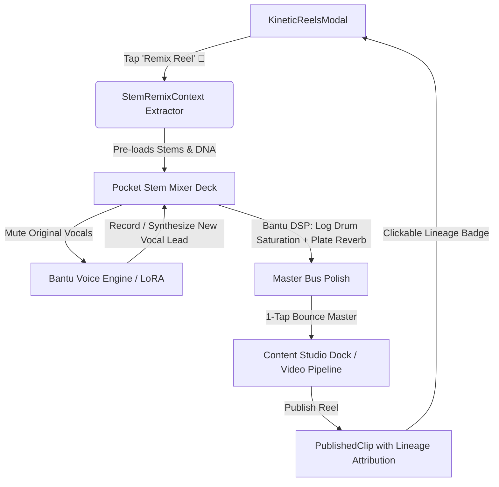

# Phase 21 · Blueprint — Audio-Stem Social Remixing & Pocket 4-Channel Stem Mixer

> **Phase:** 21  
> **Codename:** `stem-remix-and-pocket-daw`  
> **Status:** 🟡 SPECIFICATION & FOUNDATION  
> **Target Apps:** `apps/vhunambi_client`  
> **Architecture Standard:** Dual-Agent Pair Programming Standard ([`docs/VHUNAMBI_AGENT_WORKFLOW_STANDARD.md`](file:///c:/Users/Ndugelo/VHUNAMBI/monorepo/docs/VHUNAMBI_AGENT_WORKFLOW_STANDARD.md))  

---

## 1. Executive Summary & Vision

Phase 21 delivers two deeply synergistic subsystems that complete Vhunambi's audio creator journey:

1. **Track A (Social Audio Remixing & Viral Lineage)**:
   - Adds an interactive **"Remix This Reel"** action on [`KineticReelsModal`](file:///c:/Users/Ndugelo/VHUNAMBI/monorepo/apps/vhunambi_client/lib/features/social/presentation/widgets/kinetic_reels_modal.dart).
   - Extracts the 4 musical stems (Vocals, Log Drum/Bass, Drums, Melody) and initial `SongMetadataDna` context from the parent reel.
   - Allows creators to branch off existing tracks (swapping vocals with native Bantu voice timbres, replacing drum grooves, or answering with a vocal duet).
   - Establishes immutable **Lineage Attribution** (`🔁 Remixed from @makhadzi's "Makhado Sunrise"`), linking remixes back to the source reel to drive viral loops across the creator network.

2. **Track B (Pocket 4-Channel Stem Mixer & Master Bus DSP Console)**:
   - Provides a tactile, pocket mixing console for mobile and desktop creators.
   - 4 channel strips: Vocals, Log Drum / Bass, Drums, and Melodic Instruments.
   - Dedicated Mute (M), Solo (S), Gain Faders (0.0 to 1.5), and Panning (-1.0 to 1.0).
   - Bantu Master Bus DSP Suite:
     - **Amapiano Log Drum Saturation**: Low-frequency analog drive and harmonic warmth.
     - **Vocal Plate Reverb**: Ambient room spatialization tailored for African choral vocals.
     - **Sidechain Ducking**: Rhythmic compressor pumping behind heavy kicks and log drums.
     - **Stereo Width Imaging**: Expands percussion and pads while keeping sub-bass mono.
   - 1-Tap **"Bounce Master"** button that compiles the mix directly into the Content Studio for 9:16 video generation or instant social publishing.

---

## 2. User Journey & Architectural Touchpoints

---

## 3. Technology Stack & Design Token Constraints

- **Flutter / Riverpod**: Immutable StateNotifiers (`StemMixerNotifier`, `StemMixerState`).
- **Strict Design Tokens**:
  - `AppColors.brandPrimary`, `AppColors.coinGold`, `AppColors.badgeCyan`, `AppColors.streakFire`, `AppColors.surfaceElevated`.
  - Zero raw hex codes (`0xFF...`).
- **Responsive Layout**:
  - Pocket Mixer must adapt elegantly between narrow mobile viewports (< 768px, 4 compact vertical faders with horizontal scroll or auto-fit) and desktop viewports (> 1024px, studio console view).
- **Test-Timer Safety**:
  - Pure deterministic math and state transitions, zero leaking background tickers during widget testing.
