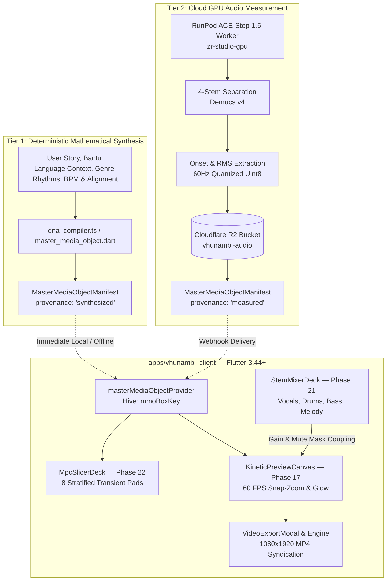

# Phase 23 · Architectural Blueprint — The Executable Master Media Object (MMO v2.0)

> **Phase:** 23  
> **Codename:** `master-media-object-v2`  
> **Target Apps:** `apps/vhunambi_api`, `apps/vhunambi_client`  
> **Standard:** Vhunambi Autonomous Engineering Standard ([`docs/VHUNAMBI_AGENT_WORKFLOW_STANDARD.md`](file:///c:/Users/Ndugelo/VHUNAMBI/monorepo/docs/VHUNAMBI_AGENT_WORKFLOW_STANDARD.md))  
> **Parent Spec:** [`docs/VHUNAMBI_MASTER_MEDIA_OBJECT_SPEC.md`](file:///c:/Users/Ndugelo/VHUNAMBI/monorepo/docs/VHUNAMBI_MASTER_MEDIA_OBJECT_SPEC.md)  
> **Date:** October 2026  

---

## 1. Executive Architectural Topology

Phase 23 transforms Vhunambi from an audio-only generator into a **Multi-Media Orchestration Platform**. It implements the **Executable Master Media Object (MMO v2.0)** using a **Hybrid Dual-Provenance Architecture**:



---

## 2. The Core Roadblock & Dual-Provenance Resolution

### The Roadblock:
Traditional audio-reactive planning assumes that a lightweight Node.js API can perform deep DSP (stem separation, transient peak slicing, zero-crossing detection, 60 Hz RMS curves) in memory without audio decoders or GPU resources. In reality, `vhunambi_api` operates on JSON/metadata, while `zr-studio-gpu` handles the raw PCM.

### The Resolution (Dual-Provenance):
Every manifest includes an explicit `provenance` field:
1. `provenance: 'synthesized'`:
   - Computed immediately from the song's musical DNA (BPM, musical key, time signature, section structure, genre rhythm rules, and phonetic alignment).
   - Generates deterministic 60 Hz quantized `Uint8` Base64 curves and an 8-pad stratified kit snapped to musical subdivision boundaries ($1/16$, $1/8$, $1/4$ notes).
   - Works **100% offline**, requires **zero new cloud GPU costs**, and executes synchronously in headless test environments.
2. `provenance: 'measured'`:
   - Emitted by the RunPod GPU worker or serverless audio processor when PCM stems are available.
   - Replaces the synthesized curves with true spectral RMS, real onset transients, and zero-crossing bounds without changing the client data contracts.

---

## 3. Visual Choreography & Live DAW Coupling Formula

### 3.1 Live Pocket DAW $\leftrightarrow$ Video Coupling:
When rendering frames in `KineticPreviewCanvas` or `VideoExportModal`, the effective modulation energy is not static; it is dynamically coupled to `stemMixerProvider` (`StemMixerState`):

$$E_{\text{effective}}(t) = \sum_{s \in \{\text{vocals}, \text{drums}, \text{bass}, \text{melody}\}} C_s[t] \cdot G_s \cdot M_s$$

Where:
- $C_s[t] \in [0.0, 1.0]$ is the stem's normalized amplitude at millisecond $t$.
- $G_s \in [0.0, 1.5]$ is the channel gain slider in `StemMixerDeck`.
- $M_s \in \{0.0, 1.0\}$ is the effective audible volume factor computed via `StemChannel.effectiveVolume(anySoloActive)`.

### 3.2 Visual State Machine by Song Section:

| Song Section (`structure.sections`) | Camera Motion Mode | Typography Shader Behavior | Atmosphere Overlay (`_AtmosphereOverlayPainter`) |
| :--- | :--- | :--- | :--- |
| **`Intro` / `Outro`** | `subtle_drift` (Ken Burns slow drift) | Standard word highlight (`AppColors.brandPrimary`) | 35mm film grain @ 35% opacity |
| **`Vocal Chant`** | `subtle_drift` + micro-sway | Ambient glow radius scales with `vocals` curve + `phoneticStress` | Floating embers (`ancestral_embers`) |
| **`Log Drum Build`** | Rising FOV zoom tension driven by `drums` + `bass` curves | High-contrast staccato scale pop on `vocal_onset` | Rapid shaker particle spawns driven by `drums` curve |
| **`The Drop`** | `logdrum_punch` (Exponential snap-zoom on `log_drum_drop` transients) | Full bloom + `AppGradients.forGenre(genre)` fill | High-velocity neon/gold burst on `log_drum_drop` |
| **`Bridge`** | Smooth orbital drift tied to `melody` stem envelope | Soft cross-fade stanza transitions | Golden dust drift (`golden_dust`) |

---

## 4. Role-Stratified 8-Pad MPC Kit Architecture

Instead of naive peak clustering (where the 8 loudest hits in Amapiano/Gqom are all kicks or log-drums), the 8 pads (`mpc_pad_0..7`) are strictly stratified across musical roles:

```
┌────────────────────────────────────────────────────────────────────────┐
│                      ROLE-STRATIFIED 8-PAD MPC KIT                     │
├────────────────────┬────────────────────┬──────────────────────────────┤
│ Pad Index          │ Musical Role       │ Source Stem & Behavior       │
├────────────────────┼────────────────────┼──────────────────────────────┤
│ PAD 0 (`mpc_pad_0`)│ Primary Kick       │ drums stem (Downbeat kick)   │
│ PAD 1 (`mpc_pad_1`)│ Percussion / Snare │ drums stem (Syncopated clap) │
│ PAD 2 (`mpc_pad_2`)│ Log Drum Attack    │ bass stem (Amapiano punch)   │
│ PAD 3 (`mpc_pad_3`)│ Sub-Bass Glide     │ bass stem (Low pitch slide)  │
│ PAD 4 (`mpc_pad_4`)│ Melodic Riff       │ melody stem (Guitar / keys)  │
│ PAD 5 (`mpc_pad_5`)│ Harmonic Stab      │ melody stem (Chords / brass) │
│ PAD 6 (`mpc_pad_6`)│ Vocal Ad-Lib Hook  │ vocals stem (Chanted phrase) │
│ PAD 7 (`mpc_pad_7`)│ Cultural Idiom     │ vocals stem (Bantu ad-lib)   │
└────────────────────┴────────────────────┴──────────────────────────────┘
```

---

## 5. Design Token & Ergonomic Invariants

1. **Zero Raw Hex Tokens:**
   - All visual elements, pad badges, and shader tints MUST consume tokens from `package:vhunambi_client/core/theme/`:
     - `AppColors.brandPrimary` (`#F97316`)
     - `AppColors.surfaceCanvas` (`#0A0A0C`)
     - `AppColors.surfaceElevated` (`#141418`)
     - `AppColors.surfaceSecondary` (`#1B1B22`)
     - `AppColors.borderSubtle` (`#2D2D38`)
     - `AppGradients.forGenre(genre)` (12 regional African genre gradients)
     - `AppRadius.cardBorder`, `AppRadius.pillBorder`, `AppRadius.thumbBorder`
2. **Apple HIG / WCAG 2.5.5 Touch Targets:**
   - All interactive controls in `StemMixerDeck`, `MpcSlicerDeck`, and `KineticPreviewCanvas` MUST enforce $\ge 44 \times 44\text{dp}$ touch targets.
3. **SDK Enum Collision Safety:**
   - Audio repeat modes MUST reference `AudioRepeatMode` (values: `off`, `all`, `one`), NEVER `RepeatMode`.
   - Playback status MUST reference `PlaybackStatus`.
4. **Responsive Helpers:**
   - Branch exclusively using `ResponsiveUtils.isMobile(context)` (< 768px) and `ResponsiveUtils.isDesktop(context)` (> 1024px).
