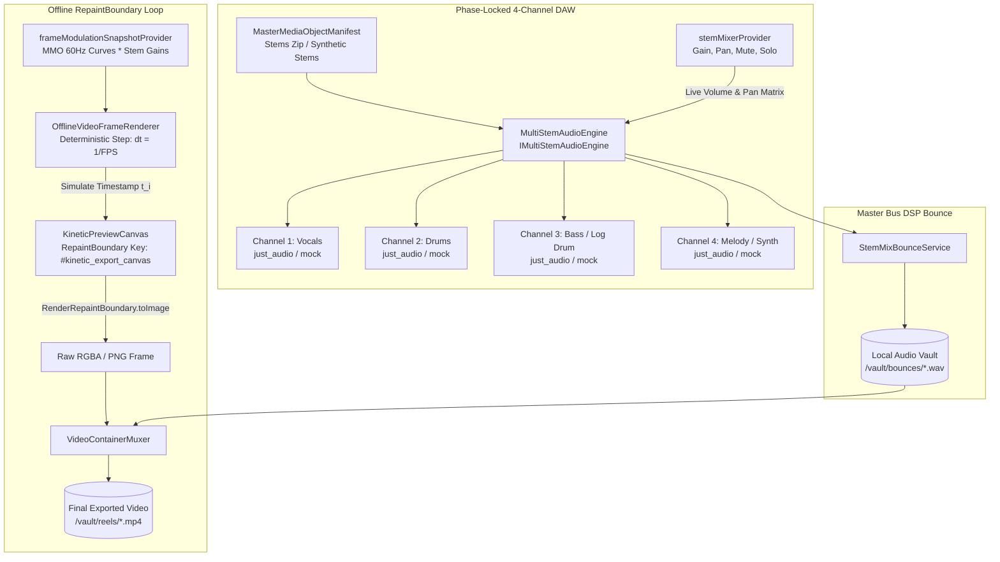
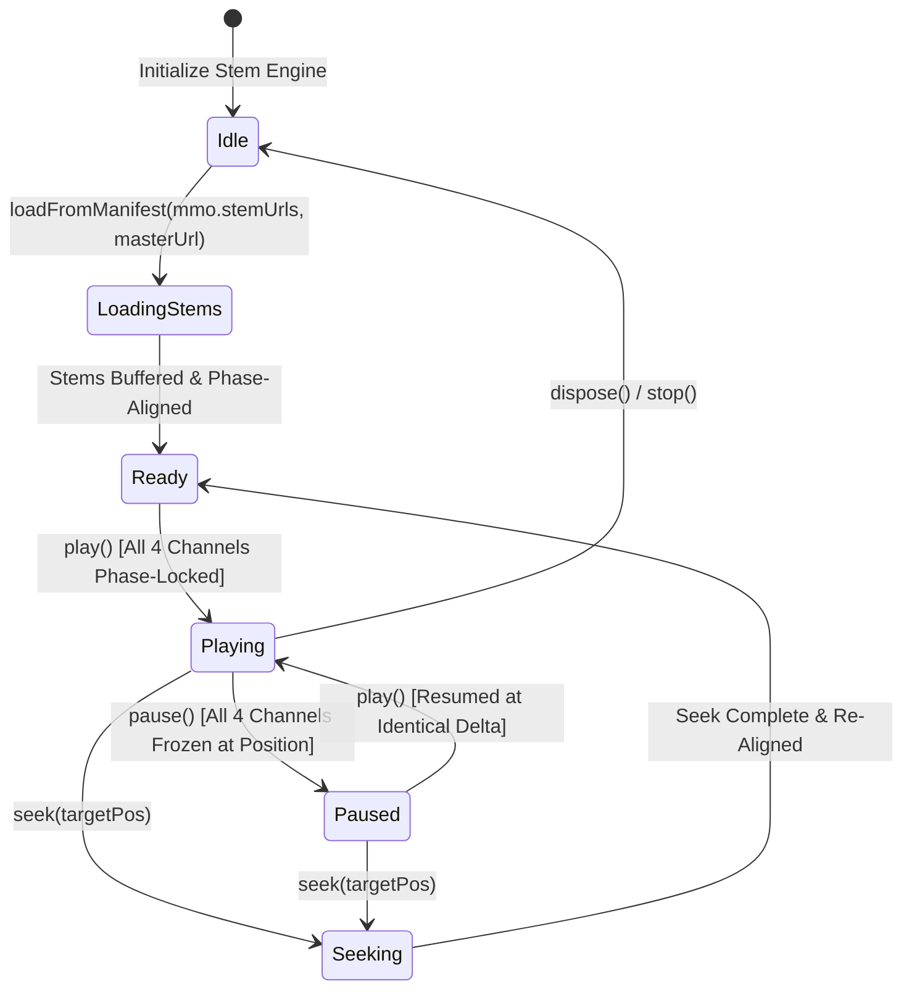
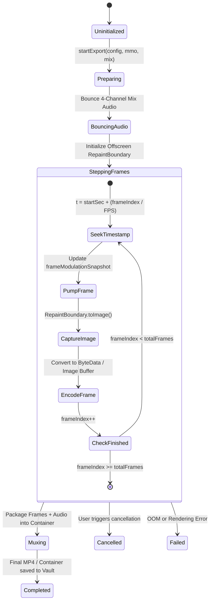

# Phase 24 · Architectural Blueprint — Multi-Stem Audio Engine & Offline Frame Renderer

> **Phase:** 24  
> **Codename:** `multi-stem-and-frame-renderer`  
> **Target Apps:** `apps/vhunambi_client`  
> **Standard:** Vhunambi Autonomous Engineering Standard ([`docs/VHUNAMBI_AGENT_WORKFLOW_STANDARD.md`](file:///c:/Users/Ndugelo/VHUNAMBI/monorepo/docs/VHUNAMBI_AGENT_WORKFLOW_STANDARD.md))  
> **Parent Specs:** [`docs/VHUNAMBI_MASTER_MEDIA_OBJECT_SPEC.md`](file:///c:/Users/Ndugelo/VHUNAMBI/monorepo/docs/VHUNAMBI_MASTER_MEDIA_OBJECT_SPEC.md), [`docs/phases/phase_23_master_media_object/blueprint.md`](file:///c:/Users/Ndugelo/VHUNAMBI/monorepo/docs/phases/phase_23_master_media_object/blueprint.md)  
> **Date:** October 2026  

---

## 1. Executive Architectural Topology

Phase 24 elevates Vhunambi from simulated audio stems and mocked export progress into an **Industrial Multi-Stem Audio Engine** and a **Deterministic Offline Frame Renderer**.



---

## 2. Executive Summary & Cultural Context

In indigenous Bantu music production (Amapiano, Gqom, Maskandi), the sonic architecture is inherently modular:
1. **The Log Drum (Bass)** provides the subterranean physical punch and syncopated heartbeat.
2. **The Shakers & Percussion (Drums)** deliver the galloping 112–115 BPM momentum.
3. **The Keys & Turnarounds (Melody)** supply nostalgic African jazz chords.
4. **The Chanted Hooks & Idioms (Vocals)** anchor spiritual, emotional, and cultural identity.

Phase 24 delivers the engineering to audition, mix, and render stems **when real stems exist**, and degrades honestly to master-only mode when they do not (the current production case):
- **Measured-Sync 4-Channel Playback (24A):** With real stems loaded, `StemMixerDeck` controls isolated channels and displays the **measured** inter-channel drift (target ≤ 40 ms, auto-resync). Without stems it shows a master-only banner and disables per-stem controls.
- **Deterministic Offline Frame Renderer (24B, blocked on encoder decision G1):** By stepping position deterministically offscreen and capturing a position-driven export canvas via `RenderRepaintBoundary.toImage(pixelRatio: 1080 / width)`, Vhunambi can render reproducible 1080×1920 frames for lyric reels. Frame **throughput is unmeasured** and must be benchmarked before any speed or duration promise is made.

---

## 3. Viewport & Layout Wireframes

### 3.1 StemMixerDeck Multi-Channel Interface (Mobile < 768px & Desktop > 1024px)

```
+-------------------------------------------------------------------------+
| [Header] Stem Mixer & Master Bus DSP             [Preset: Amapiano Club] |
+-------------------------------------------------------------------------+
| [Sync Engine Status] Measured drift: 18 ms (4/4 stems)   [Auto-resync > 40] |
+-------------------------------------------------------------------------+
|  [Channel 1: Vocals]        [Channel 2: Drums]       [Channel 3: Bass]  |
|  Level: +1.2 dB              Level: 0.0 dB            Level: +2.5 dB    |
|  [==|========] (Gain Slider) [====|======]            [=======|==]      |
|  (Pan is bounce-only; not applied live)  Pan: Center  Pan: Center      |
|  [ MUTE ] [ SOLO ]           [ MUTE ] [ SOLO ]        [ MUTE ] [ SOLO ] |
|                                                                         |
|  [Channel 4: Melody]                                                    |
|  Level: -0.8 dB                                                         |
|  [===|=======]                                                          |
|  (Master-only mode: controls disabled + "Needs Tier 2 GPU stems" banner)|
|  [ MUTE ] [ SOLO ]                                                      |
+-------------------------------------------------------------------------+
| [Master Bus DSP] Log Drum Drive: 85% | Plate Reverb: 25% | Width: 125%  |
| [Action Bar] [Reset Mix]   [Audition 4-Stems ▶]   [Preview Bounce ⤓]     |
+-------------------------------------------------------------------------+
```

### 3.2 Content Studio Offline Video Renderer Modal

```
+-------------------------------------------------------------------------+
| [Modal] Exporting Kinetic Lyric Reel (1080x1920 @ 60 FPS)               |
+-------------------------------------------------------------------------+
|  [Frame Preview]                                                        |
|  +-------------------------------------+                                |
|  | [Kinetic Canvas Frame 142/360]      |                                |
|  | "Ndi vhafunzi vha lufuno..."        | (Offscreen RepaintBoundary)    |
|  | [Log Drum Drop Snap-Zoom: 1.14x]    |                                |
|  +-------------------------------------+                                |
|                                                                         |
|  Progress: [==================>------------] 42% (Frame 151 / 360)      |
|  Elapsed: 00:04.2 | Remaining: (estimated from measured rolling avg)     |
|  Audio Sync: Master Stem Mix (WAV 44.1kHz, 16-bit)                      |
|                                                                         |
|  [ Cancel Render ]                              [ Background Export ]   |
+-------------------------------------------------------------------------+
```

---

## 4. Component Hierarchy Tree

```
lib/features/player/presentation/widgets/stem_mixer_deck.dart
├── _StemMixerHeader (Title, Genre Preset Dropdown, Engine Sync Badge)
├── _StemChannelGrid (4 Channels: Vocals, Drums, Bass, Melody)
│   └── _StemChannelStrip
│       ├── _ChannelHeader (Icon, Name, Effective Volume dB Readout)
│       ├── _TactileGainSlider (0.0 to 1.5, Touch Target >= 44px)
│       ├── _PanScrubber (-1.0 to +1.0)
│       └── _MuteSoloRow
│           ├── _MuteButton (AppColors.error / AppColors.surfaceElevated)
│           └── _SoloButton (AppColors.accentGold / AppColors.surfaceElevated)
├── _MasterBusDspSection (Log Drum Saturation, Reverb, Width sliders)
└── _MixerActionBar
    ├── _ResetMixButton
    ├── _PlayPauseStemsButton (Phase-locked 4-channel transport)
    └── _BounceMasterButton (Triggers StemMixBounceService)

lib/features/social/presentation/widgets/video_export_modal.dart   (24B)
├── _ExportConfigHeader (Resolution 9:16 / 1:1, FPS 30 / 60)
├── _OffscreenRenderStage (RepaintBoundary keyed by a GlobalKey `exportBoundaryKey`)
│   └── KineticPreviewCanvas (Rendered at exact target aspect ratio)
├── _RenderProgressIndicator (Linear progress, frame counter, ETA)
└── _ExportActionControls (Cancel, Save to Vault, Share to Reels)
```

---

## 5. State Machine & Lifecycle Models

### 5.1 Multi-Stem Playback Synchrony State Machine



### 5.2 Deterministic Video Frame Rendering State Machine



---

## 6. Design Token Bindings

> Colors, gradients and spacing MUST resolve through the real tokens below. Hex values are intentionally **not** listed (they drift and violate the zero-raw-hex rule); read `app_colors.dart`.

| UI Element | Property | Token Binding |
| :--- | :--- | :--- |
| **Stem Deck Background** | Fill | `AppColors.surfaceCanvas` |
| **Channel Strip Card** | Surface | `AppColors.surfaceElevated` |
| **Channel Strip Border** | Stroke | `AppColors.borderSubtle` |
| **Channel Gain Slider** | Active Color | `AppColors.brandPrimary` |
| **Solo Active Button** | Background | `AppColors.accentGold` |
| **Mute Active Button** | Background | `AppColors.error` |
| **Measured-Sync Badge** | Text / Dot | `AppColors.success` (drift ≤ 40 ms), `AppColors.accentGold` (resyncing) |
| **Export Progress Bar** | Gradient | an existing `AppGradients` entry (verify in `app_colors.dart`; add one in a dedicated task if none fits) |
| **Interactive Buttons** | Touch Bounds | literal 44 dp via `kMinInteractiveDimension` / `BoxConstraints(minWidth: 44, minHeight: 44)` (no `AppSpacing.touchTarget` exists) |
| **Card Radii** | Corner Radius | `AppRadius.card` |

---

## 7. Dock & Safe-Area Integration

- **Top Navigation Bar:** Integrated with `VhunambiTopBarMetrics.totalHeight(context)`.
- **Bottom Dock:** Content padding respects `VhunambiBottomDockMetrics.scrollInset(context)`.
- **Render Stage Isolation:** The offscreen `RepaintBoundary` is rendered in an isolated widget tree (`Offstage` or headless pump) so screen resolution and physical device pixel ratios do not introduce scaling distortion into the 1080×1920 output.
