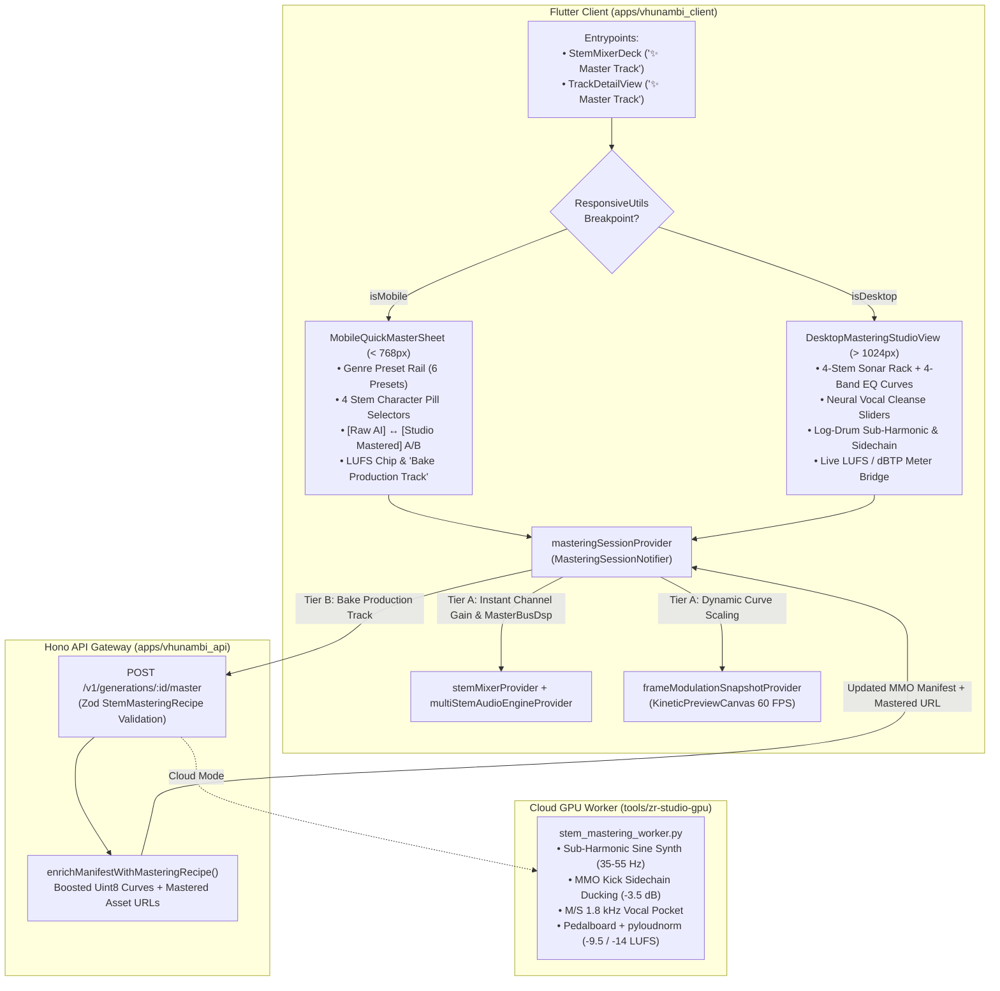
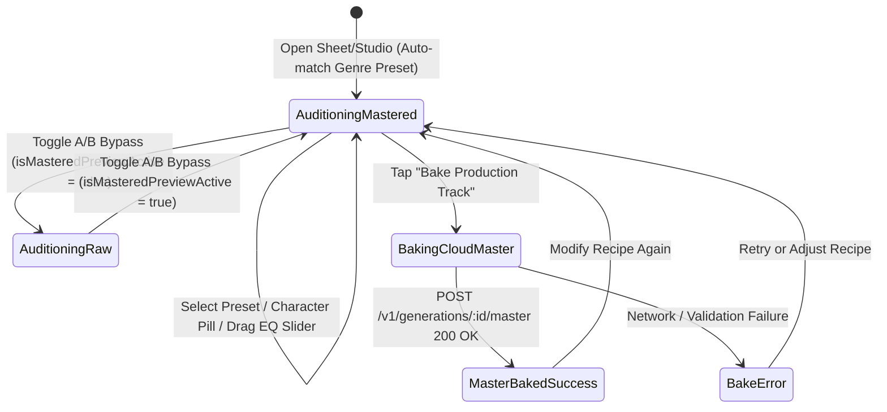

# Phase 25 Blueprint: Stem Polisher, Adobe-Style Vocal Cleanse & Mobile/Desktop Mastering Suite

> **Phase:** 25 (`phase_25_stem_mastering_suite`)  
> **Codename:** `BANTU_SONAR_MASTERING_V4`  
> **Status:** `✅ COMPLETE`  
> **Target Workspaces:** `apps/vhunambi_client`, `apps/vhunambi_api`, `tools/zr-studio-gpu`  
> **Predecessor Blueprints:**
> - [`docs/VHUNAMBI_V4_STUDIO_EVOLUTION_BLUEPRINT.md`](file:///c:/Users/Ndugelo/VHUNAMBI/monorepo/docs/VHUNAMBI_V4_STUDIO_EVOLUTION_BLUEPRINT.md)
> - [`docs/phases/phase_21_stem_remix_and_pocket_daw/blueprint.md`](file:///c:/Users/Ndugelo/VHUNAMBI/monorepo/docs/phases/phase_21_stem_remix_and_pocket_daw/blueprint.md)
> - [`docs/phases/phase_23_master_media_object/blueprint.md`](file:///c:/Users/Ndugelo/VHUNAMBI/monorepo/docs/phases/phase_23_master_media_object/blueprint.md)
> - [`docs/phases/phase_24_multi_stem_and_frame_renderer/blueprint.md`](file:///c:/Users/Ndugelo/VHUNAMBI/monorepo/docs/phases/phase_24_multi_stem_and_frame_renderer/blueprint.md)

---

## 1. Executive Summary & Cultural Grounding

Raw latent diffusion music models (including ACE-Step 1.5) suffer from **"The AI Sheen"**—metallic high-frequency phase swirl on vocals, boxy low-mids on percussion, and hollow sub-bass where an Amapiano log drum lacks physical sub-octave weight and clashes with the kick drum.

**Phase 25** introduces a **Two-Tier Non-Destructive Stem Mastering Pipeline** inspired by Cakewalk/Sonar stem bus mastering and Adobe Podcast neural speech enhancement:
1. **Tier A (0 ms Client Audition Preview):** Real-time coupling between `masteringSessionProvider`, `stemMixerProvider` (Phase 21), `multiStemAudioEngineProvider` (Phase 24A), and `frameModulationSnapshotProvider` (Phase 23). Users hear and see the mastered difference immediately—including an **Honest Master-Only Fallback** (`IMultiStemAudioEngine.hasRealStems == false`) that applies Master Bus DSP and visual modulation while informing the creator that full 4-stem isolation engages upon Cloud Studio Bake.
2. **Tier B (Lossless Cloud Studio Bake):** `POST /v1/generations/:id/master` dispatches `StemMasteringRecipe` to the RunPod worker (`tools/zr-studio-gpu/stem_mastering_worker.py`) or deterministic local simulation, running neural vocal de-noising/de-reverberation, phase-locked $35\text{–}55\text{ Hz}$ log-drum sub-harmonic synthesis, MMO kick-triggered sidechain ducking, Mid/Side $1.8\text{ kHz}$ vocal pocket carving, and `-9.5 LUFS` (Club/TikTok) or `-14.0 LUFS` (Streaming) True-Peak limiting.

---

## 2. System Topology & Data Flow Diagram



---

## 3. Viewport & Layout Wireframes

### 3.1 Mobile Quick Master Bottom Sheet (`MobileQuickMasterSheet` — `< 768px`)

```
┌──────────────────────────────────────────────────────────┐
│                        ─── (Drag Handle)                 │
│ ✨ Master Track              [Raw AI | Studio Mastered]  │
│ Auto-matched to genre · Non-destructive stem polish      │
├──────────────────────────────────────────────────────────┤
│ ℹ️ [Honest Master-Only Notice if hasRealStems == false]  │
│ "Full stem isolation engages upon Cloud Studio Bake"     │
├──────────────────────────────────────────────────────────┤
│ GENRE MASTER PRESET                                      │
│ (● Amapiano Club Knock) (○ Private School) (○ Gqom Sub) →│
├──────────────────────────────────────────────────────────┤
│ 1. VOCALS (ADOBE NEURAL CLEANSE)                         │
│ [🎙️ Studio Clean] [🔥 Warm Soul] [🌊 Wide Anthem] [Off] │
│                                                          │
│ 2. LOG DRUM & SUB-BASS                                   │
│ [🪵 Heavy Wooden Knock] [🔊 Deep Sub-808] [☁️ Smooth]    │
│                                                          │
│ 3. DRUMS & PERCUSSION                                    │
│ [⚡ Crisp Shakers] [🥁 Club Punch] [📻 Vintage Warm]     │
│                                                          │
│ 4. MELODY & HARMONY                                      │
│ [✨ Wide Stereo Pocket] [🎹 Warm Rhodes] [🎸 Bright]     │
├──────────────────────────────────────────────────────────┤
│ TARGET LOUDNESS       [-9.5 LUFS Club] [-14.0 Streaming] │
│ [ ✨ Bake Production Track (-9.5 LUFS)                 ] │
└──────────────────────────────────────────────────────────┘
```

### 3.2 Desktop Mastering Studio Workstation (`DesktopMasteringStudioView` — `> 1024px`)

```
┌────────────────────────────────────────────────────────────────────────────────────────┐
│ 🎚️ VHUNAMBI SONAR MASTERING STUDIO   [Preset: Amapiano Club Knock ▼]  [A/B: MASTERED] │
│                                      [Target: -9.5 LUFS Club] [✨ Bake Master + Stems]│
├──────────────────┬──────────────────┬──────────────────┬──────────────────┬────────────┤
│ 🎤 1. VOCALS     │ 🎹 2. LOG DRUM   │ 🥁 3. DRUMS      │ 🎸 4. MELODIC    │ 📊 MASTER  │
│ [Studio Clean ▼] │ [Wooden Knock ▼] │ [Crisp Shaker ▼] │ [Wide Pocket ▼]  │ BUS METERS │
│ ┌──────────────┐ │ ┌──────────────┐ │ ┌──────────────┐ │ ┌──────────────┐ │            │
│ │ 4-Band EQ    │ │ │ 4-Band EQ    │ │ │ 4-Band EQ    │ │ │ 4-Band EQ    │ │ Integrated │
│ │ Curve Graph  │ │ │ Curve Graph  │ │ │ Curve Graph  │ │ │ Curve Graph  │ │ -9.5 LUFS  │
│ └──────────────┘ │ └──────────────┘ │ └──────────────┘ │ └──────────────┘ │ ████████░░ │
│ HPF: 95 Hz       │ HPF: 30 Hz       │ HPF: 45 Hz       │ HPF: 110 Hz      │            │
│ Low: +0.5 dB     │ Low: +3.5 dB     │ Low: +1.0 dB     │ Low: -1.5 dB     │ True Peak  │
│ Mid: +1.5 dB     │ Mid: +3.0 dB     │ Mid: -2.5 dB     │ Mid: -2.5 dB     │ -1.0 dBTP  │
│ Air: +3.5 dB     │ Air: +1.0 dB     │ Air: +2.5 dB     │ Air: +2.0 dB     │ █████████░ │
│ ──────────────── │ ──────────────── │ ──────────────── │ ──────────────── │            │
│ NEURAL CLEANSE   │ LOG-DRUM EXCITER │ TRANSIENT & BUS  │ M/S STEREO FIELD │ Kick-Bass  │
│ De-Noise:  85%   │ Sub-Octave: 55%  │ Attack Snap:+45% │ 1.8kHz Cut:-2.5dB│ Sidechain  │
│ De-Reverb: 65%   │ Knock Drive:4.5dB│ NY Crush:    30% │ Side Width: +35% │ Active ⚡  │
│ FET Comp:  60%   │ Kick Duck: -3.5dB│                  │                  │            │
└──────────────────┴──────────────────┴──────────────────┴──────────────────┴────────────┘
```

---

## 4. State Machine & Lifecycle Model



---

## 5. Design Token Bindings Table

| Surface / Element | Token Binding |
| :--- | :--- |
| Sheet / Workstation Canvas | `AppColors.surfaceCanvas` / `AppColors.surfaceModal` |
| Stem Rack Card / Container | `AppColors.surfaceElevated` with `AppColors.borderSubtle` |
| Active Preset / Character Pill | `AppColors.brandPrimary` fill + `AppColors.brandContrast` label |
| Inactive Character Pill | `AppColors.surfaceSecondary` fill + `AppColors.textSecondary` label |
| Honest Master-Only Notice Banner | `AppColors.surfaceSecondary` + `AppColors.accentGold` icon & border |
| A/B Active ("Studio Mastered") | `AppColors.success` indicator + `AppColors.brandPrimary` badge |
| EQ Curve Line & Fill | `AppColors.brandPrimary` stroke (`2.0px`) + `AppColors.amberGlow` fill |
| Primary Bake CTA Button | `AppColors.brandPrimary` background + `AppColors.brandContrast` text + `AppRadius.pillBorder` |
| Touch Target Compliance | Minimum `44×44dp` (`BoxConstraints(minHeight: 44, minWidth: 44)`) |

