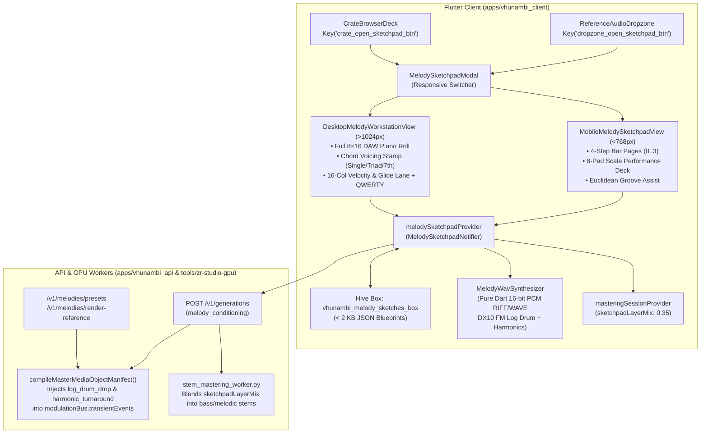

# Phase 27 Design: Device-Adaptive In-Key Melody, Chord & Log-Drum Pattern Sketchpad

> **Phase:** 27 (`phase_27_melody_logdrum_sketchpad`)  
> **Architecture:** Local-First Hive Blueprint Vault + Ephemeral In-Memory FM/Harmonic WAV Synthesizer + Mobile/Desktop Adaptive Sequencer + MMO/Mastering Synergy

---

## 1. End-to-End Architecture Diagram

---

## 2. Scale-Locked Pitch Math (`resolveScaleFrequencyHz`)

Let the MIDI note of root key $K \in \{\text{C}, \text{C}\#, \dots, \text{B}\}$ in octave $O$ be $m_{\text{root}}$ (where $\text{C}_2 = 36$ for `amapiano_log_drum` and $\text{C}_4 = 60$ for melodic instruments). Given scale mode $M$ with 8 semitone offsets $S_M = [s_0, s_1, \dots, s_7]$ and row index $r \in \{0 \dots 7\}$:

$$m(r) = m_{\text{root}} + S_M[r], \qquad f_0(r) = 440.0 \times 2^{\frac{m(r) - 69}{12}}$$

---

## 3. Pure-Dart DX10-Style FM Log-Drum & African Instrument Synthesis

`MelodyWavSynthesizer.synthesizePatternToWavBytes` generates a 16-bit mono PCM buffer at $f_s = 22050\text{ Hz}$ (or $11025\text{ Hz}$ fast preview mode) with a standard 44-byte `RIFF/WAVE` header:

1. **`amapianoLogDrum`:**
   - Instantaneous pitch with `14ms` wooden mallet strike and optional $-5\text{ semitone}$ glide:
     $$f_{\text{glide}}(\tau) = \begin{cases} f_0, & \text{if } \neg\text{hasGlide} \lor \tau < 0.35 \\ f_0 \cdot 2^{-5 \cdot (\frac{\tau - 0.35}{0.65}) / 12}, & \text{if } \text{hasGlide} \land \tau \ge 0.35 \end{cases}$$
     $$f_{\text{inst}}(t) = f_{\text{glide}}(t/T_{\text{note}}) \cdot \left(1 + 2.2 e^{-t / 0.014}\right)$$
   - 2-Operator FM hollow knock + sub-octave sine:
     $$y(t) = e^{-t / 0.18} \sin\left(\phi(t) + 1.8 e^{-t / 0.028} \sin(2\pi \cdot 2.41 f_0 t)\right) + 0.55 e^{-t / 0.26} \sin(0.5 \phi(t))$$
2. **`privateSchoolRhodes`:**
   - Voices root $f_0$, scale 3rd ($1.1892 f_0$), and scale 5th ($1.4983 f_0$) with a $7 f_0$ bell transient.
3. **`maskandiGuitar` & `vendaMbira`:**
   - 5-harmonic plucked string series with metallic tine overtone ($2.756 f_0$) for Mbira.

