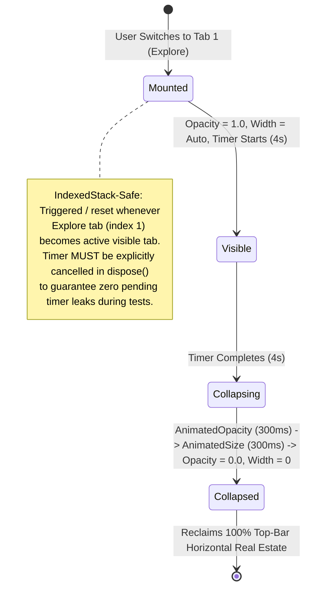
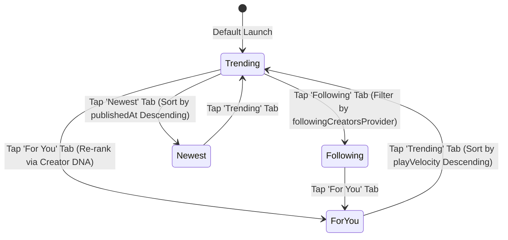

# Blueprint 29: V4.1 Social Explore Redesign (`/explore`)
## TikTok Search & Reel Tabs + Facebook Stories Rail, Compact Discovery Drawer & Creator Music Feed

> **Phase:** 29 — V4.1 Social Explore Redesign  
> **Target Apps:** `apps/vhunambi_client`, `apps/vhunambi_api`  
> **Route Path:** `/explore` (Tab Index 1 of `RootShell`)  
> **Status:** 🟡 SPECIFICATION (Drafted per `VHUNAMBI_AGENT_WORKFLOW_STANDARD.md`)  
> **Predecessor Blueprints:** `01_EXPLORE_PAGE_SPEC.md`, `18_SOCIAL_CREATOR_NETWORK.md`, `19_TRENDING_REELS.md`, `28_MARKETPLACE_VAULT_ECONOMY.md`  
> **Audit References:** `docs/audits/EXPLORE_PAGE_COMPREHENSIVE_AUDIT.md`, `docs/audits/KINETIC_REELS_SOCIAL_ARCHITECTURAL_AUDIT.md`  
> **Visual Reference Captures:** `SVID_20261031_100759_1.mp4` (Vhunambi Explore Baseline), `SVID_20261031_100931_1.mp4` (TikTok Discovery & Full-Screen Filter Tabs), `SVID_20261031_103452_1.mp4` (Facebook Stories & Compact Shortcuts Drawer)

---

## 1. Executive Summary & Cultural Vision

The **Vhunambi Explore Page** is the central public square—the TikTok and Instagram of African AI music. In its legacy implementation, `/explore` suffered from an **identity crisis**, awkwardly concatenating 10 disconnected vertical slices (disembodied avatar cards, full-width charts banners, an always-open search bar, and endless static lists) that consumed 60% of the mobile viewport before showing any playable media, while triggering an annoying soft-keyboard popup bug upon returning from reels.

**Phase 29 completely transforms `/explore` into a living, high-velocity Social Music Network** by synthesizing the proven UX paradigms of **TikTok** (dedicated search view, in-reel top filter tabs) and **Facebook** (Stories rail with "+ Post Reel" as Card #0, compact shortcuts discovery drawer, and natural creator music feed):

1. **Minimalist 56dp Top Bar & Transient 4-Second "Explore" Title**:
   - Replaces the permanently expanded inline search bar with a sleek `🔍` icon button.
   - Replaces the giant static `"Explore / Discover AI music..."` text block with a sleek, transient 4-second title pill (`AnimatedOpacity` + `AnimatedSize`) that gently fades away after tab switch, giving 100% of vertical focus back to creator content.
   - Provides 1-step direct routing on mobile: tapping `🔍` opens a dedicated full-screen `ExploreSearchView`; tapping `🔔` opens `NotificationsView` directly (no desktop hover popover).
   - Tapping `🧭` (or `Icons.grid_view_rounded`) opens the Facebook-style compact `ExploreDiscoveryDrawerSheet`.

2. **Facebook Stories-Style Kinetic Reels Rail with Card #0 `[ ➕ Post Reel ]`**:
   - The very first card on the far left of the horizontal reels rail is the user's personal `[ ➕ Post Kinetic Reel ]` card. Tapping it lets the user select any track from their library vault to publish a 9:16 kinetic reel straight to the community.
   - Removes redundant multi-line headers above the rail in favor of sleek, compact horizontal genre pills.

3. **TikTok-Style Filter Tabs Inside `KineticReelsModal`**:
   - When entering full-screen reels, the top bar presents interactive, translucent filter tabs: `[ Trending | For You | Following | Newest ]` and a `🔍` search trigger.
   - Users can pivot their full-screen 60 FPS lyric stream without ever exiting back to the feed.
   - Tapping any creator's handle or avatar routes directly to their `ArtistProfileView`.

4. **Unified Creator Music Feed (`ExploreSocialPostCard`) & Compact Discovery Drawer**:
   - The endless scroller becomes an engaging social feed. Creators are discovered naturally through rich posts containing their story/context, interactive playable waveform MP3 cards, and social engagement buttons (`❤️ Like`, `💬 Comment`, `🔁 Remix in Studio`, `💸 Tip`, `↗️ Share`).
   - MP3 utility modules (African Charts, 12-Genre Radio, Rising MP3s, Listening Streak) are neatly tucked into the compact `ExploreDiscoveryDrawerSheet`, while being tastefully interleaved into the social feed every 5th slot (4 social posts followed by 1 compact horizontal carousel with zero skipped posts).

---

## 2. System Topology & Data Flow

```mermaid
flowchart TD
    User([Creator / Listener]) --> TopBar[ExploreTopBar: 56dp]
    
    %% Top Bar Actions
    TopBar -->|Tap 🔍| SearchView[ExploreSearchView: Full-Screen Dedicated Search]
    TopBar -->|Tap 🔔 on Mobile| NotifCenter[NotificationsView: Full-Screen 1-Step]
    TopBar -->|Tap 🧭| Drawer[ExploreDiscoveryDrawerSheet: Charts, Radio, Rising, DNA]
    TopBar -->|Auto 4s Timer| FadePill[Transient 'Explore' Title Pill -> Fades to 0 Height]

    %% Main Feed
    ExploreView[ExploreView: CustomScrollView] --> Rail[Kinetic Reels Rail: Facebook Stories Style]
    Rail -->|Card #0: ➕ Post Reel| PostSheet[Quick Library Track Selector -> PublishClipModal]
    Rail -->|Card #1..N: Reel Tap| ReelModal[KineticReelsModal: Full-Screen 60 FPS]
    
    %% Reel Modal Tabs
    ReelModal --> ReelTabs[TikTok Top Tabs: Trending | For You | Following | Newest]
    ReelModal -->|Tap @handle / avatar| CreatorProfile[ArtistProfileView: /profile/:id]
    
    %% Social Posts Feed
    ExploreView --> SocialFeed[Unified Social Music Feed: ExploreSocialPostCard]
    SocialFeed --> Waveform[Interactive Waveform Scrubber + Play/Pause -> playerStateProvider]
    SocialFeed --> PostActions[❤️ Like | 💬 Comment Modal | 🔁 Remix in Studio | 💸 Tip Sheet]
    SocialFeed -->|Every 4th Item| Interleaved[Interleaved Carousels: 12-Genre Radio / Rising MP3s / Charts]
    
    %% State Layer
    SearchView <--> HiveRecent[Hive Box: Recent Searches]
    SocialFeed <--> SocialRepo[HttpSocialRepository / In-Memory Mock Fallback]
    ReelModal <--> ReelPool[ReelAudioPoolService: 3-Player LRU + Ducking]
```

---

## 3. Viewport & Layout Wireframes

### 3.1 Mobile Viewport (< 768px)

```
┌────────────────────────────────────────────────────────────────────────┐
│ [🎵] [Explore (fades in 4s)]                 [🧭 Drawer] [🔍] [🔔 (2)] │  56dp Top Bar
├────────────────────────────────────────────────────────────────────────┤
│ KINETIC REELS (Stories Rail)                                           │
│ ┌──────────────┐ ┌──────────────┐ ┌──────────────┐ ┌──────────────┐    │
│ │      ➕      │ │ 🎬 @makhadzi │ │ 🎬 @fifi     │ │ 🎬 @ndugelo  │    │  156dp Height
│ │  Post Reel   │ │  Ndo Mufuna  │ │ Sunset Gold  │ │  Venda Chant │    │  9:16 Ratio
│ │ (Your Track) │ │ ▶ 24.5K      │ │ ▶ 15.2K      │ │ ▶ 19.1K      │    │
│ └──────────────┘ └──────────────┘ └──────────────┘ └──────────────┘    │
├────────────────────────────────────────────────────────────────────────┤
│ [ For You ]  [ Following ]  [ All Songs ]  [ 🧭 Discovery Drawer ]     │  44dp Switcher
├────────────────────────────────────────────────────────────────────────┤
│ UNIFIED CREATOR MUSIC FEED                                             │
│ ┌────────────────────────────────────────────────────────────────────┐ │
│ │ (M) Makhadzi ✔️ · 2h ago · Polokwane          [ + Follow ]  [ ⋮ ]  │ │
│ │ "Late night studio session testing the Venda Folk LoRA & bass 🔥"   │ │
│ │ ┌────────────────────────────────────────────────────────────────┐ │ │
│ │ │ [Cover Art]  Ndo Mufuna Matibe                 [ ▶️ Play MP3 ] │ │ │
│ │ │ 48x48        113 BPM • Am • Amapiano • Tshivenḓa               │ │ │
│ │ │              ▂▄▆█▄▂▅▇█▆▃▂▄▆█ (Waveform Visualizer)             │ │ │
│ │ └────────────────────────────────────────────────────────────────┘ │ │
│ │  ❤️ 1.8K    💬 96 Comments    🔁 Remix in Studio    💸 Tip    ↗️   │ │
│ └────────────────────────────────────────────────────────────────────┘ │
│                                                                        │
│ ┌────────────────────────────────────────────────────────────────────┐ │
│ │ 📻 12-Genre Radio Stations (Interleaved Discovery Carousel)        │ │
│ │ [ Amapiano ((•)) ]  [ Gqom ((•)) ]  [ Maskandi ((•)) ]  [ Kwaito ] │ │
│ └────────────────────────────────────────────────────────────────────┘ │
│                                                                        │
│ ┌────────────────────────────────────────────────────────────────────┐ │
│ │ (F) Fifi · 5h ago · Soweto                    [ Following ] [ ⋮ ]  │ │
│ │ "Dropping stems for my new single! Remix it in Studio!"            │ │
│ └────────────────────────────────────────────────────────────────────┘ │
└────────────────────────────────────────────────────────────────────────┘
```

### 3.2 TikTok-Style Full-Screen `KineticReelsModal` Wireframe

```
┌────────────────────────────────────────────────────────────────────────┐
│ [ ← ]     Trending  ·  For You  ·  Following  ·  Newest     [ 🔍 Search]│ Translucent Top Bar
├────────────────────────────────────────────────────────────────────────┤
│                                                                        │
│                        60 FPS KINETIC LYRICS                           │
│                      "Ndo mufuna matibe nga maanda"                    │
│                                                                        │
│                                                              [ ❤️ 24K ]│
│                                                              [ 💬 1.2K]│
│                                                              [ 🔁 Remix]
│                                                              [ 💸 Tip ]│
│                                                              [ ↗️ Share]│
│                                                                        │
│ (M) @makhadzi ✔️ [ Follow ]                                            │
│ Ndo Mufuna Matibe · Amapiano • 113 BPM • F#m                           │
│ 🎵 Original Sound - Makhadzi ft. DJ Maphorisa                          │
└────────────────────────────────────────────────────────────────────────┘
```

---

## 4. Component Hierarchy Tree

```
ExploreView (ConsumerStatefulWidget)
├── PreferredSize AppBar (56dp mobile / 68dp desktop)
│   ├── MobileExploreTopBar / DesktopExploreTopBar
│   │   ├── _BrandGroup (Logo + vhunambiGlyph)
│   │   ├── _TransientExploreTitlePill (AnimatedOpacity + AnimatedSize, 4s auto-collapse)
│   │   ├── Spacer
│   │   ├── _DiscoveryDrawerButton (Key('explore_open_discovery_drawer_btn'))
│   │   ├── _SearchIconButton (Key('explore_open_search_view_btn'))
│   │   └── _NotificationBellButton (Key('explore_open_notifications_btn') -> 1-step full screen)
│   └── (Desktop: wide centered search bar with Ctrl+K shortcut preserved)
└── CustomScrollView
    ├── SliverToBoxAdapter: TrendingReelsShelf (Stories Rail)
    │   ├── MicroHeader & GenrePills
    │   └── Horizontal Reels ListView
    │       ├── Card #0: _PostKineticReelCard (Key('explore_post_kinetic_reel_card'))
    │       └── Cards #1..N: TrendingReelCard (Key('trending_card_${clip.id}'))
    │           └── onTap -> KineticReelsModal.show
    │               ├── _TikTokReelsTopBar (Trending | For You | Following | Newest + 🔍)
    │               ├── KineticPreviewCanvas (60 FPS Animated Lyrics)
    │               └── _SocialActionRail (Like, Comment, Remix, Tip, Share)
    ├── SliverToBoxAdapter: _FeedFilterSwitcher
    │   └── Pills: [ For You | Following | All Songs | 🧭 Discovery Drawer ]
    ├── SliverList: Unified Social Music Feed
    │   └── itemBuilder:
    │       ├── Post ((idx + 1) % 5 != 0): ExploreSocialPostCard (postIndex = idx - (idx ~/ 5))
    │       │   ├── _PostCreatorHeader (Avatar, Name, Handle, Verified, Follow Button)
    │       │   ├── _PostCaptionText
    │       │   ├── _EmbeddedPlayableTrackCard (Cover, Title, Metadata, Waveform, Play/Pause)
    │       │   └── _SocialActionBar (Like, Comment, Remix in Studio, Tip, Share)
    │       └── Carousel ((idx + 1) % 5 == 0):
    │           ├── Carousel A: Interleaved GenreRadioStrip (12 African Genres)
    │           ├── Carousel B: Interleaved RisingTracksStrip
    │           └── Carousel C: Interleaved AfricanChartsHeroStrip
    └── SliverToBoxAdapter: Bottom Transport Inset (VhunambiBottomDockMetrics)
```

---

## 5. State Machine & Lifecycle Models

### 5.1 Transient "Explore" Title Pill Lifecycle


### 5.2 Kinetic Reels Modal TikTok Filter State Machine


---

## 6. Design Token Bindings

| UI Element | CSS / Flutter Token | Hex / Spec Value | Notes |
| :--- | :--- | :--- | :--- |
| **Top Bar Background** | `AppColors.surfaceCanvas` | `#0A0A0C` | Frosted with `BorderSide(color: AppColors.borderSubtle)` |
| **Transient Title Pill** | `AppColors.surfaceElevated` | `#141418` | `AppRadius.pillBorder`, text in `AppColors.textSecondary` |
| **Post Reel Card Gradient** | `AppGradients.primaryButton` | Ochre/Tangerine `#EA580C` $\rightarrow$ `#F97316` | Standout Card #0 with `+` glyph |
| **Reel Top Bar Glass** | `AppColors.surfaceModal.withValues(alpha: 0.65)` | Semi-transparent | `BackdropFilter` blur 12px |
| **Active Reel Tab Text** | `AppColors.textPrimary` | `#FFFFFF` | Bold white text with `AppColors.brandPrimary` (`#F97316`) underline indicator (never `brandContrast` which is black `#000000`) |
| **Waveform Active Bars** | `AppColors.brandPrimary` | `#F97316` | Dynamic height mapped to RMS amplitude |
| **Waveform Inactive Bars**| `AppColors.borderSubtle` | `#2D2D38` | Subtle grey base bars |
| **Follow Button (Unfollowed)**| `AppColors.brandPrimary` | `#F97316` | Minimum 44dp hit target |
| **Follow Button (Followed)** | `AppColors.surfaceSecondary` | `#1B1B22` | Muted border with `AppColors.textSecondary` |
| **Remix in Studio Icon** | `AppColors.badgeCyan` | `#22D3EE` | Distinct creative action accent |
| **Tip Creator Icon** | `AppColors.coinGold` | `#FBBF24` | African cultural gifting accent |

---

## 7. Navigation & Dock Safe-Area Metrics

* **Top Bar Height**: `MobileExploreTopBar.barHeight = 56.0` (Mobile), `DesktopExploreTopBar.barHeight = 68.0` (Desktop). Integrates with `VhunambiTopBarMetrics.totalHeight(context, toolbarHeight: 56.0)`.
* **Bottom Inset Padding**: All scroll views terminate with `VhunambiBottomDockMetrics.scrollInset(hasActiveTrack: hasActiveTrack)`, maintaining 64dp clearance when idle and 112dp clearance when the persistent transport dock is playing an active track.

