# Phase 31: V4.1 Creator Home Dashboard Convergence — Blueprint
**Phase:** 31  
**Status:** Approved & Ready for Execution  
**Target:** `apps/vhunambi_client/lib/features/home/`  
**Dependencies:** Phase 20 (Creator Wallet & Currency), Phase 21 (Stem Mixing), Phase 25 (Stem Mastering), Phase 26 (Vocal Archetypes & Voice Cloning), Phase 27 (Melody & Log-Drum Sketchpad), Phase 28 (Beats Marketplace), Phase 30 (Creator Profile Convergence)

---

## 1. System Vision & Purpose

The **Creator Home Dashboard (`HomeDashboardView`)** is mounted at **Tab 0** of the Vhunambi root shell. It serves as the sovereign home base where African creators inspect their creative streak, monitor their coin/currency balance, initiate AI music generation, resume editing unfinished studio sessions, and explore regional rhythm traditions.

Phase 31 bridges the gap between `HomeDashboardView` and the V4.1 architectural suite. It replaces legacy static mocks with real, responsive, and reactive services:

```mermaid
graph TD
    subgraph Client State & Providers
        Wallet["creatorWalletProvider (🪙 userCoinsBalance)"]
        Profile["ownerProfileProvider (🔥 dayStreak)"]
        Vault["libraryTracksProvider (User's Recent Projects)"]
        Pipeline["generationProgressProvider (In-Flight Synthesis)"]
        Studio["studioFormProvider & melodySketchpadProvider"]
    end

    subgraph Home Dashboard Surface
        TopBar["1. 2-Tier Adaptive Top Bar (Avatar, Greeting, Streak, Coins, Bell)"]
        InFlight["2. In-Flight Generation Progress Banner (Conditional)"]
        PromptCard["3. Quick Studio Prompt Card (DNA-Informed Chips)"]
        CreationHub["4. Responsive 6-Tool V4.1 Creation Hub (2x3 Grid / 6x1 Row)"]
        JumpBackIn["5. Real Vault 'Jump Back In' Card (Play + Polish/Stems)"]
        ReelsShelf["6. Trending Kinetic Reels Shelf"]
        RhythmSpotlight["7. 7-Day Rotating Indigenous Rhythm Matrix"]
        GenreTrending["8. Scoped 'Trending in Your Genres' Feed"]
        ProBanner["9. Subscription & Coin Top-up Banner"]
    end

    Wallet -->|🪙 Live Coins| TopBar
    Profile -->|🔥 Live Streak| TopBar
    Pipeline -->|Active Step %| InFlight
    Vault -->|Latest Active Track| JumpBackIn
    TopBar -->|Bell Tap| NotificationsView["NotificationsView"]
    CreationHub -->|Tools 1-6| StudioModals["Voice Clone, Sketchpad, Master Lab, Market, Vault, Studio"]
    RhythmSpotlight -->|Try Rhythm| Studio
```

---

## 2. Core Architectural Pillars

### 2.1. Live Economy & Momentum Integration (Track A)
- **Problem**: Header hardcodes `'10 left'` and `'2 Streak'`.
- **Solution**:
  - Streak pill directly reads `ref.watch(ownerProfileProvider).dayStreak` (`Key('home_streak_pill')`).
  - Coin pill directly reads `ref.watch(creatorWalletProvider).userCoinsBalance` (`Key('home_coins_pill')`), displaying `'🪙 $coins Coins'`, while keeping `onTap: () => SubscriptionUpgradeModal.show(context)` to preserve existing test pin #8.
  - Adds a 1-step Notification Bell action (`Key('home_notifications_btn')`, $\ge 44 \times 44\text{dp}$) pushing `NotificationsView`.
  - Uses an adaptive layout ensuring indigenous greetings (*Ndi matsheloni*, *Dumela mo motshegareng*, *Sawubona kusihlwa*) never truncate on 360dp mobile viewports.

### 2.2. Conditional In-Flight Generation Banner (Track A & Safeguard 3)
- **Problem**: Creators who leave the Studio while a track is generating have zero status feedback on Home.
- **Solution**:
  - Directly watches `generationProgressProvider` (no periodic timers).
  - When `state?.isGenerating == true`, animates an elevated frosted banner (`Key('home_inflight_generation_banner')`):
    `[ ⚡ Generating "${state.trackTitle}" • ${(state.progressPercent * 100).toInt()}% | Tap to View ]`
  - Tapping calls `widget.onNavigateToStudio?.call()`.

### 2.3. True Personal Vault "Jump Back In" Engine (Track B)
- **Problem**: Previously watched `exploreTracksProvider` and showed strangers' public songs.
- **Solution**:
  - Watches `libraryTracksProvider`, filtering `!t.isTrashed`.
  - If tracks exist, selects the most recently created personal project (`tracks.first`).
  - Displays genuine title, genre gradient thumbnail, creator handle, and formatted duration.
  - Exposes dual actions:
    1. **Play/Pause Button**: Calls `playerStateProvider.notifier.playTrack(...)` (preserving test pin #9).
    2. **Polish / Stems Action (`Key('home_jump_back_master_btn')`)**: Opens `MobileQuickMasterSheet` (mobile) or `DesktopMasteringStudioView` (desktop) initialized with the track's metadata.
  - If vault is empty, falls back gracefully to `exploreTracks.first` in test mode or displays an inspiring empty state.

### 2.4. Responsive 6-Tool V4.1 Creation Hub (Track C & Safeguard 1)
- **Problem**: 4 tiles squeezed into a rigid single `Row` were crushed to 54.5dp inner width on 360dp phones, omitting modern tools.
- **Solution**:
  - Replaces rigid row with a responsive layout:
    - **Mobile (< 768dp)**: 2-Row × 3-Column Grid with comfortable spacing.
    - **Desktop ($\ge 768\text{dp}$)**: 6-Column Row.
  - 6 Creation Hub Tiles preserving all 4 legacy test pins:
    1. `AI Studio` (`Key('home_hub_ai_studio')`) → `onNavigateToStudio`.
    2. `Voice Clone` (`Key('home_hub_voice_clone')`) → `VocalIdentityPickerSheet.show(context)`.
    3. `Sketchpad` (`Key('home_hub_melody_sketchpad')`) → `MelodySketchpadModal.show(context)`.
    4. `Stem Lab` (`Key('home_hub_stem_master')`) → `MobileQuickMasterSheet` / `DesktopMasteringStudioView`.
    5. `Beats Market` (`Key('home_hub_beats_market')`) → `onNavigateToMarket`.
    6. `Asset Vault` (`Key('home_hub_asset_vault')`) → `onNavigateToLibrary`.

### 2.5. 7-Day Rotating Indigenous Rhythm Matrix (Track D)
- **Problem**: Static Maskandi banner 365 days a year with dead handoff.
- **Solution**:
  - Implement `AfricanRhythmMatrix` model with deterministic `forWeekday(int weekday)` mapping:
    - **Monday**: *Amapiano Private School (113 BPM · F# Minor)*
    - **Tuesday**: *Durban Gqom Quantum (127 BPM · C Minor)*
    - **Wednesday**: *Tshivenḓa Malende Pulse (108 BPM · G Minor)*
    - **Thursday**: *Maskandi Ukupika Syncopation (122 BPM · D Major)*
    - **Friday**: *Soweto Kwaito Groove (110 BPM · A Minor)*
    - **Saturday**: *Lagos Afro-Tech Energy (124 BPM · E Minor)*
    - **Sunday**: *African Gospel & Choral Harmonies (78 BPM · C Major)*
  - Tapping "Try Rhythm" (`Key('home_try_rhythm_btn')`) injects genre, BPM, scale, and inspirational prompt into `studioFormProvider` and `melodySketchpadProvider`, then calls `onNavigateToStudio`.

### 2.6. Real Genre Scoping in "Trending in Your Genres" (Track D)
- **Problem**: Subtitle lists user genres, but ListView rendered raw unfiltered explore tracks.
- **Solution**:
  - Filters `exploreTracks` against `onboardingState.selectedGenres` (case-insensitive).
  - Falls back gracefully to all explore tracks if user selected no genres or no tracks match, preventing an empty shelf.

