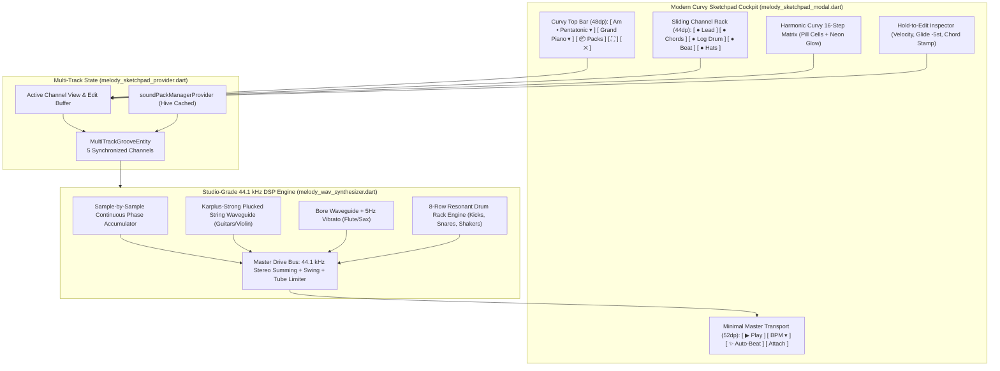

# Phase 32: Studio-Grade 44.1 kHz Multi-Track Melody & Drum Engine, Hybrid Sound Pack Manager & Curvy Minimalist UI — Blueprint

**Document Version:** 1.0.0  
**Status:** Specification Draft for Verification with Argon  
**Target Systems:**
- `apps/vhunambi_client/lib/features/studio/presentation/widgets/melody_sketchpad_modal.dart`
- `apps/vhunambi_client/lib/features/studio/domain/services/melody_wav_synthesizer.dart`
- `apps/vhunambi_client/lib/features/studio/domain/models/melody_sketchpad_models.dart`
- `apps/vhunambi_client/lib/features/studio/presentation/providers/melody_sketchpad_provider.dart`
- `apps/vhunambi_client/lib/features/studio/presentation/widgets/studio_sound_pack_sheet.dart`
- `apps/vhunambi_api/src/routes/melody_routes.ts`

---

## 1. Vision & Architecture Scope

Phase 32 resolves the fundamental audio fidelity and UI ergonomics limitations discovered in `AUDIT-SKETCHPAD-V2-001` and detailed in Argon's technical breakdown. The goal is to transform the existing single-instrument, 22.05 kHz proof-of-concept sketchpad into an **FL Studio-Grade 44.1 kHz Multi-Track Master Groove Workstation** paired with a **curvy, declustered, mobile-first interface** conforming strictly to `STD-UIUX-001`.

### 1.1 The Core Gaps Being Closed
1. **Mathematical DSP Glitch Elimination**:
   - Replaces naive dynamic-frequency sine math ($math.sin(2\pi f(t)t)$) with a continuous sample-by-sample phase accumulator ($\phi[n] = (\phi[n-1] + \frac{2\pi f_{\text{inst}}[n]}{44100}) \pmod{2\pi}$) to eliminate laser clicks and frequency foldover on kicks and log drums.
   - Upgrades system sample rate from 22,050 Hz to **44,100 Hz Stereo**, eradicating Nyquist foldover distortion above 11 kHz.
   - Introduces **Karplus-Strong physical plucked-string waveguides** (for guitars & violins), **bore resonators with 5 Hz breath vibrato** (for flutes & saxophones), and **inharmonic string dispersion** (for grand piano).
2. **FL Studio 5-Channel "Master Groove Drive"**:
   - Evolves beyond monophonic single-instrument patterns to a multi-track channel rack:
     - **Channel 1 (Lead):** Concert Grand Piano, Nylon Guitar, Bamboo Flute, Soprano Sax, Electric Guitar, Solo Violin.
     - **Channel 2 (Chords):** Private School Rhodes, Classic Piano, Neo-Soul Pad, Mbaqanga Organ.
     - **Channel 3 (Bass):** Amapiano Log Drum (with smooth pitch glide), Hip-Hop 808 Sub, Gqom Sub.
     - **Channel 4 (Beat/Kick):** 8-Row Studio Drum Rack across 6 genres (Amapiano, Hip Hop, Gqom, Afrobeats, House, Pop).
     - **Channel 5 (Hi-Hats/Percs):** 16th-Note African Mbaḓi Shakers, Trap Hi-Hat Rolls, Afro Congas.
   - Supports solo auditioning for novices while allowing experienced producers to build rich, layered grooves summed through a Master Drive Bus with swing and tube warmth.
3. **Hybrid Sound Pack Architecture (Native Core + In-App Expansions)**:
   - **Native Packaged Core Kit (0 MB Download):** All 18 core instruments and 6 genre drum kits are pre-baked at 44.1 kHz inside the APK with $< 3.5\text{ MB}$ asset footprint. The APK size remains lean (~42 MB).
   - **Downloadable Sound Pack Store (`StudioSoundPackSheet`):** Users can optionally download expansion sample packs (11–16 MB each, cached in Hive/local storage) to unlock VIP Rhodes, Symphonic Strings, Live Horns, and Trap Drums.
4. **Curvy Minimalist UI/UX (`STD-UIUX-001`)**:
   - Eliminates all 4 stacked horizontal chip rails and raw Unicode emojis.
   - Introduces a **Compact Curvy Top Bar (48dp)** with single-pill key/scale and instrument dropdowns.
   - Introduces a **Sliding Curvy Channel Rack Selector (44dp)** with real-time active channel dots.
   - Introduces a **Hold-to-Edit Gesture Matrix** (floating radial inspector for Velocity, Glide, and Chord Stamp).
   - Adds a **Full-Screen Canvas Toggle** (`PhosphorIconsRegular.cornersOut`).

---

## 2. High-Level Architecture Diagram

---

## 3. Storage & Network Architecture (Download Clarification)

### 3.1 Network vs. Native Footprint
| Component | Storage Location | Network Requirement | Footprint |
| :--- | :--- | :--- | :--- |
| **Core Studio Kit (18 Instruments + 6 Drum Kits)** | Bundled inside app assets / pure Dart DSP | **0 MB Download** (Instant offline) | $< 3.5\text{ MB}$ footprint; keeps APK $\approx 42\text{ MB}$ |
| **Expansion Sound Packs (VIP Packs 2–6)** | Downloaded on-demand via `StudioSoundPackSheet` to `getApplicationDocumentsDirectory()/sound_packs/` | **Optional Download** (11.5 MB – 16.4 MB per pack) | Cached locally; metadata stored in `vhunambi_sound_packs_box` |
| **API Sound Pack Manifest** | `GET /v1/melodies/sound-packs` | Minimal JSON metadata | $< 5\text{ KB}$ |

---

## 4. Cross-System Synergy & Backward Compatibility
- **Phase 23 (`MasterMediaObjectManifest`):** Transient events and MIDI step maps from the multi-track sketchpad pass directly to `dna_compiler.ts`.
- **Phase 25 (`StemMasteringRecipe`):** The master groove mix is fed into `masteringSessionProvider` with `sketchpadLayerMix = 0.35`.
- **Phase 27 Compatibility:** All existing test keys (`Key('melody_sketchpad_modal')`, `Key('sketchpad_play_toggle_btn')`, `Key('sketchpad_attach_reference_btn')`, `Key('sketchpad_save_vault_btn')`, `Key('sketchpad_cell_${row}_${step}')`) are strictly preserved.

