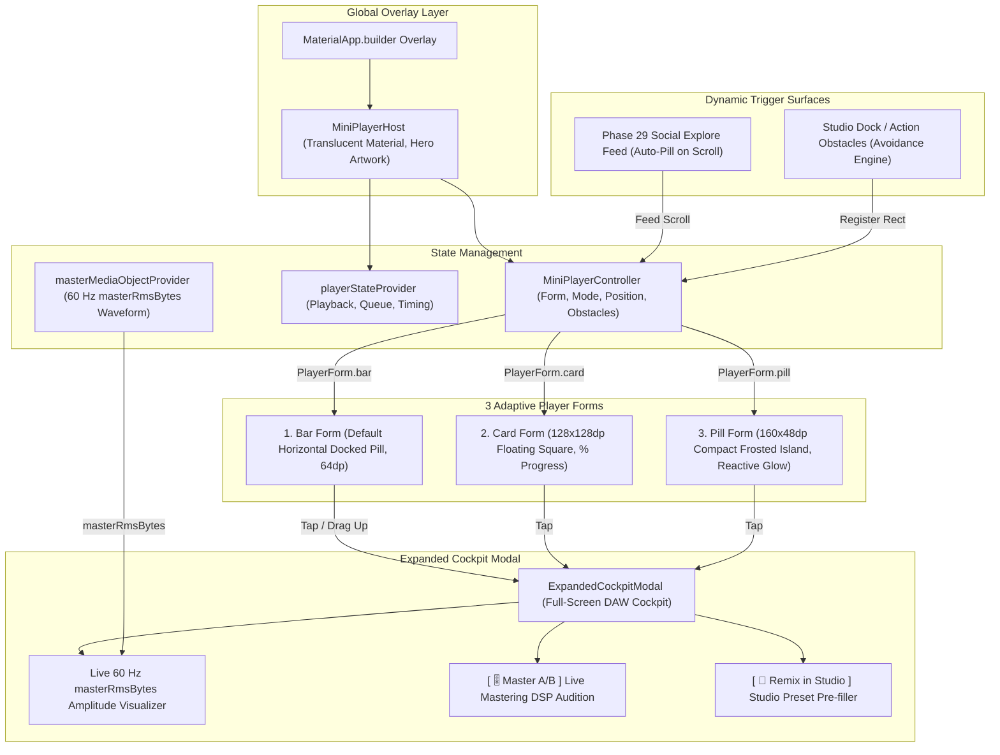

# Phase 33: Adaptive Mini Player & Expanded Cockpit V4.1 Convergence — Blueprint

**Phase:** 33  
**Status:** Approved & Ready for Execution  
**Target:** `apps/vhunambi_client/lib/features/player/` & `apps/vhunambi_client/lib/features/explore/`  
**Dependencies:** Phase 11 (Sprint M2 Spec 3 / VH-014..017), Phase 23 (Master Media Object & 60 Hz Waveform), Phase 25 (Stem Mastering Suite), Phase 27 (Melody & Studio Remixing), Phase 29 (Social Explore Redesign)

---

## 1. System Vision & Architecture

The persistent music playback interface is the acoustic heartbeat of Vhunambi. Whether browsing the **Phase 29 Social Explore feed**, licensing instrumental drops in the **Phase 28 Beats Market**, or inspecting discography in **Phase 30 Creator Profiles**, creators require continuous audio transport controls that never obstruct interactive content.

Phase 33 resolves the critical regression where the mini player disappeared entirely from mobile, finishes Sprint M2 Spec 3 (the 3-Form Adaptive Mini Player: Bar, Card, and Pill forms with obstacle avoidance and gestural transitions), and unites the persistent player with the V4.1 Studio architecture.



---

## 2. Root Cause Analysis & Architectural Patches

### 2.1. The Fatal `ModalRoute.of(context)` Route Trap (`mini_player_host.dart#L135`)
- **Problem**: In `lib/main.dart:58-65`, `MiniPlayerHost` was installed in `MaterialApp.builder`. Because `builder`'s `BuildContext` is an ancestor of the `Navigator`, `ModalRoute.of(context)` is `null` on every frame. `_shouldHide()` checked `if (route == null) return true;`, permanently returning `true` and making the player invisible 100% of the time.
- **Architectural Patch**:
  - Remove `if (route == null) return true;`.
  - Determine hiding purely from explicit, safe conditions:
    1. `ResponsiveUtils.isDesktop(context)` (Desktop uses `DesktopTransportBar`).
    2. `!playerState.hasActiveTrack` (No song queued or active).
    3. `controller.isNowPlayingOpen` (Full cockpit is expanded).
    4. `MediaQuery.of(context).viewInsets.bottom > 0` (Keyboard is open).
  - When `route != null`, check `routeName == '/onboarding' || routeName == '/splash' || routeName == '/auth'`.

### 2.2. Default Docking Math & Obstacle Avoidance (`mini_player_controller.dart`)
- **Problem**: `MiniPlayerController._position` was initialized to `Offset.zero`, placing the player at `(0, 0)` under the status bar notch. Furthermore, `_recalculateAutoPosition` never read `_obstacles`.
- **Architectural Patch**:
  - In `PlayerMode.auto` + `PlayerForm.bar`:
    - Base docking calculation:
      ```dart
      final dockBottom = VhunambiBottomDockMetrics.navBarHeight +
          MediaQuery.paddingOf(context).bottom +
          VhunambiBottomDockMetrics.floatingMargin;
      final targetY = screenSize.height - dockBottom - VhunambiBottomDockMetrics.miniPlayerHeight;
      ```
    - Obstacle avoidance: Inspect registered `_obstacles.values`. If any obstacle intersects the dock zone (`obstacle.bottom > screenSize.height - 240`), elevate the bar 8dp above the highest obstacle:
      ```dart
      final highestObstacleTop = obstaclesInDock.map((o) => o.top).reduce(min);
      final elevatedY = highestObstacleTop - VhunambiBottomDockMetrics.miniPlayerHeight - 8.0;
      ```
  - When in `PlayerMode.manual`: Respect user drag `Offset` clamped within screen safe area bounds.

### 2.3. Cockpit Launch Hook Across All 3 Forms
- **Problem**: Tapping `MobileMiniPlayer`, `CardForm`, or `PillForm` in `MiniPlayerHost` recorded analytics but failed to invoke `ExpandedCockpitModal.show(context)`.
- **Architectural Patch**:
  - Pass `onExpand: () => ExpandedCockpitModal.show(context)` to all three form builders.
  - Tapping album art, metadata, or the card/pill body smoothly presents `ExpandedCockpitModal`.

### 2.4. Phase 29 Social Explore Feed Auto-Pill Collapse
- **Problem**: When users scroll through the TikTok-style vertical Social Explore feed, a full horizontal Bar form obstructs post captions, creator handles, and action buttons (like, comment, tip).
- **Architectural Patch**:
  - In `ExploreView`, attach a notification listener to the feed scrollable.
  - When vertical scrolling is active or the feed is focused, trigger `ref.read(miniPlayerControllerProvider.notifier).setForm(PlayerForm.pill)`.
  - When switching back to Home, Library, or Market tabs, restore to `PlayerForm.bar`.

### 2.5. Expanded Cockpit V4.1 Studio Convergence
- **Problem**: `ExpandedCockpitModal` used a static dummy 40-bar waveform `(index % 5) * 6.0` and had no integration with Phase 25 (Stem Mastering) or Phase 27 (Studio Remixing).
- **Architectural Patch**:
  - **Live 60 Hz Waveform Visualizer**: Construct `SongMetadataDna.fromTrackInfo(...)` and read `ref.watch(masterMediaObjectProvider(dna)).modulationBus.masterRmsBytes`. Sample 60 vertical bars across the track duration with active `accent` progress fill and interactive drag scrubbing.
  - **Phase 25 Master A/B Toggle**: Add a `[ 🎚️ Master A/B ]` chip in the utility tray (`Key('cockpit_master_ab_btn')`) that toggles between raw audio and mastered DSP processing, showing real-time badge feedback.
  - **Phase 21/27 Remix in Studio Action**: Add a `[ 🔁 Remix in Studio ]` chip (`Key('cockpit_remix_studio_btn')`) that pre-configures `studioFormProvider` with the track's genre and prompt and navigates to the Studio cockpit (Tab 2).

### 2.6. Throttled Amplitude Sampling in `PillForm`
- **Problem**: `PillForm` ran an unthrottled 33ms periodic timer continuously, even when playback was paused or when `reduceMotion` was enabled.
- **Architectural Patch**:
  - Pause the timer when `!playerState.isPlaying`.
  - Respect `MediaQuery.maybeOf(context)?.disableAnimations ?? false` to stop the timer entirely and use static styling.

---

## 3. The 3 Adaptive Player Forms

| Form | Geometry | Inset / Position | Content & Interactions |
| :--- | :--- | :--- | :--- |
| **Bar Form** | Width: `screenSize.width - 16`<br>Height: `64dp` | `left: 8, right: 8`<br>Docked above bottom nav bar or obstacles | 44×44dp album art with Hero tag, title & genre metadata, 2px progress line, previous/play-pause/next 44×44dp buttons. Swipe up to expand cockpit; horizontal swipe to skip. |
| **Card Form** | Width: `128dp`<br>Height: `128dp` | Snapped to left/right edge with 16dp margin | 128×128dp square cover art gradient, animated ambient glow, bottom pill with play/pause and progress percentage (`${(progressRatio * 100).toInt()}%`). Tap to expand cockpit. |
| **Pill Form** | Width: `160dp`<br>Height: `48dp` | Floating pill (snapped to top/bottom or free manual position) | 32dp circular cover art monogram, play/pause icon, cover-art reactive glow driven by `masterRmsBytes`. Tap to expand cockpit; hold-drag to reposition. |

---

## 4. Verification Gates & Success Criteria

1. **Dart Analyzer Gate**: `dart analyze lib test` in `apps/vhunambi_client` reports **0 issues**.
2. **Player Feature Test Suite**: `flutter test test/features/player` passes **100% (140+ tests)**.
3. **Phase 33 Verification Suite**: Authored `test/features/player/phase33_adaptive_mini_player_test.dart` passes all targeted tests:
   - MiniPlayerHost mounts and renders without route trapping.
   - 3-Form morphing (Bar ➔ Card ➔ Pill) via controller.
   - Obstacle avoidance lifts Bar above bottom-registered UI.
   - Social Explore feed triggers auto-pill collapse.
   - Expanded Cockpit renders 60 Hz `masterRmsBytes` waveform and launches Master A/B and Remix actions.
   - 360×800dp compact mobile viewport layout passes with zero RenderFlex overflows.
4. **Cross-Feature Regressions**: `flutter test test/features/home test/features/explore test/features/profile test/features/marketplace` passes **100%**.
5. **Backend Engine**: `pnpm test` in `apps/vhunambi_api` passes **11/11 suites**.

