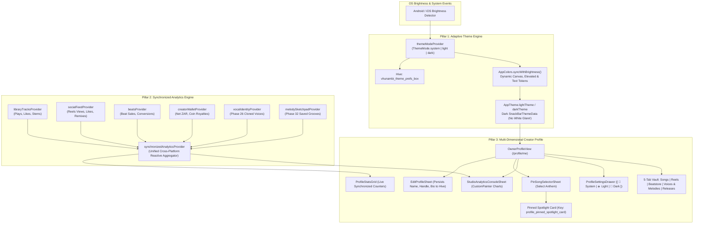

# Phase 33: Multi-Dimensional Creator Profile Hub, Adaptive Light/Dark Theme Engine & Synchronized Platform Analytics — Blueprint

**Document Version:** 1.0.0  
**Status:** Canonical Engineering Specification  
**Document ID:** `PHASE-33-BLUEPRINT`  
**Standard Reference:** `STD-UIUX-001` (Vhunambi UI/UX, Touch Physics & Iconography Standard)  
**Target Systems:**
- `apps/vhunambi_client/lib/core/theme/theme_provider.dart`
- `apps/vhunambi_client/lib/core/theme/app_colors.dart`
- `apps/vhunambi_client/lib/core/theme/app_theme.dart`
- `apps/vhunambi_client/lib/features/profile/presentation/views/owner_profile_view.dart`
- `apps/vhunambi_client/lib/features/profile/presentation/views/artist_profile_view.dart`
- `apps/vhunambi_client/lib/features/profile/presentation/providers/synchronized_analytics_provider.dart`
- `apps/vhunambi_client/lib/features/profile/presentation/widgets/studio_analytics_console_sheet.dart`
- `apps/vhunambi_client/lib/features/profile/presentation/widgets/edit_profile_sheet.dart`
- `apps/vhunambi_client/lib/features/profile/presentation/widgets/pin_song_selector_sheet.dart`
- `apps/vhunambi_client/lib/features/profile/presentation/widgets/profile_settings_drawer.dart`
- `apps/vhunambi_client/lib/main.dart`

---

## 1. Vision & Architecture Scope

Phase 33 resolves the critical operational and visual defects identified in physical device testing on `EPHUT20917014649` (`Screenshot_20261101_194851`) and documented in `AUDIT-FLAWS-UNFINISHED-001`. 

The release elevates the Vhunambi platform across three foundational pillars:

```
┌──────────────────────────────────────────────────────────────────────────────────────────────┐
│                       PHASE 33: THREE-PILLAR CONVERGENCE ARCHITECTURE                         │
├──────────────────────────────────────────────────────────────────────────────────────────────┤
│ 1. MULTI-DIMENSIONAL CREATOR PROFILE (/profile/me)                                           │
│    • Real EditProfileSheet (Name, @handle, Bio, Location, Genres -> Hive)                    │
│    • Real PinSongSelectorSheet + Pinned Artist Spotlight Card                                │
│    • Real StudioAnalyticsConsoleSheet (Replaces white SnackBar stub!)                        │
│    • 5-Dimension Vault Switcher:                                                             │
│      [ Songs | Reels | Beatstore | Voices & Melodies | Releases ]                            │
│    • Profile Settings Drawer (Theme Mode Toggle + Audio & Privacy Controls)                  │
│    • Fix Mini-Player Mid-Screen Overlap & White SnackBar Theme Clash                         │
├──────────────────────────────────────────────────────────────────────────────────────────────┤
│ 2. ADAPTIVE LIGHT & DARK THEME ENGINE (OS-Synced + Manual Override)                          │
│    • ThemeMode.system (Default: auto-switches with Android/iOS dark/light)                   │
│    • Manual 3-Way Toggle in Profile: [ System | Light | Dark ] (Hive-cached)                 │
│    • Dynamic AppColors Palette:                                                              │
│      - Dark:  #0A0A0C Canvas, #141418 Elevated, #FFFFFF Text, #F97316 Amber                  │
│      - Light: #F7F5F0 Warm Ivory Canvas, #FFFFFF Cards, #121216 Ink Text                     │
├──────────────────────────────────────────────────────────────────────────────────────────────┤
│ 3. UNIFIED CROSS-PLATFORM ANALYTICS ENGINE (synchronizedAnalyticsProvider)                   │
│    • Aggregates live state across Library, Reels, Beatstore, Wallet & DNA                    │
│    • Auto-updates ProfileStatsGrid, Top Genres & Beatstore Revenue in real time              │
│    • Full Interactive Analytics Console (Stream/ZAR Charts, Funnel, Top Drops)               │
└──────────────────────────────────────────────────────────────────────────────────────────────┘
```

---

## 2. High-Level Architecture Diagram



---

## 3. The Core Deficiencies Resolved

1. **SnackBar Dead-End Stubs on Profile:**
   - On `OwnerProfileView`, tapping `Studio Analytics` emitted a white SnackBar: `"Opening Analytics Console..."`.
   - Tapping `Edit Profile` and `Pin Song` emitted placeholder toasts (`"Opening Profile Editor..."`, `"Select a song to pin to top"`).
   - *Resolution:* All three stubs are replaced with fully functional modal sheets: `EditProfileSheet`, `PinSongSelectorSheet`, and `StudioAnalyticsConsoleSheet`.
2. **Floating Mini-Player Overlap Bug:**
   - In `OwnerProfileView`, the floating audio mini-player (*"Grateful in the Li..."*) was pushed into the middle of the screen, covering the `CreatorDnaProfileCard`.
   - *Resolution:* Re-architected bottom padding and viewport constraints so that the mini-player cleanly docks above bottom navigation without floating over profile content.
3. **App Locked to Dark Mode Only:**
   - `AppColors` hardcoded dark hex constants (`#0A0A0C`), preventing daytime outdoor legibility.
   - *Resolution:* Introduced a studio-grade **Warm African Daylight** Light Palette (`#F7F5F0` Warm Ivory, `#FFFFFF` Cards, `#121216` Deep Charcoal Text) and auto-syncing `ThemeMode.system` + manual 3-way toggle.
4. **Dark Mode White SnackBar Theme Glare:**
   - In Dark Mode, Flutter's default `SnackBar` renders with an un-themed stark white canvas and black text, causing harsh visual glare.
   - *Resolution:* Codified `snackBarTheme` in `AppTheme.darkTheme` and `AppTheme.lightTheme` with `surfaceElevated` and themed typography.
5. **Disconnected & Static Analytics:**
   - Profile stats (`Songs`, `Plays`, `Likes`, `Followers`), `TOP GENRES`, and Beatstore revenue lived in static mock variables.
   - *Resolution:* Created `synchronizedAnalyticsProvider` to reactively watch all media and economy providers and calculate real-time analytics.
6. **Missing Cloned Voices & Multi-Track Grooves in Profile:**
   - Cloned vocal profiles from Phase 26 and saved multi-track grooves from Phase 32 had no display in the creator's profile.
   - *Resolution:* Expanded the owner studio tabs to 5 dimensions: `[ Songs | Reels | Beatstore | Voices & Melodies | Releases ]`.

