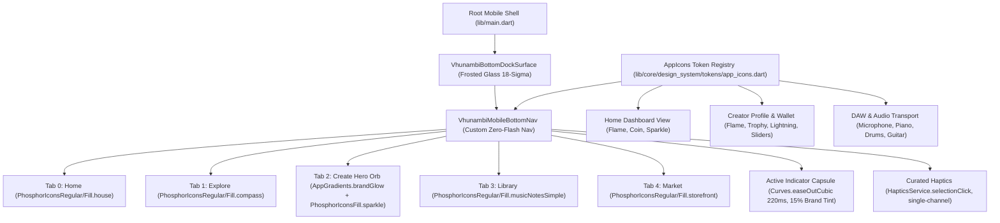

# 🗺️ Phase 34 Blueprint: Mobile Bottom Navigation & Phosphor Iconography Convergence

**Phase Identifier:** `PHASE-34-NAV-ICON`  
**Target Platform:** Mobile (`apps/vhunambi_client`)  
**Companion Documents:** `requirements.md`, `design.md`, `tasks.md`, `docs/audits/MOBILE_BOTTOM_NAV_AND_ICONOGRAPHY_AUDIT.md`  
**Flutter SDK:** 3.44.4 (Dart 3.12.2)  
**Status:** Completed & Field-Verified on Device (`EPHUT20917014649`)  

---

## 1. Executive Vision & Objectives

Vhunambi's visual language is celebrated for its **organic, soft, rounded, afro-futuristic aesthetic**. However, two core visual subsystems have fallen behind the V4.1 standard:
1. **The Sticky Mobile Bottom Navigation Bar:** Suffers from the "cracked screen flash glow" defect (caused by Flutter's default `BottomNavigationBar` `InkResponse` highlight bleeding into the 18-sigma frosted glass backdrop), abrasive double-haptics on Android, and clumsy linear tab cross-fades.
2. **Iconography Fragmentation & Emoji Abuse:** 344 instances of literal emojis (`🔥`, `🪙`, `⚡`, `🧬`, `🏆`, `🎵`, `💿`, `🎛️`, `✨`) used directly as UI buttons and status badges, coupled with sharp, industrial Material icons (`Icons.*`) that contradict Vhunambi's friendly, curved design principles.

**Phase 34 delivers two monumental system upgrades:**
- **System A — `VhunambiMobileBottomNav`:** A purpose-built, zero-flash, fluid mobile bottom navigation bar featuring a soft ambient sliding indicator capsule, an elevated brand-gradient "Create" orb, single-channel curated haptics, and 100% HIG/WCAG accessibility compliance.
- **System B — Sovereign Phosphor Iconography (`AppIcons`):** Integration of `phosphor_icons: ^3.0.1` and a centralized `AppIcons` design token registry, replacing sharp Material icons and eradicating emoji abuse in UI badges while keeping emojis strictly reserved for authentic user chat comments and cultural fan gifts.

---

## 2. Architecture & Component Interaction

---

## 3. Scope of Upgrades

1. **Package Installation:** Add `phosphor_icons: ^3.0.1` to `pubspec.yaml` with explicit style classes for zero-tree-shaking-overhead.
2. **Design Tokens Registry:** Create `lib/core/design_system/tokens/app_icons.dart` mapping semantic tokens to Phosphor vectors.
3. **Bottom Navigation Replacement:** Replace Flutter's stock `BottomNavigationBar` in `main.dart` with `VhunambiMobileBottomNav`.
4. **Emoji Deprecation Sweeps:**
   - Home Dashboard streak and coin pills.
   - Creator Profile streak, wallet earnings, and studio cockpit tab segments (`🎵 Songs` $\rightarrow$ Music Notes icon, `💿 Releases` $\rightarrow$ Disc icon, `🎛️ My Beatstore` $\rightarrow$ Sliders icon).
   - Audio DAW stem strips.
5. **Test Pin Integrity:** Ensure 100% backward compatibility with existing tests and add 8 comprehensive verification tests in `phase34_bottom_nav_and_iconography_test.dart`.

