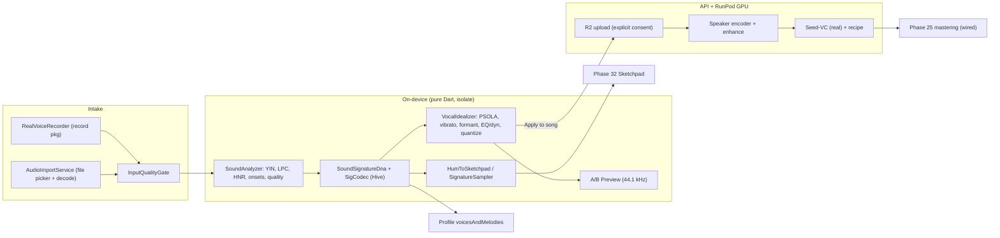

# Phase 35: Sovereign Sound Signature ID (`VHU-SIG`) & Neural Vocal Idealizer Engine - Blueprint

**Document Version:** 1.0.0
**Status:** Specification Draft for sign-off (no implementation yet)
**Depends on:** Phase 26 (voice identity), Phase 32 (44.1 kHz sketchpad), Phase 33 (profile vault, reactive theme)
**Audit:** `docs/audits/SOUND_SIGNATURE_INTAKE_AND_IDEALIZER_AUDIT.md` (AUDIT-SOUNDSIG-001)
**Standards:** `STD-UIUX-001` (Phosphor only, 44x44dp, zero raw emojis, zero raw hex, `AppColors` getters, no `const` over theme tokens)

---

## 1. Vision

Stop storing sounds as frozen WAV photographs. Decompose every sound that enters Vhunambi into an **editable acoustic description** - *who* it is (identity) separated from *how well it was performed* (performance) - then let the user sculpt the performance non-destructively, hear it instantly on device, and have the cloud respect the same settings when the song is rendered.

## 2. What is real vs. what must be built first

The audit found that today there is **no real capture, no real embedding, no upload, and no executed cloud voice stage**. So Phase 35 is two jobs:

1. **Make the foundation real** (Tracks A, F-foundation): recorder, import, durable registry, upload, GPU stages actually wired.
2. **Build the Sound Signature** on top of it (Tracks B-E, F-neural).

## 3. Three workflows (and which problem each solves)

| # | Workflow | User's raw input | Output | Core tech | Where it runs |
| :--- | :--- | :--- | :--- | :--- | :--- |
| W1 | **Reference Hygiene** (always on) | Voice note or uploaded clip used as *timbre reference* | Cleaner, level-normalised reference + real speaker embedding -> better clone | denoise, band/room repair, LUFS, speaker encoder | device (light) + cloud (heavy) |
| W2 | **Sing-it-yourself Idealizer** | The user's own sung/spoken-sung take | A finished **idealized vocal stem** usable in mixer/mastering | YIN F0, TD-PSOLA pitch/formant, vibrato, EQ/dynamics, timing | device (preview + render), cloud optional (neural timbre) |
| W3 | **Hum / Tap to Sketchpad** | Hum, beatbox, table tap, traditional instrument | 16-step notes on a channel, or a **custom sampled instrument** | onset + F0 -> `MelodyStepNote`; sampler with PSOLA row-tuning | device |

> [!IMPORTANT]
> In the current product the song's melody is generated by ACE-Step, so the user's recording is only a **timbre reference** for cloning. Pitch correction therefore matters for W2 and W3, **not** for plain cloning (where noise/reverb/level matter instead). This is why W1 is separate and is the lowest-risk, highest-reach win.

## 4. The Signature: five layers + one recipe

`SoundSignatureDna` (display ID `VHU-SIG-9A4F`, canonical ID = ULID). Compact binary blob in Hive (`vhunambi_sound_signatures_box`), **<= 8 KB for <= 20 s of audio** (budget derived in `design.md` §2.4). The **raw audio is stored separately** (app documents dir) because the signature alone cannot reproduce the user's actual voice - recipes are non-destructive edits over the retained raw take.

| # | Layer | Contents | Source | Manipulable? |
| :--- | :--- | :--- | :--- | :--- |
| 1 | Identity - `TimbreIdentityProfile` | 16-coef spectral-envelope descriptor; formants $F_1$-$F_4$; glottal-warmth proxy; harmonic purity (HNR); optional cloud speaker embedding (192/256-D) | device LPC/cepstrum; cloud encoder | blend, formant shift |
| 2 | Pitch - `PitchContourProfile` | F0 contour (50 Hz, cents-quantised), root key, scale mode, stability, natural vibrato rate/depth | device YIN | snap, smooth, re-vibrato |
| 3 | Articulation - `PhoneticArticulationProfile` | transient sharpness; unvoiced/click segment map | device | **protected** (never pitch-processed) |
| 4 | Rhythm - `RhythmicTransientGrid` | onset times, offsets vs 16-step grid, quantised `MelodyStepNote` list | device flux detector | quantise strength |
| 5 | Recording quality - `RecordingQualityProfile` | SNR, clipping %, reverb (EDT) estimate, bandwidth, level (LUFS) | device | enhance, gate |
| R | `SoundIdealizerRecipe` | 7 sliders + hybrid target (see §5) | user | the control surface |

> [!NOTE]
> Honest framing of "identity": layer 1 on device is a **descriptor** (good for display, similarity, approximate preview). Identity-grade matching/cloning uses the **cloud speaker embedding**. We never claim the on-device vector is a biometric-grade voiceprint, and `VHU-SIG` short codes are **labels, not proof of identity** (two takes of one voice get different codes; similarity is shown as a cosine score instead).

## 5. The Idealizer controls (recipe)

| Control | Range / default | Effect | Runs on |
| :--- | :--- | :--- | :--- |
| Pitch & Scale Lock | 0-1 / 0.90 | pulls notes toward the chosen `AfricanScaleMode` + root; preserves intentional glides | device |
| Vibrato & Sustain Polish | 0-1 / 0.75 | removes >8 Hz tremor; replaces with ~5.2 Hz studio vibrato; extends tails | device |
| Formant Depth Shift | -3..+3 st / 0 | moves $F_1$-$F_4$ without moving pitch | device |
| Chest Power & Air | 0-1 / 0.80 | compression, 140 Hz weight, F1 lift, HNR-gated air, box cut | device |
| Pocket Quantize | 0-1 / 0.85 | aligns syllable/note onsets to the BPM grid | device |
| Hybrid Archetype + Mix | archetype id, 0-0.75 / 0.25 | blends toward one of 24 archetypes | **cloud exact**, device *approximate preview* |
| Reference Cleanup | 0-1 / 0.70 | denoise + dereverb strength for W1 | device lite + cloud |

Hard safety rails: correction beyond **+-700 cents** per note is refused on device (artifact risk) and offered as "needs cloud"; formant shift bounded +-3 st; every control is reversible (A/B always available).

## 6. Architecture

## 7. Scope by track

| Track | Name | Delivers |
| :--- | :--- | :--- |
| **A** | Real Intake Foundation | recorder, permission, import, quality gate, storage, domain model + codec |
| **B** | Signature Analysis DSP | YIN F0, LPC formants, HNR, onsets, descriptor, key/scale estimate |
| **C** | Vocal Idealizer DSP | PSOLA, vibrato, formant shift, chest/air chain, quantize, A/B renderer |
| **D** | UI/UX | Idealizer sheet, `VHU-SIG` card, painter, integration into recorder/dropzone/profile |
| **E** | Sketchpad Bridge | Hum -> notes, custom signature instrument, tap/percussion pads |
| **F** | Cloud & Privacy | durable registry, upload, real encoder, real Seed-VC + enhance wired in `handler.py`, deletion, docs |

## 8. Non-goals
- No on-device neural model bundle (APK stays within 42-45 MB).
- No real-time monitoring of processed voice while singing (latency); preview is post-take.
- No claim to turn any voice into any other voice on device; that is cloud/neural.
- No cloning from imported audio as a voice *identity* without live calibration (safety).
- Not replacing ACE-Step generation.

## 9. Decisions requested at sign-off
1. **Include W2 "Sing-it-yourself Idealizer"** as a deliverable (new capability) - recommended.
2. **Approve `record` plugin + `RECORD_AUDIO` permission.**
3. **Accept two cloud spikes** (S1: pitch-corrected source into Seed-VC; S2: hybrid blending) with the fallbacks in `design.md` §8.
4. **Folder number:** `phase_35_mini_player_drag_dismiss` already exists; keep this name or renumber.
5. **Retention default:** raw takes kept on device until the user deletes them (cap 50 MB, managed in the vault storage modal)?

## 10. Success criteria
- Real voice in -> real, voice-dependent descriptors out (two speakers reading the same script produce measurably different signatures).
- Idealizer on a synthetic off-key test tone reaches median error <= 10 cents to scale degree at Scale Lock 1.0 while $F_1$-$F_3$ drift stays < 5%.
- A/B preview renders a 20 s take in < 4 s on the Huawei test device (isolate), UI never janks.
- Hum -> 16-step notes: >= 90% of intended notes land on the correct row/step on clean synthetic hums.
- Cloud: a cloned voice **audibly changes** the generated vocal (the stage is verifiably executed and logged).
- APK <= 45 MB; `dart analyze` 0 issues; all existing suites remain green.
