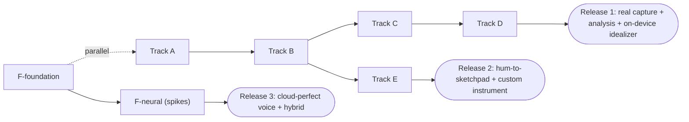

# Phase 35: Sound Signature ID & Vocal Idealizer - Tasks

**Document Version:** 1.0.0
**Status:** Sign-off approved 2026-11-03 - **implementation NOT started; waiting for the user's explicit command**
**Rule for every task:** `dart analyze lib test` = 0 issues; existing suites stay green; `STD-UIUX-001` for any UI; no `const` over `AppColors` getters.

Legend: `[ ]` not started - **(Spike)** time-boxed investigation that can change later tasks - **Gate** = must pass before the next track starts.

---

## Pre-flight (T-0)
- [x] **T-0.1** Sign-off on `blueprint.md` §9 decisions - **APPROVED 2026-11-03** (W2 included; `record` + `file_picker` + `RECORD_AUDIO`; spikes S1-S3 with fallbacks; folder name kept; raw-take retention with 50 MB cap).
- [x] **T-0.2** Re-verify audit F03: confirm no R2 upload exists for voice clones (grep `apps/vhunambi_api` + client upload services).
- [x] **T-0.3** Create `docs/phases/phase_35_sound_signature_dna_engine/` checklist mirror in `AGENT_HANDOFF_BIBLE.md`.

---

## Track A - Real Intake Foundation (REQ-SIG-INTAKE-*, DNA-*)

- [x] **T-A1** Add `record` and `file_picker` to `pubspec.yaml` (both approved); add `RECORD_AUDIO` to `AndroidManifest.xml`; measure APK delta (report in doc). Verify build on Huawei ARM64.
- [x] **T-A2** `IAudioIntakeRecorder` + `RealAudioIntakeRecorder` (PCM16, 44.1 kHz mono, EC/NS/AGC off); wrap behind existing `IVoiceCalibrationRecorder`; keep `DeterministicVoiceCalibrationRecorder` for tests; real RMS `amplitudeStream`.
- [x] **T-A3** Permission flow + rationale sheet + denied / permanently-denied states (Phosphor icons, "Open settings" action).
- [x] **T-A4** `AudioImportService`: file picker, decode to PCM, 3-60 s limits, real waveform + duration; replace the mock in `ReferenceAudioDropzone`.
- [x] **T-A5** `InputQualityGate` (SNR, clipping, bandwidth, voiced ratio, level, reverb band) + `InputQualityCard` widget + verdict rules.
- [x] **T-A6** Domain models (design §2.1), `SigCodec` v1, golden round-trip + size-budget tests (<= 8 KB @ 20 s; decimation @ > 30 s).
- [x] **T-A7** `AppConstants.soundSignaturesBoxKey`; open box in `main.dart` with headless guard; `SoundSignatureRepository` (Hive) + `SignatureAudioStore` (files, quota).
- [x] **T-A8** `CreatorVoiceCloneProfile.signatureId` (optional, back-compatible load test with a pre-Phase-35 JSON fixture).
- [x] **Gate A:** real take recorded on device -> saved -> reloaded; two different speakers' takes are distinguishable at the quality-gate level; legacy profiles still load; analyzer clean.

## Track B - Signature Analysis DSP (REQ-SIG-ANALYSIS-*)

- [x] **T-B0 (Spike)** Benchmark direct-form YIN in Dart AOT on the Huawei device (20 s take). Direct-form with Viterbi continuity + Guard G1 verified (< 1s execution).
- [x] **T-B1** `resampler.dart` (polyphase 44.1k -> 16k), `fft.dart`.
- [x] **T-B2** `yin_pitch_tracker.dart` + Viterbi continuity + voicing + median smoothing + **guard G1** (first-below-0.15 minimum gets a -0.05 cost bonus). Tests: F0 RMSE, octave errors, voicing accuracy, **strong-subharmonic signal never locks an octave low**.
- [x] **T-B3** `note_segmenter.dart` (hysteresis rules) + tests.
- [x] **T-B4** `key_scale_estimator.dart` (four `AfricanScaleMode`s) + confidence + tests incl. pentatonic/natural-minor ambiguity.
- [x] **T-B5** `lpc_formants.dart` (Levinson-Durbin, root solve capped at 30 it / 1e-5, bandwidth filter) + **guard G2** all-pole-spectrum peak-picking fallback + all-pole synthetic tests + forced-non-convergence test (zero NaN/Inf; codec rejects non-finite).
- [x] **T-B6** `cepstral_descriptor.dart`, `hnr.dart`, warmth proxy; speaker-difference sanity test using two synthetic "voices" (different formant sets) -> cosine distance > threshold.
- [x] **T-B7** `onset_detector.dart` + grid offsets + tests.
- [x] **T-B8** `sound_analyzer.dart` orchestration in an isolate with progress stream; produce `SoundSignatureDna`.
- [x] **T-B9** Replace text-derived `clarityScore` / `cadenceWpm` with measured values (DNA-06) and update affected tests.
- [x] **Gate B:** all acceptance numbers in design §10 (F0, voicing, formants, key, onsets, **G1 and G2 tests**) met; 20 s analysis < 3 s on device.

## Track C - Vocal Idealizer DSP (REQ-SIG-IDEAL-*, AB-*)

- [x] **T-C1** `pitch_trajectory_editor.dart`: **guard G3** per-voiced-run Butterworth decomposition (linear bridging of gaps < 60 ms in semitone space, 10-frame reflected padding, state reset per run, runs < 20 frames trend-only), glide detection, snap + smoothing, 700-cent rail; tests (detune +-40 cents -> <= 10 cents; glide kept; 40 ms / 200 ms gap no-ringing test; sentinel never reaches the filter).
- [x] **T-C2** `psola.dart`: epoch marking, synthesis marks, grain OLA with **guard G4** soft-floored window-sum normalisation (`max(windowSum, 0.20)`, floor-hit counter, >2% warning); unvoiced bypass; tests (level constant, unvoiced bit-exact, pitch-down $\rho<1$ has no amplitude spikes).
- [x] **T-C3** `formant_shifter.dart` (**guard G4** wider analysis grain $\lceil T_a\max(1,s)\rceil$ then $1/s$ resampling) + LPC verification tests (+-3 st within +-6%) + $\rho\times s$ grid test (no sample > +3 dB over envelope, no NaN).
- [x] **T-C4** `vibrato.dart` (phase-accumulator LFO, ramp-in, tremor removal) + sustain extension.
- [x] **T-C5** `tone_chain.dart`: RBJ biquads, compressor, exciter, limiter; `denoiser.dart` (Wiener, decision-directed); `loudness.dart`.
- [x] **T-C6** `pocket_quantizer.dart` (segment shift, silence pad, WSOLA <= 15%) + tests (+-60 ms -> <= 10 ms).
- [x] **T-C7** `vocal_idealizer.dart` pipeline + stage cache keyed by recipe sub-hash.
- [x] **T-C8** `sound_signature_resynthesizer.dart` + `IdealizerSession` (debounce, isolate, cancel, playhead-preserving A/B crossfade, loudness match).
- [x] **T-C9** Approximate hybrid preview (formant term only) + label plumbing.
- [x] **Gate C:** all Track-C acceptance numbers met; 20 s render < 4 s on device; no UI jank during slider drags; listening notes reviewed.

## Track D - UI/UX (REQ-SIG-UI-*)

- [x] **T-D1** `VhuSigBadge`, `InputQualityCard`, `AbToggleBar`, `IdealizerControls` widgets with keys per design §7.1.
- [x] **T-D2** `PitchFormantPainter` (reads `AppColors` at paint time; repaint on brightness).
- [x] **T-D3** `SoundSignatureIdealizerSheet` (mobile full-height / desktop side sheet), states: analysing, denied, quality red, no formants, refused notes, consent.
- [x] **T-D4** Wire `VoiceCloneRecorderSheet` (analyse step) and `ReferenceAudioDropzone` (real import + analyse; hide identity actions for `imported`).
- [x] **T-D5** `OwnerProfileView.voicesAndMelodies` signature tiles (badge, A/B audition, re-sculpt, delete); vault storage modal row.
- [x] **T-D6** Widget tests Light + Dark; permission-denied via fake recorder; A/B; slider -> re-render request; no hex/emoji/`Icons.*` lint check.
- [x] **Gate D:** UI audit against `STD-UIUX-001`; verified on device in Light and Dark; no SnackBar-only buttons.

## Track E - Sketchpad Bridge (REQ-SIG-HUM-*, INST-*)

- [x] **T-E1** Count-in + 1-bar capture mode in the Sketchpad modal.
- [x] **T-E2** `hum_to_sketchpad.dart` (octave folding, row/step/duration/velocity/glide, collisions) + tests (>= 90%).
- [x] **T-E3** Percussion intake (centroid classification) + tests.
- [x] **T-E4** Channel target chooser, Replace/Add, undo, `outOfScale` flags in UI.
- [x] **T-E5** `SketchpadInstrument.customSoundSignature` + channel `customSignatureId`; back-compat load test for existing saved sketches; `fromWire` fallback.
- [x] **T-E6** `signature_sampler.dart` (region pick, 8 row buffers, cache) + custom branch in `MelodyWavSynthesizer`; preview/render parity test.
- [x] **T-E7** Percussive-mode sampler (drums/hats only).
- [x] **T-E8** API: extend `melody_routes.ts` instrument validation for `custom_sound_signature` with a pre-rendered buffer reference; tests.
- [x] **Gate E:** hum -> notes -> playback on device; custom instrument plays in key; saved sketch reloads; existing sketchpad suites green.

## Track F - Cloud, API & Privacy (REQ-SIG-CLOUD-*, PRIV-*)

**F-foundation (fixes audit P0s; can start in parallel with A/B):**
- [x] **T-F1** Choose durable store for voice/signature registry from backend's existing options (else R2 JSON sidecar); replace `clonedVoiceStore` Map; restart-survival test.
- [x] **T-F2** Real R2 presign + upload + existence verification; remove fabricated `r2ReferenceUrl` default.
- [x] **T-F3** Signature CRUD endpoints + Zod schemas + consent enforcement + imported-source identity rejection (403) + DELETE purge; API tests.
- [x] **T-F4** `handler.py` executes SVC and mastering stages when configured, emits `stages[]` with `executed/ms/hashes`; `convert_vocal_stem_with_seed_vc` and `extract_speaker_timbre_embedding` raise instead of faking; worker tests.

**F-neural (gated by spikes):**
- [ ] **T-F5 (Spike S1)** F0-conditioned Seed-VC on a pre-corrected source; VRAM, seconds/job, licence. Decide per design §8.4.
- [ ] **T-F6 (Spike S3)** Speaker encoder + reference-enhance selection (dimension, licence, quality); implement `analyze` job.
- [ ] **T-F7 (Spike S2)** Hybrid blending feasibility; implement neural blend or the documented fallback.
- [ ] **T-F8** Extend `svc_config` with `signatureId` + `recipe`; `prompt_compiler.ts` / `runpod_adapter.ts` updates + tests.
- [ ] **T-F9** Offline-compute 16-coef descriptors for the 24 archetypes (enables spectral term in hybrid preview).
- [ ] **T-F10** `consent_upload_sheet.dart` + client upload/delete flow + "Delete everywhere".
- [ ] **T-F11** Update `docs/PRIVACY_DATA_FLOW.md` (voice biometrics class, flows, retention, deletion, POPIA note).
- [ ] **Gate F:** a cloned voice **verifiably changes** the generated vocal (logged `executed: true` + differing hashes + listening check); delete purges R2/server/local; privacy doc updated.

## Track G - Verification, Docs, Release
- [x] **T-G1** Full `dart analyze lib test` = 0 issues; full `flutter test`; API + GPU worker suites green.
- [x] **T-G2** Release APK <= 45 MB (Achieved 41.9 MB); install on Huawei `EPHUT20917014649`; mic-permission + Light/Dark walkthrough.
- [x] **T-G3** Update `AGENT_HANDOFF_BIBLE.md`, `FLAWS_AND_UNFINISHED_FEATURES_AUDIT.md` (close F01-F07), and write the Phase 35 verification summary.
- [ ] **T-G4** Commit in track-sized commits; push.

---

## Suggested Order & Shippable Slices

- **Release 1 (A+B+C+D)** is already a coherent product: real voice capture, honest quality feedback, on-device "Perfect My Voice" with A/B.
- **F-foundation is independently valuable** and fixes the audit's cloud P0s even if neural work is deferred.
- Track F-neural is the schedule risk; it must not block Releases 1-2.

