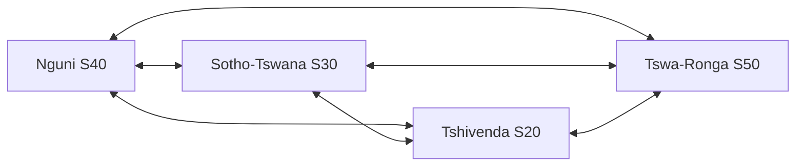

# Phase 36: Bantu Linguistic DSP, Story-to-Lyrics & Cross-Module Synergy - Design

**Document Version:** 1.0.0
**Status:** In progress
**Conventions:** "st" = semitones. All numeric defaults are tunable starting points to validate on Vhunambi data, not linguistic laws.

---

## 1. Module layout

```
lib/features/sound_signature/domain/dsp/
  bantu_language_branch.dart     enum BantuLanguageBranch + language->branch map (9 languages)
  bantu_phonology.dart           BantuProtectionProfile per branch
  bantu_similarity.dart          score, shift rules, noun classes, BantuRoutePlanner
  (existing) pitch_trajectory_editor.dart   <- guards A1, A2
  (existing) pocket_quantizer.dart          <- guard A3
lib/features/studio/.../bantu_lyric_translation_service.dart
lib/features/home/.../cross_module_synergy_deck.dart, cross_module_synergy_provider.dart
apps/vhunambi_api/src/modules/lyrics/story_transform.ts (+ route in lyrics module)
```

## 2. Topology and routing



```dart
enum BantuLanguageBranch { nguni, sothoTswana, tshivenda, tswaRonga }

class BantuRoutePlanner {
  /// Always returns [source, target]; never a third language.
  List<String> plan(String source, String target);
}
```

- Same branch -> `ShiftRouting.identity` (zero rules).
- Different branches -> `ShiftRouting.pairwise(sourceBranch, targetBranch)`; unknown pair -> no shift, score component 0, not guessed.
- Why no hub: `zu -> ve -> xh` would map click `q` (*qeda*) to `fh` (*fhela*), and the return trip cannot tell click from labial; Sotho-Tswana would lose `tl/tlh/kg` and 7-vowel harmony.

## 3. Similarity

$$\text{Score} = \operatorname{round}(0.40\,S_{Lev} + 0.30\,S_{Pairwise} + 0.30\,S_{NounClass})$$

- `S_Lev`: normalised edit distance on radicals after prefix strip, 0..100.
- `S_Pairwise`: 100 if words match after applying the pairwise rules (or identical under identity routing), else 0. Starter rules only.
- `S_NounClass`: 100 if prefixes align by class (Class 6 `ama-`<->`ma-`; Class 7 `isi-`<->`se-`<->`tshi-`), else 0.
- Tables carry `const bool kBantuTablesValidated = false;`.

## 4. Protection profiles

| Branch | Profile features |
| :--- | :--- |
| nguni | clicks (`c q x` families), depressor onsets (`b d g gc gq gx`) |
| tshivenda | dental plosives (`ḓ ṱ ṋ ḽ`), breathy `vh` |
| sothoTswana | 7-vowel spacing (`e ɛ o ɔ`), lateral affricates |
| tswaRonga | whistled sibilants (`sw zv`) |

The singer's selected branch picks the profile. The singer's formant envelope is retained; there is no centroid parameter.

## 5. DSP guards

- **A1 Depressor onset.** For nguni/tshivenda, for the first `kDepressorOnsetMs = 60` of a voiced run beginning at a depressor: `corr(t) = corr_full * clamp(t/60 ms, 0, 1)`.
- **A2 Tone polarity.** For adjacent voiced runs with raw median delta `d_raw`: if `|d_raw| >= kTonePolarityMinSt (2.0)` and `sign(d_ideal) != sign(d_raw)` then clamp `d_ideal` to 0 (or smallest same-sign step).
- **A3 Penultimate anchor.** In `PocketQuantizer`, if `dur(penult) >= kPenultRatio (1.5) * median(dur)`: compute shift for the penultimate onset, apply the same shift to the final onset, preserving their interval.
- **Existing behaviour kept:** unvoiced/transient regions bypass pitch processing (Phase 35). Branch click windows *extend/verify* this; they are not a new PSOLA capability.

## 6. Story-to-Lyrics API

`POST /v1/lyrics/story-transform`

```json
{ "story": "...", "genre": "amapiano|maskandi|gqom|gospel|kwaito_hiphop",
  "language": "zu|xh|ss|nr|nso|tn|st|ve|ts", "mood": "optional" }
```

Response: `{ sections: [{label, lines[]}], aceStepCaption, genre, language }`.

- Deterministic template engine: story is split into sentences/phrases, mapped to genre section structure (e.g. Maskandi: izibongo-style opening praise, narrative verses; Amapiano: hook-driven with vocal-chop hook).
- `compileAceStepCaption(genreDna, languageContext, vocalInstructions, mood)`: genre DNA table and language context table are separate modules; genre output never reads `language`.
- Optional LLM hook: `STORY_LLM_ENABLED=false` default.
- Client: `LyricsReviewModal` adds `Key('lyrics_story_mode_toggle')` and `Key('lyrics_cognate_finder_btn')` (finder calls `bantu_similarity`).

## 7. Lyric translation service

```dart
class LyricLineAnalysis {
  final String originalLine;
  final String phoneticSingAlongGuide; // penultimate syllable marked
  final String translatedMeaning;      // 'meaning unavailable' if no lexicon hit
  final List<CognateMatch> cognateMatches;
}
```

- Lexicon: small curated glossary asset (versioned, replaceable, marked unvalidated). No network, no LLM, no fabrication.
- UI: `reel_translate_lyrics_toggle` (`KineticReelsModal`), `track_translate_lyrics_toggle` (`LyricsTeleprompter`, track_detail_view). >= 44x44dp, Phosphor icons only, no raw emojis, `AppColors` getters.
- Animations follow `lib/motion-config` hydration-safe variants where applicable.

## 8. Cross-module synergy

- `StudioSynergyContext {sourceModule, targetModule, gapKind, measuredValue, suggestedRecipe}`.
- `crossModuleSynergyProvider` maps gaps to cards (mapping table in doc 05 §2); empty when no data.
- Cards: Voice Gap -> Idealizer, Signature -> Sketchpad; deck max 3, dismissible; on `HomeDashboardView` (full) and `OwnerProfileView` (compact).
- Badges (cosmetic only): Polyglot Vocalist (>= 3 branches), Groove Architect (5 channels), Voice Sovereign (first VHU-SIG). No monetary field; money-touching perks = **needs owner decision**.

## 9. Test strategy

- Client: `test/features/sound_signature/phase36_bantu_linguistics_and_synergy_test.dart` (REQ-BANTU-MODEL/PHON/SIM/DSP/LYR/SYN, widget keys).
- API: vitest/jest suites beside the lyrics module (REQ-BANTU-STORY-*).
- Regression: all Phase 35 tests unchanged and green.

## 10. Risks

| Risk | Mitigation |
| :--- | :--- |
| Starter tables wrong | `kBantuTablesValidated=false`, UI says "indicative", native-speaker review task |
| A1/A2 constants not matching real singers | named constants; measure on recorded takes; adjust |
| Glossary too small | explicit "meaning unavailable" fallback |
| Unused algorithm trap | each algorithm has a keyed UI entry point + invocation test |
