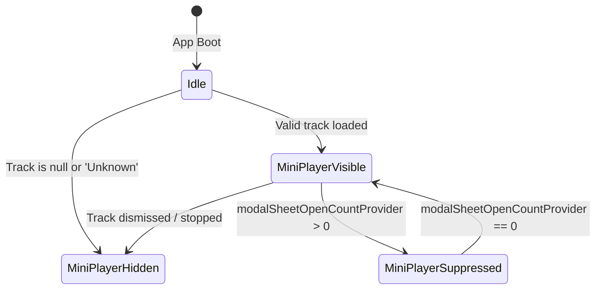

# Technical Design Document: Phase 44 Frontend Video Defect Eradication & Edge Outbox

## 1. Overview & System Context

Phase 44 hardens the Vhunambi client application (`apps/vhunambi_client`) against physical hardware failure modes and environmental edge conditions. It directly addresses the findings of the 5-minute video walkthrough (`SVID_20261103_171715_1.mp4`) and introduces an enterprise-grade offline mutation outbox engine.

### Key Capabilities

1. **Defensive Storage Engine**: Sandboxed temporary audio bounce directories eliminating Android OS `errno = 30` read-only filesystem traps.
2. **Cinema Overlay Isolation**: Dedicated dark-mode theme wrapper enforcing `#FFFFFF` contrast tokens across full-screen media surfaces.
3. **Modal-Aware Player Lifecycle**: Dynamic coordination between modal bottom sheet stacks and the floating mini-player pill.
4. **Dynamic Kinetic Composer**: Procedural vision artwork fallback and dynamic 4-vault asset populator.
5. **Ergonomic Social Feed**: Unclipped action rows, proper creator profile attribution, and self-follow suppression.
6. **Design System Hygiene**: Phosphor vector icon migrations and legacy dead code elimination.
7. **Offline-First Mutation Outbox**: Hive-backed durable local queue with exponential backoff and idempotency protection.

---

## 2. Architecture & Component Hierarchy

```
┌────────────────────────────────────────────────────────────────────────┐
│                              APP OVERLAY                               │
├────────────────────────────────────────────────────────────────────────┤
│                                                                        │
│                      MiniPlayerHost (Global Stack)                     │
│               ▲                                  ▲                     │
│               │ watches                          │ watches             │
│        playerStateProvider             modalSheetOpenCountProvider     │
│       (Hides if 'Unknown')            (Hides if count > 0)             │
│                                                                        │
├────────────────────────────────────────────────────────────────────────┤
│                           MODAL BOTTOM SHEETS                          │
├─────────────────────────────────┬──────────────────────────────────────┤
│    CreateKineticPostSheet       │     OpenVerseRemixCockpitSheet       │
│  - Procedural Vision Fallback   │   - Temp Directory Mixdown Path      │
│  - 4-Vault Dynamic Dropdown     │   - Safe Buffer Memory Fallback      │
│  - ownerProfileProvider Bind    │   - Increments modalSheetOpenCount   │
├─────────────────────────────────┴──────────────────────────────────────┤
│                         FULL-SCREEN OVERLAYS                           │
├────────────────────────────────────────────────────────────────────────┤
│                           KineticReelsModal                            │
│  - Theme(data: AppTheme.darkTheme) [Locks Dark Mode]                   │
│  - High-Contrast White Action Rail (`#FFFFFF` + dropshadow)            │
│  - Top Bar Transparent Scrim                                           │
├────────────────────────────────────────────────────────────────────────┤
│                           CORE SYNC SYSTEM                             │
├────────────────────────────────────────────────────────────────────────┤
│                           SyncOutboxService                            │
│  - Storage: Hive Box (`vhunambi_sync_outbox_box`)                      │
│  - Idempotency: UUIDv4 per action                                      │
│  - Batching: POST /api/sync/mutations                                  │
│  - UI: ProfileSettingsDrawer Durability Badge                          │
└────────────────────────────────────────────────────────────────────────┘
```

---

## 3. Detailed Component Specifications

### 3.1 Audio Bounce Path Resolution & Memory Fallback

#### Problem
In `open_verse_remix_cockpit_sheet.dart` line 147:
```dart
// BUGGY IMPLEMENTATION
targetPath: 'remix_open_verse_${DateTime.now().millisecondsSinceEpoch}.wav'
```
Because no directory prefix was provided, Dart's `File(targetPath)` resolved relative to the working directory (`/` on Android), triggering:
```
FileSystemException: Cannot open file, path = 'remix_open_verse_1793783891322.wav' 
(OS Error: Read-only file system, errno = 30)
```

#### Remedied Architecture
```
┌───────────────────────────────────────────────────────────┐
│              OpenVerseRemixCockpitSheet                   │
└─────────────────────────────┬─────────────────────────────┘
                              │ Calls bounceMixToFile()
                              ▼
┌───────────────────────────────────────────────────────────┐
│                StemMixBounceService                       │
├───────────────────────────────────────────────────────────┤
│ 1. Resolve Safe Path:                                     │
│    final tempDir = await getTemporaryDirectory();         │
│    final safePath = '${tempDir.path}/$targetFilename';    │
│                                                           │
│ 2. Defensive Write:                                       │
│    try {                                                  │
│      await File(safePath).writeAsBytes(pcmWavBytes);      │
│      return BounceResult.file(safePath);                  │
│    } on FileSystemException catch (e) {                   │
│      // FALLBACK TO MEMORY STREAM                         │
│      final base64Uri = 'data:audio/wav;base64,...';       │
│      return BounceResult.memory(base64Uri);               │
│    }                                                      │
└───────────────────────────────────────────────────────────┘
```

#### Dart Implementation Contract
```dart
class BounceResult {
  final String pathOrUri;
  final bool isInMemoryFallback;
  final int byteLength;

  const BounceResult({
    required this.pathOrUri,
    this.isInMemoryFallback = false,
    required this.byteLength,
  });
}
```

---

### 3.2 Cinema Dark Mode Theme Locking (`KineticReelsModal`)

#### Visual Defect Root Cause
`KineticReelsModal` used context-dependent theme tokens (`AppColors.textPrimaryOf(context)`). Under Light Mode, this resolved to `#121216` (charcoal). Since the reel canvas renders 9:16 video with a black backdrop, the charcoal icons disappeared into the background.

#### Architectural Remedy
Wrap the modal in an isolated dark theme boundary:
```dart
@override
Widget build(BuildContext context) {
  return Theme(
    data: AppTheme.darkTheme,
    child: AnnotatedRegion<SystemUiOverlayStyle>(
      value: SystemUiOverlayStyle.light,
      child: Scaffold(
        backgroundColor: Colors.black,
        body: Stack(
          children: [
            _buildVideoSurface(),
            _buildActionRail(), // Bound to AppColors.darkTextPrimary
            _buildTopBar(),     // High-contrast cinema overlay
          ],
        ),
      ),
    ),
  );
}
```

#### Action Rail Style Specification
```
┌─────────────────────────┐
│     ACTION RAIL UI      │
├─────────────────────────┤
│       ┌───────┐         │
│       │  (♥)  │  Icon:  #FFFFFF
│       └───────┘         │  Shadow: BoxShadow(blurRadius: 4, color: Colors.black54)
│         1.8K    Text:  #FFFFFF, 12sp Bold
│                         │
│       ┌───────┐         │
│       │  (💬)  │  Icon:  #FFFFFF
│       └───────┘         │  Shadow: BoxShadow(blurRadius: 4, color: Colors.black54)
│          96     Text:  #FFFFFF, 12sp Bold
│                         │
│       ┌───────┐         │
│       │  (⮎)  │  Icon:  #FFFFFF
│       └───────┘         │
│        Share    Text:  #FFFFFF, 12sp Bold
└─────────────────────────┘
```

---

### 3.3 Modal Bottom Sheet Mini-Player Coordination

#### State Transition Logic


#### Implementation in `navigation_providers.dart`
```dart
final modalSheetOpenCountProvider = StateProvider<int>((ref) => 0);

class ModalSheetGuard {
  static void onOpen(WidgetRef ref) {
    ref.read(modalSheetOpenCountProvider.notifier).state++;
  }

  static void onClose(WidgetRef ref) {
    ref.read(modalSheetOpenCountProvider.notifier).state = 
      (ref.read(modalSheetOpenCountProvider.notifier).state - 1).clamp(0, 99);
  }
}
```

---

### 3.4 Kinetic Post Composer: Dynamic Vault Populator

`CreateKineticPostSheet` dynamic dropdown switching logic:

| Active Tab | Provider Source | Item Title | Item Subtitle | Badge |
| :--- | :--- | :--- | :--- | :--- |
| **Song** | `libraryTracksProvider` | `track.title` | `track.artist` | `"Master"` |
| **Beat** | `beatsProvider` | `beat.title` | `beat.producerName` | `"${beat.bpm} BPM"` |
| **Voice DNA** | `soundSignatureProvider` | `sig.name` | `sig.timbreDescription` | `"${sig.matchConfidence}% Match"` |
| **Groove** | `melodySketchpadProvider` | `sketch.title` | `sketch.genre` | `"${sketch.tempo} BPM"` |

#### Procedural Vision Thumbnail Fallback
```dart
Widget _buildVisionThumbnail(String? uri) {
  if (uri == null || uri.isEmpty || uri.startsWith('vision://')) {
    return Container(
      width: 80,
      height: 80,
      decoration: BoxDecoration(
        borderRadius: BorderRadius.circular(12),
        gradient: LinearGradient(
          colors: [AppColors.accentPrimary.withOpacity(0.8), AppColors.accentSecondary.withOpacity(0.8)],
          begin: Alignment.topLeft,
          end: Alignment.bottomRight,
        ),
      ),
      child: Center(
        child: Icon(PhosphorIconsRegular.waveform, color: Colors.white, size: 32),
      ),
    );
  }
  return Image.network(uri, width: 80, height: 80, fit: BoxFit.cover, errorBuilder: (_, __, ___) => _buildVisionThumbnail(null));
}
```

---

### 3.5 Social Card Action Row Ergonomics

#### Before (Clipped on Mobile Screens)
```
[ Like (1840) ] [ Comment (96) ] [ Repost (14) ] [ Remix (8) ] [ Co-Sign (12/25) ] [ Tip ] [ Share ]
===> OVERFLOW BY 48 PIXELS ON 360DP SCREENS
```

#### After (Two-Tier Ergonomic Layout)
```
┌────────────────────────────────────────────────────────────────────────┐
│ @cern • AI Sonic Architect                               [ Your Post ]│
│ Late night studio session testing the Venda Folk LoRA slide 🔥         │
│                                                                        │
│ ┌───────────────────────────┐ ┌──────────────────────────────────────┐ │
│ │ 🌿 Venda Folk / Afrobeats │ │ 🔥 Co-Sign 14/25 • 11 needed to break │ │ │
│ └───────────────────────────┘ └──────────────────────────────────────┘ │
│                                                                        │
│ [ 4:5 Visual Canvas / Procedural Waveform Engine ]                     │
│                                                                        │
│ [♥ 1840]   [💬 96]   [🔁 14]   [🔀 Remix]   [🪙 1250 Tip]   [↗ Share] │
└────────────────────────────────────────────────────────────────────────┘
```

---

### 3.6 Offline-First Mutation Outbox (`SyncOutboxService`)

#### Entity Model: `SyncMutationRecord`
```dart
enum SyncStatus { pending, syncing, synced, failed }

class SyncMutationRecord {
  final String idempotencyKey; // UUIDv4
  final String entityType;     // 'post' | 'track' | 'tip' | 'cosign' | 'remix'
  final String action;         // 'create' | 'update' | 'delete' | 'cosign' | 'tip'
  final Map<String, dynamic> payload;
  final DateTime createdAt;
  final int retryCount;
  final SyncStatus status;

  SyncMutationRecord({
    required this.idempotencyKey,
    required this.entityType,
    required this.action,
    required this.payload,
    required this.createdAt,
    this.retryCount = 0,
    this.status = SyncStatus.pending,
  });

  Map<String, dynamic> toJson() => {
    'idempotencyKey': idempotencyKey,
    'entityType': entityType,
    'action': action,
    'payload': payload,
    'createdAt': createdAt.toIso8601String(),
    'retryCount': retryCount,
    'status': status.name,
  };
}
```

#### Outbox Flush & Backoff Strategy
```
Initial Attempt ──► Network Failure
       │
       ▼
Wait 2s * (2 ^ retryCount) ± jitter (Max 60s)
       │
       ▼
Batch POST /api/sync/mutations (Max 50 items per payload)
       │
       ├─► 200 OK: Delete from Hive box or mark synced
       └─► 4xx/5xx: Increment retryCount; reschedule
```

---

## 4. UI/UX Specifications

### Color Tokens & Accessibility

| Element | Light Mode Value | Dark Mode Value | Contrast Ratio |
| :--- | :--- | :--- | :--- |
| `KineticReelsModal` Action Icons | `#FFFFFF` | `#FFFFFF` | $\ge 12:1$ (on dark media) |
| `KineticReelsModal` Text Scrim | `rgba(0,0,0,0.65)` | `rgba(0,0,0,0.65)` | $\ge 7:1$ |
| `ProfileBannerHeader` Share Icon | `AppColors.textPrimary` (`#121216`) | `AppColors.textPrimary` (`#F4F4F6`) | $\ge 14:1$ |
| `CatalogFilterBar` Active Chip | `AppColors.accentPrimary` | `AppColors.accentPrimary` | $\ge 4.5:1$ |
| Co-Sign Progress Bar | `#FF8A00` (Amber) | `#FFA040` (Bright Amber) | $\ge 5:1$ |

---

## 5. Error Handling & Resilience Matrix

| Component | Failure Scenario | Fallback Action | User Impact |
| :--- | :--- | :--- | :--- |
| `StemMixBounceService` | Device disk full or path restricted (`errno = 30`) | Sum bytes in RAM; return `data:audio/wav;base64,...` | Remix publishes seamlessly without disk error |
| `CreateKineticPostSheet` | Image URL fails to download or network offline | Render algorithmic `VisionProceduralCanvas` | Clean visual experience; no broken image icons |
| `MiniPlayerHost` | Player launched with uninitialized track (`'Unknown'`) | Suppress render (`_shouldHide() == true`) | No ugly `"Unknown - Unknown"` placeholder pill |
| `SyncOutboxService` | Backend unreachable during post publish | Save mutation record to local Hive box | Post visible optimistically; synced automatically |
