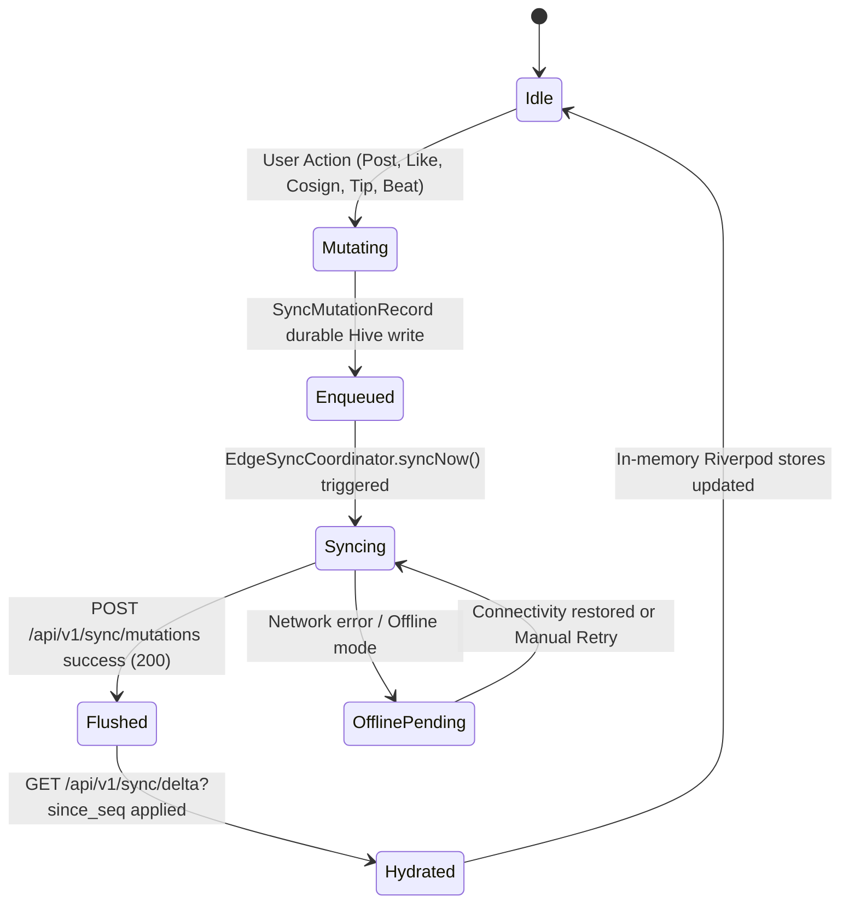

# Phase 46 Blueprint: Kinetic Reels V3 (Split-Screen Duets & Stem Isolation), Live Client $\leftrightarrow$ SQLite Delta Sync Coordinator, RunPod GPU V2 Master Router & Residual Video UI Sweeps

> **Target Workspaces:**
> - `apps/vhunambi_client/` (Flutter 3.x+ Cross-Platform Mobile/Desktop)
> - `apps/vhunambi_api/` (Node 24 / Hono REST API + Native SQLite WAL Persistence)
> - `tools/zr-studio-gpu/` (Python 3.10+ RunPod Serverless Audio Synthesis & Mastering)
>
> **Status:** 🟡 SPECIFICATION & ARCHITECTURAL CONTRACT  
> **Parent Specifications:**
> - [`docs/VHUNAMBI_AGENT_WORKFLOW_STANDARD.md`](file:///c:/Users/Ndugelo/VHUNAMBI/monorepo/docs/VHUNAMBI_AGENT_WORKFLOW_STANDARD.md)
> - [`docs/phases/phase_44_frontend_flawless_polish_and_edge_outbox/blueprint.md`](file:///c:/Users/Ndugelo/VHUNAMBI/monorepo/docs/phases/phase_44_frontend_flawless_polish_and_edge_outbox/blueprint.md)
> - [`docs/phases/phase_45_backend_sqlite_persistence_and_delta_sync/blueprint.md`](file:///c:/Users/Ndugelo/VHUNAMBI/monorepo/docs/phases/phase_45_backend_sqlite_persistence_and_delta_sync/blueprint.md)
> - [`.kiro/specs/adaptive-mini-player/design.md`](file:///c:/Users/Ndugelo/VHUNAMBI/monorepo/.kiro/specs/adaptive-mini-player/design.md)
> - [`docs/phases/phase_07_track_profiles/blueprint.md`](file:///c:/Users/Ndugelo/VHUNAMBI/monorepo/docs/phases/phase_07_track_profiles/blueprint.md)

---

## 1. Executive Summary & Cultural Grounding

Phase 46 delivers the unified multimedia, synchronization, and synthesis leap that bridges physical device interaction to high-concurrency backend persistence and serverless GPU synthesis:

1. **Residual Video UI Defect Eradication (Track A):** Sweeps the 3 visual imperfections identified in physical walkthrough `SVID_20261104_111526_1.mp4`:
   - Fixes the circular Share button on `ArtistProfileView` / `ProfileBannerHeader` in Light Mode by binding icon and border explicitly to context theme tokens.
   - Replaces the 80×80 attached image fallback in `CreateKineticPostSheet` with an offline-resilient procedural Vhunambi Vision gradient with `AppAssets.heritageCrateCover` and Phosphor sparkles.
   - Relocates the `Co-Sign` milestone pill (`Key('post_cosign_btn_${post.id}')`) on `ExploreSocialPostCard` into a dedicated wrap row alongside `Open Stems · N Remixes`, preventing clipping against long author titles and provenance badges.

2. **Kinetic Reels V3 (Track B):** Transforms `KineticReelsModal` from a dark lyrics box into a full-scale interactive visual performance stage:
   - **Vhunambi Vision Animated Stage:** Renders an audio-reactive ambient background (`AppAssets.heritageCrateCover` with 24% opacity, bass-reactive radial pulse driven by `frameModulationSnapshotProvider`, and cinematic vignette).
   - **Split-Screen Open-Verse Duet Stage (`Key('reel_duet_split_stage_${clip.id}')`):** When viewing a remixed clip, renders a dual-creator split visual stage displaying the Originator (`@makhadzi`) $\times$ Co-Creator (`@fifi` / `@cern`) with pulsing audio-reactive avatar rings and a **70/30 Co-Creation Split** royalty badge.
   - **On-Reel Interactive 4-Stem Isolation Bar (`Key('reel_stem_toggle_bar')`):** Translucent 4-pill overlay (`[Vocals]`, `[Log-Drum]`, `[Drums]`, `[Chords]`) that directly muter/solos stems in real-time, synchronizing with `stemMixerProvider`.

3. **Live Bi-Directional Client $\leftrightarrow$ SQLite Delta Sync Coordinator (Track C):**
   - Connects `SocialFeedPostsNotifier`, `CreatorWalletNotifier`, and `MarketplaceBeatsNotifier` to auto-enqueue `SyncMutationRecord` entries into Phase 44's `SyncOutboxService`.
   - Introduces `EdgeSyncCoordinator` to flush mutations to `POST /api/v1/sync/mutations` and hydrate incremental updates from `GET /api/v1/sync/delta?since_seq=<cursor>`, complete with offline fallback and a 1-tap `[ Sync Now ]` button in `ProfileSettingsDrawer`.

4. **Unified RunPod GPU V2 Master Pipeline Router (Track D):**
   - Resolves audit finding `SIG-F05` by turning `tools/zr-studio-gpu/handler.py` into a strict 5-stage sequential orchestrator:
     `Stage 1 (ace_step_synthesis)` $\rightarrow$ `Stage 2 (demucs_stem_separation)` $\rightarrow$ `Stage 3 (seed_vc_voice_conversion)` $\rightarrow$ `Stage 4 (stem_mastering_dsp)` $\rightarrow$ `Stage 5 (mmo_telemetry_extraction)`.
   - Records verifiable stage execution metrics (`stage_metrics: [{ name, executed, duration_ms, input_sha256, output_sha256 }]`) and packages master audio, stems, and Master Media Object v2.0 manifest to Cloudflare R2.

---

## 2. Forensic Defect & Root Cause Matrix (`SVID_20261104_111526_1.mp4`)

| Timestamp | Defect Caught on Screen | Root Cause (File & Line) | Architectural Solution | Regression Defense |
|---|---|---|---|---|
| **01:34 & 04:09** | Blank white circle Share button on `ArtistProfileView` in Light Mode | `profile_banner_header.dart` used `IconButton.styleFrom` without setting `foregroundColor: AppColors.textPrimaryOf(context)`; `artist_profile_view.dart` hardcoded `color: Colors.white` on top app bar share button. | Bind `foregroundColor` and icon `color` to `AppColors.textPrimaryOf(context)` and border to `AppColors.borderSubtleOf(context)`. | Widget test asserting `Theme(data: AppTheme.lightTheme)` renders icon with color `#121216`. |
| **00:12–00:22** | Broken-image icon in `CreateKineticPostSheet` 80×80 photo preview | `create_kinetic_post_sheet.dart` `errorBuilder` rendered fallback without local asset background or offline procedural canvas. | Wrap fallback inside `DecoratedBox` with subtle heritage crate texture, vibrant amber/cyan gradient, and Phosphor sparkle icon. | Offline widget test providing bad URL and verifying zero broken-image glyphs. |
| **00:25–00:55** | Truncated `"🔥 Co-..."` pill in post card header | Placed inside narrow horizontal header row alongside creator name, verified tick, handle, time, and follow button. | Move `_buildCosignButton` into a dedicated `Wrap` row adjacent to `Open Stems · N Remixes` below the caption. | Bounded width layout test with 360dp narrow viewport verifying full text `🔥 Co-Sign · 18/25`. |

---

## 3. System Topology & Cross-Layer Data Flow

```mermaid
graph TD
    subgraph Client ["Flutter Client (apps/vhunambi_client)"]
        UI[Explore / Reels / Wallet / Studio UI] -->|User Action: Post, Like, Cosign, Tip| Notifiers[Riverpod State Notifiers]
        Notifiers -->|1. Idempotent Mutation| Outbox[SyncOutboxService: Hive WAL Queue]
        EdgeCoord[EdgeSyncCoordinator] -->|2. Trigger Flush| Outbox
        EdgeCoord -->|3. POST /api/v1/sync/mutations| SyncAPI[Sync API Gateway]
        SyncAPI -->|4. Incremental Delta GET| EdgeCoord
        EdgeCoord -->|5. Merge Updates| Notifiers
        ReelsUI[KineticReelsModal V3] -->|Stem Solo/Mute| StemMixer[StemMixerNotifier]
    end

    subgraph Backend ["Node 24 API Gateway (apps/vhunambi_api)"]
        SyncAPI --> Server[Hono REST Server]
        Server --> SyncRoute[/api/v1/sync/mutations & delta]
        SyncRoute --> DB[(VhunambiDb: Native SQLite WAL)]
        DB -->|Monotonic seq Cursor| SyncRoute
    end

    subgraph GPUBridge ["RunPod GPU V2 Pipeline (tools/zr-studio-gpu)"]
        Server -->|Dispatches Job| Handler[handler.py: runpod_handler]
        Handler --> S1[Stage 1: ACE-Step 1.5 Synthesis]
        S1 --> S2[Stage 2: Demucs v4 4-Stem Separation]
        S2 --> S3[Stage 3: Seed-VC Voice Conversion]
        S3 --> S4[Stage 4: Phase 25 Mastering DSP]
        S4 --> S5[Stage 5: MMO 60Hz Telemetry Extraction]
        S5 --> R2[(Cloudflare R2 Bucket)]
        R2 -->|Signed Webhook| Server
    end
```

---

## 4. Dual-Viewport Layout Geometries (ASCII Wireframes)

### 4.1 Mobile Viewport Wireframe (< 768px, Kinetic Reels V3 Split-Screen Duet)
```
Mobile Kinetic Reel Viewport (390 x 844dp):
┌────────────────────────────────────────────────────────────────────────┐
│ [ < Back ]   (🎵) VHUNAMBI REELS   •   [ 70/30 Co-Creation Split ]     │ <-- Top Scrim Bar
├────────────────────────────────────────────────────────────────────────┤
│                                                                        │
│   ┌────────────────────────────────────────────────────────────────┐   │
│   │  ORIGINATOR              🤝 CO-CREATOR                         │   │ <-- Split-Screen
│   │  (@makhadzi)                (@fifi)                            │   │     Duet Stage
│   │  ┌──────────┐               ┌──────────┐                       │   │     (Audio-Reactive
│   │  │ 👤 56dp  │               │ 👤 56dp  │                       │   │      Pulse Rings)
│   │  └──────────┘               └──────────┘                       │   │
│   │  Lead Vocals & Chorus       Amapiano Log-Drum & Remix Flip     │   │
│   └────────────────────────────────────────────────────────────────┘   │
│                                                                        │
│                                                                        │
│             ılılıllı|ı|ı|lılıl|  KINETIC LYRICS  |lılıllı|ı|ı|         │ <-- 60 FPS Canvas
│                "Ndo mufuna Matibe, mbilu yanga yo vhuya..."            │     + Vision Stage
│                                                                        │
│                                                                        │
│   ┌────────────────────────────────────────────────────────────────┐   │
│   │ [ 🎤 Vocals ]   [ 🥁 Log-Drum ]   [ 🥁 Drums ]   [ 🎹 Chords ]  │   │ <-- 4-Stem Isolation
│   └────────────────────────────────────────────────────────────────┘   │     Bar (Tap Mute/Solo)
│                                                                        │
│   Ndo Mufuna Matibe (Open-Verse Remix)                                 │ <-- Track Details
│   @fifi • Original sound by @makhadzi • Amapiano                       │
│   ┌──────────────────────────────────────────────────┐                 │
│   │ ═════════════════════════════════════════ 0:14 / 0:30 │           │ <-- Scrubber
│   └──────────────────────────────────────────────────┘                 │
└────────────────────────────────────────────────────────────────────────┘
```

### 4.2 Desktop Viewport Wireframe (> 1024px, Kinetic Reels Cinema Stage)
```
Desktop Centered Cinema Stage (Centered Max-Width 540px in 1280px Container):
┌──────────────────────────────────────────────────────────────────────────────────────────────────┐
│                                    ┌────────────────────────┐                                    │
│                                    │ [ < ] VHUNAMBI CINEMA  │                                    │
│                                    ├────────────────────────┤                                    │
│                                    │ 🤝 Makhadzi x Fifi     │                                    │
│                                    │   70/30 Co-Creation    │                                    │
│                                    │                        │                                    │
│                                    │      KINETIC LYRICS    │                                    │
│                                    │      VISION BACKDROP   │                                    │
│                                    │                        │                                    │
│                                    │ [Vocals] [Bass] [Drums]│ <-- Stem Toggle Bar                │
│                                    │                        │                                    │
│                                    │ Ndo Mufuna Matibe      │                                    │
│                                    │ [ ❤️ 1.8K ] [ 💬 96 ]  │                                    │
│                                    └────────────────────────┘                                    │
└──────────────────────────────────────────────────────────────────────────────────────────────────┘
```

---

## 5. Component Hierarchy Tree

```
KineticReelsModal (Theme: AppTheme.darkTheme)
├── PageView.builder (Clips)
│   └── _ReelItemView
│       └── Stack (expand)
│           ├── GenreBackdropGradient
│           ├── VhunambiVisionAnimatedStage (AppAssets.heritageCrateCover 24% + Radial Pulse)
│           ├── KineticPreviewCanvas (60 FPS Telemetry & Karaoke)
│           ├── ReelDuetSplitStage (Key: 'reel_duet_split_stage_${clip.id}')
│           │   ├── OriginatorColumn (Avatar + Pulse Ring + Handle)
│           │   ├── CoCreationSplitBadge ('70/30 Split')
│           │   └── RemixerColumn (Avatar + Pulse Ring + Handle)
│           ├── BottomReadabilityScrim (LinearGradient black87)
│           ├── TapPlayPauseZone (Center 44dp icon)
│           ├── TopProgressScrubber & Header
│           │   ├── LinearProgressIndicator
│           │   └── ReelsTopBar ([Back] [Search] [Title])
│           ├── ReelStemToggleBar (Key: 'reel_stem_toggle_bar')
│           │   ├── StemPill: Vocals (Key: 'reel_stem_pill_vocals')
│           │   ├── StemPill: Log-Drum (Key: 'reel_stem_pill_bass')
│           │   ├── StemPill: Drums (Key: 'reel_stem_pill_drums')
│           │   └── StemPill: Chords (Key: 'reel_stem_pill_melodic')
│           ├── ReelBottomTrackInfo (Title, Artist, Audio Badge, Waveform)
│           └── ReelActionRail (Like, Comment, Remix, Gift, Share, Translate)
```

---

## 6. Finite State Machine & State Transition Matrix



### State Transition Table:
| Event / Trigger | Initial State | Target State | Guard Conditions | Side Effects / Outbox Actions |
|---|---|---|---|---|
| User taps Co-Sign | Idle | Mutating | `isCosigned == false` | Optimistic counter increment + `SyncMutationRecord` enqueued |
| User taps Stem Pill | Active Reel | Mixed Audio | `channel != null` | `stemMixerProvider.notifier.toggleMute(type)` or `toggleSolo(type)` |
| `syncNow()` called | Idle | Syncing | Outbox not empty or delta check | Flush payload to server; poll `/delta`; update last `seq` cursor |
| GPU job received | Received | Synthesizing | Valid `song_spec` | Execute Stage 1 ACE-Step; record `stages[0]` duration & SHA-256 |
| Voice config present | Stems Separated | Voice Converted | `svc_config != null` | Execute Stage 3 Seed-VC on `vocals.wav`; record `stages[2]` |

---

## 7. Design Token Bindings Matrix

| Component | Visual Role | Token Binding |
|---|---|---|
| Share Button (Profile) | Surface & Border | `AppColors.surfaceElevatedOf(context)` / `AppColors.borderSubtleOf(context)` |
| Share Button (Profile) | Icon Glyphs | `AppColors.textPrimaryOf(context)` (crisp #121216 in Light Mode) |
| Composer 80×80 Image | Fallback Surface | Procedural LinearGradient (`AppColors.brandPrimary` $\rightarrow$ `badgeCyan`) + Sparkle |
| Co-Sign Milestone Pill | Elevated Chip | `AppColors.surfaceSecondaryOf(context)` / `AppColors.brandPrimary` border when active |
| Reel Stage Backdrop | Ambient Vision | `AppAssets.heritageCrateCover` at 24% opacity + Radial Bass Ring |
| Duet Split Stage | Header Backdrop | `Colors.black.withValues(alpha: 0.65)` + `AppRadius.cardBorder` |
| Stem Isolation Pills | Translucent Strip | `Colors.black54` container + `AppColors.brandPrimary` / `badgeCyan` when active |

---

## 8. Geometry & Safe Area Invariants

- **Kinetic Reel Safe Area**: Top scrubber placed at `MediaQuery.paddingOf(context).top`.
- **Reel Stem Toggle Bar**: Positioned exactly 88dp above bottom safe area, cleanly clear of track info and caption.
- **Top Bar Integration**: `VhunambiTopBarMetrics.totalHeight(context)` applied across all non-fullscreen views.
- **Outbox Persistence**: Mutation queue stored in Hive box `vhunambi_sync_outbox_box`.

