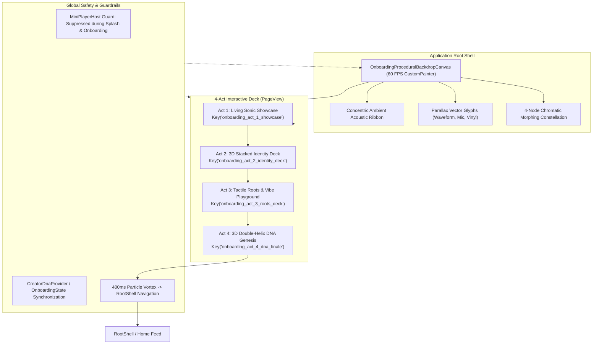

# Phase 47: Motion-Graphics Onboarding Engine, 3D Stacked Vector Cards & Double-Helix DNA Genesis

> **Document Type:** Specification Blueprint (Revision 2.1 — Zero-Summarization Law)  
> **Status:** APPROVED FOR IMPLEMENTATION  
> **Target Package:** `apps/vhunambi_client`  
> **Target Release:** Vhunambi V4.7 (Phase 47)  
> **Hardware Target:** Android ARM64 (`EPHUT20917014649`)

---

## 1. Cultural Context & Forensic Genesis

Vhunambi (*Tshivenḓa: "the artistic soul, mastery, and capacity to sing and produce"*) bridges ancient oral storytelling traditions with sovereign generative AI audio synthesis. In African musical philosophy, entering a musical space is not a sterile administrative form—it is a sacred initiation, a rhythmic gathering (*Tshikona*, *Ingoma*, *Lekgotla*), where creator identity, regional tongue, and ancestral tempo fuse into a singular sonic fingerprint.

### 1.1 Forensic Defect Matrix (`SVID_20261104_154954_1.mp4`)

A rigorous forensic audit of the physical Android device walkthrough recorded at `2026-11-04T15:49:54` identified five catastrophic UX breakdowns:

| Timestamp | Defect Description | Forensic Root Cause | Architectural Remedy |
| :--- | :--- | :--- | :--- |
| **00:06–00:09** | **Mini-Player Pill Bleeds Over Splash & Onboarding** | `MiniPlayerHost._shouldHide` relied solely on `ModalRoute.of(context)?.settings.name`, which evaluates to `'/'` on root and `null` on anonymous routes, allowing the persistent mini-player to float over the Splash screen and Slide 1. | Connect `MiniPlayerHost` to `isSplashActiveProvider` and `onboardingStateProvider.hasCompletedOnboarding`; suppress rendering unconditionally during Splash and Onboarding. |
| **00:21–00:34** | **12× Duplicate "Amapiano" Chips on Genre Slide** | `_genreToEnum` in `onboarding_view.dart` mapped unknown genre IDs to `orElse: () => Genre.amapiano`. `GenreColorChip` then rendered `genre.displayName`, resulting in 11 identical "Amapiano" chips in a row. | Retire `GenreColorChip` enum coupling; implement `TactileGenreCard` displaying the explicit unique genre string, vibrant palette, and dancing EQ equalizer bars. |
| **00:45–00:56** | **Radio-Button Questionnaire & 5× Duplicate "Energetic" Chips** | Sound Signature was built as giant stacked radio-button lists (`Tempo Feel`, `Vocal Energy`), and `_moodStringToEnum` mapped non-matching moods to `Mood.energetic`, rendering 5 identical "Energetic" pills. | Retire the settings-form radio buttons entirely; replace with a continuous **Tactile Vibe Energy Slider/Orb** and interactive visual mood orbs. |
| **00:13–00:20** | **Flat Emojis & Repetitive Chip Forms (Slides 2 & 4)** | Identity selection relied on flat rectangular boxes with raw unicode emojis (`🎹`, `🎤`, `✍️`, `⚡`, `🎧`) violating `STD-UIUX-001`, with duplicate chip grids on Slide 4. | Implement **3D Stacked & Flippable Identity Tarot Deck** with programmatic `CustomPainter` vector artwork and 3D matrix spring physics. |
| **00:57–01:04** | **Static Final Slide & Truncated "Activate Creato..." Button** | Finale was a static 25% progress bar with crowded 6-dot indicator and truncated CTA button on 360dp mobile viewports. | Build **Act 4 Double-Helix DNA Particle Finale** (`CreatorDnaHelixFinale`) with spinning 3D strand, real-time particle emission, and full-width CTA. |

---

## 2. Motion Reference Analysis (`SVID_20261104_145338_1.mp4`)

The motion graphics reference provided demonstrates a living 60 FPS vector canvas:
1. **Geometric Constellation Morphing:** 4 primary chromatic nodes (`#F97316` Amber, `#06B6D4` Cyan, `#10B981` Emerald, `#F59E0B` Gold) orbit around a shared gravitational center.
2. **Satellite Fission & Fusion:** Nodes split into tiny satellite dots (radii 2–4dp), orbit in retrograde paths, and coalesce back into parent bodies.
3. **Pill Capsule Stretching:** Nodes stretch along velocity vectors into rounded capsule geometries (width-to-height ratio 3.2:1) during phase transitions.
4. **Parallax Phosphor Glyphs:** Soft, translucent vector glyphs drift in the background at varying depth coefficients (Z = 0.2 to 0.8).
5. **Acoustic Waveform Ripples:** Touching any card emits concentric bezier wave rings that modulate canvas line weights.

---

## 3. High-Level Architectural Topology



---

## 4. Viewport Layouts & Visual Wireframes

### 4.1 Mobile Viewport (< 768px, Reference 360 × 800 dp)

```text
+-------------------------------------------------------------+
| [<- Back]              VHUNAMBI                 [Skip / Help]|
|                                                             |
|   ~~~~~~~~~~~~~~~~~~~~~~~~~~~~~~~~~~~~~~~~~~~~~~~~~~~~~~~   |
|   ~    (60 FPS OnboardingProceduralBackdropCanvas)      ~   |
|   ~     [Amber]           [Cyan]                        ~   |
|   ~          \             /     (Orbiting Nodes)       ~   |
|   ~           ( Vhunambi )                              ~   |
|   ~          /             \                            ~   |
|   ~     [Emerald]         [Gold]                        ~   |
|   ~~~~~~~~~~~~~~~~~~~~~~~~~~~~~~~~~~~~~~~~~~~~~~~~~~~~~~~   |
|                                                             |
|   +-----------------------------------------------------+   |
|   |                  ACTIVE ACT STAGE                   |   |
|   |                                                     |   |
|   |   [ Act 1: Living Constellation Showcase ]          |   |
|   |     or                                              |   |
|   |   [ Act 2: 3D Stacked & Fanned Tarot Deck ]         |   |
|   |     (Card tilts, slides, flips on swipe/tap)        |   |
|   |     or                                              |   |
|   |   [ Act 3: 12x Tactile Vinyls + Vibe Energy Orb ]   |   |
|   |     (Dancing EQ bars, 0 duplicate chips)            |   |
|   |     or                                              |   |
|   |   [ Act 4: Interactive 3D Double-Helix DNA ]        |   |
|   |     (Touch-spinning double helix with particles)    |   |
|   +-----------------------------------------------------+   |
|                                                             |
|   [ o   o   o   o ] (4-Act Glowing Step Indicator)          |
|                                                             |
|   +-----------------------------------------------------+   |
|   |  [   ACTIVATE MY CREATOR DNA (100% Full Width)   ]  |   |
|   +-----------------------------------------------------+   |
+-------------------------------------------------------------+
```

### 4.2 Desktop Viewport (> 1024px, 1440 × 900 dp)

```text
+----------------------------------------------------------------------------------------------------+
|  (V) VHUNAMBI SOVEREIGN AUDIO                                               [ Exit to Studio (X) ]  |
+----------------------------------------------------------------------------------------------------+
|                                                  |                                                 |
|          LIVING MOTION GRAPHICS STAGE            |             INTERACTIVE CARD WORKSPACE          |
|                                                  |                                                 |
|    ~~~~~~~~~~~~~~~~~~~~~~~~~~~~~~~~~~~~~~~~~~    |   Act 2 / Act 3 / Act 4 Active Stage:           |
|    ~                                        ~    |                                                 |
|    ~    (60 FPS Procedural Node System)     ~    |   +-----------------------------------------+   |
|    ~         *       O       *              ~    |   |  [ Card Fan / Helix / Vinyl Grid ]      |   |
|    ~          \     / \     /               ~    |   |                                         |   |
|    ~           [ Vhunambi Core ]            ~    |   |  Programmatically painted vectors       |   |
|    ~          /     \ /     \               ~    |   |  Real-time soundwave visualization      |   |
|    ~         *       O       *              ~    |   |  Zero duplicate chips                   |   |
|    ~                                        ~    |   +-----------------------------------------+   |
|    ~    Harmonic Wave Ribbon & Satellite    ~    |                                                 |
|    ~    Particle Physics at 60 FPS          ~    |   [ Previous ]                 [ Continue -> ]  |
|    ~~~~~~~~~~~~~~~~~~~~~~~~~~~~~~~~~~~~~~~~~~    |                                                 |
|                                                  |   Selected Roots: Amapiano * Tshivenḓa * Vocal  |
+----------------------------------------------------------------------------------------------------+
```

---

## 5. Design Tokens & Visual Hierarchy Matrix

All visual surfaces in Phase 47 strictly bind to `package:vhunambi_client/core/theme/` tokens. Zero hardcoded hex colors are permitted:

| Element | Dark Mode Token (`AppTheme.darkTheme`) | Light Mode Token (`AppTheme.lightTheme`) | Cultural / Semantic Significance |
| :--- | :--- | :--- | :--- |
| **Canvas Background** | `AppColors.surfaceCanvas` (`#0A0A0C`) | `AppColors.surfaceCanvas` (`#FAF7F2`) | Pitch black cinema vs Warm Ivory paper |
| **Node 1 (Amber / Sunset)** | `AppColors.brandPrimary` (`#F97316`) | `AppColors.brandPrimary` (`#EA580C`) | Highveld African sunset, core energy |
| **Node 2 (Cyan / Electro)** | `AppColors.badgeCyan` (`#06B6D4`) | `AppColors.badgeCyan` (`#0891B2`) | Amapiano digital logs, high frequencies |
| **Node 3 (Emerald / Roots)** | `AppColors.badgeGreen` (`#10B981`) | `AppColors.badgeGreen` (`#059669`) | Heritage soil, organic acoustic timbre |
| **Node 4 (Gold / Royalty)** | `AppColors.badgeAmber` (`#F59E0B`) | `AppColors.badgeAmber` (`#D97706`) | Sovereign royalty, commercial creator wealth |
| **Glass Card Surface** | `Colors.white.withValues(alpha: 0.06)` | `Colors.black.withValues(alpha: 0.04)` | Translucent tactile glass container |
| **Card Border** | `AppColors.borderSubtleOf(context)` | `AppColors.borderSubtleOf(context)` | Crisp contrast separation |
| **CTA Primary Button** | `AppColors.brandPrimary` | `AppColors.brandPrimary` | High-visibility primary action |
| **CTA Button Text** | `AppColors.darkTextPrimary` (`#FFFFFF`) | `AppColors.darkTextPrimary` (`#FFFFFF`) | High-contrast cinema white |

---

## 6. MiniPlayerHost Suppression Geometry & Safety

```text
Splash / Onboarding Life-Cycle:
[ App Start ] -> isSplashActive = true   -> MiniPlayerHost returns SizedBox.shrink()
      |
      v
[ Splash Complete ] -> hasCompletedOnboarding == false -> MiniPlayerHost returns SizedBox.shrink()
      |
      v
[ Act 4 Finale Complete ] -> completeOnboarding() -> isSplashActive = false
      |
      v
[ RootShell Mounted ] -> hasActiveTrack == true -> MiniPlayerHost displays Bar / Pill form dock
```

