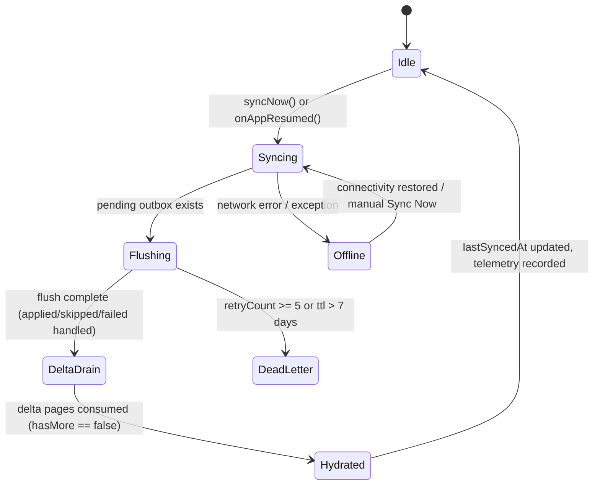

# Phase 48 Blueprint: Edge Sync Production Hardening

## 1. Metadata & Architectural Scope

- **Phase Code:** PHASE-48
- **Phase Title:** Edge Sync Production Hardening & Offline Fault Tolerance
- **Status:** 🟡 IN EXECUTION / REMEDIATION
- **Target Workspaces:** `apps/vhunambi_client`, `apps/vhunambi_api`
- **Upstream Dependencies:** Phase 44 (Edge Outbox Baseline), Phase 45 (SQLite WAL & Delta Sync), Phase 46 (GPU Pipeline Sync)
- **Downstream Consumers:** All financial, social, and audio production workflows

---

## 2. Executive Summary & African Musical Context

Phase 48 hardens the offline-first edge synchronization layer into a production-grade, fault-tolerant synchronization engine. 

### Cultural & Musical Context
African music creators frequently produce music under severe infrastructural friction:
1. **Intermittent Cellular Data (3G/LTE/Edge):** In townships and regional creative hubs (e.g., Soweto, Khayelitsha, Bulawayo, Kumasi), connectivity drops without warning. Creators spending hours arranging 112–115 BPM Amapiano log drums, recording Maskandi guitar riffs, or slicing vocal chops must never lose work when signal drops.
2. **Rolling Power Outages (Load Shedding):** Cellular base stations frequently go offline during regional grid blackouts.
3. **Financial Priority Law:** Casual social engagement (likes, play counts) generates high volumes of mutations. When network resumes, **financial transactions** (instant wallet top-ups, ZAR Ozow/EFT cashouts, beat marketplace commercial licenses, 70/30 stem remix royalties) must never wait behind thousands of queued likes. 
4. **Commutative Counter Invariant:** When two creators in different provinces like or co-sign a track offline, both co-signs must increment the counter on sync (`count + 1`) rather than overwriting each other.

---

## 3. Architecture Topology & Cross-Layer Data Flow

```
┌─────────────────────────────────────────────────────────────────────────────┐
│                         CLIENT SIDE (Flutter/Dart)                          │
├─────────────────────────────────────────────────────────────────────────────┤
│                                                                             │
│  [ UI: ProfileSettingsDrawer ]                                             │
│    ├── [ Sync Now ] button (Key: settings_sync_now_btn)                     │
│    ├── Dead-Letter count chip (Key: settings_dead_letter_count)              │
│    └── Sync Latency ms text (Key: settings_sync_latency_ms)                 │
│                                                                             │
│  [ EdgeSyncCoordinator : StateNotifier<EdgeSyncState> ]                     │
│    ├── syncNow() — flush outbox → drain multi-page deltas (max 10 pages)   │
│    ├── onAppResumed() — auto-sync on app resume                            │
│    ├── Stream<bool> connectivityStream (injectable, empty in tests)        │
│    └── EdgeSyncState — includes 50-item telemetry ring buffer              │
│                                                                             │
│  [ SyncOutboxService ] — Hive box vhunambi_sync_outbox_box                 │
│    ├── SyncMutationRecord (schemaVersion: 2, priority, baseSeq)            │
│    ├── getPendingBatch(maxBatchSize) — priority-ordered drain              │
│    ├── Compaction: size cap 1000, evict background first, never critical   │
│    ├── Dead-letter: retryCount >= 5 or ttlDays >= 7                        │
│    └── v1 → v2 JSON migration in fromJson()                                │
│                                                                             │
└─────────────────────────────────────────────────────────────────────────────┘
                               │ HTTPS (POST /api/v1/sync/mutations, GET /api/v1/sync/delta)
                               ▼
┌─────────────────────────────────────────────────────────────────────────────┐
│                         BACKEND SIDE (Node.js/Hono + SQLite WAL)            │
├─────────────────────────────────────────────────────────────────────────────┤
│                                                                             │
│  [ POST /api/v1/sync/mutations ]                                           │
│    └── Per-item SAVEPOINT — item #3 failure never aborts #1, #2, #4..#10   │
│    ├── Commutative counters: like/cosign/repost/tip → count + 1            │
│    ├── Versioned edits: baseSeq stale → conflict, no overwrite             │
│    └── Return: { applied, skipped, failed[], latestSeq }                   │
│                                                                             │
│  [ GET /api/v1/sync/delta?since_seq=X&limit=Y ]                            │
│    └── Paginated: { changes, latestSeq, nextCursorSeq, hasMore }           │
│    └── ETag: "cursor-<latestSeq>" / 304 Not Modified preserved             │
│                                                                             │
└─────────────────────────────────────────────────────────────────────────────┘
```

---

## 4. Finite State Machine (EdgeSyncCoordinator)



---

## 5. Dual-Viewport Layout Geometries (ProfileSettingsDrawer Edge Sync Section)

### Desktop Viewport (1440dp)
```
┌──────────────────────────────────────────────────────────────┐
│  [⚡ Edge Sync Engine]                      [ Sync Now ]    │
│  Status: Idle (Synced 2m ago)                                │
│  ┌─────────────────────────┐  ┌───────────────────────────┐  │
│  │ ⚡ Latency: 42ms        │  │ 📬 Dead-Letter: 0 items   │  │
│  └─────────────────────────┘  └───────────────────────────┘  │
└──────────────────────────────────────────────────────────────┘
```

### Mobile Viewport (360dp)
```
┌──────────────────────────────────┐
│ [⚡ Edge Sync Engine]            │
│ Status: Idle (Synced 2m ago)     │
│ [ ⚡ 42ms ]   [ 📬 0 dead-letter ]│
│ [───────── Sync Now ───────────] │
└──────────────────────────────────┘
```

---

## 6. Design Token Matrix (`AppColors`)

| UI Element | Dark Mode Token | Light Mode Token | Purpose |
|---|---|---|---|
| Edge Sync Header Icon | `AppColors.brandPrimary` (`#F97316`) | `AppColors.brandPrimary` (`#F97316`) | Vibrant sync indicator |
| Latency Metric Chip | `AppColors.badgeCyan` (`#22D3EE`) | `AppColors.badgeCyanBg` | Network speed status |
| Dead-Letter Status | `AppColors.accentWarning` (`#F59E0B`) | `AppColors.accentWarning` | Flagging dead items |
| Sync Button Fill | `AppColors.brandPrimary` | `AppColors.brandPrimary` | Primary CTA |
| Sync Button Text | `AppColors.brandContrast` (`#000000`) | `AppColors.brandContrast` | High-contrast black label |

---

## 7. Priority Ordering Matrix

| Priority | Use Cases | Examples |
|---|---|---|
| `critical` | Financial & legal transactions | Wallet top-up, ZAR EFT/Ozow payout, beat/vocal license purchase, 70/30 remix royalty split |
| `normal` | Creator content & profile | Kinetic post creation, repost, profile edit, Open-Verse publish |
| `background` | Social engagement | Like, co-sign, play count increment |

**Drain rule:** `getPendingBatch()` sorts ascending by `SyncPriority` (critical → normal → background), then by `createdAt` chronological.

---

## 8. Geometry & Safe Invariants

| Invariant | Value | Enforcement |
|---|---|---|
| Max outbox size | 1,000 records | Evict oldest `background` record first; never evict `critical` |
| Max retries | 5 | Exceeding → `SyncRecordStatus.deadLetter` |
| TTL days | 7 | Older than 7 days → `deadLetter` |
| Max batch size | 50 | Per flush cycle |
| Max delta pages per sync | 10 | Prevents runaway pagination |
| Delta page limit | 1–200 (default 100) | Backend enforces max |
| Telemetry ring buffer | 50 events | Oldest evicted when full |
