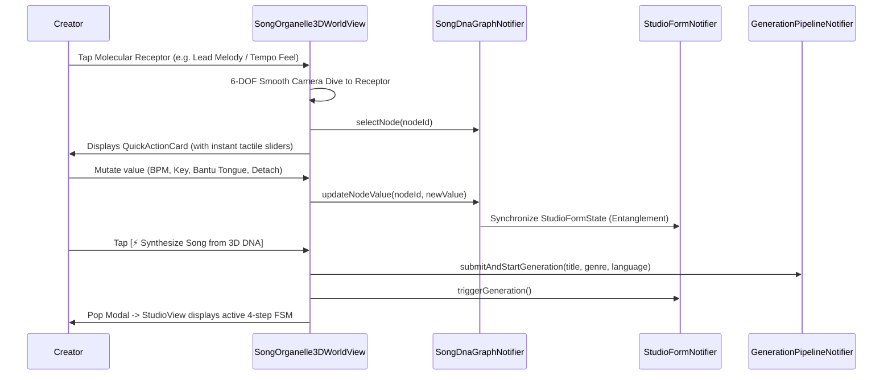

# Phase 51: Detailed Technical & Visual Design

## 1. Visual Aesthetics & Microscopic Palette Tokens

| Structure | Hex Color Range | Blending & Effects | Visual Role |
|---|---|---|---|
| **Abyssal Void** | `#020813` $\to$ `#041424` | Radial gradient | 100% opaque cellular fluid void |
| **Bokeh Organelles** | `#00F5D4`, `#FF6B00`, `#10B981` | `MaskFilter.blur(BlurStyle.normal, 16.0)` | Distant depth-of-field cellular clusters |
| **Outer Membrane** | `#00F5D4` $\to$ `#06B6D4` | Triangulated wireframe, Fresnel rim alpha | Deformable 3D cyan cellular mesh |
| **Inner Nucleus** | `#FF6B00` $\to$ `#FFB703` | Multi-stop radial corona, stippled sphere | Blazing amber genomic core |
| **Neural Filaments** | `#FF8500` ($0.7$ alpha) | Cubic Bézier 3D curves with BPM glow | Internal cytoplasmic energy conduits |
| **Dendrite Arm 1** | `#FF6B00` (Amber) | Glowing molecular bonds + photon dots | Beat & Rhythm branch |
| **Dendrite Arm 2** | `#00F5D4` (Cyan) | Glowing molecular bonds + photon dots | Vocal & Linguistic branch |
| **Dendrite Arm 3** | `#10B981` (Emerald) | Glowing molecular bonds + photon dots | Harmonic & Instrument branch |
| **Dendrite Arm 4** | `#F72585` (Magenta) | Glowing molecular bonds + photon dots | Invasive & External Intake branch |

---

## 2. Mathematical Formulations

### 2.1 3D Geodesic Spherical Harmonic Deformation
The outer cyan membrane is defined on spherical coordinates $(\theta, \phi)$ where $\theta \in [0, 2\pi]$ (longitude) and $\phi \in [-\pi/2, \pi/2]$ (latitude).
At time $t$, radius $r(\theta, \phi, t)$ is evaluated as:
$$r(\theta, \phi, t) = R_{\text{base}} \cdot \Bigl(1.0 + 0.07\sin(3\theta + 1.6t)\cos(2\phi - 1.2t) + 0.04\cos(4\phi + 2.2t)\Bigr)$$
Vertices are transformed to 3D Cartesian coordinates:
$$x = r \cos(\phi)\cos(\theta), \quad y = r \sin(\phi), \quad z = r \cos(\phi)\sin(\theta)$$
Camera rotation by yaw $\psi$ and pitch $\theta_p$ yields:
$$x_1 = x\cos\psi - z\sin\psi, \quad z_1 = x\sin\psi + z\cos\psi$$
$$y_2 = y\cos\theta_p - z_1\sin\theta_p, \quad z_2 = y\sin\theta_p + z_1\cos\theta_p$$
Perspective projection onto the 2D viewport:
$$\text{scale} = \frac{f}{f + d_{\text{cam}} + z_2}, \quad X_s = c_x + x_1 \cdot \text{scale}, \quad Y_s = c_y + y_2 \cdot \text{scale}$$

### 2.2 Cubic Bézier Neural Filaments
Internal filaments connecting the amber nucleus $\mathbf{P}_0 = (0, 0, 0)$ to membrane boundary point $\mathbf{P}_3$ utilize intermediate control vectors $\mathbf{P}_1$ and $\mathbf{P}_2$ derived via cross product with camera up-vector to produce organic S-curves:
$$\mathbf{B}(u) = (1-u)^3\mathbf{P}_0 + 3(1-u)^2 u\mathbf{P}_1 + 3(1-u)u^2\mathbf{P}_2 + u^3\mathbf{P}_3, \quad u \in [0, 1]$$

### 2.3 Card Stack Z-Order Inversion Sorting
In `InteractiveIdentityCardStack`, given cards $i \in \{0, \dots, N-1\}$ and active index $A$:
$$\text{depth}(i) = |i - A|$$
Sorted stack list ordering:
$$\text{SortComparator}(a, b) = \text{depth}(b).\text{compareTo}(\text{depth}(a))$$
This guarantees cards with larger depth values (furthest in background) are emitted first into the `Stack.children` list, while $\text{depth}(A) = 0$ is guaranteed to be emitted last, rendering it above all other cards.

---

## 3. Component Interaction & Quantum Entanglement

