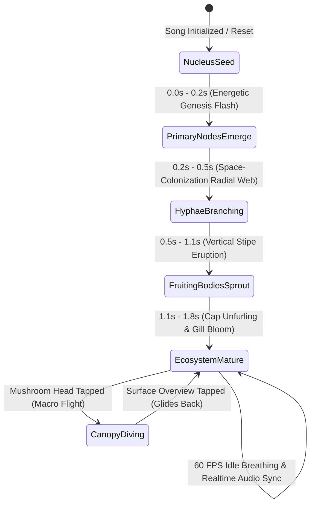
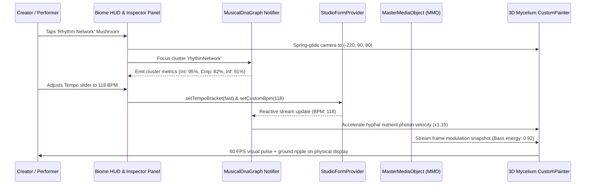

# 🍄 PHASE 53 BLUEPRINT: THE 3D ORGANIC MYCELIUM BIOME
## "A Song as a Living Ecosystem" — Multi-Cluster 3D Biological Visualization Engine

---

### 1. Executive Overview & Visual North Star

Phase 53 represents a fundamental paradigm shift in the sonic identity and user experience of Vhunambi. In previous iterations (Phases 50–52), the Song DNA was modeled as an isolated microscopic organelle floating in an empty void. While mathematically sophisticated in its vertex calculations, physical hardware recordings on the Huawei test device (`EPHUT20917014649`) conclusively demonstrated that a floating spherical structure in zero-gravity inherently breaks down when translating multi-track musical complexity:
1. **Lack of Ground Plane / Horizon**: Without a 3D ground plane or terrestrial elevation, rotating the camera causes background and foreground nodes to project right through the central nucleus, collapsing into an unreadable tangle of overlapping text pills.
2. **Gesture Collision & Camera Lock**: Because touch hit-targets for dozens of microscopic nodes were distributed across the canvas, 1-finger orbit drags collided with node hit-detectors, and 2-finger pinch gestures failed to resolve focal deltas cleanly.
3. **Disconnected Musical Metaphor**: Floating dots and sticks resemble generic graph theory diagrams rather than the warm, living, deeply interconnected soul of African music synthesis.

**The Solution: The Organic Mycelium Network (`3D Biome: Living Music Ecosystem`)**
In nature, a fungal mycelium network is the planetary biological internet: an underground web of ultra-fine branching filaments (hyphae) that connect distinct plants, transmit chemical nutrients, and send instantaneous electrical signals across an ecosystem. Periodically, at hubs of high energetic density, the network erupts upward through the surface into magnificent **Mushroom Fruiting Bodies**.

In Vhunambi Phase 53, **a song does not merely contain musical components; those components form an interconnected living ecosystem**:
* The entire composition lives upon a contoured, bioluminescent 3D terrain grid viewed from an elevated 3D perspective ($30^\circ - 55^\circ$ elevation).
* The **6 Core Musical Domains** are represented by 6 giant, glowing **Mushroom Fruiting Bodies (Parent Clusters)** rising out of an underground web of glowing hyphal filaments:
  1. 🎵 **Melody Core** (Golden-Amber `#FF9E00` — Central Dominant Mushroom): The song's heartbeat, motifs, pitch patterns, and vocal hooks.
  2. 🥁 **Rhythm Network** (Electric Blue-Cyan `#00B4D8` — Foreground Left): BPM, percussion, Amapiano log-drum syncopation, and groove pocket.
  3. 🎤 **Vocal Network** (Bioluminescent Violet `#9D4EDD` — Upper Left): Lead vocals, choir harmonies, Bantu oral cadence, and sovereign voice clones.
  4. 🎼 **Harmony Network** (Vibrant Emerald `#10B981` — Upper Right): Chords, African pentatonic/heptatonic modal scales, and harmonic progressions.
  5. 💗 **Emotion Network** (Magenta-Rose `#F72585` — Right Midground): Mood, energy, emotional tension, and sonic warmth.
  6. 🎚️ **Production Network** (Teal-Aqua `#06D6A0` — Lower Center): Sound design, spatial reverb acoustics, Stem-Lock authority, and mixing balance.
* These 6 clusters are **not isolated islands**. Their underground mycelium filaments physically cross, weave, and intersect. A vocal topline connects `melodyCore` $\leftrightarrow$ `vocalNetwork`; a log-drum bassline connects `rhythmNetwork` $\leftrightarrow$ `harmonyNetwork` $\leftrightarrow$ `productionNetwork`. At these intersections, **Network Junctions** and tiny **Sprout / Pinhead Mushrooms** emerge!
* **Zero Pill Clutter in Overview Mode**: When viewing the global Biome landscape, ONLY the 6 Parent Mushroom Heads display clean floating circular icon badges above their glowing translucent caps.
* **Canopy Focus & Inspector Drawer**: Tapping any Mushroom Head glides the camera into that mushroom's colony, illuminates its radial gills and attached child nodes, and unfurls the right-hand **Cluster Inspector Drawer** (`BiomeClusterInspectorPanel`) featuring live waveforms, 3 metric readouts (`Intensity %`, `Complexity %`, `Influence %`), related intersecting nodes, and tactile Studio Cockpit mutators.
* **Song Journey Timeline Scrubber**: A tactile bottom scrubber (`Intro ─── Verse ─── ● Chorus ─── Bridge ─── Outro`) modulates bioluminescent activity across the 6 clusters in real time.

---

### 2. Forensic Post-Mortem: Why Floating Spheres Fail vs. Why Mycelium Landscapes Win

```
┌────────────────────────────────────────────────────────────────────────────────────────┐
│                               ARCHITECTURAL COMPARISON                                 │
├────────────────────────────────────────┬───────────────────────────────────────────────┤
│ PHASE 51/52 FLOATING SPHERICAL VOID    │ PHASE 53 ORGANIC MYCELIUM 3D BIOME            │
├────────────────────────────────────────┼───────────────────────────────────────────────┤
│ • Zero ground plane or horizon; nodes  │ • Contoured 3D terrain grid with natural      │
│   orbit in empty 3D space.             │   horizon line and 35°–50° pitch elevation.   │
│ • Child pills project directly over    │ • 6 Parent Mushroom Heads positioned at       │
│   the center nucleus when rotated.     │   dedicated spatial loci; zero overlap.       │
│ • Straight lines or curved tubes bunch │ • Web of hyphae filaments branching across    │
│   into a central chaotic tangle.       │   terrain via space-colonization algorithm.   │
│ • Child text pills always visible in   │ • Overview mode shows ONLY 6 parent badges;   │
│   overview, colliding and clipping.    │   child leaves reveal ONLY upon branch dive.  │
│ • Pan and Scale gestures conflicted;   │ • Decoupled touch surface: background gesture │
│   macro dive broke canvas rotation.    │   plane never steals HUD button taps.         │
│ • Static visual graph with no growth   │ • 5-stage biological growth animation: tiny   │
│   or song timeline relationship.       │   nucleus seed -> branching -> mature canopy. │
└────────────────────────────────────────┴───────────────────────────────────────────────┘
```

#### Detailed Breakdown of Failure Modes in Phase 51/52
1. **Spherical Tangling**: In a 3D sphere, nodes exist in spherical shells $r \in [100, 260]$. When projected to a 2D viewport via standard pinhole camera projection $(x' = x \cdot f / (z + d), y' = y \cdot f / (z + d))$, any rotation around the $Y$ (yaw) or $X$ (pitch) axis invariably brings nodes from opposite sides of the sphere directly in line with each other. Because each node possessed a rectangular billboard text pill ($128 \times 30\text{dp}$), these rectangles rendered on top of each other, creating an illegible "ghost stack."
2. **Gesture Ambiguity**: In Phase 51/52, `GestureDetector` instances were placed on both the outer viewport and individual `Positioned` widgets. Because `Positioned` widgets covered vast swathes of the viewport with transparent click-targets, user drag gestures intended to rotate the 3D model were swallowed by child node detectors. When macro-dive zoom was added, focal points shifted abruptly, freezing the rotational delta.
3. **Lack of Ecological Context**: Music is hierarchical and relational. A melody does not float randomly in space; it is rooted in rhythm, harmonically colored by chords, and expressed through vocal timbre. The mycelium metaphor naturally enforces this grounding: the ground plane represents the subterranean sonic soil, hyphae represent shared musical DNA, and fruiting bodies represent audible, surface-level musical components.

---

### 3. 5-Layer Decoupled System Architecture

To guarantee long-term maintainability, testability, and rendering agility, Phase 53 enforces a strict **separation between the Musical DNA Graph and the 3D Rendering Engine**:

```
┌────────────────────────────────────────────────────────────────────────────────────────┐
│                        LAYER 1: AUDIO & STUDIO FEATURE EXTRACTION                      │
│ • Deterministic Song Fingerprint Seed (SHA-256 derived from genre, BPM, key, stems)    │
│ • Real-time FFT / Audio Features (Energy, Spectral Centroid, Onsets, Harmonic Peaks)   │
│ • MasterMediaObject (MMO) & Stem-Lock Metadata (Phase 25 / Phase 48 integration)       │
└───────────────────────────────────────────┬────────────────────────────────────────────┘
                                            │ feeds domain state
                                            ▼
┌────────────────────────────────────────────────────────────────────────────────────────┐
│                        LAYER 2: MUSICAL DNA GRAPH (PURE DART DOMAIN)                   │
│ • 6 Primary Mushroom Fruiting Bodies (Melody, Rhythm, Vocal, Harmony, Emotion, Prod)   │
│ • Cross-Cluster Intersecting Filaments (MyceliumHyphaEdge with tension & signal flow)  │
│ • Subterranean Junctions (MyceliumJunction at filament intersections)                  │
│ • Attached Child Leaf Nodes (Caps, Gills, Roots) with parametric weights               │
│ • 100% Independent of Flutter UI or CustomPainter (testable in headless CLI/VM)       │
└───────────────────────────────────────────┬────────────────────────────────────────────┘
                                            │ observed by
                                            ▼
┌────────────────────────────────────────────────────────────────────────────────────────┐
│                   LAYER 3: PROCEDURAL 3D MYCELIUM & MUSHROOM GENERATOR                 │
│ • Parametric Mushroom Cap (Pileus): Inverted paraboloid dome with fluted rim           │
│ • Radial Lamellae (Gills): Bioluminescent internal light ribs under translucent cap    │
│ • Hyperboloid Stipe (Stem): Fibrous flared stalk rooting into subterranean ground      │
│ • Space-Colonization Mycelium Generator: Catmull-Rom splines with nutrient attraction  │
└───────────────────────────────────────────┬────────────────────────────────────────────┘
                                            │ projected by
                                            ▼
┌────────────────────────────────────────────────────────────────────────────────────────┐
│                   LAYER 4: 3D PERSPECTIVE TERRAIN CAMERA & GROWTH ENGINE               │
│ • Mathematical 3D View & Perspective Projection Matrices (FOV 60°, near 1.0, far 2000) │
│ • Rock-solid 1-Finger Orbit Drag (Yaw 360°, Pitch 15°–75°) & 2-Finger Pinch Zoom       │
│ • 5-Stage Organic Growth Sequence: Nucleus Seed -> Sprouting -> Mature Living Biome    │
│ • Timeline-driven Bioluminescent Activity Modulation (Intro -> Verse -> Chorus ...)    │
└───────────────────────────────────────────┬────────────────────────────────────────────┘
                                            │ displayed via
                                            ▼
┌────────────────────────────────────────────────────────────────────────────────────────┐
│                        LAYER 5: FLUTTER HUD & INTERACTION DECKS                        │
│ • Top Bar with Sovereign Title + Mini Now Playing Transport Pill (Waveform, Play/Mute) │
│ • Right-Hand BiomeClusterInspectorPanel: Live waveform, 3 metrics, mutators, related   │
│ • Bottom Song Journey Timeline Scrubber: Interactive section seeker with pulse glow    │
│ • Bottom-Left Interactive Controls Bar: Rotate, Zoom, Focus, Compare, Analyse pills    │
│ • Bottom-Left Network Layers Filter: Core Elements, Supporting, Atmosphere, Emotion    │
└────────────────────────────────────────────────────────────────────────────────────────┘
```

#### Layer 1: Audio & Studio Feature Extraction Engine
- **Deterministic Seed Computation**: A 64-bit integer seed is generated via `sha256(genre + bpm + key + prompt + stemLocks)`. This seed initializes the pseudo-random space-colonization hyphae distribution. Consequently, **every distinct song configuration generates a unique, persistent 3D fungal landscape**, while the exact same song always yields identical geometry.
- **Dynamic Energy Extraction**: Integrates with `MasterMediaObject` and `FrameModulationSnapshot` to extract real-time audio dynamics:
  - Low-frequency energy ($20\text{Hz} - 250\text{Hz}$) drives `rhythmNetwork` cap pulsations and log-drum ground ripples.
  - Mid-frequency vocal energy ($250\text{Hz} - 4\text{kHz}$) drives `vocalNetwork` spore emission and gill luminosity.
  - High-frequency harmonics ($4\text{kHz} - 16\text{kHz}$) modulate `melodyCore` crown sparks and shaker hyphae shimmer.
- **Stem-Lock Authority State**: Subscribes directly to `StudioFormState.branchStemLockModes`. Stems locked to `lockedPure44k` display crystalline gold-cyan hyphal sheaths, verifying 0 dB pass-through integrity.

#### Layer 2: Musical DNA Graph (Pure Dart Domain)
- Represents the mathematical graph $G = (V, E)$ completely free of Flutter rendering imports (`dart:ui` or `package:flutter`).
- Nodes $V$ contain 6 `MyceliumCluster` parent instances and $N$ attached `MyceliumChildNode` leaves.
- Edges $E$ contain `MyceliumHyphaEdge` records carrying physical length, signal conductance rate, current nutrient flow velocity, and parent/target cluster identifiers.
- State mutation is mediated via Riverpod's `StateNotifier<MusicalDnaGraph>`, allowing full unit test coverage in standard Dart VM without widget test overhead.

#### Layer 3: Procedural 3D Mycelium & Mushroom Generator
- Translates the pure domain graph into 3D geometric primitives.
- Evaluates parametric equations for:
  - **Pileus (Cap)**: Continuous surface mapping $P(u, v) = (x(u, v), y(u, v), z(u, v))$ creating an umbrella dome with a scalloped, fluted margin.
  - **Lamellae (Gills)**: $K$ radial fins originating from the stipe attachment point and fanning out to the cap perimeter.
  - **Stipe (Stem)**: Flared cylindrical hyperboloid with vertical fibrous striations.
  - **Subterranean Hyphae**: Space-colonization tree generation using attractors scattered across a 2D Gaussian terrain field $z = h(x, y)$.

#### Layer 4: 3D Perspective Terrain Camera & Growth Engine
- Enforces an elevated perspective camera anchored to a spherical coordinate frame $(r, \theta, \phi)$ looking toward target focal center $(x_c, y_c, z_c)$.
- Pitch $\phi$ is strictly clamped between $15^\circ$ and $75^\circ$ above the ground plane, preventing disorientation or flipping beneath the terrain.
- Coordinates the 5-Stage Growth Sequence via normalized parameter $\tau \in [0.0, 1.0]$, transitioning smoothly from a single glowing point of origin to an expansive, breathing musical ecosystem.

#### Layer 5: Flutter HUD & Interaction Decks
- Provides an uncluttered, high-end production cockpit matching modern pro-audio workstations.
- Decouples touch events: HUD panels and controls sit on top of the 3D viewport in an explicit non-blocking gesture hierarchy.
- Tapping a mushroom cap initiates an animated camera flight along a Catmull-Rom spline down to that cluster's stipe, smoothly opening the `BiomeClusterInspectorPanel` without jarring perspective jumps.

---

### 4. The 6 Primary Mushroom Fruiting Bodies (Domain Taxonomy)

Each of the 6 major clusters represents a foundational dimension of music creation. Their 3D terrain loci, biological color palettes, and sonic traits are codified below:

```
                              [3] VOCALS (Violet #9D4EDD)
                                  (-160, 220, 180)
                                        \
                                         \  intertwined
                                          \ hyphae
                                           \
     [2] RHYTHM (Cyan #00B4D8) ──────── [1] MELODY CORE (Gold #FF9E00) ──────── [4] HARMONY (Emerald #10B981)
         (-220, 90, 80)                   (0, 140, 0) [Dominant Center]             (210, 180, 120)
               \                                    |                                    /
                \                                   |                                   /
                 \                                  |                                  /
            [6] PRODUCTION (Aqua #06D6A0) ──────────┴────────────── [5] EMOTION (Rose #F72585)
                (-40, 80, -70)                                          (180, 100, -30)
```

#### Detailed Biological & Musical Specification of the 6 Clusters

```
┌────────────────────────────────────────────────────────────────────────────────────────┐
│                        THE 6 PRIMARY MUSHROOM CLUSTER SPECIFICATIONS                   │
├─────────────────┬──────────┬──────────────┬────────────────────────┬───────────────────┤
│ CLUSTER DOMAIN  │ PALETTE  │ 3D LOCUS     │ CAP & GILL MORPHOLOGY  │ SONIC ATTRIBUTES  │
├─────────────────┼──────────┼──────────────┼────────────────────────┼───────────────────┤
│ 1. Melody Core  │ Gold     │ (0, 140, 0)  │ Giant dome (R: 55dp),  │ Main hooks, lead  │
│                 │ #FF9E00  │ Center       │ fluted rim, 32 gills   │ motifs, pitch     │
├─────────────────┼──────────┼──────────────┼────────────────────────┼───────────────────┤
│ 2. Rhythm       │ Cyan     │ (-220, 90,   │ Stepped concentric cap │ BPM, log-drum sub,│
│                 │ #00B4D8  │ 80) FG-Left  │ (R: 41dp), ripple rim  │ shakers, grooves  │
├─────────────────┼──────────┼──────────────┼────────────────────────┼───────────────────┤
│ 3. Vocals       │ Violet   │ (-160, 220,  │ Translucent bell dome  │ Lead voice, Bantu │
│                 │ #9D4EDD  │ 180) BG-Left │ (R: 47dp), spore cloud │ timbre, choir     │
├─────────────────┼──────────┼──────────────┼────────────────────────┼───────────────────┤
│ 4. Harmony      │ Emerald  │ (210, 180,   │ Geometric layered cap  │ Chords, pentatonic│
│                 │ #10B981  │ 120) BG-Right│ (R: 44dp), crystal rim │ scales, Rhodes    │
├─────────────────┼──────────┼──────────────┼────────────────────────┼───────────────────┤
│ 5. Emotion      │ Magenta  │ (180, 100,   │ Pulsating heart pileus │ Mood, tension,    │
│                 │ #F72585  │ -30) MG-Right│ (R: 39dp), warm corona │ energy build/drop │
├─────────────────┼──────────┼──────────────┼────────────────────────┼───────────────────┤
│ 6. Production   │ Teal     │ (-40, 80,    │ Dual-ring flat disc    │ 3D room reverb,   │
│                 │ #06D6A0  │ -70) FG-Ctr  │ (R: 38dp), speaker cap │ stem-locks, mix   │
└─────────────────┴──────────┴──────────────┴────────────────────────┴───────────────────┘
```

#### Attached Child Leaf Nodes per Cluster

Each mushroom fruiting body serves as an ecological anchor for 4 to 6 attached child leaf nodes. In Overview Mode, these leaves are nestled compactly within the cap's under-canopy and subterranean root base. When a user focuses on a mushroom, these leaf nodes unfurl radially into clear, distinct micro-satellites:

1. **`melodyCore` Attached Nodes**:
   - `node_mel_lead_hook`: Primary vocal/synth lead melody line ($100\%$ melodic presence).
   - `node_mel_motif_repetition`: Recurring rhythmic/melodic hook phrases.
   - `node_mel_pitch_contour`: Micro-tonal vocal slides and pitch bend contours.
   - `node_mel_counter_melody`: Secondary brass/flute response line.
   - `node_mel_call_response`: Bantu ancestral call-and-response phrase pairing.

2. **`rhythmNetwork` Attached Nodes**:
   - `node_rhy_log_drum`: Amapiano multi-octave pitched log-drum sub bassline.
   - `node_rhy_shaker_groove`: 16th-note syncopated seed shaker shimmer.
   - `node_rhy_snare_rim`: Crisp African rimshot and woodblock accents.
   - `node_rhy_tempo_pocket`: 112–115 BPM medium tempo pocket definition.
   - `node_rhy_conga_percussion`: Live tribal conga and djembe polyrhythms.

3. **`vocalNetwork` Attached Nodes**:
   - `node_vox_timbre_elder`: Venda Folk Elder deep chest resonance.
   - `node_vox_linguistic_dialect`: Tshivenḓa dental consonant phonetic articulation.
   - `node_vox_lora_weight`: Active LoRA sovereign identity adaptation ($85\%$).
   - `node_vox_choir_backing`: Multi-part soprano and tenor lush African harmonies.
   - `node_vox_adlib_phrases`: Traditional celebratory vocal exclamations ("Ndi zwone!").

4. **`harmonyNetwork` Attached Nodes**:
   - `node_harm_rhodes_chords`: Soulful Private School Amapiano minor 9th keys.
   - `node_harm_bantu_scale`: Southern African pentatonic and hexatonic modes.
   - `node_harm_bass_progression`: Root progression tying bass fundamentals to melody.
   - `node_harm_brass_stabs`: Warm trumpet and tenor sax harmonic punctuations.

5. **`emotionNetwork` Attached Nodes**:
   - `node_emo_soulful_warmth`: Harmonic richness inducing nostalgic warmth.
   - `node_emo_energy_surge`: Dynamic build-up into drop/chorus release.
   - `node_emo_tension_balance`: Dissonance resolution driving emotional narrative.
   - `node_emo_uplifting_feel`: Major-minor modal shifts lifting energetic state.

6. **`productionNetwork` Attached Nodes**:
   - `node_prod_plate_reverb`: Lush 3D spatial acoustic room simulation.
   - `node_prod_stem_lock_pure`: Pure 44.1 kHz uncompressed pass-through stem lock.
   - `node_prod_sidechain_ducking`: Dynamic log-drum ducking behind kick transients.
   - `node_prod_stereo_width`: Spatial binaural field expansion on hats and chords.
   - `node_prod_master_ceiling`: True-peak limiter set to $-0.3\text{dBFS}$.

---

### 5. Subterranean Mycelium Hyphae & Intersecting Junctions

The subterranean terrain is traversed by a dense network of **MyceliumHyphaEdge** filaments generated procedurally using a modified 3D Space-Colonization algorithm:
* **Hyphal Strands**: Curved 3D Catmull-Rom splines rendered as multi-layered luminous conduits.
* **Synaptic Nutrient Packets**: Bioluminescent photon beads travel along the hyphae between connected clusters with speed proportional to the track's tempo and current playhead section.
* **Network Junctions**: Where 3 or more hyphae intersect, a glowing nodal bead is formed.
* **Sprout / Pinhead Mushrooms**: At the most active junctions, tiny baby sprout mushrooms ($8\text{dp}-16\text{dp}$ tall) push up through the terrain, creating volumetric depth and biological realism without adding UI pill clutter.

#### Cross-Cluster Connectivity Matrix
The 6 clusters are interwoven through biological conduits:
```
           Melody   Rhythm   Vocals   Harmony   Emotion   Production
Melody       ─        ●        ●         ●         ●          ○
Rhythm       ●        ─        ○         ●         ○          ●
Vocals       ●        ○        ─         ●         ●          ○
Harmony      ●        ●        ●         ─         ●          ●
Emotion      ●        ○        ●         ●         ─          ○
Production   ○        ●        ○         ●         ○          ─

Legend: ● = Direct primary hypha (thick conduit + high photon traffic)
        ○ = Subterranean secondary filament (fine hypha + ambient nutrient pulse)
```

---

### 6. 5-Stage Organic Growth Engine (Milestone M5)

When a song is initialized, loaded, or regenerated, the 3D Biome undergoes a deterministic, breathtaking organic growth sequence that mirrors fungal colony expansion:



1. **`nucleusSeed` ($t \in [0.0, 0.2\text{s}]$)**: A single blazing golden-orange nucleus emerges at $(0, 0, 0)$, pulsating with high-frequency particle shimmer.
2. **`primaryNodesEmerge` ($t \in [0.2, 0.5\text{s}]$)**: The 6 foundational cluster seeds ignite at their designated spatial coordinates, establishing the biological territory.
3. **`hyphaeBranching` ($t \in [0.5, 1.1\text{s}]$)**: Mycelium hyphae rapidly branch outward across the ground plane, weaving between clusters and establishing cross-domain connections.
4. **`fruitingBodiesSprout` ($t \in [1.1, 1.8\text{s}]$)**: The 6 Mushroom Fruiting Bodies push upward from their stipes; their translucent umbrella caps expand to sizes proportional to each domain's dominance in the track.
5. **`ecosystemMature` ($t \ge 1.8\text{s}$)**: The ecosystem achieves stable equilibrium. Stipes and caps gently breathe with resting sine oscillations; travelling nutrient photons circulate through the hyphae; when the song is paused, the structure **retains its exact 3D identity** (never collapses or scrambles).

---

### 7. Flutter Interaction Layer & HUD Specification

Matching the visual reference in `3D Biome: Living Music Ecosystem.png`, the UI layout is organized as follows:

```
┌────────────────────────────────────────────────────────────────────────────────────────┐
│ [🧬] 3D Biome — Explore the Living DNA of Music       [Now Playing: African Dreams ▶ 🔊]│
├───────────────────────────────────────────────────────────────────────┬────────────────┤
│                                                                       │ 🎵 Melody Core │
│                         (3) Vocals                                    │ The melodic DNA│
│                                           (4) Harmony                 ├────────────────┤
│                                                                       │ ∿∿∿∿∿∿∿∿∿∿∿∿∿  │
│                                                                       │ Live Waveform  │
│        (2) Rhythm        (1) MELODY CORE                              ├────────────────┤
│                             [Center]                                  │ Int: 92%       │
│                                            (5) Emotion                │ Cmp: 78%       │
│                                                                       │ Inf: 95%       │
│                     (6) Production                                    ├────────────────┤
│                                                                       │ Related Nodes: │
│                                                                       │ [Harmony][Vox] │
├──────────────────────────┬────────────────────────────────────────────┼────────────────┤
│ Network Layers:          │ Song Journey:                              │ [Explore /     │
│ [●] Core Elements        │ Intro ───── Verse ───── ● Chorus ─── Outro │  Edit Child    │
│ [●] Supporting [●] Atmos │                                            │  Nodes →]      │
│ [Rotate][Zoom][Focus]    │ [ ⚡ Synthesize Song from Living Biome ]    │ [Synthesize]   │
└──────────────────────────┴────────────────────────────────────────────┴────────────────┘
```

1. **Top Bar & Mini Transport Pill**:
   * Left: Sovereign Vhunambi DNA Helix Emblem + `3D Biome — Explore the Living DNA of Music`.
   * Center: Subtitle: `A Song as a Living Ecosystem: Like a mycelium network, your song forms a dynamic web of interconnected musical elements — where every node breathes with sound.`
   * Right: Mini `Now Playing` capsule featuring track title, active live mini-waveform, `Play/Pause`, `Mute`, and `More Options` buttons.

2. **Right-Hand `BiomeClusterInspectorPanel`**:
   * Appears smoothly when any of the 6 Mushroom Heads is tapped.
   * Header: Domain Icon + Cluster Name (e.g. `🎵 Melody Core`) + Close `✕`.
   * Description: `The melodic DNA of the track.`
   * Live Frequency Waveform: Real-time animated canvas reflecting stem audio.
   * 3 Metric Readouts:
     * `Intensity 92%` (Energy and presence in current arrangement).
     * `Complexity 78%` (Harmonic/rhythmic information density).
     * `Influence 95%` (Cross-cluster hyphae connectivity weight).
   * Related Intersecting Nodes: Tappable pills (`Harmony`, `Vocals`, `Emotion`) that glide the camera directly along the connecting mycelium hypha to that partner mushroom!
   * Studio Action Button: `[ Explore Details / Edit Child Nodes → ]` which allows adjusting genre, tempo, instruments, and Bantu voice profiles directly.

3. **Bottom `Song Journey` Timeline Scrubber**:
   * Spans horizontally across the bottom center: `Intro ─── Verse ─── ● Chorus ─── Bridge ─── Outro`.
   * Current playing section is highlighted with an energetic radial glow.
   * Tapping or scrubbing through sections dynamically alters the bioluminescence of the biome:
     * `Intro`: `Rhythm` and `Production` mushrooms glow bright; `Vocals` rest at 20% luminosity.
     * `Chorus`: `Melody Core`, `Vocals`, and `Emotion` erupt into maximum additive brilliance (`BlendMode.plus`), with rapid photon flow along their connecting hyphae.

4. **Bottom-Left `Interactive Controls` & `Network Layers` Bar**:
   * Quick-Action Controls: `Rotate` (auto-spin toggle), `Zoom` (macro focus), `Focus` (reset overview), `Compare` (split-screen mode), `Analyse` (diagnostic spectrum).
   * Filter Toggles: `Core Elements`, `Supporting Elements`, `Atmosphere`, `Emotional Layer` (allows creators to solo or isolate specific biological layers).

---

### 8. 6-Milestone Implementation Roadmap

* **Milestone M1 — Procedural 3D Mycelium & Mushroom Mesh Generator**: Mathematical parametric definitions for pileus caps, lamellae gills, stipes, and space-colonization hyphae.
* **Milestone M2 — Organic Node & Filament Animations**: 60 FPS breathing shaders, travelling synaptic nutrient packets via `BlendMode.plus`, and terrain contour lighting.
* **Milestone M3 — 6 Musical Clusters & Decoupled Domain Graph**: Pure Dart state management (`MusicalDnaGraph`, `MyceliumCluster`, `MyceliumHyphaEdge`) fully decoupled from rendering.
* **Milestone M4 — Interactive 3D Terrain Camera & Inspector Drawer**: Rock-solid 1-finger orbit drag, 2-finger pinch zoom, smooth camera glide to mushroom caps, and `BiomeClusterInspectorPanel`.
* **Milestone M5 — 5-Stage Organic Growth & Song Journey Audio Reactivity**: Growth state machine, section scrubber (`Intro -> Chorus`), and real-time audio energy modulation.
* **Milestone M6 — Real Audio Analysis, MMO Integration & Benchmark**: Audio feature ingestion, stem-lock manifest coupling, 60 FPS ARM64 benchmark, and release verification.

---

### 9. Multi-Agent Spec Reinforcement Pipeline Protocol

Phase 53 adheres to an uncompromising multi-agent quality assurance protocol before any Dart code is generated:
1. **Stage 1: Antigravity (Gemini Flash)** — Comprehensive codebase audit and creation of the complete 4-document specification suite (`blueprint.md`, `requirements.md`, `design.md`, `tasks.md`). Code modification is strictly forbidden in this turn.
2. **Stage 2: Argon (Gemini Pro)** — Mathematical hardening of parametric mushroom cap equations, space-colonization algorithms, and gesture projection matrices.
3. **Stage 3: Claude Sonnet 5.5** — Architectural review of Riverpod state decoupling, `Song Journey` state machine, and UX micro-interaction contracts.
4. **Stage 4: Kimi K3** — Hardware benchmark audit, 60 FPS frame budget on Huawei ARM64, and widget test determinism.
5. **Stage 5: Antigravity (Gemini Flash)** — Deterministic, high-velocity code implementation and deployment to physical device `EPHUT20917014649`.


---

### 10. Mathematical Formulation of 3D Terrain & Space Colonization

#### 10.1 Contoured Bioluminescent Terrain Grid Equation
The subterranean landscape is parameterized over a 2D coordinate lattice $(u, v) \in [-1, 1] \times [-1, 1]$ mapped to continuous 3D elevation coordinates:
$$x(u, v) = u \cdot W_{\text{terrain}}$$
$$y(u, v) = v \cdot D_{\text{terrain}}$$
$$z(u, v) = \sum_{k=1}^{6} A_k \cdot \exp\left(-\frac{(x - x_k)^2 + (y - y_k)^2}{2 \sigma_k^2}\right) + \eta(x, y)$$
where:
* $(x_k, y_k)$ denotes the 2D planar root coordinate of the $k$-th Mushroom Fruiting Body.
* $A_k$ denotes the topographic mound elevation under each mushroom cluster ($A_k \in [15\text{dp}, 35\text{dp}]$), elevating each colony naturally above the flat substrate.
* $\sigma_k$ controls mound spread radius ($\sigma_k \approx 45\text{dp}-65\text{dp}$).
* $\eta(x, y) = A_{\text{micro}} \sin(\omega_1 x) \cos(\omega_2 y)$ provides organic micro-undulations preventing sterile flat planes.

#### 10.2 Space-Colonization Hyphal Network Algorithm
Subterranean mycelium hyphae grow toward discrete biological attractors distributed across the terrain field:
1. **Attractor Initialization**: A set of $N_{\text{attractors}} = 120$ target points $S = \{p_1, p_2, \dots, p_N\}$ are seeded deterministically using the song fingerprint seed. Attractors cluster heavily along direct line segments between mutually connected clusters (as defined in the Cross-Cluster Connectivity Matrix).
2. **Hyphal Growth Loop**:
   * For each hyphal node $v_i$, identify all attractors within attraction radius $d_{\text{max}} = 60\text{dp}$.
   * If an attractor is within consumption distance $d_{\text{min}} = 12\text{dp}$, the attractor is deactivated and spawns a sprout mushroom or junction node.
   * Calculate normalized growth vector:
     $$\vec{D}_{v_i} = \frac{\sum_{p_j \in S_{v_i}} \frac{p_j - v_i}{\lVert p_j - v_i \rVert}}{\left\lVert \sum_{p_j \in S_{v_i}} \frac{p_j - v_i}{\lVert p_j - v_i \rVert} \right\rVert}$$
   * Create a new child hyphal vertex $v_{\text{new}} = v_i + D \cdot \vec{D}_{v_i}$ with step size $D = 8\text{dp}$.
   * Connect vertices using cubic Catmull-Rom interpolation to yield continuous, silky, organic tubular paths.

---

### 11. Mobile & Desktop Ergonomic Layout Architecture

The user interface must operate seamlessly across both compact mobile portrait displays (e.g., Huawei JNY-LX1 $1080 \times 2310$ px, 398 PPI) and wide desktop displays (macOS / Windows 4K):

#### 11.1 Mobile Portrait Layout (Touch-Optimized)
* **Viewport Height Allocation**:
  * Top Bar & Mini Transport Pill: $58\text{dp}$ fixed height, top-docked with `SafeArea`.
  * Sovereign 3D Mycelium Canvas: Flex-1 `$100\%$` remaining height.
  * Bottom Dock: $96\text{dp}$ containing the horizontal `Song Journey` Timeline Scrubber and the high-voltage `[ Synthesize Song ]` CTA button.
* **Thumb-Reach Zone Engineering**:
  * The 6 Mushroom Fruiting Bodies are oriented in a forward-leaning amphitheater: `Rhythm` (foreground left) and `Production` (foreground center-right) sit within the lower third of the viewport, effortlessly reachable by the user's thumb.
  * Tapping any Mushroom Head triggers a bottom-sheet / right-dock hybrid slide (`BiomeClusterInspectorPanel`) occupying the bottom $48\%$ of the screen, allowing immediate single-thumb adjustments to BPM, Voice Profile, and Stem-Lock mode without reaching to the top corners.

#### 11.2 Desktop & Tablet Landscape Layout (Studio Cockpit)
* **Dual-Pane Cockpit**:
  * Left $65\%$ viewport: Sovereign 3D Living Biome canvas with full mouse drag orbit, mouse wheel zoom, and click-to-focus.
  * Right $35\%$ fixed sidebar: Persistent `BiomeClusterInspectorPanel` with live high-resolution FFT spectrum, parameter sliders, and detailed Bantu linguistics controls.
  * Top Bar: Integrated full transport bar with stem volume faders and timecode display.

---

### 12. Audio Feature Ingestion & State Entanglement Protocol

Phase 53 enforces bi-directional quantum entanglement between the visual mycelium ecosystem and the core studio audio engines:



---

### 13. 60 FPS Render Pipeline & Additive Blend Shading

To guarantee a locked 60 FPS refresh rate on mobile ARM64 hardware without thermal throttling:
1. **Layered Depth Sorting**:
   * All 3D geometry vertices $(x, y, z)$ are transformed via the View-Projection matrix into camera coordinates $(x_c, y_c, z_c)$.
   * Primitives are bucketed into 6 discrete render layers and sorted in back-to-front depth order ($z_c$ descending):
     * Layer 1: Skybox Abyssal Void & Ambient Floating Spores.
     * Layer 2: Subterranean Ground Lattice & Catmull-Rom Hyphae.
     * Layer 3: Synaptic Nutrient Photon Beads (`BlendMode.plus`).
     * Layer 4: Mushroom Stipes (Fibrous hyperboloid stalks).
     * Layer 5: Under-Cap Lamellae Gills & Radial Bioluminescent Ribs.
     * Layer 6: Translucent Umbrella Pileus Caps & Spotted Crown Glow.
2. **Additive Light Accumulation (`BlendMode.plus`)**:
   * Overlapping hyphal conduits and glowing gills utilize `paint.blendMode = BlendMode.plus`. Where multiple filaments converge at network junctions, light values naturally accumulate toward pure, intense white-gold luminescence without requiring multi-pass post-processing bloom shaders.
3. **Geometry Caching**:
   * Static terrain splines and hyphal branch coordinates are computed once per song seed and cached in contiguous `Float32List` buffers. Only dynamic pulse offsets, camera transformations, and audio-reactive scale factors are evaluated per frame.

---

### 14. Comprehensive Verification Criteria & Success Gates

Before Phase 53 is approved for production release, it must satisfy all 5 Verification Gates:

```
┌────────────────────────────────────────────────────────────────────────────────────────┐
│                              PHASE 53 VERIFICATION GATES                               │
├──────┬────────────────────────┬────────────────────────────────────────────────────────┤
│ GATE │ CRITERION              │ ACCEPTANCE THRESHOLD                                   │
├──────┼────────────────────────┼────────────────────────────────────────────────────────┤
│ G-01 │ Pure Domain Isolation  │ `MusicalDnaGraph` unit tests pass in 100% headless     │
│      │                        │ Dart VM without importing Flutter or `dart:ui`.        │
├──────┼────────────────────────┼────────────────────────────────────────────────────────┤
│ G-02 │ Zero Pill Clutter      │ In Overview Mode, exactly 6 parent icon badges are     │
│      │                        │ visible; zero child text pills overlap or clip.        │
├──────┼────────────────────────┼────────────────────────────────────────────────────────┤
│ G-03 │ Gesture Reliability    │ 1-finger drag orbits smoothly through 360° yaw and     │
│      │                        │ 15°–75° pitch; 2-finger pinch zooms without lockup.    │
├──────┼────────────────────────┼────────────────────────────────────────────────────────┤
│ G-04 │ Hardware Frame Budget  │ Profiling on Huawei JNY-LX1 confirms sustained 60 FPS  │
│      │                        │ (<16.6ms per frame render) during continuous orbit.    │
├──────┼────────────────────────┼────────────────────────────────────────────────────────┤
│ G-05 │ Zero Plugin Law & Emojis│ 0 external pub packages added; 100% Phosphor icons and  │
│      │                        │ vector painters; strictly 0 raw emojis in UI code.     │
└──────┴────────────────────────┴────────────────────────────────────────────────────────┘
```
