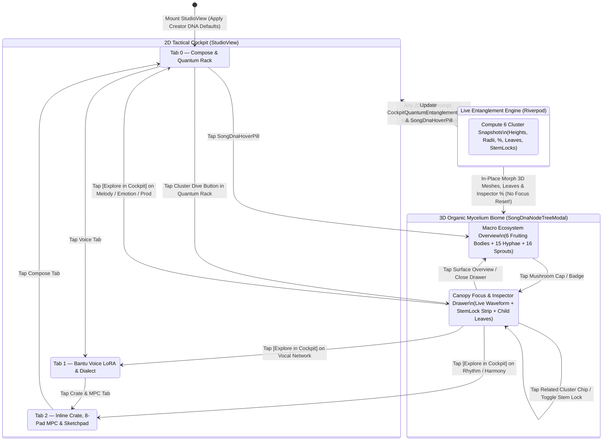
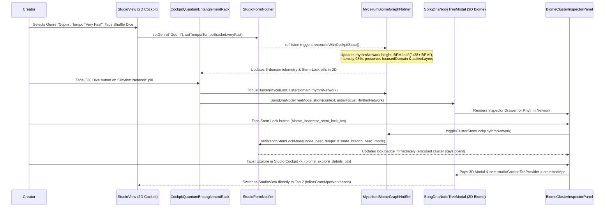

# Phase 54 Architectural Blueprint: 2D Studio Cockpit & 3D Mycelium Biome Bi-Directional Quantum Entanglement

## "One Living Musical Organism Across Two Dimensional Planes"

- **Phase Identifier**: `phase_54_cockpit_biome_quantum_entanglement`
- **Target Application**: `apps/vhunambi_client` (Flutter Mobile ARM64 & Desktop)
- **Parent Audit Reference**: [`docs/audits/STUDIO_COCKPIT_AND_2D_SONG_CREATION_FLOW_AUDIT.md`](../../audits/STUDIO_COCKPIT_AND_2D_SONG_CREATION_FLOW_AUDIT.md)
- **Prerequisite Phase**: [`docs/phases/phase_53_organic_mycelium_3d_biome/`](../phase_53_organic_mycelium_3d_biome/)
- **Coordinate System Standard**: Right-Handed 3D Y-Up World Space ($X$ lateral right, $+Y = h(X, Z) \ge 0$ vertical elevation up, $+Z$ foreground depth toward camera)
- **UI/UX Governance**: `STD-UIUX-001` (Zero Raw Emojis, Authentic `PhosphorIconsBold`, $\ge 44 \times 44\text{dp}$ touch targets, 100% Opaque Modal Surfaces)

---

## 1. Executive Overview & Visual North Star

In Phase 53, Vhunambi introduced the **3D Organic Mycelium Network Biome** (`SongDnaNodeTreeModal` + `OrganicMycelium3DPainter`), rendering a song's DNA as 6 living 3D mushroom fruiting bodies rooted on a contoured elevation terrain ($Y = h(X, Z) \ge 0$) interconnected by 15 subterranean arterial hyphae, 72 branching rootlet tendrils, and 16 bioluminescent sprout pinheads.

However, our forensic audit of the **2D Studio Cockpit (`StudioView`)** and its connection to the **3D Mycelium Biome** uncovered a critical architectural gap: **the 2D Tactical Cockpit and the 3D Living Biome were operating as partially disconnected state islands rather than a single quantum-entangled musical organism.**

Specifically, when a creator configures a song in the 2D Cockpit—typing a prompt, choosing a regional genre, sculpting 5-channel melodies in `MelodySketchpadModal`, chopping 8 transient pads in `MpcSlicerDeck`, or tuning dialect vowels in `BantuVoiceDeck`—those rich 2D parameters did not dynamically morph the 3D mushroom heights, cap radii, child leaf labels, or inspector telemetry percentages. Worse still, a split-brain key dictionary (`'node_branch_*'` vs `'node_beat_tempo'`) and a destructive `ref.watch(studioFormProvider)` recreation trap caused stem locks and camera focus states to desynchronize or reset across dimensions.

**Phase 54** establishes **100% Bi-Directional Quantum Entanglement** between the 2D Studio Cockpit and the 3D Mycelium Biome:
1. **Non-Destructive 5-Provider Entanglement Engine**: `MyceliumBiomeGraphNotifier` listens non-destructively (`ref.listen`) to all 5 Studio Cockpit state providers (`studioFormProvider`, `melodySketchpadProvider`, `mpcSlicerProvider`, `heritageCrateProvider`, and `vocalIdentityProvider`), morphing 3D fruiting body dimensions, child leaf titles/subtitles, and inspector metrics (`Intensity %`, `Complexity %`, `Influence %`) in real time without resetting camera focus or active layers.
2. **Unified 6-Domain Stem Authority Registry**: Eliminates the split-brain key bug by unifying all stem-lock lookups (`lockedPure44k`, `harmonicInpaint`, `elasticResynth`) across `StudioFormState`, `SongDnaGraphNotifier`, and `MyceliumBiomeGraphNotifier` with full backward compatibility.
3. **2D Cockpit Quantum Entanglement & Stem Authority Rack**: Adds a dedicated 6-domain telemetry and stem-lock dock (`CockpitQuantumEntanglementRack`) directly inside the 2D Compose tab so creators can see and toggle stem locks and jump straight into any 3D mushroom cluster with one tap.
4. **3D $\to$ 2D Deep-Link Teleportation & Inspector Stem-Lock Controls**: Wires the previously dead `onToggleStemLock` and `onExploreDetails` callbacks in `BiomeClusterInspectorPanel` so creators can lock/unlock stems inside the 3D Inspector or teleport directly back to the exact 2D Cockpit tab (`Compose`, `Voice`, `Crate & MPC`) or tool modal (`MelodySketchpadModal`).
5. **Inline Crate, 8-Pad MPC & Sketchpad Workbench on Tab 2**: Elevates the Heritage Crate, 8-Pad MPC Slicer, and 5-Channel Sketchpad launcher into an inline hardware rack on Tab 2 (`InlineCrateMpcWorkbench`) while preserving all legacy modal launch buttons.

---

## 2. Forensic Post-Mortem: Disconnected Islands vs. Phase 54 Quantum Entanglement

```
┌────────────────────────────────────────────────────────────────────────────────────────┐
│         FORENSIC POST-MORTEM: WHY 2D <-> 3D ENTANGLEMENT WAS BROKEN PRE-PHASE 54       │
├──────────────────────────────┬─────────────────────────────────────────────────────────┤
│ PRE-PHASE 54 DEFECT          │ PHASE 54 QUANTUM ENTANGLEMENT SOLUTION                  │
├──────────────────────────────┼─────────────────────────────────────────────────────────┤
│ 1. Destructive Provider      │ Non-Destructive In-Place Reconciliation:                │
│    Recreation Trap:          │ `myceliumBiomeGraphProvider` instantiates once and uses │
│    `ref.watch(studioForm)`   │ `ref.listen` across all 5 studio providers to call      │
│    recreated the entire      │ `reconcileWithCockpitState(...)`, preserving camera     │
│    `MyceliumBiomeNotifier`   │ focus, selected leaves, active layers, and custom nodes.│
│    on every 2D edit!         │                                                         │
├──────────────────────────────┼─────────────────────────────────────────────────────────┤
│ 2. Split-Brain Stem-Lock     │ Unified Canonical Stem Authority Dictionary:            │
│    Keys:                     │ `StudioFormState.canonicalLockForDomain(domain)` maps   │
│    `StudioFormState` used    │ both `MyceliumClusterDomain` keys and legacy Phase 52   │
│    `'node_beat_tempo'` while │ keys (`'node_beat_tempo'`, `'node_sketchpad_groove'`,   │
│    `MyceliumClusterDomain`   │ `'node_vocal_persona'`, `'node_spatial_atmosphere'`)    │
│    used `'node_branch_beat'`.│ bidirectionally in a single atomic operation.           │
├──────────────────────────────┼─────────────────────────────────────────────────────────┤
│ 3. Static `const` Child      │ Live 2D-Driven Child Leaves & Parametric Morphing:      │
│    Leaves & Hardcoded %:     │ All 29 child leaves and 6 fruiting body dimensions      │
│    3D mushrooms always said  │ (`stipeHeight`, `capRadius`, `intensityPercent`,        │
│    "113 BPM", "Venda Elder", │ `complexityPercent`, `influencePercent`) are computed   │
│    and "92% / 78% / 95%"     │ dynamically from Prompt, Genre, Tempo, Sketchpad steps, │
│    regardless of 2D edits.   │ MPC slices, Voice LoRA, and Dialect Inflection sliders. │
├──────────────────────────────┼─────────────────────────────────────────────────────────┤
│ 4. Unwired 3D Inspector      │ Active 3D Inspector Stem-Lock Strip & Deep-Link Router: │
│    Callbacks:                │ `BiomeClusterInspectorPanel` renders a 3-mode Stem      │
│    `onToggleStemLock` was    │ Authority selector (`biome_inspector_stem_lock_btn`)    │
│    never rendered in UI, and │ and `onExploreDetails` invokes `CockpitBiomeBridge` to  │
│    `onExploreDetails` was a  │ teleport to the corresponding 2D tab or tool modal.     │
│    dead haptic no-op.        │                                                         │
├──────────────────────────────┼─────────────────────────────────────────────────────────┤
│ 5. Invisible Stem Locks in   │ 2D Cockpit Quantum Entanglement Rack:                   │
│    2D Cockpit & Private Tab  │ `CockpitQuantumEntanglementRack` sits on Tab 0 showing  │
│    Index (`int _mode = 0`):  │ all 6 clusters, their live stem-lock badges, and 1-tap  │
│    Users in 2D could not see │ 3D dive buttons. `studioCockpitTabProvider` exposes     │
│    which stems were locked.  │ the active 2D tab (`compose`, `voice`, `crateAndMpc`).  │
└──────────────────────────────┴─────────────────────────────────────────────────────────┘
```

---

## 3. Multi-Layer Bi-Directional Entanglement Architecture

```
┌────────────────────────────────────────────────────────────────────────────────────────┐
│                    PHASE 54 BI-DIRECTIONAL ENTANGLEMENT ARCHITECTURE                   │
├────────────────────────────────────────────────────────────────────────────────────────┤
│ LAYER 1: 2D TACTICAL COCKPIT SURFACES (`StudioView` + Tool Modals)                     │
│  ├── Tab 0 (`CockpitWorkspaceTab.compose`):                                            │
│  │    • `PromptInputBox` + `SonicVibeDiceButton` + `RegionalGenreSelector`             │
│  │    • `CockpitQuantumEntanglementRack` (6 Cluster Pills + Stem Locks + 3D Dive)      │
│  │    • `ReferenceAudioDropzone` + `MultilingualLanguageSelector` + `AdvancedOptions`  │
│  ├── Tab 1 (`CockpitWorkspaceTab.voice`):                                              │
│  │    • `BantuVoiceDeck` (5 Native Profiles + 24-Voice Catalog + Zero-Shot Cloner)     │
│  │    • `DialectInflectionConfig` (Vowel Roundness, Vibrato, Choir) + Phonetic Preview │
│  └── Tab 2 (`CockpitWorkspaceTab.crateAndMpc`):                                        │
│       • `InlineCrateMpcWorkbench` (Inline Crate + 8-Pad MPC Slicer + 5-Ch Sketchpad)   │
│       • `DirectDawVocalUploadSheet` + Legacy Modal Launch Buttons                      │
├───────────────────────────────────────────┬────────────────────────────────────────────┤
│                                           ▲                                            │
│                                           │ Synchronous Riverpod State Reconciliation  │
│                                           ▼                                            │
│ LAYER 2: UNIFIED QUANTUM ENTANGLEMENT HUB (`CockpitBiomeEntanglementEngine`)           │
│  • Aggregates: `StudioFormState` + `MelodySketchpadState` + `MpcSlicerState`           │
│                + `HeritageCrateState` + `VocalIdentityState`                           │
│  • Computes:   6 `ClusterEntanglementSnapshot` records (Height, Radius, Pulse,         │
│                Intensity %, Complexity %, Influence %, StemLockMode, 5 Child Leaves)   │
│  • Routes:     2D -> 3D Cluster Dive (`openBiomeFocusedOnCluster`)                     │
│                3D -> 2D Cockpit Teleport (`teleportFromClusterToCockpit`)              │
├───────────────────────────────────────────┬────────────────────────────────────────────┤
│                                           ▲                                            │
│                                           │ Real-Time 60 FPS Mesh & HUD Binding        │
│                                           ▼                                            │
│ LAYER 3: 3D ORGANIC MYCELIUM BIOME (`SongDnaNodeTreeModal` + `OrganicMycelium3DPainter`)│
│  ├── 6 Parametric 3D Fruiting Bodies (`ui.Vertices.raw` 5-Ring × 24-Seg Caps + Gills)  │
│  ├── 15 Arterial Hyphae (Gold Lock Shimmer when `isStemLocked == true`)                │
│  ├── `BiomeClusterInspectorPanel` (Live Waveform, Dynamic %, Stem-Lock Toggle,         │
│  │    Related Cluster Chips, `[ Explore in Cockpit -> ]` Deep-Link Button)             │
│  └── `SongJourneyTimelineScrubber`, `BiomeInteractiveControlsBar`, `NetworkLayers`     │
└────────────────────────────────────────────────────────────────────────────────────────┘
```

---

## 4. Complete 2D-to-3D Dimensional Mapping & Telemetry Matrix

Every 2D Cockpit control maps deterministically to one of the 6 3D Mycelium Fruiting Bodies in Right-Handed 3D Y-Up World Space:

| 3D Cluster Domain | Canonical Planar $(X_k, Z_k)$ | Terrain Root $Y_{\text{root}}$ | Base $\to$ Max Apex $Y_{\text{apex}}$ | Base $\to$ Max Cap Radius $R_{\text{cap}}$ | Entangled 2D Cockpit Sources | 3D $\to$ 2D Teleport Target (`onExploreDetails`) |
| :--- | :--- | :--- | :--- | :--- | :--- | :--- |
| **1. `melodyCore`** | $(0, 0)$ | $32.0\text{dp}$ | $126 \to 156\text{dp}$ | $48 \to 64\text{dp}$ | `form.prompt`, `sketchpad.lead` steps, `sketchpad.activePattern.instrument`, `sketchpad.isGlideModeEnabled` | `CockpitWorkspaceTab.compose` (or `MelodySketchpadModal` when leaf `node_mel_lead_hook` tapped) |
| **2. `rhythmNetwork`** | $(-195, +95)$ | $22.0\text{dp}$ | $86 \to 114\text{dp}$ | $36 \to 50\text{dp}$ | `form.genre`, `form.tempo`, `mpcSlicer.sourceTitle`, `mpcSlicer.bpm`, `mpcSlicer.timeStretchRatio`, `sketchpad.drums` | `CockpitWorkspaceTab.crateAndMpc` (inline MPC Slicer & Drum Rack) |
| **3. `vocalNetwork`** | $(-155, -90)$ | $26.0\text{dp}$ | $106 \to 136\text{dp}$ | $40 \to 54\text{dp}$ | `form.selectedVoiceProfile`, `vocalIdentity.activeVoiceDisplayLabel`, `form.language`, `form.dialectInflection`, `form.customLyrics` | `CockpitWorkspaceTab.voice` (`BantuVoiceDeck` & Phonetic Alignment) |
| **4. `harmonyNetwork`** | $(+165, -85)$ | $25.0\text{dp}$ | $102 \to 130\text{dp}$ | $39 \to 52\text{dp}$ | `sketchpad.chords` & `bass` steps, `sketchpad.activePattern.scale`, `sketchpad.activePattern.rootKey`, `sketchpad.chordStampMode` | `CockpitWorkspaceTab.crateAndMpc` (or `MelodySketchpadModal` Chords channel) |
| **5. `emotionNetwork`** | $(+190, +75)$ | $21.0\text{dp}$ | $84 \to 112\text{dp}$ | $35 \to 48\text{dp}$ | `form.mood`, `form.vocalEnergy` (`soft`, `mid`, `intense`), `form.songStructure`, `form.vocalVoices` (`solo`, `duet`, `choir`) | `CockpitWorkspaceTab.compose` (`AdvancedOptionsAccordion` Mood & Energy) |
| **6. `productionNetwork`**| $(-35, +155)$ | $18.0\text{dp}$ | $74 \to 98\text{dp}$ | $34 \to 45\text{dp}$ | `form.branchStemLockModes`, `form.referenceAudioPath`, `form.durationSeconds`, `form.isInstrumental` | `CockpitWorkspaceTab.compose` (`CockpitQuantumEntanglementRack` & Dropzone) |

---

## 5. Canonical Stem Authority Key Unification Matrix

To permanently eliminate Finding F-01 (Split-Brain Stem-Lock Keys), Phase 54 establishes a single canonical bi-directional key mapping between `MyceliumClusterDomain`, `StudioFormState.branchStemLockModes`, and `SongDnaGraphNotifier`:

| 3D `MyceliumClusterDomain` | Canonical Primary Key (`studioBranchKey`) | Synchronized Legacy Alias Key | Default Initial `StemLockMode` | Acoustic Meaning in Synthesis Pipeline |
| :--- | :--- | :--- | :--- | :--- |
| **`melodyCore`** | `'node_sketchpad_groove'` | `'node_branch_instruments'` | `StemLockMode.lockedPure44k` | Preserves 5-Channel Sketchpad Lead/Motif WAV at 44.1 kHz |
| **`rhythmNetwork`** | `'node_beat_tempo'` | `'node_branch_beat'` | `StemLockMode.lockedPure44k` | Preserves chopped MPC drum transients & log-drum groove |
| **`vocalNetwork`** | `'node_vocal_persona'` | `'node_branch_vocal'` | `StemLockMode.harmonicInpaint` | Guides Bantu Voice LoRA synthesis along harmonic grid |
| **`harmonyNetwork`** | `'node_harmony_chords'` | `'node_sketchpad_groove'` | `StemLockMode.lockedPure44k` | Preserves Rhodes chord voicings & scale progression |
| **`emotionNetwork`** | `'node_emotion_mood'` | `'node_vocal_persona'` | `StemLockMode.harmonicInpaint` | Modulates dynamic tension, choir swells, and energy envelope |
| **`productionNetwork`**| `'node_spatial_atmosphere'` | `'node_branch_sfx'` | `StemLockMode.harmonicInpaint` | Controls spatial room reverb, sidechain ducking, and ceiling |

Whenever `setClusterStemLockMode(MyceliumClusterDomain domain, StemLockMode mode)` or `setBranchStemLockMode(String key, StemLockMode mode)` is invoked from *either* the 2D Cockpit or the 3D Biome, `StudioFormNotifier` writes **both** the canonical primary key and its legacy alias key into `branchStemLockModes`. This guarantees 100% synchronization across all Phase 50–54 widgets and tests.

---

## 6. Bi-Directional Quantum Entanglement State Machine



---

## 7. Dual-Viewport Wireframes: 2D Cockpit & 3D Biome Integration

### 7.1 2D Cockpit Tab 0 (`Compose`) with `CockpitQuantumEntanglementRack`

```
┌────────────────────────────────────────────────────────────────────────────────────────┐
│ [Vhunambi Top Bar]                                                                     │
├────────────────────────────────────────────────────────────────────────────────────────┤
│ [ Compose (Active) ]               [ Voice ]               [ Crate & MPC ]             │
├────────────────────────────────────────────────────────────────────────────────────────┤
│ ═══════════════════════════════ 7 / 9 Slots  [ (DNA) Song DNA 86%  •  6 Stems > ]      │
├────────────────────────────────────────────────────────────────────────────────────────┤
│ ┌────────────────────────────────────────────────────────────────────────────────────┐ │
│ │ (DNA) DNA suggests: Amapiano • Tshivenḓa                        [ (Dice) Shuffle ] │ │
│ └────────────────────────────────────────────────────────────────────────────────────┘ │
│ ┌────────────────────────────────────────────────────────────────────────────────────┐ │
│ │ Describe your song story, instruments, or vibe...                                  │ │
│ │ "Late-night log drum session in Soweto with hypnotic jazz Rhodes..."               │ │
│ │ [Late-night log drum...]  [Township love story...]  [Maskandi homecoming...]       │ │
│ └────────────────────────────────────────────────────────────────────────────────────┘ │
│ ┌────────────────────────────────────────────────────────────────────────────────────┐ │
│ │ (DNA) 2D <-> 3D QUANTUM STEM AUTHORITY RACK                    [ Open 3D Biome > ] │ │
│ │ ┌───────────────────────┐ ┌───────────────────────┐ ┌───────────────────────┐      │ │
│ │ │ (*) Melody Core   94% │ │ (*) Rhythm Net    96% │ │ (*) Vocal Net     89% │      │ │
│ │ │ Rhodes Lead • 8 Steps │ │ Amapiano • 113 BPM    │ │ Venda Elder • Venda   │      │ │
│ │ │ [Lock Pure 44.1k] [3D]│ │ [Lock Pure 44.1k] [3D]│ │ [Guided Inpaint] [3D] │      │ │
│ │ └───────────────────────┘ └───────────────────────┘ └───────────────────────┘      │ │
│ │ ┌───────────────────────┐ ┌───────────────────────┐ ┌───────────────────────┐      │ │
│ │ │ (*) Harmony Net   91% │ │ (*) Emotion Net   88% │ │ (*) Production    86% │      │ │
│ │ │ Pentatonic • Chords   │ │ Uplifting • Mid Energy│ │ 3 Locked • 30s Master │      │ │
│ │ │ [Lock Pure 44.1k] [3D]│ │ [Guided Inpaint] [3D] │ │ [Guided Inpaint] [3D] │      │ │
│ │ └───────────────────────┘ └───────────────────────┘ └───────────────────────┘      │ │
│ └────────────────────────────────────────────────────────────────────────────────────┘ │
│ [ Regional Genre Selector ]  [ Multilingual Language Selector ]  [ Advanced Options ]  │
├────────────────────────────────────────────────────────────────────────────────────────┤
│ [ (Sparkle) Synthesize Full Song ]                                                     │
└────────────────────────────────────────────────────────────────────────────────────────┘
```

### 7.2 2D Cockpit Tab 2 (`Crate & MPC`) with `InlineCrateMpcWorkbench`

```
┌────────────────────────────────────────────────────────────────────────────────────────┐
│ [ Compose ]                        [ Voice ]               [ Crate & MPC (Active) ]    │
├────────────────────────────────────────────────────────────────────────────────────────┤
│ ┌─────────────────────────────────────────┐ ┌────────────────────────────────────────┐ │
│ │ [Upload] Direct DAW & Vocal Uploader    │ │ [Disc] Fullscreen Crate & MPC Sheet    │ │
│ └─────────────────────────────────────────┘ └────────────────────────────────────────┘ │
│ ┌────────────────────────────────────────────────────────────────────────────────────┐ │
│ │ (Faders) INLINE GROOVE & SAMPLE WORKBENCH            [Lock Beat Stem: Pure 44.1k]  │ │
│ │ ┌────────────────────────┐ ┌────────────────────────┐ ┌──────────────────────────┐ │ │
│ │ │ [1] Heritage Crate     │ │ [2] 8-Pad MPC Slicer   │ │ [3] 5-Ch Groove Sketchpad│ │ │
│ │ └────────────────────────┘ └────────────────────────┘ └──────────────────────────┘ │ │
│ │  Active Kit: Soweto Log Drum Vol. 2 • 113 BPM • Stretch: 1.0x                      │ │
│ │  ┌──────────────┐  ┌──────────────┐  ┌──────────────┐  ┌──────────────┐            │ │
│ │  │ PAD 1 (0.0s) │  │ PAD 2 (0.5s) │  │ PAD 3 (1.0s) │  │ PAD 4 (1.5s) │            │ │
│ │  └──────────────┘  └──────────────┘  └──────────────┘  └──────────────┘            │ │
│ │  ┌──────────────┐  ┌──────────────┐  ┌──────────────┐  ┌──────────────┐            │ │
│ │  │ PAD 5 (2.0s) │  │ PAD 6 (2.5s) │  │ PAD 7 (3.0s) │  │ PAD 8 (3.5s) │            │ │
│ │  └──────────────┘  └──────────────┘  └──────────────┘  └──────────────┘            │ │
│ └────────────────────────────────────────────────────────────────────────────────────┘ │
└────────────────────────────────────────────────────────────────────────────────────────┘
```

### 7.3 3D `BiomeClusterInspectorPanel` with Stem-Lock Strip & Cockpit Teleport

```
┌──────────────────────────────────────────────────────────┐
│ (Waveform) Rhythm Network                            [X] │
│ BPM, log-drum sub & syncopated groove                    │
│ ılılılılılılılılılılılılılılılılılılılılılılılılılılılıl │
│ Intensity          Complexity          Influence         │
│ 96%                84%                 98%               │
│ ──────────────────────────────────────────────────────── │
│ Stem Authority Mode                                      │
│ [ (Lock) Lock Pure 44.1k ]  [ (DNA) Guided Inpaint ]     │
│ ──────────────────────────────────────────────────────── │
│ Active 2D Telemetry                                      │
│ • Genre: Amapiano (Medium 112-115 BPM)                   │
│ • MPC Kit: Soweto Log Drum (1.0x Stretch)                │
│ ──────────────────────────────────────────────────────── │
│ Related Nodes                                            │
│ (o) Melody Core   (o) Harmony   (o) Production           │
│                                                          │
│ [       Explore in Studio Cockpit ->                   ] │
└──────────────────────────────────────────────────────────┘
```

---

## 8. Mathematical Formulations for 2D $\to$ 3D Parametric Morphing

To satisfy Law 1 (Theory-to-Code Mathematical Fidelity), the 3D geometry and telemetry of each `MushroomFruitingBody` $k \in \{1..6\}$ are continuous, deterministic functions of the 2D Cockpit state vector $\mathbf{S}_{\text{2D}}$:

### 8.1 Normalized Domain Energy Weights $\mathcal{E}_k(\mathbf{S}_{\text{2D}}) \in [0.0, 1.0]$

1. **Melody Core Energy ($\mathcal{E}_{\text{mel}}$)**:
   $$\mathcal{E}_{\text{mel}} = \text{clamp}_{[0.45, 1.0]}\!\left( 0.50 + 0.25 \cdot \min\!\left(1.0, \frac{|\text{prompt}|}{80}\right) + 0.15 \cdot \frac{N_{\text{leadSteps}}}{16} + 0.10 \cdot \mathbb{I}(\text{hasAttachedSketch}) \right)$$
2. **Rhythm Network Energy ($\mathcal{E}_{\text{rhy}}$)**:
   Let $\tau_{\text{bpm}} \in \{0.65, 0.82, 0.94, 1.0\}$ correspond to `TempoBracket` $\{\text{slow}, \text{medium}, \text{fast}, \text{veryFast}\}$, and $N_{\text{activePads}} \in [0, 8]$ be the number of unmuted pads in `MpcSlicerState`:
   $$\mathcal{E}_{\text{rhy}} = \text{clamp}_{[0.50, 1.0]}\!\left( 0.45 + 0.35 \cdot \tau_{\text{bpm}} + 0.12 \cdot \frac{N_{\text{activePads}}}{8} + 0.08 \cdot \frac{N_{\text{drumSteps}}}{16} \right)$$
3. **Vocal Network Energy ($\mathcal{E}_{\text{vox}}$)**:
   If `form.isInstrumental == true`, $\mathcal{E}_{\text{vox}} = 0.30$. Otherwise:
   $$\mathcal{E}_{\text{vox}} = \text{clamp}_{[0.45, 1.0]}\!\left( 0.50 + 0.20 \cdot L_{\text{lora}} + 0.15 \cdot \frac{D_{\text{vowel}} + D_{\text{vibrato}} + D_{\text{choir}}}{3} + 0.15 \cdot \mathbb{I}(\text{hasCustomLyrics} \lor \text{isClonedVoice}) \right)$$
4. **Harmony Network Energy ($\mathcal{E}_{\text{harm}}$)**:
   $$\mathcal{E}_{\text{harm}} = \text{clamp}_{[0.50, 1.0]}\!\left( 0.55 + 0.25 \cdot \frac{N_{\text{chordSteps}} + N_{\text{bassSteps}}}{32} + 0.12 \cdot \mathbb{I}(\text{chordStampMode} \neq \text{single}) + 0.08 \cdot N_{\text{customLeaves}} \right)$$
5. **Emotion Network Energy ($\mathcal{E}_{\text{emo}}$)**:
   Let $\nu_{\text{energy}} \in \{0.65, 0.85, 1.0\}$ correspond to `VocalEnergy` $\{\text{soft}, \text{mid}, \text{intense}\}$:
   $$\mathcal{E}_{\text{emo}} = \text{clamp}_{[0.50, 1.0]}\!\left( 0.45 + 0.35 \cdot \nu_{\text{energy}} + 0.20 \cdot \mathbb{I}(\text{vocalVoices} == \text{choir} \lor \text{vocalVoices} == \text{duet}) \right)$$
6. **Production Network Energy ($\mathcal{E}_{\text{prod}}$)**:
   Let $N_{\text{locked}} \in [0, 6]$ be the number of clusters with `StemLockMode.lockedPure44k`:
   $$\mathcal{E}_{\text{prod}} = \text{clamp}_{[0.50, 1.0]}\!\left( 0.50 + 0.30 \cdot \frac{N_{\text{locked}}}{6} + 0.20 \cdot \mathbb{I}(\text{referenceAudioPath} \neq \text{null}) \right)$$

### 8.2 Parametric 3D Fruiting Body Dimensions & Telemetry Percentages

Given $\mathcal{E}_k \in [0.30, 1.0]$ and complexity factor $\mathcal{C}_k \in [0.40, 1.0]$:
- **Stipe Height ($H_{\text{stipe}, k}$)**:
  $$H_{\text{stipe}, k}(\mathcal{E}_k) = H_{\text{base}, k} \cdot \left(0.82 + 0.28 \cdot \mathcal{E}_k\right)$$
  such that $Y_{\text{apex}, k} = Y_{\text{root}, k} + H_{\text{stipe}, k}(\mathcal{E}_k)$ rises along $+Y$ in Right-Handed 3D Y-Up World Space as the user enriches that domain in the 2D Cockpit!
- **Cap Radius ($R_{\text{cap}, k}$)**:
  $$R_{\text{cap}, k}(\mathcal{E}_k) = R_{\text{base}, k} \cdot \left(0.85 + 0.22 \cdot \mathcal{E}_k\right)$$
- **Inspector Metrics**:
  $$\text{Intensity}_k = \text{round}(100 \cdot \mathcal{E}_k)\%, \quad \text{Complexity}_k = \text{round}(100 \cdot \mathcal{C}_k)\%, \quad \text{Influence}_k = \text{round}\!\left(100 \cdot (0.6 \mathcal{E}_k + 0.4 \mathcal{C}_k)\right)\%$$

---

## 9. End-to-End Bi-Directional Sequence Diagram



---

## 10. Hardware Performance, Memory & Verification Gates

| Gate ID | Verification Domain | Metric / Invariant | Target Threshold |
| :--- | :--- | :--- | :--- |
| **G-01** | **Non-Destructive Reconciliation** | Focusing a 3D cluster and mutating `studioFormProvider` (genre, tempo, stem lock) | `focusedDomain` remains non-null (`100%` state retention) |
| **G-02** | **Canonical Stem Lock Parity** | Locking via `MyceliumClusterDomain` updates both primary & legacy keys in `StudioFormState` | `100%` parity across 2D Rack, 3D Inspector, and Phase 52 Card |
| **G-03** | **Live 2D $\to$ 3D Telemetry Morphing** | Changing genre, tempo, voice profile, language, or sketchpad steps updates 3D child leaves & % | Zero stale hardcoded strings when 2D state changes |
| **G-04** | **3D $\to$ 2D Deep-Link Teleport** | Tapping `biome_explore_details_btn` routes to target `CockpitWorkspaceTab` | Deterministic tab switch (`compose`, `voice`, `crateAndMpc`) |
| **G-05** | **Static Analysis & Linter** | `flutter analyze lib/features/studio test/features/studio` | `No issues found!` (0 errors, 0 warnings) |
| **G-06** | **Automated Regression Suite** | Phases 50, 51, 52, 53, and 54 widget & unit tests | `100%` pass rate across all test suites |

