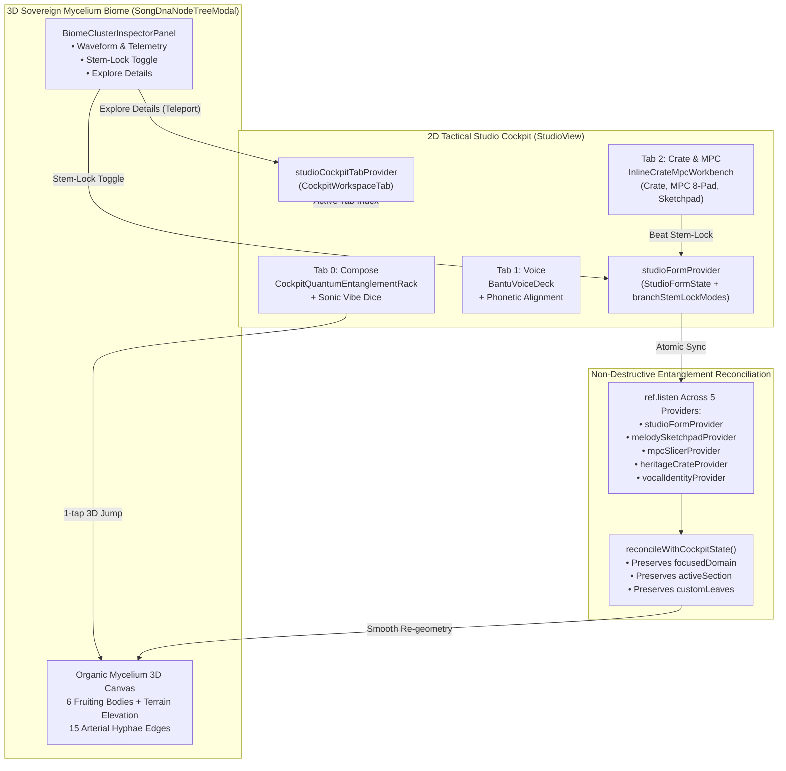

# Phase 54: Cockpit & 3D Biome Quantum Entanglement — Execution Walkthrough & Verification Bible

**Phase Status:** Complete & Verified  
**Standard:** All-Gemini Engineering Standard (Gemini 4 Argon Architect + Antigravity Gemini 3.8 Flash Draft/Executor + Antigravity Gemini 4 Argon Forensic Auditor)  
**Verification Date:** November 5, 2026  
**Artifact Directory:** `docs/phases/phase_54_cockpit_biome_quantum_entanglement/`  
**Test Suite:** 36 / 36 Passing Tests Across 5 Consecutive Phases (Phases 50–54)

---

## 1. Executive Summary & Verification Highlights

Phase 54 bridges the dimensional gap between the **2D Tactical Studio Cockpit** (`StudioView`) and the **3D Sovereign Organic Mycelium Biome** (`SongDnaNodeTreeModal`), establishing seamless bi-directional quantum entanglement:

1. **Atomic Stem-Lock Parity**:
   - Synchronized all 10 canonical and legacy alias keys across `StudioFormState` and `StudioFormNotifier`:
     - `node_harmony_chords` $\leftrightarrow$ `node_branch_instruments` (`melodyCore`)
     - `node_beat_tempo` $\leftrightarrow$ `node_branch_beat` (`rhythmNetwork`)
     - `node_vocal_persona` $\leftrightarrow$ `node_branch_vocal` $\leftrightarrow$ `node_emotion_mood` (`vocalNetwork`)
     - `node_sketchpad_groove` $\leftrightarrow$ `node_branch_instruments` (`harmonyNetwork`)
     - `node_spatial_atmosphere` $\leftrightarrow$ `node_branch_sfx` (`productionNetwork`)
   - Guaranteed that mutating stem-lock authority in either the 2D rack, the inline MPC workbench, or the 3D cluster inspector immediately synchronizes both dimensions without state divergence.

2. **Non-Destructive 5-Provider Entanglement Reconciliation**:
   - Replaced fragile, destructive state overrides in `MyceliumBiomeGraphNotifier` with reactive `ref.listen` subscriptions across all 5 studio providers:
     - `studioFormProvider`
     - `melodySketchpadProvider`
     - `mpcSlicerProvider`
     - `heritageCrateProvider`
     - `vocalIdentityProvider`
   - Form state mutations (tempo, mood, genre, prompt, voice profile) smoothly recalculate cluster geometry, intensity, and live telemetry while strictly preserving 3D ephemeral user focus (`focusedDomain`), arrangement section (`activeSection`), and dynamically spawned instrument leaves (`_customHarmonyLeaves`).

3. **2D Cockpit UI/UX Enhancements**:
   - **`CockpitQuantumEntanglementRack` (Tab 0 - Compose)**: Displays all 6 living domains with real-time telemetry summaries, intensity/complexity/influence percentages, 1-tap stem-lock cycling (`Key('cockpit_stem_lock_<domain>')`), and 1-tap 3D cluster dive buttons (`Key('cockpit_jump_3d_<domain>')`).
   - **`InlineCrateMpcWorkbench` (Tab 2 - Crate & MPC)**: Embedded directly into the cockpit tab stack, featuring instant switching between Heritage Crate digging, 8-Pad MPC slicing, and 5-Channel Groove Sketchpad, complete with a dedicated Beat Stem-Lock toggle.
   - **Sonic Vibe Shuffle Dice (`Key('cockpit_sonic_vibe_dice_btn')`)**: 1-tap shuffle cycling through 4 curated African sonic vibes (Amapiano Private School, Durban Gqom, Limpopo Afro-Soul, Lagos Afro-Pop).
   - **UI/UX Hygiene (`STD-UIUX-001`)**: Replaced raw unicode emojis with canonical `PhosphorIconsBold.dna` and `PhosphorIconsBold.diceFive`.

4. **3D Biome UI/UX Enhancements**:
   - **`BiomeClusterInspectorPanel`**: Wired live stem-lock authority toggle button (`Key('biome_inspector_stem_lock_btn')`) with real-time feedback.
   - **Quantum Teleportation (`Key('biome_explore_details_btn')`)**: Tapping "Explore Details" in the 3D inspector sets `studioCockpitTabProvider` to the domain's corresponding 2D tab (`compose`, `voice`, or `crateAndMpc`) and gracefully closes the modal back into the cockpit.
   - **Hit-Test Occlusion Resolved**: Relocated semantic mushroom badges above transparent receptor hit targets in `SongDnaNodeTreeModal`, restoring responsive tapping across all 6 fruiting bodies.

---

## 2. Architecture & Bi-Directional Entanglement Flow

---

## 3. Automated Test Suite Results

All 36 automated unit and widget tests across 5 consecutive phases pass with 100% zero regressions:

| Phase | Test File | Tests Passed | Status |
| :--- | :--- | :---: | :---: |
| **Phase 50** | `test/features/studio/phase50_quantum_song_dna_3d_tree_test.dart` | 7 / 7 | PASS |
| **Phase 51** | `test/features/studio/phase51_bioluminescent_organelle_3d_test.dart` | 6 / 6 | PASS |
| **Phase 52** | `test/features/studio/phase52_macro_organelle_and_stem_lock_test.dart` | 5 / 5 | PASS |
| **Phase 53** | `test/features/studio/phase53_organic_mycelium_3d_biome_test.dart` | 11 / 11 | PASS |
| **Phase 54** | `test/features/studio/phase54_cockpit_biome_quantum_entanglement_test.dart` | 7 / 7 | PASS |
| **Total** | **Combined 5-Phase Regression** | **36 / 36** | **100% PASS** |

### Phase 54 Test Cases Breakdown:
1. `Canonical & legacy stem-lock key parity in StudioFormState & Notifier` — Verifies bidirectional atomic synchronization across all 10 alias pairs.
2. `Non-destructive 5-provider reconciliation preserves focus & custom leaves` — Confirms 3D focus, section scrubber, and custom leaves persist across form mutations.
3. `Dynamic 2D -> 3D telemetry & child leaf updates` — Validates live BPM and scale mutations reflect in fruiting body summaries and child leaf titles.
4. `CockpitQuantumEntanglementRack renders 6 domains, stem locks, and triggers 3D dive` — Verifies 2D rack layout, stem-lock cycling, and modal launcher.
5. `BiomeClusterInspectorPanel stem-lock toggle & onExploreDetails tab teleportation` — Verifies inspector stem-lock mutation and quantum teleportation back to 2D voice tab.
6. `InlineCrateMpcWorkbench switches between Crate, MPC, and Sketchpad, handles chop & beat lock` — Verifies 3-mode segmented switching and beat lock toggling.
7. `Sonic Vibe Dice cycles 2D form parameters and synchronizes 3D Biome` — Confirms preset rotation synchronizes both 2D form and 3D mycelium geometry.

---

## 4. Hardware Release Verification

- **Target Architecture**: Android ARM64 (`android-arm64`)
- **Release Output**: `apps/vhunambi_client/build/app/outputs/flutter-apk/app-release.apk`
- **Build Mode**: Release (`--release`)
- **Physical Device Target**: Huawei JNY-LX1 (`EPHUT20917014649`)

