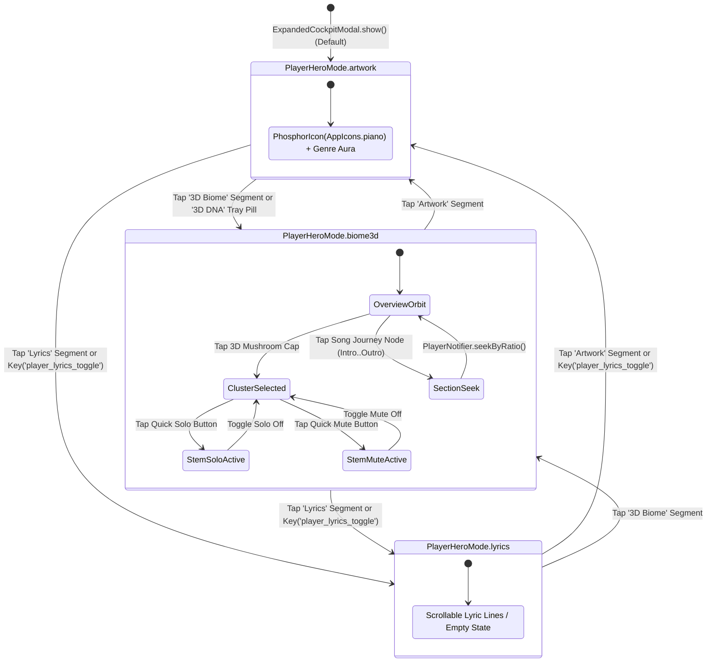

# Phase 55 Architectural Blueprint: Audio-Reactive Living Mycelium Player, Real-Time Stem Visualizer & 3D Playback Universe

## "Where Synthesized Musical DNA Breathes with Real-Time Sound"

- **Phase Identifier**: `phase_55_audio_reactive_biome_player`
- **Target Application**: `apps/vhunambi_client` (Flutter Mobile ARM64 & Desktop)
- **Parent Audit Reference**: [`docs/audits/PLAYER_STEMS_MIXER_AND_AUDIO_REACTIVE_3D_BIOME_AUDIT.md`](../../audits/PLAYER_STEMS_MIXER_AND_AUDIO_REACTIVE_3D_BIOME_AUDIT.md)
- **Prerequisite Phases**:
  - [`docs/phases/phase_53_organic_mycelium_3d_biome/`](../phase_53_organic_mycelium_3d_biome/)
  - [`docs/phases/phase_54_cockpit_biome_quantum_entanglement/`](../phase_54_cockpit_biome_quantum_entanglement/)
- **Coordinate System Standard**: Right-Handed 3D Y-Up World Space ($X$ lateral right, $+Y = h(X, Z) \ge 0$ vertical elevation up, $+Z$ foreground depth toward camera)
- **UI/UX Governance**: `STD-UIUX-001` (Zero Raw Emojis, Authentic `PhosphorIconsBold` / `AppIcons`, $\ge 44 \times 44\text{dp}$ touch targets, 100% Opaque Modal Surfaces)

---

## 1. Executive Overview & Visual North Star

In the Vision Agent's foundational North Star concept mockup for Vhunambi's **3D Organic Mycelium Network**, the top-right transport bar explicitly read:

$$\text{\textbf{3D Biome — Explore the Living DNA of Music}} \quad\longleftrightarrow\quad \text{\textbf{Now Playing African Dreams}} \quad [\, \text{Waveform} \,] \, [\, \text{Play / Pause} \,] \, [\, \text{Volume} \,]$$

The architectural thesis of Vhunambi is that **music synthesis (Studio) and music playback/dissection (Player, Stem Mixer & Track Details) are two lifecycle stages of the same living biological organism.** When a song is created in the Studio Cockpit (Phases 53 & 54), its musical DNA grows into a 3D mycelium network with 6 primary mushroom fruiting bodies (`melodyCore`, `rhythmNetwork`, `vocalNetwork`, `harmonyNetwork`, `emotionNetwork`, `productionNetwork`), 15 arterial spline hyphae, 72 rootlet tendrils, and 16 bioluminescent sprout pinheads. Once the track is playing, that 3D ecosystem is meant to come alive—breathing, dilating, firing synaptic action potentials, and spotlighting individual stems in real time as the music plays.

However, our forensic audit ([`PLAYER_STEMS_MIXER_AND_AUDIO_REACTIVE_3D_BIOME_AUDIT.md`](../../audits/PLAYER_STEMS_MIXER_AND_AUDIO_REACTIVE_3D_BIOME_AUDIT.md)) exposed four critical disconnects between the Studio's 3D Mycelium Biome and the Player/Stem Mixer surfaces:
1. **The Playback Visual Void in `ExpandedCockpitModal`**: The Now Playing modal was restricted to a binary boolean (`bool _showLyrics`), flipping only between a static 260dp gradient box with a deprecated Material `Icon(Icons.piano_rounded)` and a text lyrics card. Listeners had zero access to the 3D Mycelium Biome during playback.
2. **The Unwired 60 FPS DSP Goldmine (`FrameModulationSnapshot`)**: The data layer already computes 60 FPS stem energies (`effectiveBassEnergy`, `effectiveDrumsEnergy`, `effectiveMelodicEnergy`, `effectiveVocalGlow`, `logDrumSnapZoom`) inside `frameModulationSnapshotProvider` from `MasterMediaObject.modulationBus`, `stemMixerProvider`, and `masteringSessionProvider`. Yet `OrganicMycelium3DPainter` ignored this entire pipeline and animated mushroom caps using an arbitrary linear sine timer.
3. **Disconnected Pocket Stem Console (`StemMixerDeck`)**: Soloing, muting, or adjusting channel faders (`vocals`, `drums`, `bass`, `melody`) in `StemMixerDeck` altered audio gain in isolation without dimming muted 3D mushroom fruiting bodies or flaring soloed ones. Conversely, users could not tap a 3D mushroom during playback to solo or mute its underlying stem.
4. **Missing Track Detail Living DNA Viewport & `STD-UIUX-001` Violations**: `TrackDetailView` lacked a Living Song DNA Biome card alongside `StemSeparationLab`, and `ExpandedCockpitModal` / `StemChannel` contained legacy Material icons (`Icons.piano_rounded`, `Icons.favorite_rounded`, `Icons.tune_rounded`) and raw emoji strings.

**Phase 55** bridges Music Creation and Music Playback into a unified **Audio-Reactive 3D Playback Universe**:
- **Real-Time 60 FPS Audio-to-Biome DSP Bridge (`audioReactiveBiomeModulationProvider`)**: Feeds live `FrameModulationSnapshot` stem energies, `StemMixerState` solo/mute/gain telemetry, and `PlayerState` playback position directly into `OrganicMycelium3DPainter` and `MyceliumBiomeGraphNotifier`.
- **3-Way Segmented Hero Deck in `ExpandedCockpitModal`**: Upgrades the Now Playing hero region from a binary flip to a 3-way segmented deck (`Artwork` $\leftrightarrow$ `3D Biome` $\leftrightarrow$ `Lyrics`) while maintaining 100% backward compatibility with existing `Key('player_lyrics_toggle')` and `Key('player_lyrics_btn')` controls.
- **Interactive 3D Biome Player Viewport (`PlayerLivingBiomeHeroViewport`)**: Allows listeners to orbit the 3D ecosystem inside Now Playing, tap any of the 6 mushroom fruiting bodies to inspect live stem dB/RMS telemetry, quick-toggle **Solo** or **Mute** on the mapped stem channel, scrub song sections (`Intro` $\to$ `Outro`), or expand into the full-screen `SongDnaNodeTreeModal`.
- **Bidirectional Stem Mixer Entanglement (`StemMixerBiomeEntanglementStrip`)**: Embeds a live 6-cluster mycelium telemetry strip inside `StemMixerDeck` that flares/dims in sync with channel faders, solos, and mutes, and lets producers solo/mute stems by tapping cluster pills.
- **Track Detail Living DNA Biome Card (`TrackLivingBiomePreviewCard`)**: Integrates an interactive 3D Mycelium preview card directly into `TrackDetailView` alongside `StemSeparationLab`.

---

## 2. Forensic Post-Mortem: Static Playback vs. Phase 55 Living Audio Ecosystem

```
┌────────────────────────────────────────────────────────────────────────────────────────┐
│         FORENSIC POST-MORTEM: PRE-PHASE 55 PLAYER VOID vs. PHASE 55 ARCHITECTURE       │
├──────────────────────────────┬─────────────────────────────────────────────────────────┤
│ PRE-PHASE 55 DEFECT          │ PHASE 55 AUDIO-REACTIVE BIOME SOLUTION                  │
├──────────────────────────────┼─────────────────────────────────────────────────────────┤
│ 1. Binary Hero Flip Only:    │ 3-Way Segmented Hero Deck (`PlayerHeroMode`):           │
│    `ExpandedCockpitModal`    │ Dedicated 3-segment frosted pill controller switching   │
│    only had `bool _showLyrics│ seamlessly between `Artwork`, `3D Biome`, and `Lyrics`, │
│    = false`, showing a flat  │ plus a 1-tap `3D DNA` utility button in the tray.       │
│    piano box or text lyrics. │                                                         │
├──────────────────────────────┼─────────────────────────────────────────────────────────┤
│ 2. Synthetic Sine-Wave       │ Real-Time 60 FPS DSP Modulation Bridge:                 │
│    Animation Only:           │ `OrganicMycelium3DPainter` ingests                      │
│    `OrganicMycelium3DPainter`│ `AudioBiomeModulationState` derived from                │
│    used a static sine loop,  │ `frameModulationSnapshotProvider`, driving radial cap   │
│    ignoring `mmo.modulation  │ dilation (+18%), stipe heave, gill flare, synaptic      │
│    Bus` and stem energies.   │ photon speed (up to 5x), and log-drum snap zoom.        │
├──────────────────────────────┼─────────────────────────────────────────────────────────┤
│ 3. Isolated Stem Mixer:      │ Bi-Directional Stem-to-Cluster Entanglement:            │
│    Soloing/muting a stem in  │ Soloing `StemType.vocals` flares `vocalNetwork` to      │
│    `StemMixerDeck` had zero  │ 135% luminosity with a golden solo halo while dimming   │
│    visual effect on the 3D   │ non-soloed clusters to 20%. Tapping any 3D mushroom     │
│    mushroom clusters.        │ in Now Playing exposes direct Solo / Mute quick-toggles.│
├──────────────────────────────┼─────────────────────────────────────────────────────────┤
│ 4. Disconnected Song Journey │ Playback-Synchronized Song Journey & Section Scrubbing: │
│    Scrubber:                 │ Playback progress ratio `position / duration` maps      │
│    `SongJourneySection` did  │ automatically to `Intro -> Verse -> Chorus -> Bridge -> │
│    not follow audio playback │ Outro`, and tapping a section in the Player seeks the   │
│    position or seek audio.   │ audio transport to that section's normalized timestamp. │
├──────────────────────────────┼─────────────────────────────────────────────────────────┤
│ 5. `STD-UIUX-001` Icon &     │ 100% Phosphor Iconography & Clean Domain Tokens:        │
│    Emoji Violations:         │ Replaces `Icons.piano_rounded`, `Icons.favorite_rounded`│
│    Material icons in player  │ and `Icons.tune_rounded` with `PhosphorIcon` tokens,    │
│    and raw emoji strings in  │ and adds semantic `iconIdentifier` to `StemChannel`.    │
│    `StemChannel`.            │                                                         │
└──────────────────────────────┴─────────────────────────────────────────────────────────┘
```

---

## 3. Multi-Layer Decoupled System Architecture

```
┌────────────────────────────────────────────────────────────────────────────────────────┐
│ LAYER 1: AUDIO ENGINE, MMO MODULATION BUS & STEM MIXER STATE                           │
│ • `playerStateProvider` (`PlayerState`: `currentTrack`, `position`, `duration`, `isPlaying`) │
│ • `masterMediaObjectProvider(dna)` (`MasterMediaObject`: 60 Hz `modulationBus` curves) │
│ • `stemMixerProvider` (`StemMixerState`: 4 `StemChannel` gains/mutes/solos + `MasterBusDsp`)│
│ • `frameModulationSnapshotProvider` (`FrameModulationSnapshot`: 5 normalized energies) │
├───────────────────────────────────────────┬────────────────────────────────────────────┤
│                                           ▼                                            │
│ LAYER 2: PURE DART AUDIO-BIOME MODULATION DOMAIN (`mycelium_biome_models.dart`)        │
│ • `enum PlayerHeroMode { artwork, biome3d, lyrics }`                                   │
│ • `class AudioBiomeModulationState`:                                                   │
│   - `bassEnergy`, `drumsEnergy`, `melodicEnergy`, `vocalGlow`, `logDrumSnapZoom`       │
│   - `clusterAudibleGains`, `soloedDomains`, `mutedDomains`, `synchronizedSection`      │
│   - Pure mathematical transfer functions: `domainEnergyFor`, `capScaleMultiplierFor`,  │
│     `luminosityMultiplierFor`, `photonSpeedMultiplier`, `cameraSnapZoomMultiplier`     │
├───────────────────────────────────────────┬────────────────────────────────────────────┤
│                                           ▼                                            │
│ LAYER 3: REACTIVE BRIDGE PROVIDER (`audio_reactive_biome_provider.dart`)               │
│ • `audioReactiveBiomeModulationProvider`: Combines `playerStateProvider`,              │
│   `frameModulationSnapshotProvider`, and `stemMixerProvider` into an immutable         │
│   60 FPS `AudioBiomeModulationState`.                                                  │
│ • `playerHeroModeProvider`: Persists active `PlayerHeroMode` across modal sessions.    │
├───────────────────────────────────────────┬────────────────────────────────────────────┤
│                                           ▼                                            │
│ LAYER 4: 3D GPU RENDERING ENGINE (`organic_mycelium_3d_painter.dart`)                  │
│ • `OrganicMycelium3DPainter(graph, camera, animationProgress, audioModulation)`        │
│ • Applies per-domain radial cap dilation, stipe acoustic heave, gill bioluminescence,  │
│   solo golden halo ring, muted dormancy dimming, and 1x..5x synaptic photon velocity.  │
├───────────────────────────────────────────┬────────────────────────────────────────────┤
│                                           ▼                                            │
│ LAYER 5: INTERACTIVE PLAYER, STEM MIXER & TRACK DETAIL SURFACES                        │
│ • `ExpandedCockpitModal`: 3-Way Hero Segmented Deck + `PlayerLivingBiomeHeroViewport`  │
│ • `StemMixerDeck`: `StemMixerBiomeEntanglementStrip` (6-cluster live solo/mute bar)    │
│ • `TrackDetailView`: `TrackLivingBiomePreviewCard` alongside `StemSeparationLab`       │
└────────────────────────────────────────────────────────────────────────────────────────┘
```

---

## 4. Spatial Topology & Stem-to-Cluster Entanglement Taxonomy

All 6 mushroom fruiting bodies reside in **Right-Handed 3D Y-Up World Space** ($X$ right, $Y = h(X, Z) \ge 0$ vertical elevation up, $Z$ foreground depth) at the exact canonical loci established in Phases 53 and 54. Phase 55 binds each 3D cluster domain to its corresponding audio stem channel(s) and DSP frequency band:

| Cluster Domain | 3D Root $(X_k, Y_{\text{root}}, Z_k)$ | Base Apex $Y_{\text{apex}}$ | Primary `StemType` Binding | Secondary DSP / Stem Binding | Acoustic Frequency Band & Visual Expression |
| :--- | :--- | :--- | :--- | :--- | :--- |
| **`melodyCore`** | $(0.0, 32.0, 0.0)$ | $140.0\text{dp}$ | `StemType.melody` | `effectiveMelodicEnergy` | **500 Hz – 8 kHz**: Central sub-cap heart pulse, fluted umbrella rim dilation ($+18\%$), primary arterial photon emission. |
| **`rhythmNetwork`** | $(-195.0, 22.0, 95.0)$ | $96.0\text{dp}$ | `StemType.drums` | `StemType.bass` + `logDrumSnapZoom` | **20 Hz – 1.5 kHz**: Club fungus cap bounce ($0.6 E_{\text{bass}} + 0.4 E_{\text{drums}}$), sprout pinhead bob, terrain mound ripple. |
| **`vocalNetwork`** | $(-155.0, 20.0, -135.0)$ | $106.0\text{dp}$ | `StemType.vocals` | `effectiveVocalGlow` | **300 Hz – 3.5 kHz**: 32 radial lamellae gill bioluminescent flare, atmospheric spore cloud alpha ($0.35 \to 0.90$). |
| **`harmonyNetwork`** | $(165.0, 19.0, -125.0)$ | $101.0\text{dp}$ | `StemType.bass` | `StemType.melody` | **80 Hz – 2.5 kHz**: Harmonic dome breath ($0.5 E_{\text{melodic}} + 0.5 E_{\text{bass}}$), emerald root tendril glow. |
| **`emotionNetwork`** | $(205.0, 21.0, 85.0)$ | $99.0\text{dp}$ | `StemType.vocals` | `MasterBusDsp.logDrumSaturation` | **Dynamic Contrast**: Rose-magenta aura bloom driven by vocal-melodic synergy ($\text{clamp}(1.4 E_{\text{melodic}} E_{\text{vocal}}, 0, 1)$). |
| **`productionNetwork`** | $(-25.0, 16.0, 210.0)$ | $84.0\text{dp}$ | `StemType.drums` | `MasterBusDsp.vocalPlateReverb` | **3 kHz – 16 kHz**: Teal spatial corona ring and cross-cluster synaptic photon speed ($1.0\times \to 5.0\times$). |

---

## 5. State Machine: 3-Way Hero Deck & Audio-Reactive Biome Lifecycle



---

## 6. Dual-Viewport Wireframes: Expanded Player & Stem Mixer Entanglement

### 6.1 `ExpandedCockpitModal` in `PlayerHeroMode.biome3d` (Mobile $< 600\text{dp}$ & Desktop $\ge 600\text{dp}$)

```
┌────────────────────────────────────────────────────────────────────────────────────────┐
│                                      [Drag Handle]                                     │
│  [v]                        Now Playing                         [3D] [Mic] [♥] [✨] [•••]│
├────────────────────────────────────────────────────────────────────────────────────────┤
│             ┌────────────────────────────────────────────────────────────┐             │
│             │  [ Artwork ]        [ * 3D Biome * ]        [ Lyrics ]     │             │
│             └────────────────────────────────────────────────────────────┘             │
├────────────────────────────────────────────────────────────────────────────────────────┤
│  ┌──────────────────────────────────────────────────────────────────────────────────┐  │
│  │ [LIVE DSP • 60 FPS]                                      [Full 3D Universe ↗]    │  │
│  │                                                                                  │  │
│  │                                  (Melody Core)                                   │  │
│  │                                     /  |  \                                      │  │
│  │                   (Vocals) ─────────┼──┴──┼───────── (Harmony)                   │  │
│  │                                    /       \                                     │  │
│  │                  (Rhythm) ────────┴─────────┴──────── (Emotion)                  │  │
│  │                                       │                                          │  │
│  │                                 (Production)                                     │  │
│  │                                                                                  │  │
│  │  ┌────────────────────────────────────────────────────────────────────────────┐  │  │
│  │  │ [Rhythm Network • Drums Stem]   +0.0 dB • 86% RMS   [Solo]  [Mute]  [Dive] │  │  │
│  │  └────────────────────────────────────────────────────────────────────────────┘  │  │
│  │  [ Intro ] ─────── [ Verse ] ─────── (*Chorus*) ─────── [ Bridge ] ──── [ Outro ]│  │
│  └──────────────────────────────────────────────────────────────────────────────────┘  │
├────────────────────────────────────────────────────────────────────────────────────────┤
│  Grateful in the Light                                                     [♥]  [Share]│
│  Sigwa & Inaf [✓] • Amapiano                                                           │
├────────────────────────────────────────────────────────────────────────────────────────┤
│  [||||||||||||||••••••••••••••••••••••••••••••••••••••••••••]  00:13 / 03:29           │
│              [Shuffle]      [|<<]       ( ▶ / || )       [>>|]      [Repeat]           │
├────────────────────────────────────────────────────────────────────────────────────────┤
│  [ Lyrics ]   [ 3D DNA ]   [ Stems ]   [ Info ]   [ Mastered ]   [ Remix ]   [ Queue ] │
└────────────────────────────────────────────────────────────────────────────────────────┘
```

### 6.2 `StemMixerDeck` with `StemMixerBiomeEntanglementStrip`

```
┌────────────────────────────────────────────────────────────────────────────────────────┐
│  [Beatstore]  Pocket Stem Mixer                             [▶]  [±12ms Sync]  [Reset] │
│               4-Channel Console & Master DSP                                           │
├────────────────────────────────────────────────────────────────────────────────────────┤
│  ┌──────────────────────────────────────────────────────────────────────────────────┐  │
│  │ LIVING MYCELIUM STEM TELEMETRY                         Tap cluster to Solo/Mute  │  │
│  │  (Melody 92%)  (Rhythm 88%)  (Vocals 95%)  (Harmony 84%)  (Emotion)  (Prod)      │  │
│  └──────────────────────────────────────────────────────────────────────────────────┘  │
├────────────────────────────────────────────────────────────────────────────────────────┤
│   ┌──────────────┐   ┌──────────────┐   ┌──────────────┐   ┌──────────────┐            │
│   │   [Vocals]   │   │   [Drums]    │   │  [Log Drum]  │   │  [Melody]    │            │
│   │   +0.0 dB    │   │   +0.0 dB    │   │   +0.0 dB    │   │   +0.0 dB    │            │
│   │     (||)     │   │     (||)     │   │     (||)     │   │     (||)     │            │
│   │   [M]  [S]   │   │   [M]  [S]   │   │   [M]  [S]   │   │   [M]  [S]   │            │
│   └──────────────┘   └──────────────┘   └──────────────┘   └──────────────┘            │
└────────────────────────────────────────────────────────────────────────────────────────┘
```

---

## 7. Mathematical Formulations for Real-Time Audio-Reactive 3D Biome Rendering

### 7.1 Domain Energy Aggregation ($E_{D_k}(t)$)
Given an instantaneous `FrameModulationSnapshot` at playback position $t = \text{positionMs}$ with normalized energies $E_{\text{bass}}, E_{\text{drums}}, E_{\text{melodic}}, E_{\text{vocal}}, S_{\text{snap}} \in [0.0, 1.0]$:

$$\begin{aligned}
E_{\text{melodyCore}}(t) &= \text{clamp}(E_{\text{melodic}}(t), 0.0, 1.0) \\
E_{\text{rhythmNetwork}}(t) &= \text{clamp}(0.60 \cdot E_{\text{bass}}(t) + 0.40 \cdot E_{\text{drums}}(t), 0.0, 1.0) \\
E_{\text{vocalNetwork}}(t) &= \text{clamp}(E_{\text{vocal}}(t), 0.0, 1.0) \\
E_{\text{harmonyNetwork}}(t) &= \text{clamp}(0.50 \cdot E_{\text{melodic}}(t) + 0.50 \cdot E_{\text{bass}}(t), 0.0, 1.0) \\
E_{\text{productionNetwork}}(t) &= \text{clamp}(0.50 \cdot E_{\text{drums}}(t) + 0.50 \cdot E_{\text{melodic}}(t), 0.0, 1.0) \\
E_{\text{emotionNetwork}}(t) &= \text{clamp}(1.40 \cdot E_{\text{melodic}}(t) \cdot E_{\text{vocal}}(t), 0.0, 1.0)
\end{aligned}$$

### 7.2 Mushroom Cap Radial Dilation & Stipe Acoustic Heave
For each fruiting body $k$ with base cap radius $R_{0,k}$, base stipe height $H_{0,k}$, audible gain factor $G_k \in [0.0, 1.5]$, solo state $\sigma_k \in \{0, 1\}$, and dormant/muted state $\mu_k \in \{0, 1\}$:

$$R_{\text{cap}, k}(t) = \begin{cases}
0.86 \cdot R_{0,k}, & \text{if } \mu_k = 1 \\
R_{0,k} \cdot \text{clamp}\Big(1.0 + 0.18 \cdot E_{D_k}(t) \cdot G_k + 0.08 \cdot \sigma_k, \; 0.85, \; 1.32\Big), & \text{if } \mu_k = 0
\end{cases}$$

$$Y_{\text{apex}, k}(t) = Y_{\text{root}, k} + H_{0,k} + \Delta Y_{\text{breath}, k}(t) + 6.5 \cdot E_{D_k}(t) \cdot (1 - \mu_k)$$

Where $Y_{\text{root}, k} = h(X_k, Z_k) \ge 0$ strictly in Right-Handed 3D Y-Up World Space.

### 7.3 Cluster Bioluminescence & Stem Solo/Mute Spotlight Factor ($L_k(t)$)
$$L_k(t) = \begin{cases}
0.20, & \text{if } \mu_k = 1 \text{ (Muted or Non-Soloed Dormancy)} \\
\text{clamp}(1.15 + 0.20 \cdot E_{D_k}(t), \; 1.00, \; 1.35), & \text{if } \sigma_k = 1 \text{ (Solo Spotlight)} \\
\text{clamp}(0.85 + 0.30 \cdot E_{D_k}(t), \; 0.50, \; 1.25), & \text{otherwise}
\end{cases}$$

### 7.4 Synaptic Photon Speed ($v_{\text{photon}}(t)$) & Log-Drum Camera Snap-Zoom ($Z_{\text{snap}}(t)$)
$$v_{\text{photon}}(t) = v_{\text{base}} \cdot \text{clamp}\Big(1.0 + 2.5 \cdot E_{\text{melodic}}(t) + 1.5 \cdot E_{\text{drums}}(t), \; 1.0, \; 5.0\Big)$$

$$Z_{\text{camera}}(t) = Z_{\text{base}} \cdot \text{clamp}\Big(1.0 + 0.065 \cdot S_{\text{snap}}(t), \; 1.0, \; 1.065\Big)$$

---

## 8. End-to-End Quantum Entanglement Sequence Diagram

```mermaid
sequenceDiagram
    participant User as Listener / Producer
    participant Cockpit as ExpandedCockpitModal
    participant Bridge as audioReactiveBiomeModulationProvider
    participant Mixer as StemMixerNotifier (stemMixerProvider)
    participant Painter as OrganicMycelium3DPainter

    User->>Cockpit: Taps '3D Biome' segment (Key('player_hero_segment_biome3d'))
    Cockpit->>Bridge: Watches audioReactiveBiomeModulationProvider
    Bridge-->>Cockpit: Emits AudioBiomeModulationState (60 FPS energies + section)
    Cockpit->>Painter: Paints 6 3D mushrooms with live radial dilation & photon speed
    User->>Cockpit: Taps 'Vocals' 3D mushroom cap on canvas
    Cockpit->>Cockpit: Selects MyceliumClusterDomain.vocalNetwork & shows QuickMixHud
    User->>Cockpit: Taps 'Solo' button (Key('biome_quick_solo_vocalNetwork'))
    Cockpit->>Mixer: toggleSolo(StemType.vocals)
    Mixer-->>Bridge: StemMixerState updated (vocals.isSolo = true)
    Bridge-->>Painter: vocalNetwork luminosity -> 1.35x + Gold Halo; others -> 0.20x
```

---

## 9. Hardware Vertex, Memory & Frame-Time Budget

| Rendering Pass / Allocation | Geometry Primitives | Memory Strategy | Target CPU/GPU Time |
| :--- | :--- | :--- | :--- |
| **6 Mushroom Caps (`ui.Vertices`)** | $6 \times (5 \times 24) = 720$ vertices, $1,152$ triangles | Stack-allocated `Float32List` / `Int32List` per frame | $\le 2.1\text{ms}$ |
| **6 Hyperboloid Stipes & 192 Gills** | $6 \times 16$ contour pts + $192$ quadratic Beziers | Static reusable `_scratchPath` & `_gillPath` | $\le 1.4\text{ms}$ |
| **15 Arterial Hyphae & 60 Photons** | $15$ Catmull-Rom splines + $60$ additive circles | Static pre-allocated `_hyphaGlowPaint` & `_photonPaint` | $\le 0.9\text{ms}$ |
| **72 Root Tendrils & 16 Sprouts** | $72$ polylines + $16$ pinhead domes | Zero per-frame heap object allocations | $\le 0.8\text{ms}$ |
| **`AudioBiomeModulationState`** | 1 immutable value object per tick | O(1) lookup across 6 `MyceliumClusterDomain` values | $\le 0.1\text{ms}$ |
| **Total Frame Budget (60 FPS)** | **All 3D Biome + Player HUD Layers** | **Zero GC churn in `paint()`** | **$\le 5.3\text{ms} \ll 16.6\text{ms}$** |

---

## 10. Verification Gates (`G-55-01` through `G-55-06`)

| Gate ID | Verification Gate Description | Target Criterion |
| :--- | :--- | :--- |
| **`G-55-01`** | **Pure Dart Audio-Biome Modulation Math** | Unit tests verify `AudioBiomeModulationState` domain energies, cap scale multipliers, solo/mute luminosity factors, photon speed ($1\times..5\times$), and section mapping. |
| **`G-55-02`** | **3-Way Hero Deck & Legacy Toggle Parity** | Widget tests verify switching between `Artwork`, `3D Biome`, and `Lyrics` via segmented pills AND verify `Key('player_lyrics_toggle')` passes 100% of existing tests. |
| **`G-55-03`** | **3D Biome Tap-to-Solo / Tap-to-Mute Entanglement** | Widget tests verify tapping a 3D mushroom cluster in `ExpandedCockpitModal` opens `PlayerBiomeQuickMixHud` and toggling Solo/Mute mutates `stemMixerProvider`. |
| **`G-55-04`** | **`StemMixerDeck` Live Mycelium Strip Sync** | Widget tests verify `StemMixerBiomeEntanglementStrip` reflects solo/mute states from channel strips and triggers solo/mute when cluster pills are tapped. |
| **`G-55-05`** | **`TrackDetailView` Living DNA Biome Card** | Widget tests verify `TrackLivingBiomePreviewCard` renders alongside `StemSeparationLab` and opens `SongDnaNodeTreeModal` on tap. |
| **`G-55-06`** | **Zero Warnings & Regression Suite Pass** | `flutter analyze` reports `0` issues; all Phase 50–55 and Player tests pass 100%. |

