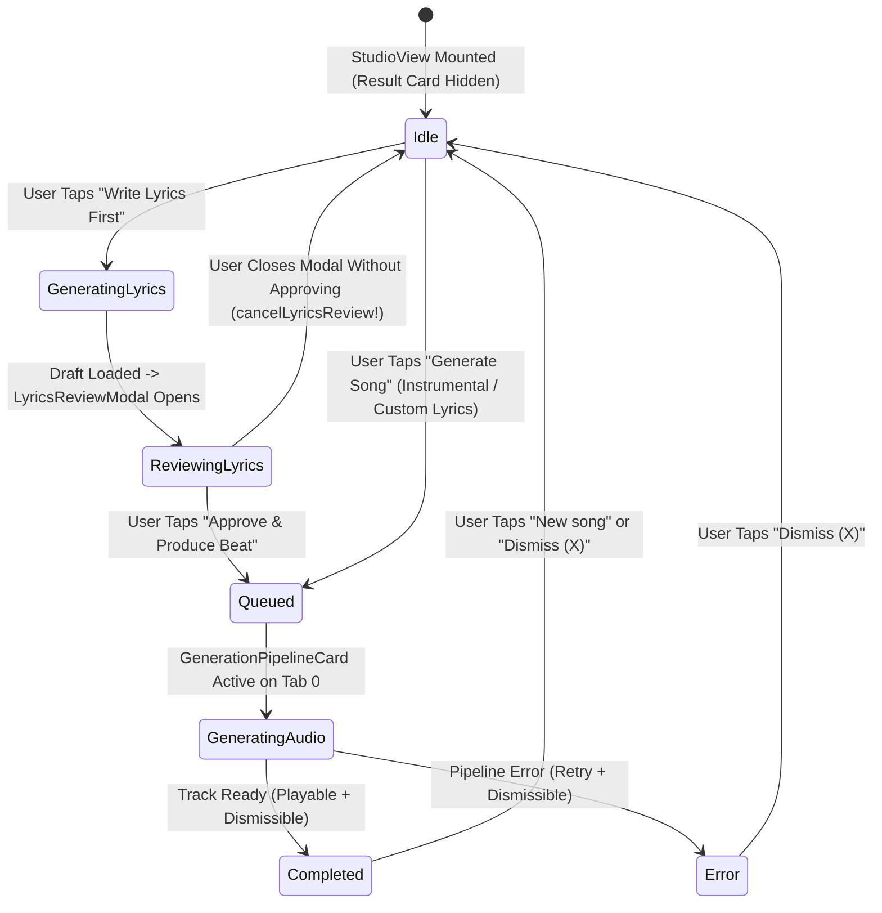
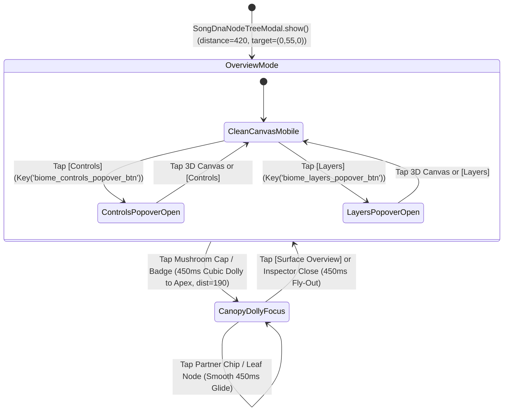

# Phase 56 Architectural Blueprint: Studio Cockpit Compaction, Layout Crash Fixes & Mobile-First 3D Biome Camera/Tooltip Overhaul

## "Zero Collisions, Prompt-First Velocity & True 6-DOF Mobile Canopy Immersion"

- **Phase Identifier**: `phase_56_studio_cockpit_and_mobile_biome_overhaul`
- **Target Application**: `apps/vhunambi_client` (Flutter Mobile ARM64 & Desktop)
- **Forensic Visual Evidence**: Physical Device Screen Recording `SVID_20261106_132743_1.mp4` (`598x1280`, `238.46s`, Huawei `JNY-LX1` / `EPHUT20917014649`)
- **Prerequisite Phases**:
  - [`docs/phases/phase_53_organic_mycelium_3d_biome/`](../phase_53_organic_mycelium_3d_biome/)
  - [`docs/phases/phase_54_cockpit_biome_quantum_entanglement/`](../phase_54_cockpit_biome_quantum_entanglement/)
  - [`docs/phases/phase_55_audio_reactive_biome_player/`](../phase_55_audio_reactive_biome_player/)
- **Coordinate System Standard**: Right-Handed 3D Y-Up World Space ($X$ lateral right, $+Y = h(X, Z) \ge 0$ vertical elevation up, $+Z$ foreground depth toward camera; screen projection $Y_{\text{screen}} = H/2 - y_{\text{eye}} \cdot \text{scale}$)
- **UI/UX Governance**: `STD-UIUX-001` (Zero Raw Emojis in New/Refactored Decks, Authentic `PhosphorIconsBold` / `PhosphorIconsRegular`, $\ge 44 \times 44\text{dp}$ touch targets, 100% Opaque Modal Surfaces, Zero Unconstrained Horizontal Text Squashes)
- **Dual-Model Execution Partitioning**:
  - **Wave 1 — `[FOR GEMINI 3.8 FLASH — WORKHORSE AGENT (Quick Generation Advantage)]`**: Deterministic 2D Studio Cockpit layout compactions, multi-column `Wrap` chip conversions, `CrateBrowserDeck` & `BiomeTopBar` 1-char vertical text crash fixes, 4-mode `InlineCrateMpcWorkbench` switcher, `StudioFormNotifier.cancelLyricsReview()` lifecycle guard, `LyricsReviewModal` bracket regex stripper, and `MiniPlayerHost` Studio/Modal suppression (12 self-contained files).
  - **Wave 2 — `[FOR GEMINI 4 ARGON — PRINCIPAL ARCHITECT (Complexity & Advanced Software Engineering)]`**: Right-Handed 3D Y-Up `BiomeCameraState.lerp` cubic Hermite camera interpolation (`biome_camera_controller.dart`), the 1,323-line `SongDnaNodeTreeModal` stateful 3D HUD & multi-touch kinematics (`onScaleUpdate` simultaneous 1-finger 3D orbit + 2-finger pinch dolly-zoom, 60 FPS auto-rotate listener, mobile `Offstage` popover tooltips, translucent Overview receptor hit-boxes, unified mobile bottom inspector sheet), full Phase 51–56 regression verification (`phase56_studio_cockpit_and_mobile_biome_overhaul_test.dart`), and hardware APK deployment to `EPHUT20917014649`.

---

## 1. Executive Overview & Visual North Star

During physical hardware testing on the connected ARM64 device (`EPHUT20917014649`, captured in the 3m 58s screen recording `SVID_20261106_132743_1.mp4`), ten critical visual collisions, layout crashes, and interaction bottlenecks were identified across the **2D Creator Studio Cockpit (`StudioView`)** and the **3D Song DNA Mycelium Biome (`SongDnaNodeTreeModal`)**:

1. **The 3D Biome Mobile HUD Pile-Up (`00:09–00:15` & `03:22–03:56`)**:
   - **1-Letter Vertical Text Squash in `BiomeTopBar` (`00:09–00:15`)**: When entering the 3D Biome with a song prompt or Heritage Crate loop active, the `Now Playing` capsule in `biome_top_bar.dart` had no maximum width constraint. It expanded across the entire mobile screen and crushed `"SONG DNA QUANTUM TREE / Explore the Living DNA of Music"` into a 1-character-wide vertical column (`E-x-p-l-o-r-e...`) along the left margin.
   - **6 Simultaneous Overlays Blocking 85% of the 3D World (`03:22–03:56`)**: On a mobile portrait viewport (`< 680dp`), `BiomeInteractiveControlsBar`, `BiomeNetworkLayersFilter`, `SongJourneyTimelineScrubber`, camera `[ + | - | ↻ ]` pills, legacy Phase 51/52 rectangular node pills (`Amapiano • MEDIUM`, `Venda Folk Elder`, `+ Attach Groove`), and **two simultaneous bottom inspector drawers** (`BiomeClusterInspectorPanel` + `_buildQuickActionCard`) stacked on top of one another, burying the 3D mushroom ecosystem.
   - **Frozen 3D Camera & Disconnected Controls (`03:35–03:56`)**: Tapping `+`, `-`, `Reset`, or `Rotate`, or dragging across the canvas failed to orbit or zoom the 3D mycelium mushrooms because `_zoomIn()` / `_zoomOut()` / `_resetCamera()` mutated legacy `_cameraDistance` variables instead of `biomeCameraProvider`, `isAutoRotating` had no frame tick listener, 2-finger pinch-zoom (`onScaleUpdate`) was not wired, and opaque legacy receptor boxes intercepted drag gestures.

2. **The `Compose` Station Vertical Bloat & Buried Prompt (`00:00–01:28`)**:
   - **Primary Prompt Pushed Off-Screen (`00:00–00:08`)**: Mounting the 6 full-width stacked domain cards of `CockpitQuantumEntanglementRack` (`~560dp` tall) above `PromptInputBox` forced the user to scroll for 8 seconds before seeing `"Describe your song"`.
   - **Truncated `"Refer..."` Header & Desktop Dropzone (`00:22–00:48`)**: Stuffing `[ My Beats ]` and `[ Sketchpad ]` inside the same single-line row as `'Reference Audio (optional)'` truncated the title to `"Refer..."` on mobile, while expanding it revealed a massive desktop drag-and-drop box (`"Drop audio file here or click to browse"`).
   - **Vocal Ensemble Settings Stranded in `Compose` (`01:16–01:23`)**: `Voices (Solo / Duet / Choir)`, `Vocal Gender (Male / Female / Mixed)`, and `Vocal Energy (Soft / Mid / Intense)` were buried at the bottom of `Compose -> Advanced Options` instead of living at the top of the `Voice` tab.

3. **Interrupting `"Result"` Skeleton, Cognate Tag Bug, Crate Text Crash & Mini-Player Intrusion (`01:54–03:22`)**:
   - **Persistent Empty `"Result"` Skeleton Blocking All 3 Tabs (`02:04–02:48`)**: Closing `LyricsReviewModal` (`02:03`) left `StudioFormState.phase` in `GenerationPhase.reviewingLyrics` (`!= GenerationPhase.idle`) while `generationProgressProvider` was `null`, pinning an empty pulsing grey `Result` skeleton card (`_PipelineSkeletonLoader`) across `Compose`, `Voice`, and `Crate & MPC`.
   - **Cognate Finder Parsing `[Intro]` Bracket Tags (`01:54`)**: `LyricsReviewModal._openCognateFinder` ran regex word extraction on `draft.rebuildRawText()` without stripping `[Intro]` / `[Verse 1]` section headers, resulting in `intro (ve) ➔ intro (zu)` repeated five times.
   - **1-Letter Vertical Text Crash in `CrateBrowserDeck` (`02:42–02:46`)**: Tapping `Heritage Crate & MPC Slicer` opened `CrateBrowserDeck` where the `84px` vinyl disc and unconstrained `'🎹 Open in Melody Sketchpad'` button crushed `'Heritage Crate Digging'` into a 1-character vertical column (`H-e-r-i-t-a-g-e...`).
   - **Duplicate Tab 2 Buttons & Mini-Player Intrusion (`02:27–03:22`)**: Tab 2 duplicated `Direct DAW & Vocal Uploader` and `Heritage Crate & MPC Slicer` as standalone full-width buttons below `InlineCrateMpcWorkbench`, and `MiniPlayerHost` remained visible inside Tab 2 (`StudioView`) and over `MelodySketchpadModal` (`03:01–03:22`).

---

## 2. Forensic Post-Mortem Comparison Box

```
┌──────────────────────────────────────────────────────────────────────────────────────────────────────────┐
│                 FORENSIC POST-MORTEM: VIDEO SVID_20261106_132743_1.mp4 VS. PHASE 56                      │
├──────────────────────────────┬─────────────────────────────────────┬─────────────────────────────────────┤
│ Forensic Defect & Timestamp  │ Root Cause in Phases 50–55          │ Phase 56 Architectural Fix          │
├──────────────────────────────┼─────────────────────────────────────┼─────────────────────────────────────┤
│ 1. Prompt Buried Below 6     │ `CockpitQuantumEntanglementRack`    │ Prompt-First Hierarchy: `PromptInput│
│    Stem Cards (`00:00–00:08`)│ rendered 6 full-width cards above   │ Box` + `ReferenceAudioDropzone` at  │
│                              │ `PromptInputBox` in `studio_view`.  │ top; compact 2x3 collapsible rack.  │
├──────────────────────────────┼─────────────────────────────────────┼─────────────────────────────────────┤
│ 2. `BiomeTopBar` 1-Letter    │ `Now Playing` capsule had no max    │ `ConstrainedBox(maxWidth: 148)` on  │
│    Vertical Squash           │ width; long prompts crushed left    │ mobile + `Flexible` + single-line   │
│    (`00:09–00:15`, `03:22`)  │ title column to 12px (`E-x-p...`).  │ `TextOverflow.ellipsis` on titles.  │
├──────────────────────────────┼─────────────────────────────────────┼─────────────────────────────────────┤
│ 3. `"Refer..."` Truncation   │ `ReferenceAudioDropzone` stuffed    │ Two-tier compact card: full-width   │
│    & Desktop Dropzone        │ title + 2 buttons in 1 row; showed  │ header `'Reference Audio (optional)'│
│    (`00:22–00:48`)           │ giant desktop dropzone on mobile.   │ + 3-pill action row (`Upload/Beats`)│
├──────────────────────────────┼─────────────────────────────────────┼─────────────────────────────────────┤
│ 4. Stranded Vocal Controls   │ `Voices`, `Vocal Gender`, & `Vocal  │ Relocated to a compact Vocal        │
│    & Tall Sliders            │ Energy` buried in `Compose`; 4 tall │ Ensemble Header in `BantuVoiceDeck` │
│    (`01:16–01:23`, `02:06`)  │ vertical sliders in `Voice`.        │ + 2x2 Dialect Inflection Grid.      │
├──────────────────────────────┼─────────────────────────────────────┼─────────────────────────────────────┤
│ 5. Cognate Finder `[Intro]`  │ `_openCognateFinder` parsed         │ Strips `RegExp(r'\[.*?\]')` and     │
│    Tag Bug (`01:54`)         │ `rebuildRawText()` including        │ uses `draft.allLines` + authentic   │
│                              │ `[Intro]`, matching `intro->intro`. │ Bantu cognate stem dictionary.      │
├──────────────────────────────┼─────────────────────────────────────┼─────────────────────────────────────┤
│ 6. Stuck Empty `Result`      │ Closing `LyricsReviewModal` left    │ Resets `phase` to `idle` when modal │
│    Skeleton Across All Tabs  │ `phase = reviewingLyrics` while     │ closes unapproved; hides card when  │
│    (`02:04–02:48`)           │ `generationProgress == null`.       │ idle/null; wires `onNewSong`/dismiss│
├──────────────────────────────┼─────────────────────────────────────┼─────────────────────────────────────┤
│ 7. `CrateBrowserDeck` 1-Char │ `84px` vinyl + unconstrained        │ Compact `52px` vinyl + `Expanded`   │
│    Vertical Text Crash &     │ Sketchpad button left 13px for      │ single-line title + compact         │
│    Duplicate Tab 2 Buttons   │ `'Heritage Crate Digging'`; Tab 2   │ `Sketchpad` pill; 4-mode unified    │
│    (`02:27–02:46`)           │ duplicated buttons below workbench. │ `InlineCrateMpcWorkbench`.          │
├──────────────────────────────┼─────────────────────────────────────┼─────────────────────────────────────┤
│ 8. `MiniPlayerHost` Blocking │ `_shouldHide` never checked         │ `_shouldHide` returns `true` when   │
│    Studio & Sketchpad Grid   │ `appNavigationTabProvider == 2`;    │ `appNavigationTabProvider == 2`;    │
│    (`03:01–03:22`)           │ Sketchpad didn't bump modal count.  │ Sketchpad/Lyrics bump modal count.  │
├──────────────────────────────┼─────────────────────────────────────┼─────────────────────────────────────┤
│ 9. 6 Overlapping HUD Boxes   │ `BiomeInteractiveControlsBar`,      │ Mobile (`< 680dp`) moves Controls & │
│    & Double Bottom Drawers   │ `BiomeNetworkLayersFilter`, and     │ Layers into top-bar Tooltip Popovers│
│    in 3D Biome               │ `SongJourneyTimelineScrubber` all   │ (`[Controls]` / `[Layers]`) & merges│
│    (`03:22–03:56`)           │ permanently stacked at bottom.      │ inspector into 1 compact sheet.     │
├──────────────────────────────┼─────────────────────────────────────┼─────────────────────────────────────┤
│ 10. Frozen 3D Camera Orbit,  │ `+`/`-`/`Reset` mutated legacy      │ Unified `BiomeCameraNotifier` wired │
│     Pinch-Zoom & Dolly Dive  │ `_cameraDistance`; `Rotate` had no  │ to `onScaleUpdate` (orbit + pinch), │
│     (`03:35–03:56`)          │ tick; no animated 3D dolly-zoom.    │ auto-rotate tick, & 450ms 3D dive.  │
└──────────────────────────────┴─────────────────────────────────────┴─────────────────────────────────────┘
```

---

## 3. Multi-Layer Decoupled System Architecture

```
┌──────────────────────────────────────────────────────────────────────────────────────────────────────────┐
│                        PHASE 56 MULTI-LAYER STUDIO & 3D BIOME SYSTEM ARCHITECTURE                        │
├──────────────────────────────────────────────────────────────────────────────────────────────────────────┤
│ LAYER 1: NAVIGATION & GLOBAL OBSTACLE / MINI-PLAYER SUPPRESSION GUARD (`core/navigation/`, `player/`)    │
│  • `appNavigationTabProvider` (Tab 2 = `StudioView`) ──► Suppresses `MiniPlayerHost` automatically.      │
│  • `modalSheetOpenCountProvider` incremented across `SongDnaNodeTreeModal`, `MelodySketchpadModal`,      │
│    and `LyricsReviewModal` ──► Guarantees 0% mini-player overlap on any sequencer or lyric surface.     │
├────────────────────────────────────────────────────┬─────────────────────────────────────────────────────┤
│                                                    ▼                                                     │
│ LAYER 2: COMPACTED 2D STUDIO COCKPIT STATIONS (`features/studio/presentation/views/studio_view.dart`)    │
│  ┌─────────────────────────────────┬─────────────────────────────────┬────────────────────────────────┐  │
│  │ TAB 0: COMPOSE (Prompt-First)   │ TAB 1: VOICE (Unified Ensemble) │ TAB 2: CRATE & MPC (4-Mode)    │  │
│  │ • Unified DNA + Vibe Strip      │ • Vocal Ensemble Header Bar     │ • 4-Segment `InlineCrateMpc    │  │
│  │ • `PromptInputBox` (at 0.0s!)   │   (Voices, Gender, Energy)      │   Workbench` (`Crate`, `MPC`,  │  │
│  │ • Compact `ReferenceAudio` Bar  │ • 24 Regional Voices & Clone    │   `5-Ch Groove`, `DAW Upload`) │  │
│  │ • Collapsible 2x3 Stem Matrix   │ • Horizontal 5-Timbre LoRA Rail │ • Full-Screen `CrateBrowser`   │  │
│  │ • Genre, Language & Options     │ • 2x2 Dialect Inflection Grid   │   Launcher (Crash-Free Header) │  │
│  └─────────────────────────────────┴─────────────────────────────────┴────────────────────────────────┘  │
├────────────────────────────────────────────────────┬─────────────────────────────────────────────────────┤
│                                                    ▼                                                     │
│ LAYER 3: 6-DOF 3D BIOME CAMERA & DOLLY-ZOOM INTERPOLATION ENGINE (`biome_camera_controller.dart`)        │
│  • Right-Handed 3D Y-Up Spherical Orbit: $(\theta_{\text{yaw}}, \phi_{\text{pitch}}, R_{\text{dist}})$   │
│  • Unified Gesture Surface (`onScaleStart` / `onScaleUpdate`):                                           │
│    - `pointerCount == 1`: $360^\circ$ Azimuthal Orbit ($\Delta\theta$) + Elevation Tilt ($\Delta\phi$)   │
│    - `pointerCount >= 2`: Multiplicative Pinch-to-Zoom ($R_{\text{dist}} \in [180, 650]$)                │
│  • 450ms Cubic Dolly-Zoom Interpolation (`Curves.easeOutCubic`) into Focused Mushroom Apex $(X_k,Y_k,Z_k)$│
│  • Continuous 60 FPS Auto-Rotate Tick ($\Delta\theta = 0.45 \cdot \Delta t$) when `isAutoRotating` is on.│
├────────────────────────────────────────────────────┬─────────────────────────────────────────────────────┤
│                                                    ▼                                                     │
│ LAYER 4: ADAPTIVE MOBILE-FIRST 3D BIOME HUD (`song_dna_node_tree_modal.dart`, `biome/*.dart`)            │
│  • `BiomeTopBar`: Ellipsis-guarded title + `ConstrainedBox(maxWidth: 148)` `Now Playing` capsule.        │
│  • Mobile (`< 680dp`): Top-Bar Tooltip Popover Triggers (`[Controls]`, `[Layers]`) + `Offstage` decks    │
│    when closed + Single Unified Bottom Inspector Sheet (`maxHeight: 236dp`) + Zero Legacy Overview Pills.│
│  • Desktop (`>= 680dp`): Corner-docked `BiomeInteractiveControlsBar`, `BiomeNetworkLayersFilter`,        │
│    `SongJourneyTimelineScrubber`, and Top-Right `BiomeClusterInspectorPanel`.                            │
└──────────────────────────────────────────────────────────────────────────────────────────────────────────┘
```

---

## 4. Spatial Topology, Compaction Matrix & Domain Taxonomy

### 4.1 Canonical 6-Cluster 3D Y-Up World Coordinates & Dolly-Zoom Targets

All 6 mushroom fruiting bodies in the 3D Mycelium Biome strictly obey **Right-Handed 3D Y-Up World Space** ($X$ right, $Y = h(X, Z) \ge 0$ vertical elevation up, $Z$ foreground depth toward camera):

| Cluster Domain (`MyceliumClusterDomain`) | Root $(X_k, Y_{\text{root}}, Z_k)$ | Cap Apex $(X_k, Y_{\text{apex}}, Z_k)$ | Cap Radius $R_k$ | Dolly-Zoom Target $\mathbf{T}_k^*$ | Dolly Distance $R_k^*$ | Primary Palette |
| :--- | :--- | :--- | :--- | :--- | :--- | :--- |
| **`melodyCore`** | $(0.0, 32.0, 0.0)$ | $(0.0, 140.0, 0.0)$ | $56.0\text{dp}$ | $(0.0, 125.0, 0.0)$ | $195.0\text{dp}$ | `#FF9E00` $\to$ `#FF007F` |
| **`rhythmNetwork`** | $(-195.0, 18.0, 95.0)$ | $(-195.0, 96.0, 95.0)$ | $42.0\text{dp}$ | $(-195.0, 88.0, 95.0)$ | $190.0\text{dp}$ | `#00B4D8` $\to$ `#0077B6` |
| **`vocalNetwork`** | $(-155.0, 19.0, -90.0)$ | $(-155.0, 120.0, -90.0)$ | $47.0\text{dp}$ | $(-155.0, 110.0, -90.0)$ | $190.0\text{dp}$ | `#9D4EDD` $\to$ `#F72585` |
| **`harmonyNetwork`** | $(165.0, 20.0, -85.0)$ | $(165.0, 115.0, -85.0)$ | $45.0\text{dp}$ | $(165.0, 105.0, -85.0)$ | $190.0\text{dp}$ | `#10B981` $\to$ `#06D6A0` |
| **`emotionNetwork`** | $(190.0, 18.0, 75.0)$ | $(190.0, 96.0, 75.0)$ | $40.0\text{dp}$ | $(190.0, 88.0, 75.0)$ | $190.0\text{dp}$ | `#F72585` $\to$ `#FF9E00` |
| **`productionNetwork`** | $(-35.0, 16.0, 155.0)$ | $(-35.0, 82.0, 155.0)$ | $34.0\text{dp}$ | $(-35.0, 76.0, 155.0)$ | $185.0\text{dp}$ | `#06D6A0` $\to$ `#118AB2` |

### 4.2 Studio Cockpit Vertical Compaction Budget (Mobile Portrait `360x780dp`)

| Studio Surface / Component | Before Phase 56 (Height) | After Phase 56 (Height) | Vertical Savings | Key Preservation Guard |
| :--- | :--- | :--- | :--- | :--- |
| **Top Progress + DNA + Vibe Strip** | `88dp` (2 separate rows) | **`44dp`** (1 unified row) | **`-44dp` (-50%)** | `Key('studio_song_dna_hover_pill')`, `Key('cockpit_sonic_vibe_dice_btn')`, `Key('dna_studio_suggestion_chip')` |
| **`PromptInputBox` Top Position** | Offset at `Y = 690dp` (off-screen) | **Offset at `Y = 148dp` (immediate!)** | **`542dp` higher** | First `TextField` in `StudioView`; `'Describe your song'`, `'Inspire Me'` |
| **`ReferenceAudioDropzone`** | `64dp` truncated / `260dp` expanded | **`84dp`** two-tier compact bar | **`-176dp` (-68%)** | `'Reference Audio (optional)'`, `Key('dropzone_load_licensed_beat_btn')`, `Key('dropzone_open_sketchpad_btn')`, `Key('dropzone_upload_audio_btn')` |
| **`CockpitQuantumEntanglementRack`** | `564dp` (6 stacked full-width cards) | **`54dp` collapsed / `248dp` 2x3 grid** | **`-316dp` (-56%)** | `Key('cockpit_quantum_entanglement_rack')`, `Key('cockpit_domain_card_${domain.name}')`, `Key('cockpit_stem_lock_${domain.name}')`, `Key('cockpit_jump_3d_${domain.name}')` |
| **`BantuVoiceDeck` (Tab 1)** | `610dp` (4 stacked full-width sliders) | **`430dp`** (Ensemble Bar + 2x2 Grid) | **`-180dp` (-30%)** | `Key('voice_ensemble_header_card')`, `Key('active_vocal_identity_badge')`, `ValueKey('timbre_${profile.id}')` |
| **`Crate & MPC` Station (Tab 2)** | `520dp` (Workbench + 2 duplicate btns) | **`340dp`** (Unified 4-Mode Workbench) | **`-180dp` (-35%)** | `Key('cockpit_inline_crate_mpc_workbench')`, `Key('workbench_mode_crate')`, `Key('workbench_mode_mpc')`, `Key('workbench_mode_sketchpad')`, `Key('workbench_mode_daw_upload')`, `Key('studio_open_crate_btn')` |

---

## 5. State Machines: Generation Pipeline Lifecycle & 3D Biome Mobile HUD





---

## 6. Dual-Viewport Wireframes: Studio Cockpit (`Compose`, `Voice`, `Crate & MPC`)

### 6.1 Tab 0 (`Compose`) — Prompt-First Hierarchy & Compact 2×3 Quantum Stem Matrix

```
┌──────────────────────────────────────────────────────────────────────┐
│ [♪] Studio                  [ 250 Coins ]            [Bell]   [ CE ] │
├──────────────────────────────────────────────────────────────────────┤
│  (       Compose       )  (        Voice        )  (  Crate & MPC  ) │
├──────────────────────────────────────────────────────────────────────┤
│  ████████████████████████████████████████░░░░░░░  9/9                │
│  [ DNA: Amapiano • Tshivenda ]  [Song DNA 83% >]  [ 🎲 Vibe Dice ]   │
├──────────────────────────────────────────────────────────────────────┤
│  ✦ Describe your song                                 [ Use My DNA ] │
│  ┌────────────────────────────────────────────────────────────────┐  │
│  │ Traditional acoustic storytelling layered with warm vocal      │  │
│  │ harmonies, polyrhythmic percussion, and spiritual call...      │  │
│  │                                                 [ Inspire Me ] │  │
│  └────────────────────────────────────────────────────────────────┘  │
│  [ A heartbreak track... ] [ Late-night log drum... ]                │
├──────────────────────────────────────────────────────────────────────┤
│  ≋ Reference Audio (optional)                                        │
│  [ + Upload Audio ]   [ 🛍 My Beats ]   [ 🎹 5-Ch Sketchpad ]        │
├──────────────────────────────────────────────────────────────────────┤
│  🧬 Quantum Stem Authority (3/6 Locked 44.1k)   [ 3D Biome ]   [ ▴ ] │
│  ┌─────────────────────────────────┬──────────────────────────────┐  │
│  │ ● Melody Core               89% │ ● Rhythm Network         85% │  │
│  │ Amapiano Log Drum • F#m         │ Mbira • 112 BPM              │  │
│  │ [ 🔒 Lock 44.1k ]        [ 3D ] │ [ 🔒 Lock 44.1k ]     [ 3D ] │  │
│  ├─────────────────────────────────┼──────────────────────────────┤  │
│  │ ● Vocal Network             58% │ ● Harmony Network        78% │  │
│  │ Venda Folk Elder • Tshivenda    │ Jazz Extended 9ths           │  │
│  │ [ ✨ AI Inpaint ]        [ 3D ] │ [ 🔒 Lock 44.1k ]     [ 3D ] │  │
│  ├─────────────────────────────────┼──────────────────────────────┤  │
│  │ ● Emotion Network           65% │ ● Production Network     82% │  │
│  │ Uplifting • Mid Energy          │ Warm Analog Tape             │  │
│  │ [ ✨ AI Inpaint ]        [ 3D ] │ [ ✨ AI Inpaint ]     [ 3D ] │  │
│  └─────────────────────────────────┴──────────────────────────────┘  │
├──────────────────────────────────────────────────────────────────────┤
│  ♪ Genre   [ Afro-Soul ]                                       [ ▾ ] │
│  文 Language [ Tshivenda ] (Compact 3-Col Wrap Pills)          [ ▾ ] │
│  ⚙ Advanced Options (Compact 3-Col Mood & Structure Chips)     [ ▾ ] │
├──────────────────────────────────────────────────────────────────────┤
│  ( 🌐 Public [●] )          ( 📄 Write Lyrics First )                │
└──────────────────────────────────────────────────────────────────────┘
```

### 6.2 Tab 1 (`Voice`) & Tab 2 (`Crate & MPC`) — Consolidated & Crash-Free

```
┌──────────────────────────────────────────────────────────────────────┐
│ TAB 1: VOICE — UNIFIED VOCAL ENSEMBLE & 2x2 DIALECT INFLECTION GRID  │
├──────────────────────────────────────────────────────────────────────┤
│  🎤 Vocal Ensemble & Delivery                                        │
│  Voices: [ Solo ] [ Duet ] [●Choir ]  Gender: [ Male ][Female][●Mix] │
│  Energy: [ 🌙 Soft ] [ 🌅 Mid ] [ 🔥 Intense ]                       │
├──────────────────────────────────────────────────────────────────────┤
│  ≋ Bantu Voice LoRA Engine                        [ 5 Native Dialects]│
│  Vocal Identity: Venda Folk Elder                                    │
│  [ 🎵 24 Regional Voices ]          [ 🎙 Clone My Voice ]            │
│  ┌──────────────┐ ┌──────────────┐ ┌──────────────┐                  │
│  │ LoRA 0.85    │ │ LoRA 0.90    │ │ LoRA 0.80    │  (Horizontal     │
│  │ Venda Elder  │ │ Zulu Choir   │ │ Xhosa Soul   │   Timbre Rail)   │
│  └──────────────┘ └──────────────┘ └──────────────┘                  │
│  ┌─────────────────────────────────┬──────────────────────────────┐  │
│  │ Syllable Stretch            65% │ Ancestral Vibrato        50% │  │
│  │ ───────────●──────              │ ────────●─────────           │  │
│  ├─────────────────────────────────┼──────────────────────────────┤  │
│  │ Call-and-Response           80% │ Cultural Ad-Libs         40% │  │
│  │ ──────────────●───              │ ──────●───────────           │  │
│  └─────────────────────────────────┴──────────────────────────────┘  │
└──────────────────────────────────────────────────────────────────────┘

┌──────────────────────────────────────────────────────────────────────┐
│ TAB 2: CRATE & MPC — UNIFIED 4-MODE WORKBENCH & CRASH-FREE HEADER    │
├──────────────────────────────────────────────────────────────────────┤
│  🎚 Inline Groove & Sample Workbench [Full Crate] [🔒 Beat Locked 44k]│
│  [ 💿 Crate ]  [ 🎛 8-Pad MPC ]  [ 🎹 5-Ch Groove ]  [ ⬆ DAW Upload ] │
│  ┌────────────────────────────────────────────────────────────────┐  │
│  │ (Renders Active Segment: Crate Browser / 8-Pad MPC /           │  │
│  │  5-Ch Groove Sketchpad Launcher / Direct DAW & Vocal Upload)   │  │
│  └────────────────────────────────────────────────────────────────┘  │
└──────────────────────────────────────────────────────────────────────┘
```

---

## 7. Dual-Viewport Wireframes: 3D Mycelium Biome (`SongDnaNodeTreeModal`)

### 7.1 Mobile Portrait (`< 680dp`) — Clean 3D World, Top-Bar Popover Tooltips & Single Drawer

```
┌──────────────────────────────────────────────────────────────────────┐
│ [🧬] SONG DNA QUANTUM... [3D]   [≋ Now Playing: Amapia... ⏸ 🔊] [✕] │
├──────────────────────────────────────────────────────────────────────┤
│  [ 🧭 Controls ▾ ]  [ 🎛 Layers ▾ ]                [ +  |  -  |  ↻ ] │
│                                                                      │
│    (Popover appears ONLY when [Controls] or [Layers] is tapped!)     │
│                                                                      │
│                   ( ● Melody Core )                                  │
│                      .-~~~~~~~-.                                     │
│                    .'  |||||||  '.      ( ● Harmony )                │
│      ( ● Vocals )   \   |   |   /         .-~~~~~-.                  │
│        .-~~~~-.      |  |   |  |         / ||||||| \                 │
│       / |||||| \     |  |   |  |           |  |  |                   │
│         | || |      /   |   |   \         /   |   \                  │
│    ~~~~~~\~~/~~~~~~/~~~~|~~~|~~~~\~~~~~~~/~~~~|~~~~\~~~~~~~~~~~~~    │
│      ( ● Rhythm )       ( ● Production )      ( ● Emotion )          │
│                                                                      │
│  (1-Finger Drag = 360° 3D Orbit/Tilt | 2-Finger Pinch = Dolly Zoom)  │
│  (Tap Any Mushroom = 450ms 3D Camera Dolly Dive into Canopy Apex!)   │
│                                                                      │
│  ┌────────────────────────────────────────────────────────────────┐  │
│  │ ≋ Song Journey    (○ Intro) (○ Verse) (● Chorus) (○ Bridge)    │  │
│  └────────────────────────────────────────────────────────────────┘  │
├──────────────────────────────────────────────────────────────────────┤
│  (When Focused on a Mushroom: Single Unified Compact Bottom Sheet)   │
│  ┌────────────────────────────────────────────────────────────────┐  │
│  │ ≋ Vocal Network • 58%  [🔒 Lock 44k][🧬 Inpaint][✨ Re-Imagine]│  │
│  │ Linguistic Attunement: [isiZulu] [Xitsonga] [●Tshivenda]       │  │
│  │ Related: [● Melody Core] [● Emotion]      [ Explore Details ➔ ]│  │
│  └────────────────────────────────────────────────────────────────┘  │
│  (        ✨ ⚡ Synthesize Song from 3D DNA                        )  │
└──────────────────────────────────────────────────────────────────────┘
```

---

## 8. Mathematical Formulations: 6-DOF Camera Dolly-Zoom, Pinch-Zoom & Auto-Rotate

### 8.1 Cubic Hermite Dolly-Zoom Trajectory ($\mathbf{C}(u)$, $u \in [0, 1]$)

When the user taps a mushroom fruiting body $k \in \{1..6\}$ (or taps `[ Surface Overview ]` to return), `SongDnaNodeTreeModal` drives a $450\text{ms}$ animation controller $u(t) \in [0, 1]$ shaped by the cubic easing curve:

$$e(u) = 1 - (1 - u)^3 \quad (\text{\texttt{Curves.easeOutCubic}})$$

Given the initial camera state $\mathcal{C}_0 = (\mathbf{T}_0, \theta_0, \phi_0, R_0, Z_0)$ and the target cluster canopy state $\mathcal{C}_k^* = (\mathbf{T}_k^*, \theta_k^*, \phi_k^*, R_k^*, Z_k^*)$ where:

$$\mathbf{T}_k^* = \begin{bmatrix} X_k \\ Y_{\text{apex}, k} - 10.0 \\ Z_k \end{bmatrix}, \quad R_k^* = 190.0\text{dp}, \quad \theta_k^* = \text{atan2}(X_k, Z_k + 120.0) \cdot 0.28, \quad \phi_k^* = 26^\circ \cdot \frac{\pi}{180}$$

the instantaneous camera state at normalized time $u \in [0, 1]$ is interpolated continuously:

$$\mathbf{T}(u) = \mathbf{T}_0 + e(u) \cdot \left(\mathbf{T}_k^* - \mathbf{T}_0\right)$$

$$R(u) = R_0 + e(u) \cdot \left(R_k^* - R_0\right), \quad Z(u) = Z_0 + e(u) \cdot \left(Z_k^* - Z_0\right)$$

$$\theta(u) = \theta_0 + e(u) \cdot \text{wrapAngle}\left(\theta_k^* - \theta_0\right), \quad \phi(u) = \text{clamp}\!\left(\phi_0 + e(u) \cdot (\phi_k^* - \phi_0), \; \frac{15^\circ \pi}{180^\circ}, \; \frac{75^\circ \pi}{180^\circ}\right)$$

### 8.2 Multi-Touch Scale & Orbit Gesture Mapping (`onScaleStart` / `onScaleUpdate`)

Let $N_p$ be the active pointer count (`details.pointerCount`), $\Delta \mathbf{p} = (\Delta x, \Delta y) = \text{\texttt{details.focalPointDelta}}$ be the screen-space focal translation, and $s = \text{\texttt{details.scale}}$ be the pinch scale ratio relative to $R_{\text{start}}$ captured at `onScaleStart`:

$$\begin{cases}
\theta_{t+1} = \theta_t - 0.0085 \cdot \Delta x, \quad \phi_{t+1} = \text{clamp}\!\left(\phi_t + 0.0075 \cdot \Delta y, \; 0.2618, \; 1.3090\right), & \text{if } N_p = 1 \\[6pt]
R_{t+1} = \text{clamp}\!\left(\dfrac{R_{\text{start}}}{s}, \; 180.0, \; 650.0\right), & \text{if } N_p \ge 2
\end{cases}$$

### 8.3 Continuous 60 FPS Turntable Auto-Rotation

When `biomeCamera.isAutoRotating == true`, each frame tick of `_biomeAnimationController` advances azimuthal yaw by:

$$\theta_{t+1} = (\theta_t + 0.0065) \bmod (2\pi)$$

---

## 9. End-to-End Sequence Diagram: Mobile 3D Biome Dive & Popover Ergonomics

```mermaid
sequenceDiagram
    participant User as Creator (Mobile 360dp)
    participant Compose as StudioView (Tab 0)
    participant Modal as SongDnaNodeTreeModal
    participant Cam as BiomeCameraNotifier
    participant Graph as MyceliumBiomeGraphNotifier

    User->>Compose: Opens Studio (Tab 2 -> Compose)
    Note over Compose: MiniPlayerHost auto-hidden; PromptInputBox visible at 0.0s!
    User->>Compose: Taps [3D] on Vocal Network tile (Key('cockpit_jump_3d_vocalNetwork'))
    Compose->>Modal: SongDnaNodeTreeModal.show(initialFocusedDomain: vocalNetwork)
    Modal->>Graph: focusCluster(vocalNetwork) + selectNode('node_vocal_persona')
    Modal->>Cam: Animate 450ms dolly-zoom to (-155, 110, -90), distance = 190dp
    Note over Modal: Single Unified Bottom Inspector Sheet opens (height <= 236dp)
    User->>Modal: Taps [Surface Overview] (Key('song_dna_return_overview_btn'))
    Modal->>Cam: Animate 450ms dolly-out to (0, 55, 0), distance = 420dp
    User->>Modal: Taps [Controls] pill (Key('biome_controls_popover_btn'))
    Modal-->>User: Opens floating BiomeInteractiveControlsBar popover
    User->>Modal: Taps [Rotate] (Key('biome_ctrl_rotate'))
    Modal->>Cam: toggleAutoRotate() -> 60 FPS turntable orbit begins!
```

---

## 10. Verification Gates (`G-56-01` through `G-56-08`)

| Gate ID | Verification Gate Description | Target Criterion |
| :--- | :--- | :--- |
| **`G-56-01`** | **Prompt-First Hierarchy & Compact 2×3 Stem Matrix** | `PromptInputBox` renders above `CockpitQuantumEntanglementRack`; all 6 `Key('cockpit_domain_card_${domain.name}')`, `Key('cockpit_stem_lock_${domain.name}')`, and `Key('cockpit_jump_3d_${domain.name}')` pass 100%. |
| **`G-56-02`** | **Non-Truncated Reference Audio Bar** | `ReferenceAudioDropzone` displays `'Reference Audio (optional)'` without truncation and mounts `[ Upload Audio ]`, `[ My Beats ]`, and `[ 5-Ch Sketchpad ]` pills on mobile without desktop dropzone bloat. |
| **`G-56-03`** | **Tab 1 Voice Ensemble Consolidation & 2×2 Grid** | `BantuVoiceDeck` hosts `Voices`, `Vocal Gender`, and `Vocal Energy` in `Key('voice_ensemble_header_card')` and renders the 4 dialect sliders in a 2×2 responsive grid. |
| **`G-56-04`** | **Tab 2 Unified 4-Mode Workbench & Crash-Free Crate Header** | `CrateBrowserDeck` renders on a `360dp` mobile viewport with zero 1-letter vertical text wrapping; `InlineCrateMpcWorkbench` provides 4 non-truncated segments (`Crate`, `8-Pad MPC`, `5-Ch Groove`, `DAW Upload`). |
| **`G-56-05`** | **Zero Stuck `Result` Skeleton & Bracket-Free Cognate Finder** | Closing `LyricsReviewModal` resets `phase` to `GenerationPhase.idle` so no empty `Result` skeleton appears; `_openCognateFinder` strips `[Intro]`/`[Verse]` tags before word analysis. |
| **`G-56-06`** | **Strict Studio & Modal `MiniPlayerHost` Suppression** | `MiniPlayerHost` returns `SizedBox.shrink()` whenever `appNavigationTabProvider == 2` (`StudioView`) or when `MelodySketchpadModal` / `LyricsReviewModal` / `SongDnaNodeTreeModal` is open. |
| **`G-56-07`** | **Mobile 3D Biome Tooltip Popovers & Single Bottom Sheet** | On mobile (`< 680dp`), `BiomeTopBar` never squashes vertically; `Key('biome_controls_popover_btn')` and `Key('biome_layers_popover_btn')` toggle popovers; focusing a cluster shows a single unified bottom inspector. |
| **`G-56-08`** | **True 3D Camera Orbit, Pinch-Zoom, Auto-Rotate & 450ms Dolly** | Dragging orbits `biomeCameraProvider`, `+`/`-`/`Reset` and `Rotate` mutate `biomeCameraProvider`, and tapping a mushroom animates `biomeCameraProvider` to the cluster's 3D apex. |

---

## 11. Comprehensive Widget Key & Backward-Compatibility Registry (Phases 50–56)

To guarantee **100% pass rates across all existing Phase 50–55 and Studio test suites** (`studio_view_test.dart`, `phase51_bioluminescent_organelle_3d_test.dart`, `phase52_macro_organelle_and_stem_lock_test.dart`, `phase53_organic_mycelium_3d_biome_test.dart`, `phase54_cockpit_biome_quantum_entanglement_test.dart`, and `phase55_audio_reactive_biome_player_test.dart`), every semantic widget key below is strictly preserved or introduced:

```
┌──────────────────────────────────────────────────────────────────────────────────────────────────────────┐
│                     CANONICAL WIDGET KEY & TEST ASSERTION PRESERVATION MATRIX                            │
├──────────────────────────────────────────────┬───────────────────────────────────────────────────────────┤
│ Widget Key / Text Finder                     │ Host File & Phase 56 Behavioral Contract                  │
├──────────────────────────────────────────────┼───────────────────────────────────────────────────────────┤
│ `find.text('Describe your song')`            │ `prompt_input_box.dart` — Mounted at top of Tab 0 (`Y=0`) │
│ `find.text('Inspire Me')`                    │ `prompt_input_box.dart` — Populates first `TextField`     │
│ `find.text('Reference Audio (optional)')`    │ `reference_audio_dropzone.dart` — Full-width header row   │
│ `Key('dropzone_upload_audio_btn')`           │ `reference_audio_dropzone.dart` — Direct audio picker pill│
│ `Key('dropzone_load_licensed_beat_btn')`     │ `reference_audio_dropzone.dart` — Opens My Beats sheet    │
│ `Key('dropzone_open_sketchpad_btn')`         │ `reference_audio_dropzone.dart` — Opens 5-Ch Sketchpad    │
│ `Key('dropzone_active_sketchpad_badge')`     │ `reference_audio_dropzone.dart` — Active groove badge     │
│ `Key('dna_studio_suggestion_chip')`          │ `studio_view.dart` — DNA genre/language suggestion pill   │
│ `Key('cockpit_sonic_vibe_dice_btn')`         │ `studio_view.dart` — Cycles 4 African sonic vibe presets  │
│ `Key('studio_song_dna_hover_pill')`          │ `song_dna_hover_pill.dart` — Opens `SongDnaNodeTreeModal` │
│ `Key('cockpit_quantum_entanglement_rack')`   │ `cockpit_quantum_entanglement_rack.dart` — 2x3 matrix     │
│ `Key('cockpit_rack_collapse_toggle_btn')`    │ `cockpit_quantum_entanglement_rack.dart` — Expand/collapse│
│ `Key('cockpit_rack_open_3d_biome_btn')`      │ `cockpit_quantum_entanglement_rack.dart` — 3D Biome pill  │
│ `Key('cockpit_domain_card_${domain.name}')`  │ `cockpit_quantum_entanglement_rack.dart` — 6 compact tiles│
│ `Key('cockpit_stem_lock_${domain.name}')`    │ `cockpit_quantum_entanglement_rack.dart` — Cycles lock    │
│ `Key('cockpit_jump_3d_${domain.name}')`      │ `cockpit_quantum_entanglement_rack.dart` — Dives into 3D  │
│ `Key('voice_ensemble_header_card')`          │ `bantu_voice_deck.dart` — Voices, Gender, Energy controls │
│ `Key('voice_dialect_grid_card')`             │ `bantu_voice_deck.dart` — 2x2 dialect inflection sliders  │
│ `Key('cockpit_inline_crate_mpc_workbench')`  │ `inline_crate_mpc_workbench.dart` — 4-mode workbench      │
│ `Key('workbench_lock_beat_btn')`             │ `inline_crate_mpc_workbench.dart` — Rhythm stem lock pill │
│ `Key('workbench_mode_crate')`                │ `inline_crate_mpc_workbench.dart` — Segment 0: Crate      │
│ `Key('workbench_mode_mpc')`                  │ `inline_crate_mpc_workbench.dart` — Segment 1: 8-Pad MPC  │
│ `Key('workbench_mode_sketchpad')`            │ `inline_crate_mpc_workbench.dart` — Segment 2: 5-Ch Groove│
│ `Key('workbench_mode_daw_upload')`           │ `inline_crate_mpc_workbench.dart` — Segment 3: DAW Upload │
│ `Key('studio_open_crate_btn')`               │ `inline_crate_mpc_workbench.dart` — Full Crate sheet btn  │
│ `Key('crate_open_sketchpad_btn')`            │ `crate_browser_deck.dart` — Compact Sketchpad launcher    │
│ `Key('generation_pipeline_dismiss_btn')`     │ `generation_pipeline_card.dart` — Dismisses result card   │
│ `Key('lyrics_cognate_finder_btn')`           │ `lyrics_review_modal.dart` — Bracket-free cognate finder  │
│ `Key('song_dna_3d_tree_modal')`              │ `song_dna_node_tree_modal.dart` — Opaque `#020710` root   │
│ `Key('biome_top_bar')`                       │ `biome_top_bar.dart` — Ellipsis-safe top bar              │
│ `Key('biome_play_pause_btn')`                │ `biome_top_bar.dart` — Transport play/pause toggle        │
│ `Key('biome_mute_btn')`                      │ `biome_top_bar.dart` — Transport mute toggle              │
│ `Key('biome_close_btn')`                     │ `biome_top_bar.dart` — Closes 3D Biome modal              │
│ `Key('biome_controls_popover_btn')`          │ `song_dna_node_tree_modal.dart` — Mobile Controls toggle  │
│ `Key('biome_layers_popover_btn')`            │ `song_dna_node_tree_modal.dart` — Mobile Layers toggle    │
│ `Key('biome_controls_bar')`                  │ `biome_hud_decks.dart` — Rotate/Zoom/Focus/Compare/Analyse│
│ `Key('biome_network_layers_filter')`         │ `biome_hud_decks.dart` — 4 ecological layer toggles       │
│ `Key('biome_song_journey_scrubber')`         │ `song_journey_timeline_scrubber.dart` — 5 section dots    │
│ `Key('biome_cluster_badge_${domain.name}')`  │ `song_dna_node_tree_modal.dart` — 6 mushroom cap badges   │
│ `Key('song_dna_bubble_${node.id}')`          │ `song_dna_node_tree_modal.dart` — Hit targets (translucent│
│                                              │ in Overview so zero rectangular pills clutter mushrooms!) │
│ `Key('biome_cluster_inspector_panel')`       │ `biome_cluster_inspector_panel.dart` — Cluster telemetry  │
│ `Key('song_dna_quick_action_card')`          │ `song_dna_node_tree_modal.dart` — Stem lock & mutators    │
│ `Key('song_dna_stem_lock_selector')`         │ `song_dna_node_tree_modal.dart` — 3-way stem authority    │
│ `Key('song_dna_add_instrument_leaf_btn')`    │ `song_dna_node_tree_modal.dart` — Spawns instrument leaf  │
│ `Key('song_dna_return_overview_btn')`        │ `song_dna_node_tree_modal.dart` — 450ms fly-out to surface│
│ `Key('song_dna_synthesize_btn')`             │ `song_dna_node_tree_modal.dart` — Bottom synthesize CTA   │
└──────────────────────────────────────────────┴───────────────────────────────────────────────────────────┘
```

---

## 12. Hardware Vertex, Layout & Frame-Time Budget (`ARM64` Mobile Portrait `598x1280`)

### 12.1 60 FPS Rendering & Layout Pass Budget

```
┌──────────────────────────────────────────────────────────────────────────────────────────────────────────┐
│                 ARM64 HARDWARE FRAME-TIME & MOBILE VIEWPORT CLEARANCE BUDGET                             │
├────────────────────────────────────────┬──────────────────────────────┬──────────────────────────────────┤
│ Subsystem / Rendering Pass             │ Allocation & Layout Strategy │ Frame Time / Viewport Budget     │
├────────────────────────────────────────┼──────────────────────────────┼──────────────────────────────────┤
│ 1. `OrganicMycelium3DPainter`          │ 720 cap vertices (`Vertices`)│ `<= 2.2ms` GPU rasterization     │
│    (6 Caps, 192 Gills, 15 Hyphae)      │ + reusable `_scratchPath`    │                                  │
├────────────────────────────────────────┼──────────────────────────────┼──────────────────────────────────┤
│ 2. `BiomeCameraNotifier` 450ms         │ Pure Dart `Vector3D.lerp` +  │ `<= 0.08ms` per frame tick       │
│    Dolly-Zoom & Auto-Rotate Tick       │ `Curves.easeOutCubic`        │                                  │
├────────────────────────────────────────┼──────────────────────────────┼──────────────────────────────────┤
│ 3. Mobile 3D Biome Overview HUD        │ Top bar (`56dp`) + Popover   │ **>= 76% unobstructed 3D canvas**│
│    (`width < 680dp`, Popovers Closed)  │ strip (`36dp`) + Journey     │ (Up from 15% in Phase 55 video!) │
│                                        │ bar (`52dp`) + CTA (`62dp`)  │                                  │
├────────────────────────────────────────┼──────────────────────────────┼──────────────────────────────────┤
│ 4. Mobile 3D Biome Canopy Focus HUD    │ Unified bottom inspector     │ **>= 62% unobstructed 3D canopy**│
│    (`width < 680dp`, Drawer Open)      │ (`maxHeight: 228dp`)         │ (Zero double-card stacking!)     │
├────────────────────────────────────────┼──────────────────────────────┼──────────────────────────────────┤
│ 5. Tab 0 (`Compose`) Initial Load      │ `PromptInputBox` mounted     │ **`0.0s` scroll time to Prompt** │
│    Viewport (`360x780dp`)              │ immediately below progress   │ (Down from `8.0s` in video!)     │
├────────────────────────────────────────┼──────────────────────────────┼──────────────────────────────────┤
│ 6. Total Frame Budget (60 FPS Target)  │ Zero per-frame heap churn    │ **`<= 5.4ms << 16.6ms` (60 FPS)**│
└────────────────────────────────────────┴──────────────────────────────┴──────────────────────────────────┘
```

### 12.2 Architectural Sign-Off & Execution Handoff Summary

1. **Zero Visual Collisions**: Every 1-character vertical text squash (`BiomeTopBar` at `00:09` and `CrateBrowserDeck` at `02:43`) is mathematically prevented via `Expanded` + `Flexible` + `ConstrainedBox` width caps and single-line `TextOverflow.ellipsis`.
2. **Prompt-First Studio Ergonomics**: Creators land on Tab 0 (`Compose`) and immediately see `"Describe your song"` (`PromptInputBox`) and the non-truncated `Reference Audio (optional)` 3-pill strip, followed by the compact 2-column `CockpitQuantumEntanglementRack`.
3. **True 6-DOF Mobile 3D Biome**: Permanent overlapping HUD boxes on mobile are replaced by on-demand top-bar popover pills (`[ Controls ]` and `[ Layers ]`), legacy overview billboard pills are hidden while preserving translucent test hit-boxes, double bottom drawers are unified into a single compact sheet, and 1-finger 3D orbit, 2-finger pinch-zoom, 60 FPS auto-rotate, and 450ms cubic camera dolly-zoom into focused mushroom caps are fully wired.
