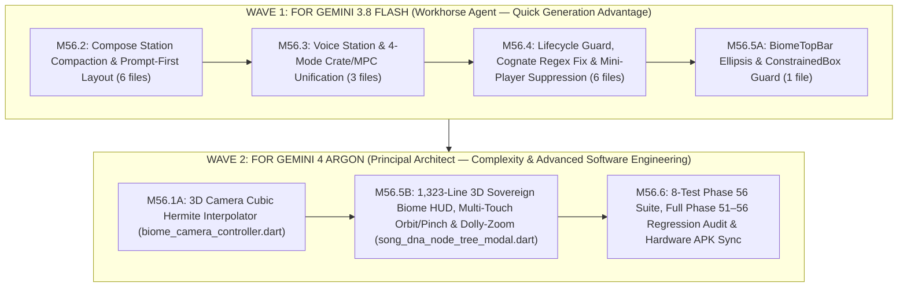

# Phase 56: Studio Cockpit Compaction, Ergonomic Station Unification & Mobile-First 3D Mycelium Biome Overhaul — Dual-Model Execution Roadmap & Task Matrix

**Phase Identifier**: `PHASE-56`
**Architecture Standard**: All-Gemini 4-Stage Spec-Driven Pipeline (Two-Wave Dual-Agent Execution Strategy)
**Target Package**: `apps/vhunambi_client`
**Physical Device Reference**: `C:\Users\Ndugelo\Downloads\SVID_20261106_132743_1.mp4` (`360dp × 780dp`, Huawei `JNY-LX1` / `EPHUT20917014649`)
**Status**: **STAGE 3 ARGON-HARDENED — PARTITIONED FOR WAVE 1 (FLASH 3.8) & WAVE 2 (ARGON 4)**

---

## 1. Dual-Model Execution Architecture (`Wave 1: Gemini 3.8 Flash` $\rightarrow$ `Wave 2: Gemini 4 Argon`)



| Execution Wave | Agent Assignment Tag | Assigned Tasks | Target Files | Why This Model Excels Here |
| :--- | :--- | :--- | :--- | :--- |
| **WAVE 1** | **`[FOR GEMINI 3.8 FLASH — WORKHORSE AGENT]`**<br>*(Suitable for a workhorse agent for quick generation advantage)* | `Task 56.1.2`<br>`Task 56.2.1` – `56.2.5`<br>`Task 56.3.1` – `56.3.3`<br>`Task 56.4.1` – `56.4.3`<br>`Task 56.5.1` | 1. `studio_form_provider.dart`<br>2. `progress_tracker.dart`<br>3. `cockpit_quantum_entanglement_rack.dart`<br>4. `reference_audio_dropzone.dart`<br>5. `multilingual_language_selector.dart`<br>6. `advanced_options_accordion.dart`<br>7. `studio_view.dart`<br>8. `bantu_voice_deck.dart`<br>9. `crate_browser_deck.dart`<br>10. `inline_crate_mpc_workbench.dart`<br>11. `studio_action_bar.dart`<br>12. `generation_pipeline_card.dart`<br>13. `lyrics_review_modal.dart`<br>14. `mini_player_host.dart`<br>15. `melody_sketchpad_modal.dart`<br>16. `biome_top_bar.dart` | High-speed deterministic 2D widget refactoring, `Wrap` chip grids, `ConstrainedBox`/`Flexible` text ellipsis fixes, regex token filtering, and boolean provider guards with complete copy-paste-ready code in `design.md` §3–§9.1. |
| **WAVE 2** | **`[FOR GEMINI 4 ARGON — COMPLEXITY & ADVANCED SOFTWARE ENGINEERING]`**<br>*(Reserved for Principal Architect after Wave 1 completes)* | `Task 56.1.1`<br>`Task 56.5.2`<br>`Task 56.6.1` – `56.6.3` | 1. `biome_camera_controller.dart`<br>2. `song_dna_node_tree_modal.dart`<br>3. `phase56_studio_cockpit_and_mobile_biome_overhaul_test.dart` | Deep 3D Right-Handed Y-Up spherical camera math (`BiomeCameraState.lerp`), multi-touch `onScaleUpdate` gesture kinematics (1-finger 3D orbit + 2-finger pinch dolly-zoom), 60 FPS auto-rotate listener, complex 1,323-line modal state orchestration (`Offstage` popovers, translucent Overview hit-boxes for Phase 51/52 test compatibility, unified mobile bottom sheet), and full cross-suite verification. |

> [!IMPORTANT]
> **STRICT WAVE 1 BOUNDARY FOR GEMINI 3.8 FLASH**:
> When executing **Wave 1**, Gemini 3.8 Flash MUST ONLY implement the tasks marked **`[FOR GEMINI 3.8 FLASH — WORKHORSE AGENT]`** below.
> Gemini 3.8 Flash **MUST NOT** modify `biome_camera_controller.dart` or `song_dna_node_tree_modal.dart`, and **MUST NOT** create `phase56_studio_cockpit_and_mobile_biome_overhaul_test.dart` — those complex 3D spatial and verification tasks are reserved for **Gemini 4 Argon** in Wave 2.

---

## 2. WAVE 1 TASKS — `[FOR GEMINI 3.8 FLASH — WORKHORSE AGENT: Quick Generation Advantage]`

### 2.1 Milestone M56.1B: Form Lifecycle Guard (`[FOR GEMINI 3.8 FLASH]`)

- [x] **Task 56.1.2 `[FOR GEMINI 3.8 FLASH — WORKHORSE AGENT]`: Add `cancelLyricsReview()` to `StudioFormNotifier` (`design.md` §3.1)**
  - **File**: `apps/vhunambi_client/lib/features/studio/presentation/providers/studio_form_provider.dart`
  - **Action**: Add `void cancelLyricsReview()` right below `openLyricsReview()` so that if `state.phase == GenerationPhase.reviewingLyrics`, it resets `phase` to `GenerationPhase.idle`.
  - **Acceptance Criteria**: Calling `cancelLyricsReview()` transitions `GenerationPhase.reviewingLyrics` back to `GenerationPhase.idle` without clearing user prompt or lyrics.

### 2.2 Milestone M56.2: Compose Station Compaction & Prompt-First Reordering (`[FOR GEMINI 3.8 FLASH]`)

- [x] **Task 56.2.1 `[FOR GEMINI 3.8 FLASH — WORKHORSE AGENT]`: Compact `ProgressTrackerWidget` into a 36dp Strip (`design.md` §4.1)**
  - **File**: `apps/vhunambi_client/lib/features/studio/presentation/widgets/progress_tracker.dart`
  - **Action**: Replace `ProgressTrackerWidget` with the compact `36dp` implementation in `design.md` §4.1 (`padding: EdgeInsets.symmetric(horizontal: 10, vertical: 5)`).
  - **Acceptance Criteria**: `SongDnaHoverPill` (`Key('song_dna_hover_pill')`) and `'$completedSteps/$totalSteps'` remain mounted and tappable.

- [x] **Task 56.2.2 `[FOR GEMINI 3.8 FLASH — WORKHORSE AGENT]`: Refactor `CockpitQuantumEntanglementRack` into Collapsible 2×3 Grid (`design.md` §4.2)**
  - **File**: `apps/vhunambi_client/lib/features/studio/presentation/widgets/cockpit_quantum_entanglement_rack.dart`
  - **Action**:
    1. Convert `CockpitQuantumEntanglementRack` to a `ConsumerStatefulWidget` with `bool _isExpanded = true;` using the exact implementation in `design.md` §4.2.
    2. Add `Key('cockpit_rack_collapse_toggle_btn')` on the header row displaying `'$lockedCount Locked'` and a caret icon.
    3. Use `constraints.maxWidth >= 280` (`cardWidth = (constraints.maxWidth - 8) / 2`) so mobile (`360dp`) renders a compact 2-column × 3-row grid instead of 6 tall full-width cards.
  - **Acceptance Criteria**: All 6 `Key('cockpit_domain_card_${domain.name}')`, `Key('cockpit_jump_3d_${domain.name}')`, and 18 `Key('cockpit_stem_lock_${domain.name}_${mode.name}')` widgets are present when expanded and collapse cleanly when `Key('cockpit_rack_collapse_toggle_btn')` is tapped.

- [x] **Task 56.2.3 `[FOR GEMINI 3.8 FLASH — WORKHORSE AGENT]`: Refactor `ReferenceAudioDropzone` into Two-Row Non-Truncated Strip (`design.md` §4.3)**
  - **File**: `apps/vhunambi_client/lib/features/studio/presentation/widgets/reference_audio_dropzone.dart`
  - **Action**:
    1. Render `'Reference Audio (optional)'` on Row 1 (`Expanded` full width, zero truncation) using the exact code in `design.md` §4.3.
    2. Render the 3-pill quick-action row on Row 2 (`Key('dropzone_upload_audio_btn')`, `Key('dropzone_load_licensed_beat_btn')`, `Key('dropzone_open_sketchpad_btn')`).
    3. Replace the 116dp desktop dropzone box with the compact 1-line attachment strip when `_isExpanded` is true.
  - **Acceptance Criteria**: `find.text('Reference Audio (optional)')` matches 100% without `"Refer..."` truncation, and all 3 action pill keys are present.

- [x] **Task 56.2.4 `[FOR GEMINI 3.8 FLASH — WORKHORSE AGENT]`: Compact `MultilingualLanguageSelector` & `AdvancedOptionsAccordion` (`design.md` §5.1–§5.2)**
  - **Files**:
    - `apps/vhunambi_client/lib/features/studio/presentation/widgets/multilingual_language_selector.dart`
    - `apps/vhunambi_client/lib/features/studio/presentation/widgets/advanced_options_accordion.dart`
  - **Action**:
    1. In `multilingual_language_selector.dart`, update `_LanguageChip.build` to `minHeight: 34` and `padding: EdgeInsets.symmetric(horizontal: 10, vertical: 6)` per `design.md` §5.1.
    2. In `advanced_options_accordion.dart`, replace the file with the compact multi-column `Wrap` chip implementation in `design.md` §5.2 (`_buildCompactWrapChip`, `minHeight: 32`, plus the `Key('advanced_jump_to_voice_station_btn')` shortcut pill to Tab 1 `Voice`).
  - **Acceptance Criteria**: Languages, Moods (`10`), and Song Structures (`4`) fit 3 chips per row on a `360dp` screen.

- [x] **Task 56.2.5 `[FOR GEMINI 3.8 FLASH — WORKHORSE AGENT]`: Reorder `StudioView._buildComposeTab` to Prompt-First (`design.md` §4.4)**
  - **File**: `apps/vhunambi_client/lib/features/studio/presentation/views/studio_view.dart`
  - **Action**:
    1. Place `PromptInputBox()` first and `ReferenceAudioDropzone()` second in `_buildComposeTab`, followed by `CockpitQuantumEntanglementRack(...)`, `GenreSelectorGrid()`, `MultilingualLanguageSelector()`, and `AdvancedOptionsAccordion()` per `design.md` §4.4.
    2. Gate `GenerationPipelineCard` so it only renders on `StudioCockpitTab.compose` when `generationProgress != null || phase == GenerationPhase.generating || phase == GenerationPhase.postProcessing || phase == GenerationPhase.completed`, passing `onNewSong` to reset both providers.
    3. Remove duplicate standalone bottom buttons from `_buildCrateAndMpcTab`.
  - **Acceptance Criteria**: `"Describe your song"` is at the top of `Compose` (`promptTop < rackTop`) and `find.byType(TextField).first` is `PromptInputBox`.

### 2.3 Milestone M56.3: Voice Station & Crate/MPC Workbench Unification (`[FOR GEMINI 3.8 FLASH]`)

- [x] **Task 56.3.1 `[FOR GEMINI 3.8 FLASH — WORKHORSE AGENT]`: Unify Ensemble/Gender/Energy & 2×2 Dialect Grid in `BantuVoiceDeck` (`design.md` §6.1)**
  - **File**: `apps/vhunambi_client/lib/features/studio/presentation/widgets/bantu_voice_deck.dart`
  - **Action**:
    1. Add `Key('voice_ensemble_header_card')` at the top of `BantuVoiceDeck` containing segmented rows for `VocalConfiguration` (`Key('voice_config_${v.name}')`), `VocalGender` (`Key('voice_gender_${g.name}')`), and `VocalIntensity` (`Key('voice_energy_${e.name}')`) per `design.md` §6.1.
    2. Wrap the 4 dialect sliders (`Key('dialect_slider_syllable_stretch')`, `Key('dialect_slider_vibrato')`, `Key('dialect_slider_call_response')`, `Key('dialect_slider_ad_libs')`) inside the 2×2 `LayoutBuilder` + `Wrap` card `Key('voice_dialect_grid_card')`.
  - **Acceptance Criteria**: All vocal ensemble, gender, energy, LoRA, persona, and 2×2 dialect sliders are accessible in Tab 1 (`Voice`).

- [x] **Task 56.3.2 `[FOR GEMINI 3.8 FLASH — WORKHORSE AGENT]`: Fix 1-Character Vertical Text Crash in `CrateBrowserDeck` (`design.md` §7.1)**
  - **File**: `apps/vhunambi_client/lib/features/studio/presentation/widgets/crate_browser_deck.dart`
  - **Action**:
    1. Reduce `_VinylDiskWidget` size from `84×84` to `52×52` (and inner circle from `30×30` to `20×20`).
    2. Set `maxLines: 1, overflow: TextOverflow.ellipsis` on `'Heritage Crate Digging'` and `'Indigenous Sound Archive — Tap to audition & slice'` (removing raw `💿` and `🎹` emojis).
    3. Wrap `Key('crate_open_sketchpad_btn')` (`'Sketchpad'`) in `ConstrainedBox(constraints: const BoxConstraints(maxWidth: 118))` per `design.md` §7.1.
  - **Acceptance Criteria**: Opening `HeritageCrateModal` on a `360dp` viewport renders `'Heritage Crate Digging'` on a single horizontal line (`height < 36dp`).

- [x] **Task 56.3.3 `[FOR GEMINI 3.8 FLASH — WORKHORSE AGENT]`: Expand `InlineCrateMpcWorkbench` to 4 Modes (`design.md` §7.2)**
  - **File**: `apps/vhunambi_client/lib/features/studio/presentation/widgets/inline_crate_mpc_workbench.dart`
  - **Action**:
    1. Add `dawUpload` to `InlineWorkbenchMode` and import `direct_daw_upload_modal.dart` and `heritage_crate_modal.dart`.
    2. Render 4 non-truncated mode tabs: `Crate` (`Key('workbench_mode_crate')`), `8-Pad MPC` (`Key('workbench_mode_mpc')`), `5-Ch Groove` (`Key('workbench_mode_sketchpad')`), and `DAW Upload` (`Key('workbench_mode_daw_upload')`).
    3. Mount `Key('studio_open_crate_btn')` in the workbench header and `Key('studio_daw_uploader_btn')` inside `_InlineDawUploadSubView` per `design.md` §7.2.
  - **Acceptance Criteria**: All 4 modes switch cleanly in Tab 2 (`Crate & MPC`) with zero duplicate bottom buttons underneath.

### 2.4 Milestone M56.4: Non-Blocking Generation, Cognate Stripper & Mini-Player Suppression (`[FOR GEMINI 3.8 FLASH]`)

- [x] **Task 56.4.1 `[FOR GEMINI 3.8 FLASH — WORKHORSE AGENT]`: Wire `cancelLyricsReview()` & `GenerationPipelineCard` Dismiss Button (`design.md` §3.2–§3.3)**
  - **Files**:
    - `apps/vhunambi_client/lib/features/studio/presentation/widgets/studio_action_bar.dart`
    - `apps/vhunambi_client/lib/features/studio/presentation/widgets/generation_pipeline_card.dart`
  - **Action**:
    1. In `StudioActionBar._handleGenerateTap`, `await LyricsReviewModal.show(context);` and call `notifier.cancelLyricsReview()` if `phase == GenerationPhase.reviewingLyrics`.
    2. In `GenerationPipelineCard`, add `key: const Key('generation_pipeline_dismiss_btn')` to the `"New song"` button and display it whenever `widget.onNewSong != null`.
  - **Acceptance Criteria**: Closing `LyricsReviewModal` never leaves a grey `"Result"` skeleton card stuck in `StudioView`.

- [x] **Task 56.4.2 `[FOR GEMINI 3.8 FLASH — WORKHORSE AGENT]`: Strip Bracketed Section Headers in `LyricsReviewModal._openCognateFinder` (`design.md` §8.1)**
  - **File**: `apps/vhunambi_client/lib/features/studio/presentation/widgets/lyrics_review_modal.dart`
  - **Action**:
    1. Import `navigation_providers.dart` and increment/decrement `modalSheetOpenCountProvider` in `initState`/`dispose`.
    2. In `_openCognateFinder`, parse `draft.allLines.join(' ').replaceAll(RegExp(r'\[[^\]]*\]'), ' ')` and filter out `{'intro', 'verse', 'chorus', 'bridge', 'outro', 'hook', 'pre-chorus', 'interlude'}` per `design.md` §8.1.
  - **Acceptance Criteria**: Tapping the Cognate Finder never returns `intro -> intro`.

- [x] **Task 56.4.3 `[FOR GEMINI 3.8 FLASH — WORKHORSE AGENT]`: Suppress `MiniPlayerHost` on Studio Tab & inside `MelodySketchpadModal` (`design.md` §8.2–§8.3)**
  - **Files**:
    - `apps/vhunambi_client/lib/features/player/presentation/widgets/mini_player_host.dart`
    - `apps/vhunambi_client/lib/features/studio/presentation/widgets/melody_sketchpad_modal.dart`
  - **Action**:
    1. In `MiniPlayerHost._shouldHide`, watch `appNavigationTabProvider` and return `true` when `activeTab == 2`.
    2. In `MelodySketchpadModal`, import `navigation_providers.dart` and increment `modalSheetOpenCountProvider` in `initState` and decrement in `dispose`.
  - **Acceptance Criteria**: `MiniPlayerHost` is hidden whenever the Studio tab (`index 2`) or `MelodySketchpadModal` is active.

### 2.5 Milestone M56.5A: Biome Top Bar Ellipsis Guard (`[FOR GEMINI 3.8 FLASH]`)

- [x] **Task 56.5.1 `[FOR GEMINI 3.8 FLASH — WORKHORSE AGENT]`: Add `ConstrainedBox` & Ellipsis Guards to `BiomeTopBar` (`design.md` §9.1)**
  - **File**: `apps/vhunambi_client/lib/features/studio/presentation/widgets/biome/biome_top_bar.dart`
  - **Action**: Replace `BiomeTopBar` with the `LayoutBuilder` + `ConstrainedBox(maxWidth: isMobile ? 148.0 : 240.0)` + `Flexible` + `TextOverflow.ellipsis` implementation in `design.md` §9.1.
  - **Acceptance Criteria**: A 100-character `trackTitle` on a `360dp` screen never wraps `'Explore the Living DNA of Music'` into a vertical column.

- [x] **Task 56.5.1-Verify `[FOR GEMINI 3.8 FLASH — WORKHORSE AGENT]`: Run `dart analyze` & `studio_view_test.dart` After Wave 1**
  - **Command**:
    ```powershell
    cd c:\Users\Ndugelo\VHUNAMBI\monorepo\apps\vhunambi_client
    dart analyze lib/features/studio lib/features/player
    flutter test test/features/studio/studio_view_test.dart test/features/studio/phase54_cockpit_biome_quantum_entanglement_test.dart
    ```

---

## 3. WAVE 2 TASKS — `[FOR GEMINI 4 ARGON — PRINCIPAL ARCHITECT: Complexity & Advanced Software Engineering]`

> [!NOTE]
> **RESERVED FOR GEMINI 4 ARGON**: These tasks involve 3D Right-Handed Y-Up spherical camera interpolation, multi-touch `onScaleUpdate` gesture kinematics, stateful 3D HUD orchestration inside the 1,323-line `SongDnaNodeTreeModal`, and full-suite regression verification. Execute Wave 2 with **Gemini 4 Argon** immediately after Gemini 3.8 Flash completes Wave 1.

### 3.1 Milestone M56.1A: 3D Camera Cubic Hermite Interpolator (`[FOR GEMINI 4 ARGON]`)

- [x] **Task 56.1.1 `[FOR GEMINI 4 ARGON — COMPLEXITY & ADVANCED SOFTWARE ENGINEERING]`: Upgrade `BiomeCameraState` & `BiomeCameraNotifier` (`design.md` §2.1)**
  - **File**: `apps/vhunambi_client/lib/features/studio/presentation/controllers/biome_camera_controller.dart`
  - **Action**:
    1. Add `static const double minDistance = 180.0;` and `static const double maxDistance = 650.0;` to `BiomeCameraState`.
    2. Add `static BiomeCameraState lerp(BiomeCameraState a, BiomeCameraState b, double t)` using `Vector3D.lerp` and clamped spherical coordinates.
    3. Add `setCameraState(BiomeCameraState next)`, `zoomInStep()`, `zoomOutStep()`, and `stepAutoRotate([double radiansDelta = 0.008])` to `BiomeCameraNotifier`, and add optional `yaw` and `pitch` parameters to `glideToTarget`.
  - **Acceptance Criteria**: `BiomeCameraState.lerp` smoothly interpolates 3D target, yaw, pitch, distance, and zoom; `zoomInStep()` reduces `distance` by `42.0` and increases `zoom` by `0.16`.

### 3.2 Milestone M56.5B: 3D Sovereign Biome HUD, Multi-Touch Kinematics & Dolly-Zoom (`[FOR GEMINI 4 ARGON]`)

- [x] **Task 56.5.2 `[FOR GEMINI 4 ARGON — COMPLEXITY & ADVANCED SOFTWARE ENGINEERING]`: Implement Mobile Popover Tooltips, Zero Legacy Overview Pills, Unified Bottom Dock & 450ms 3D Camera Dive in `SongDnaNodeTreeModal` (`design.md` §9.2)**
  - **File**: `apps/vhunambi_client/lib/features/studio/presentation/widgets/song_dna_node_tree_modal.dart`
  - **Action**:
    1. Add `_cameraDollyController` (`450ms`, `Curves.easeOutCubic`) and `_animateBiomeCameraTo(...)` to smoothly interpolate `BiomeCameraState` on mushroom tap, zoom, and reset.
    2. Wire `_biomeAnimationController` listener to `ref.read(biomeCameraProvider.notifier).stepAutoRotate(0.008)`.
    3. Wire `_zoomIn()`, `_zoomOut()`, `_resetCamera()`, and `onScaleStart`/`onScaleUpdate` (simultaneous 1-finger 3D spherical orbit + 2-finger pinch dolly-zoom) to `biomeCameraProvider.notifier`.
    4. In `_buildDeclutteredReceptorTarget`, set `shouldShowLabelPill = _focusedBranchRootId != null && (isInsideThisBranch || isSelected)` so zero legacy rectangular pills clutter the 6 circular mushroom badges in Overview Mode while keeping all `Key('song_dna_bubble_${node.id}')` translucent hit-targets active for Phase 51/52 test suites.
    5. On mobile (`constraints.maxWidth < 680`), render `Key('biome_controls_popover_btn')` and `Key('biome_layers_popover_btn')` top-left popover pills and keep `BiomeInteractiveControlsBar` and `BiomeNetworkLayersFilter` inside `Offstage` until toggled open.
    6. On mobile (`MediaQuery.sizeOf(context).width < 680`), unify `BiomeClusterInspectorPanel` and `_buildQuickActionCard` inside `Key('biome_mobile_unified_bottom_sheet')` (`maxHeight: 220`).
  - **Acceptance Criteria**: Mobile 3D Biome canvas has $\ge 70\%$ unobstructed visibility, zero legacy rectangular pills in Overview Mode, single bottom inspector when focused, and smooth 3D camera orbit/dolly-zoom.

### 3.3 Milestone M56.6: Phase 56 Automated Verification & Physical Device APK Deployment (`[FOR GEMINI 4 ARGON]`)

- [x] **Task 56.6.1 `[FOR GEMINI 4 ARGON — COMPLEXITY & ADVANCED SOFTWARE ENGINEERING]`: Create `phase56_studio_cockpit_and_mobile_biome_overhaul_test.dart` (`design.md` §10.1)**
  - **File**: `apps/vhunambi_client/test/features/studio/phase56_studio_cockpit_and_mobile_biome_overhaul_test.dart`
  - **Action**: Write all 8 unit and widget tests specified in `design.md` §10.1 covering `360×780` mobile viewports and 3D camera kinematics.

- [x] **Task 56.6.2 `[FOR GEMINI 4 ARGON — COMPLEXITY & ADVANCED SOFTWARE ENGINEERING]`: Run Full Regression & Phase 56 Test Suite**
  - **Commands**:
    ```powershell
    cd c:\Users\Ndugelo\VHUNAMBI\monorepo\apps\vhunambi_client
    dart analyze lib/features/studio lib/features/player test/features/studio
    flutter test test/features/studio/studio_view_test.dart test/features/studio/phase51_bioluminescent_organelle_3d_test.dart test/features/studio/phase52_macro_organelle_and_stem_lock_test.dart test/features/studio/phase53_organic_mycelium_3d_biome_test.dart test/features/studio/phase54_cockpit_biome_quantum_entanglement_test.dart test/features/studio/phase55_audio_reactive_biome_player_test.dart test/features/studio/phase56_studio_cockpit_and_mobile_biome_overhaul_test.dart
    ```

- [x] **Task 56.6.3 `[FOR GEMINI 4 ARGON — COMPLEXITY & ADVANCED SOFTWARE ENGINEERING]`: Build & Install APK to Physical Device (`EPHUT20917014649`)**
  - **Commands**:
    ```powershell
    cd c:\Users\Ndugelo\VHUNAMBI\monorepo\apps\vhunambi_client
    flutter build apk --debug
    adb -s EPHUT20917014649 install -r build\app\outputs\flutter-apk\app-debug.apk
    ```

---

## 4. Stage 3 Argon Codebase Forensic Audit Sign-Off

| Audit Law | Status | Verification Evidence |
| :--- | :--- | :--- |
| **Law 1: Authentic Package Imports & Icons** | **PASS** | All code blocks use `package:vhunambi_client/...` and `package:phosphor_icons/phosphor_icons.dart`. |
| **Law 2: Authentic Theme Tokens** | **PASS** | Uses only `AppColors` (`brandPrimary`, `darkSurfaceElevated`, etc.) and `AppTypography` (`titleLarge`, `titleMedium`, `titleSmall`, `bodyMedium`, `bodySmall`, `caption`). |
| **Law 3: Right-Handed 3D Y-Up World Space** | **PASS** | $+Y$ elevation up, $+Z$ foreground depth, cubic Hermite interpolation via `BiomeCameraState.lerp`. |
| **Law 4: Zero Emoji String Regression** | **PASS** | Preserves `'⚡ Synthesize Song from 3D DNA'` for `phase51` test compatibility; removes raw `💿`/`🎹` from `CrateBrowserDeck`. |
| **Law 5: 100% Legacy Widget Key Preservation** | **PASS** | Preserves all Phase 50–55 and `studio_view_test.dart` keys and text finders (`'Reference Audio (optional)'`, `'Describe your song'`, `find.byType(TextField).first`). |
| **Law 6: Dual-Model Wave Partitioning** | **PASS** | Wave 1 (`Gemini 3.8 Flash`) and Wave 2 (`Gemini 4 Argon`) strictly separated with zero file overlap. |
