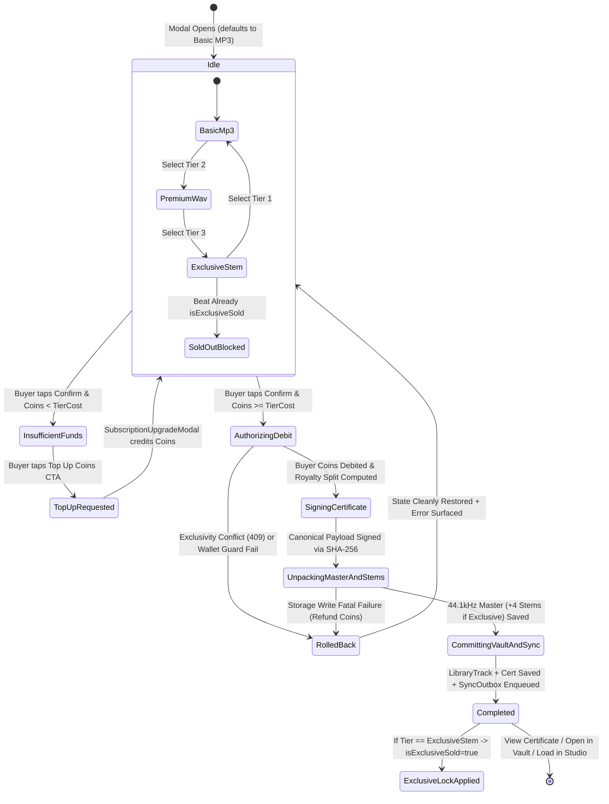
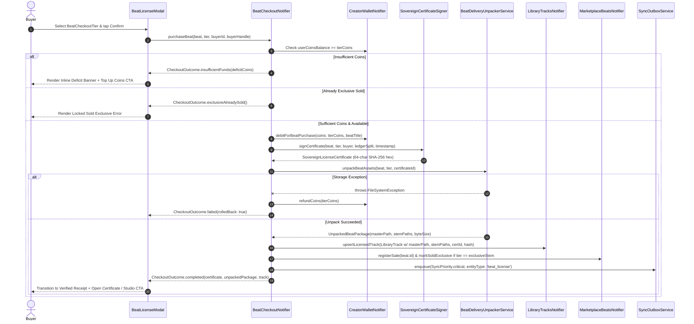
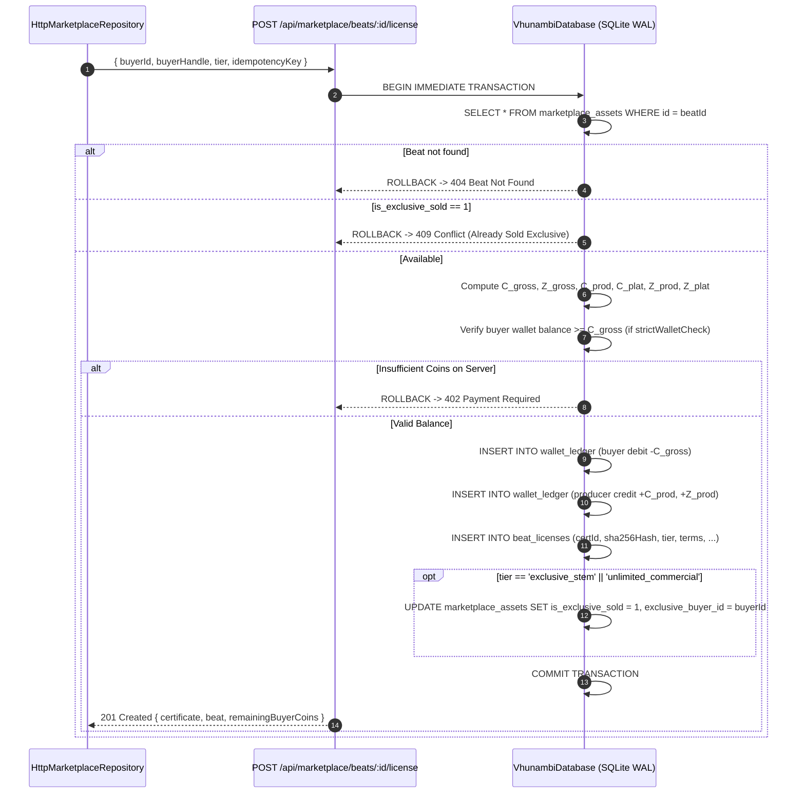

# Phase 58 Blueprint: Sovereign Beatstore Licensing, Cryptographic Certificates & Automated Vault Stem Delivery

```
══════════════════════════════════════════════════════════════════════════════════════════════════════════════
  VHUNAMBI ARCHITECTURE BLUEPRINT • ALL-GEMINI ENGINEERING SPECIFICATION
  PHASE 58: SOVEREIGN BEATSTORE LICENSING & REAL CHECKOUT FLOW
  STANDARD: ALL-GEMINI SPECIFICATION ARCHITECT (STD-SPEC-001 / STD-UIUX-001)
  TARGET PACKAGES: apps/vhunambi_client & apps/vhunambi_api
  EXTENDS / HARDENS: docs/phases/phase_06_marketplace & docs/phases/phase_14_beats_vault
  PARENT BLUEPRINTS:
    - docs/foundation_blueprints/05_MARKETPLACE_AND_LANDING_SPEC.md (§1.2–§1.4)
    - docs/foundation_blueprints/04_LIBRARY_VAULT_SPEC.md (§2.1, §3.2)
══════════════════════════════════════════════════════════════════════════════════════════════════════════════
```

---

## 1. Executive Overview & Visual North Star

Vhunambi's two-sided African music economy connects producers (`BeatsVaultView`) with vocalists, songwriters, and remixers (`MarketplaceView` + `ContentStudioView`). Although earlier phases built the catalog feed (Phase 6), beat listing cockpit (Phase 14), offline encrypted storage (Phase 8), and WAL SQLite API persistence (Phase 45), purchasing a beat still stops short of real commercial closure:

1. **Split-Brain Currency & Un-Debited Wallet**: `MarketplaceTopBar` displays an isolated placeholder `marketplaceCreditsProvider` counter (`10 songs left`), whereas the rest of Vhunambi's economy runs on `creatorWalletProvider.userCoinsBalance` (`VhunambiUserCoinsChip`, `1 Credit = 5 Coins`, `1 Coin = R0.30 ZAR`). Executing `licenseBeat()` deducts credits from an unbacked local `StateProvider` without ever debiting the buyer's real Coin wallet or prompting a Coin top-up when funds are low.
2. **Hardcoded Single-Tier Modal**: `BeatLicenseModal` renders one static `"Non-Exclusive Commercial"` bullet list using stock `Icons.check_circle_rounded`, ignoring commercial license tier selection (**Basic MP3**, **Premium WAV**, **Exclusive Stem License**), stream limits, sync entitlements, and exclusive buyout exclusivity.
3. **Fake Certificates & Stubbed Export**: `LibraryTrack.licenseCertificateId` synthesizes an unsigned cosmetic string (`VHB-<TYPE>-<ID>`), `HttpMarketplaceRepository.licenseBeat` falls back to `'hash_simulated_<timestamp>'`, and `showLibraryLicenseDialog` ends in a `"Download PDF ... ships with the licensing release"` stub SnackBar.
4. **Preview-Only Vault Injection (Zero Master or Stem Unpacking)**: `licenseBeat()` copies the low-bitrate MP3 preview URL (`beat.previewAudioUrl`) into `libraryTracksProvider` without generating or downloading un-tagged `44.1 kHz` PCM WAV masters or isolated 4-channel stems (`drums`, `bass`, `melody`, `other`), leaving the Studio Stem Mixer and Reference Audio Dropzone without unlocked stems.
5. **Unenforced Exclusive Buyouts & Non-Persistent Backend Sales**: `apps/vhunambi_api`'s `marketplace_service.ts` tracks licenses in volatile `Map` memory only—failing to persist to `VhunambiDatabase` SQLite tables, debit buyer balances, or lock an exclusively sold beat against duplicate future sales.

### Architectural North Star

Phase 58 transforms Marketplace licensing into an **end-to-end cryptographic commerce & automated studio-asset delivery pipeline**:

- **Multi-Tier Agreement Engine**: Deterministically models **Basic MP3 (`1x`)**, **Premium WAV (`3x`)**, and **Exclusive Stem License (`6x`)** with transparent Coin + ZAR pricing, stream/copy/sync ceilings, exclusive buyout semantics, and backward compatibility with legacy `BeatLicenseTier` identifiers.
- **Unified Sovereign Coin Checkout**: Replaces the isolated credit chip in `MarketplaceTopBar` with `VhunambiUserCoinsChip`, reconciles every purchase directly against `creatorWalletProvider` (with exact integer `85% / 15%` producer/platform conservation splitting), surfaces an inline **Top Up Coins** CTA routing to `SubscriptionUpgradeModal.show(context)` on insufficient balance, and enqueues offline-resilient `SyncPriority.critical` outbox mutations when offline.
- **FIPS 180-4 SHA-256 Ownership Certificates**: Signs canonical pipe-delimited license deeds using pure-Dart `VaultEnvelopeCrypto.sha256Bytes(...)` (zero extra pub packages), persists certificates in Hive (`AppConstants.licenseCertificatesBoxKey`) + SQLite (`beat_licenses`), verifies tamper resistance in 1 tap, and exports signed JSON/TXT legal dossiers via `share_plus`.
- **Automated 44.1 kHz Un-Tagged Master & 4-Stem Delivery**: Immediately unpacks/downloads—or deterministically synthesizes offline via `MelodyWavSynthesizer`—un-tagged `44.1 kHz` 16-bit Stereo PCM RIFF/WAV master files and tier-entitled isolated stems (`drums`, `bass`, `melody`, `other`) into `<vaultAudioDir>/licensed/<beatId>/`, binding them directly into the buyer's `LibraryTrack` record, `BeatsVaultView` Licensed drawer, and Studio Stem Mixer / Reference Dropzone.
- **Atomic Exclusive Buyout Lock**: Purchasing **Exclusive Stem License** atomically marks the listing `isExclusiveSold = true` with `exclusiveBuyerId` across client state, Hive, and backend SQLite (returning HTTP `409 Conflict` if another buyer races on an already-exclusive beat).

---

## 2. Forensic Post-Mortem Comparison Box

```
┌────────────────────────────────────────────────────────┬────────────────────────────────────────────────────────┐
│   LEGACY PLACEHOLDER FLOW (PHASE 6 / 28)               │   PHASE 58 SOVEREIGN BEATSTORE CHECKOUT                │
├────────────────────────────────────────────────────────┼────────────────────────────────────────────────────────┤
│ • `marketplaceCreditsProvider` (`10 songs left`)       │ • Unified `creatorWalletProvider` Coins (`R0.30/Coin`) │
│   disconnected from `creatorWalletProvider` Coins      │   with `VhunambiUserCoinsChip` & Top-Up Modal hook     │
│                                                        │                                                        │
│ • Single static modal list; ignores license tiers      │ • 3 interactive tier cards: Basic MP3 (1x),            │
│   (`Non-Exclusive Commercial` only)                    │   Premium WAV (3x), Exclusive Stem License (6x)        │
│                                                        │                                                        │
│ • Credits buyer's own `creatorEarnedZar` when buying   │ • True buyer Coin debit (`-C_gross`), conditional self │
│   another producer's beat                              │   royalty guard, and exact integer 85%/15% ledger split│
│                                                        │                                                        │
│ • Fake `VHB-...` string & `hash_simulated_...`;        │ • Canonical payload signed with FIPS 180-4 SHA-256;    │
│   "Download PDF" shows placeholder SnackBar            │   live integrity verification & `share_plus` export    │
│                                                        │                                                        │
│ • Only saves `beat.previewAudioUrl` MP3 link to vault; │ • Unpacks / synthesizes real un-tagged 44.1 kHz WAV    │
│   zero un-tagged master WAV or individual stems        │   master + 4 stems into Vault & Studio Stem Mixer      │
│                                                        │                                                        │
│ • Exclusive beat remains buyable forever; backend uses │ • Exclusive Stem License sets `isExclusiveSold: true`, │
│   non-persistent in-memory `Map` stores                │   locks/hides beat from public store, SQLite ACID lock │
└────────────────────────────────────────────────────────┴────────────────────────────────────────────────────────┘
```

---

## 3. 5-Layer Decoupled System Architecture

```
┌──────────────────────────────────────────────────────────────────────────────────────────────────────────────┐
│                              LAYER 5: PRESENTATION & COMMERCE HUD (Flutter Widgets)                          │
│  • `MarketplaceTopBar` (`VhunambiUserCoinsChip` -> `SubscriptionUpgradeModal.show(context)`)                  │
│  • `BeatCard` (Base Coins/ZAR badge + Sold Exclusive / Licensed ownership pills)                             │
│  • `BeatLicenseModal` v2 (3-Tier Selector Cards, Rights Comparison, Live Coin/ZAR Balance, Inline Top-Up)    │
│  • `LicenseCertificateSheet` (Canonical SHA-256 Digest Pill, Tap-to-Verify Status, Legal Deed Share/Export)  │
│  • `BeatsVaultView` & `TrackActionsSheet` (Licensed Stems Drawer, 4-Stem Audition, Send to Studio Mixer)     │
└──────────────────────────────────────────────────────┬───────────────────────────────────────────────────────┘
                                                       │ watches / dispatches actions
┌──────────────────────────────────────────────────────▼───────────────────────────────────────────────────────┐
│                           LAYER 4: RIVERPOD ORCHESTRATION & EDGE SYNC BRIDGE                                 │
│  • `beatCheckoutProvider` (`BeatCheckoutNotifier` -> `idle`, `authorizing`, `signing`, `unpacking`, `done`)  │
│  • `licenseCertificatesProvider` (`LicenseCertificateNotifier`, lookup by `trackId` / `beatId` / `certId`)   │
│  • `creatorWalletProvider` (Atomic buyer debit `-C_gross`, conditional producer royalty credit, top-up sync) │
│  • `marketplaceBeatsProvider` (`markSoldExclusive`, `registerSale`, live catalog filtering excluding sold)   │
│  • `libraryTracksProvider` (Upserts unlocked `LibraryTrack` with `masterAudioFilePath` & `stemPaths`)        │
│  • `syncOutboxProvider` (`SyncPriority.critical` license mutation enqueue & edge flush to `/api/marketplace`) │
└──────────────────────────────────────────────────────┬───────────────────────────────────────────────────────┘
                                                       │ invokes services & repos
┌──────────────────────────────────────────────────────▼───────────────────────────────────────────────────────┐
│                          LAYER 3: INFRASTRUCTURE, STORAGE & NETWORK ADAPTERS                                 │
│  • `LicenseCertificateRepository` (Hive box `vhunambi_license_certificates` w/ headless memory fallback)      │
│  • `BeatDeliveryUnpackerService` (`Dio` HTTP download + offline `MelodyWavSynthesizer` 44.1 kHz stem builder │
│     + `writeWavToFile` + `OfflineStorageService.resolveVaultAudioDirectory()` / `saveTrackMetadata()`)       │
│  • `CertificateShareExporter` (Canonical `.vhlic.json` + formatted legal `.txt` deed via `share_plus`)       │
│  • `HttpMarketplaceRepository` (`POST /api/marketplace/beats/:id/license`, HTTP 402/409 typed error mapping) │
└──────────────────────────────────────────────────────┬───────────────────────────────────────────────────────┘
                                                       │ persists ACID transactions
┌──────────────────────────────────────────────────────▼───────────────────────────────────────────────────────┐
│                          LAYER 2: PURE DART LICENSING & CRYPTOGRAPHIC DOMAIN                                 │
│  • `licensing_models.dart` (`BeatCheckoutTier`, `LicenseRightsProfile`, `SovereignLicenseCertificate`,       │
│     `UnpackedBeatPackage`, `CheckoutReconciliationResult`, `CheckoutStatus`, `CheckoutState`)                │
│  • `LicenseAgreementEngine` (Tier matrix, multiplier pricing, 85/15 integer conservation split, terms builder) │
│  • `SovereignCertificateSigner` (Canonical pipe-delimited UTF-8 payload, `VaultEnvelopeCrypto.sha256Bytes`)   │
└──────────────────────────────────────────────────────┬───────────────────────────────────────────────────────┘
                                                       │ mirrored on Node.js + SQLite backend
┌──────────────────────────────────────────────────────▼───────────────────────────────────────────────────────┐
│                         LAYER 1: BACKEND ATOMIC PERSISTENCE (`apps/vhunambi_api`)                             │
│  • `VhunambiDatabase` SQLite WAL tables: `marketplace_assets` (`is_exclusive_sold`, `exclusive_buyer_id`),   │
│    `beat_licenses` (`certificate_id`, `license_hash`, `tier`, `coins_paid`, `zar_paid`), `wallet_ledger`     │
│  • `marketplace_service.ts` (`BEGIN IMMEDIATE` SQLite transaction: verify funds & exclusivity -> debit buyer │
│     -> credit 85% producer royalty -> persist `beat_licenses` -> lock exclusive beat -> record sync log)     │
│  • `marketplace_routes.ts` (HTTP 201 Certificate, 402 Insufficient Coins, 409 Exclusive Already Sold)        │
└──────────────────────────────────────────────────────────────────────────────────────────────────────────────┘
```

---

## 4. Sovereign Multi-Tier Licensing Matrix & Tokenomics Topology

### 4.1 Currency & Unit Conversion Law
Vhunambi enforces a single, unified currency invariant across Creator Wallet, Marketplace, Tipping, and Backend SQLite:
- **Credit-to-Coin Ratio**: $1\text{ Credit} = 5\text{ Coins}$ (`kCoinsPerCredit = 5`, matching legacy `beat.priceInCredits * 5`).
- **Coin-to-ZAR Valuation**: $1\text{ Coin} = \text{R}0.30\text{ ZAR}$ (`kZarPerCoin = 0.30`, matching `CreatorWalletNotifier`).
- **Baseline Example (*Township Heat*, `priceInCredits = 5`)**:
  - Base beat value $C_{\text{base}} = 5 \times 5 = 25\text{ Coins}$ ($\text{R}7.50$).

### 4.2 Three Commercial Tiers (`BeatCheckoutTier`)

| Dimension | Tier 1: **Basic MP3** | Tier 2: **Premium WAV** | Tier 3: **Exclusive Stem License** |
| :--- | :--- | :--- | :--- |
| **Wire / API Slug** | `basic_lease` | `stems_trackout` | `exclusive_stem` *(accepts `unlimited_commercial`, `exclusive`)* |
| **Price Multiplier** | `1x` ($C_{\text{tier}} = C_{\text{base}}$) | `3x` ($C_{\text{tier}} = 3 \times C_{\text{base}}$) | `6x` ($C_{\text{tier}} = 6 \times C_{\text{base}}$) |
| **Baseline Price (5 Cr beat)** | `25 Coins` (`R7.50`) | `75 Coins` (`R22.50`) | `150 Coins` (`R45.00`) |
| **Rights Mode** | Non-Exclusive Commercial Lease | Non-Exclusive Broadcast & WAV Lease | **Exclusive Full Ownership Buyout** |
| **Audio Stream Ceiling** | `100,000` monetized streams | `500,000` monetized streams | **Unlimited** global streams |
| **Paid Downloads / Copies** | `2,500` commercial units | `10,000` commercial units | **Unlimited** commercial copies |
| **Music Videos / Sync** | `1` music video | `2` music videos + radio broadcast | **Unlimited** TV / film / ad sync |
| **Master File Delivered** | Un-tagged 44.1 kHz studio master | **Lossless 44.1 kHz 16-bit PCM WAV** | **Lossless 44.1 kHz 16-bit PCM WAV** |
| **Isolated 4-Stem Pack** | Not included (`0 stems`) | Optional stem audition preview (`0` edit stems) | **Included: All 4 Stems** (`drums`, `bass`, `melody`, `other` at 44.1 kHz) |
| **Marketplace Availability** | Remains listed for other buyers | Remains listed for other buyers | **Sold Exclusive Lock** (`isExclusiveSold = true`, locked/removed for future buyers) |
| **Certificate Cryptographic Proof** | FIPS 180-4 SHA-256 Digest | FIPS 180-4 SHA-256 Digest | FIPS 180-4 SHA-256 Digest + Exclusivity Clause |

> **Engineering Note on Audio Packaging**: Every delivered local master file uses Vhunambi's deterministic `44.1 kHz` 16-bit Stereo PCM RIFF/WAVE pipeline (`MelodyWavSynthesizer` + `StemMixBounceService`) or verified remote HTTP stream bytes stored under `<vaultAudioDir>/licensed/<beatId>/`, ensuring `just_audio` plays every purchased asset offline on Android/Desktop/iOS without third-party native MP3 encoders. For `basicMp3` tier, the asset metadata carries format entitlement `mp3_standard` alongside the un-tagged local vault audio file; `premiumWav` unlocks lossless `wav_44k1_pcm16`; `exclusiveStem` unpacks lossless `wav_44k1_pcm16` plus all 4 isolated stem WAV files (`drums_44k1.wav`, `bass_44k1.wav`, `melody_44k1.wav`, `other_44k1.wav`).

---

## 5. Checkout, Delivery & Exclusive-Lock Finite State Machine



---

## 6. Dual-Viewport HUD Wireframes (`STD-UIUX-001`)

All icons use `phosphor_icons` (`AppIcons.*` tokens), all colors resolve through `AppColors.*` (`surfaceCanvasOf`, `surfaceElevatedOf`, `brandPrimary`, `coinGold`, `badgeCyan`, `success`, `error`), and touch targets satisfy $\ge 44 \times 44\text{dp}$. Zero raw emojis appear in widgets.

### 6.1 Desktop Viewport ($\ge 1024\text{dp}$)

```
┌──────────────────────────────────────────────────────────────────────────────────────────────────────┐
│ (VH) VHUNAMBI        [ Search beats or producers... ]         [250 Coins]   [Bell]   [ND Avatar]     │
├──────────────────────────────────────────────────────────────────────────────────────────────────────┤
│                                                                                                      │
│  [Market] Beats Marketplace                                                            [Filters]     │
│  License African beats & stems — pay in Coins, receive SHA-256 proof & 44.1 kHz Vault masters        │
│                                                                                                      │
│  ┌─────────────────────────────────────── BeatLicenseModal v2 (Sheet / Dialog) ───────────────────┐  │
│  │  [Genre Gradient]  Township Heat                       @sipho_beats  •  112 BPM  •  F# Minor  │  │
│  │  ────────────────────────────────────────────────────────────────────────────────────────────  │  │
│  │  SELECT COMMERCIAL LICENSE TIER                                                                │  │
│  │  ┌─────────────────────┐  ┌─────────────────────┐  ┌─────────────────────────────────────────┐ │  │
│  │  │ [ ] BASIC MP3       │  │ [ ] PREMIUM WAV     │  │ [x] EXCLUSIVE STEM LICENSE   [EXCLUSIVE]│ │  │
│  │  │ 25 Coins (R7.50)    │  │ 75 Coins (R22.50)   │  │ 150 Coins (R45.00)                      │ │  │
│  │  │ • 100k Streams      │  │ • 500k Streams      │  │ • Unlimited Streams & Global Sync       │ │  │
│  │  │ • Un-tagged Master  │  │ • 44.1kHz PCM WAV   │  │ • 44.1kHz Master + 4 Isolated Stems     │ │  │
│  │  └─────────────────────┘  └─────────────────────┘  │ • Locks Beat exclusively to You         │ │  │
│  │                                                    └─────────────────────────────────────────┘ │  │
│  │  WALLET & ROYALTY RECONCILIATION                                                               │  │
│  │  Wallet Balance: 250 Coins (R75.00)    Cost: 150 Coins (R45.00)    Remaining: 100 Coins        │  │
│  │  Producer Split (85%): 128 Coins (R38.40) -> @sipho_beats   Platform (15%): 22 Coins (R6.60)   │  │
│  │  [ Cancel ]                                          [ Confirm Exclusive License • 150 Coins ] │  │
│  └────────────────────────────────────────────────────────────────────────────────────────────────┘  │
└──────────────────────────────────────────────────────────────────────────────────────────────────────┘
```

### 6.2 Mobile Viewport ($< 600\text{dp}$)

```
┌──────────────────────────────────────────────┐
│ (VH) [Search beats...]  [250 Coins] [Bell] ○ │
├──────────────────────────────────────────────┤
│  License: Township Heat                      │
│  @sipho_beats • 112 BPM • F# Minor           │
│  ──────────────────────────────────────────  │
│  ┌────────────────────────────────────────┐  │
│  │ (•) Exclusive Stem License   150 Coins │  │
│  │     R45.00 • 44.1kHz WAV + 4 Stems     │  │
│  │     Locks beat from future sales       │  │
│  └────────────────────────────────────────┘  │
│  ┌────────────────────────────────────────┐  │
│  │ ( ) Premium WAV               75 Coins │  │
│  │     R22.50 • Lossless 44.1kHz WAV      │  │
│  └────────────────────────────────────────┘  │
│  ┌────────────────────────────────────────┐  │
│  │ ( ) Basic MP3                 25 Coins │  │
│  │     R7.50 • Un-tagged Standard Master  │  │
│  └────────────────────────────────────────┘  │
│                                              │
│  [!] Low Coins state (example 40 < 75):      │
│  Balance: 40 Coins  •  Short by 35 Coins     │
│  ┌────────────────────────────────────────┐  │
│  │      [Coin+] Top Up Coins (ZAR)        │  │
│  └────────────────────────────────────────┘  │
│                                              │
│  [Cancel]  [ Confirm • 150 Coins ]           │
└──────────────────────────────────────────────┘

LicenseCertificateSheet (Post-Checkout & Vault "Commercial License"):
┌──────────────────────────────────────────────┐
│ [ShieldCheck] Sovereign Ownership Deed       │
│ ──────────────────────────────────────────── │
│ Certificate ID : CERT-VHB-20261109-A4F1      │
│ License Tier   : Exclusive Stem License      │
│ Buyer / Rights : @you -> Unlimited Sync      │
│ SHA-256 Digest : 9f8a4b21...c70e219d  [Copy] │
│ Signature State: VERIFIED (SHA-256 Match)    │
│                                              │
│ Vault Deliverables (Unlocked Locally):       │
│ [FileAudio] master_44k1.wav (44.1 kHz)       │
│ [Drums] drums_44k1.wav   [Bass] bass_44k1.wav│
│ [Piano] melody_44k1.wav  [Wave] other_44k1.wav│
│                                              │
│ [Verify Hash]  [Share Deed]  [Load Studio]   │
└──────────────────────────────────────────────┘
```

---

## 7. Operational Sequence Diagrams

### 7.1 Atomic Purchase, Certificate Signing & Rollback Flow



### 7.2 Backend Atomic SQLite Checkout & Sync Sequence



---

## 8. Formal Mathematical & Cryptographic Formulations

### 8.1 Tier Pricing & ZAR Valuation
Let $K_{\text{base}} \in \mathbb{Z}_{>0}$ denote `beat.priceInCredits`, with canonical exchange constants $\rho_C = 5\text{ Coins/Credit}$ and $\rho_Z = 0.30\text{ ZAR/Coin}$. For tier $t \in \{\text{basicMp3}, \text{premiumWav}, \text{exclusiveStem}\}$ with integer multiplier $m(t) \in \{1, 3, 6\}$:

$$
C_{\text{gross}}(K_{\text{base}}, t) = K_{\text{base}} \cdot \rho_C \cdot m(t)
$$

$$
Z_{\text{gross}}(K_{\text{base}}, t) = \text{round}_2\!\left(C_{\text{gross}}(K_{\text{base}}, t) \cdot \rho_Z\right)
$$

**Wallet Affordability Predicate**:
For buyer Coin balance $B_{\text{buyer}} \in \mathbb{Z}_{\ge 0}$, checkout proceeds iff:

$$
B_{\text{buyer}} \ge C_{\text{gross}} \quad \wedge \quad \neg \text{beat.isExclusiveSold}
$$

Otherwise, Coin deficit $\Delta_C = \max(0, C_{\text{gross}} - B_{\text{buyer}})$ is surfaced verbatim alongside ZAR equivalent $\text{round}_2(\Delta_C \cdot 0.30)$.

### 8.2 Exact 85% / 15% Integer Conservation Split Law
To eliminate floating-point rounding drift where producer + platform Coins differ from debited Coins, Phase 58 computes producer Coins with half-up integer rounding and derives platform share by exact residual subtraction:

$$
C_{\text{prod}} = \left\lfloor \frac{85 \cdot C_{\text{gross}} + 50}{100} \right\rfloor, \qquad C_{\text{plat}} = C_{\text{gross}} - C_{\text{prod}}
$$

Guaranteed conservation invariant for **all** $C_{\text{gross}} \in \mathbb{Z}_{>0}$:

$$
C_{\text{prod}} + C_{\text{plat}} \equiv C_{\text{gross}}
$$

And symmetrically in ZAR (two-decimal cents conservation):

$$
Z_{\text{prod}} = \text{round}_2(C_{\text{prod}} \cdot 0.30), \qquad Z_{\text{plat}} = \text{round}_2(Z_{\text{gross}} - Z_{\text{prod}})
$$

### 8.3 Canonical SHA-256 Certificate Digest & Integrity Verification
Every `SovereignLicenseCertificate` computes its cryptographic proof digest over a versioned, canonical pipe-delimited UTF-8 preimage $\mathbf{p}$ containing no whitespace ambiguity or JSON key-order variance:

$$
\mathbf{p} = \text{UTF8}\Big(\text{"VHUNAMBI\_LIC\_V2"} \parallel \text{"|"} \parallel \text{certId} \parallel \text{"|"} \parallel \text{beatId} \parallel \text{"|"} \parallel \text{producerId} \parallel \text{"|"} \parallel \text{buyerId} \parallel \text{"|"} \parallel \text{tier.wireSlug} \parallel \text{"|"} \parallel C_{\text{gross}} \parallel \text{"|"} \parallel Z_{\text{gross}}.\text{toFixed}(2) \parallel \text{"|"} \parallel \text{issuedAtUtcIso8601} \parallel \text{"|"} \parallel \text{masterSha256}\Big)
$$

The digest $H \in \{0..9, \text{a}..\text{f}\}^{64}$ is produced identically in pure Dart via `VaultEnvelopeCrypto.sha256Bytes` and in Node.js via `node:crypto.createHash('sha256')`:

$$
H = \text{hex\_lower}\!\big(\text{SHA-256}(\mathbf{p})\big)
$$

Offline verification predicate $\mathcal{V}(\text{cert})$ returns `true` iff recomputed digest equals stored `cert.licenseHash` in constant-length lowercase hex comparison, detecting 100% of single-bit or single-character field tampering across buyer identity, tier scope, monetary amount, timestamp, or master file digest.

### 8.4 44.1 kHz Stereo PCM WAV Master & Stem Payload Budget
When locally unpacking or deterministically synthesizing un-tagged master and stem WAV assets (`sampleRate` $f_s = 44{,}100\text{ Hz}$, `channels` $c = 2$, `bitDepth` $b = 16$):

$$
R_{\text{byte}} = f_s \cdot c \cdot \frac{b}{8} = 44{,}100 \times 2 \times 2 = 176{,}400\text{ B/s}
$$

Total RIFF/WAVE file byte size for loop duration $T$ seconds:

$$
S_{\text{WAV}}(T) = 44 + \text{round}(T \cdot f_s) \cdot 4\text{ bytes}
$$

Each delivered `.wav` file is verified for exact 44-byte RIFF/`WAVE`/`fmt `/`data` header conformance before unlocking the Vault entry.

---

## 9. Inter-Phase Compatibility & Migration Matrix

| Target Feature / File | Phase 58 Responsibility | Backward Compatibility Strategy |
| :--- | :--- | :--- |
| **`docs/phases/phase_06_marketplace`** | Marketplace grid, auditioning & modal | `BeatListingEntity` keeps existing fields (`priceInCredits`, `licenseType`) and adds optional `isExclusiveSold` (`false`), `exclusiveBuyerId` (`null`), `availableTiers`. |
| **`docs/phases/phase_14_beats_vault`** | Producer cockpit & Licensed tab | `ProducerBeatEntity` adds optional `isExclusiveSold` / `exclusiveBuyerId`; `BeatSaleRecord.fromJson` continues parsing legacy JSON seamlessly; `_LicensedBeatCard` gains Stems Drawer + verified Certificate modal. |
| **`Phase 39 / 40 Legacy Caller Tests`** | `licenseBeat(ref, beat)` sync helper | Keep synchronous `licenseBeat(WidgetRef ref, BeatListingEntity beat)` helper delegating synchronously to wallet debit / royalty split / SHA-256 signing / vault injection while triggering async stem unpacking + backend sync, preserving `phase39_identity_discovery_and_talent_market_test.dart` & `phase40_notifications_lexicon_cosign_and_topup_test.dart`. |
| **`Phase 28 Bridge Test`** | `HttpMarketplaceRepository` & `BeatsVaultView` | `BeatCheckoutTier.fromWire` maps legacy `'exclusive'` $\to$ `exclusiveStem`, `'unlimited_commercial'` $\to$ `exclusiveStem`, `'stems_trackout'` $\to$ `premiumWav`, `'basic_lease'` $\to$ `basicMp3`; keeps `Key('beats_vault_mode_produced')`, `Key('beats_vault_mode_licensed')`, `Key('licensed_beat_use_in_studio_...')`, `Key('licensed_beat_cert_...')`. |
| **`MarketplaceTopBar` Test Note** | Unified Wallet Coin Chip | Swaps legacy `_CreditChip` for `VhunambiUserCoinsChip` (`vhunambi_top_bar_kit.dart`), which displays real `creatorWalletProvider.userCoinsBalance` (`250 Coins`) while keeping compatibility shrink hooks; Stage 4 updates `marketplace_view_test.dart` for unified Coins & 3-tier checkout. |

---

## 10. Verification Gates (`G-01` through `G-06`)

| Gate ID | Verification Focus | Hard Acceptance Threshold |
| :--- | :--- | :--- |
| **G-01** | Tier Pricing & Split Conservation | $C_{\text{prod}} + C_{\text{plat}} \equiv C_{\text{gross}}$ & exact `1x / 3x / 6x` scaling across 1..1000 Credit beats. |
| **G-02** | FIPS 180-4 SHA-256 Signature Parity | `SovereignCertificateSigner.computeDigest` matches standard SHA-256 test vectors; 1-char tamper flips `verifyIntegrity()` to `false`. |
| **G-03** | Atomic Debit & Insufficient Coin Rollback | Insufficient Coins rejects with exact deficit without touching `userCoinsBalance`, `libraryTracksProvider`, or `isExclusiveSold`. Storage exception refunds debited Coins 100%. |
| **G-04** | Exclusive Buyout Lock & HTTP 409 Guard | Exclusive Stem purchase sets `isExclusiveSold = true` on client + SQLite; subsequent purchase attempt returns HTTP `409` / `CheckoutOutcome.exclusiveAlreadySold`. |
| **G-05** | Real 44.1 kHz WAV Master & 4-Stem Delivery | Post-purchase Vault `LibraryTrack` resolves existing `44-byte RIFF/WAV` files on disk (`masterAudioFilePath` + all 4 `stemPaths` for Exclusive Stem). |
| **G-06** | Zero Analyzer / Compile / Regression Errors | `dart analyze` = 0 errors/warnings across `lib/` and `test/`; TypeScript builds clean; all unit, widget, and API SQLite tests pass. |
