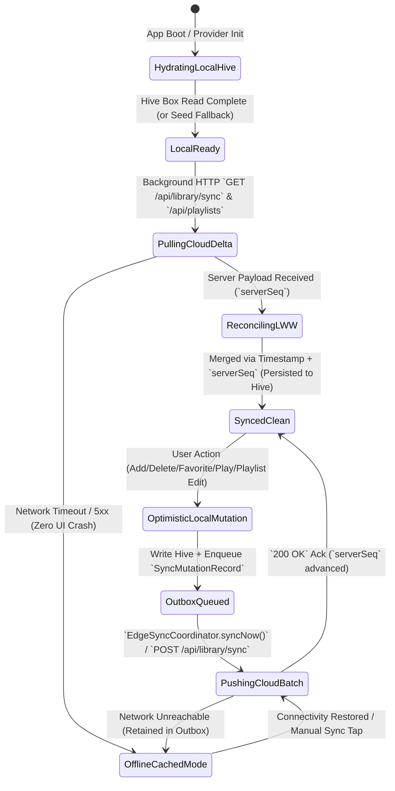
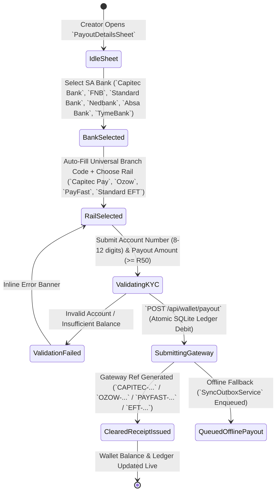
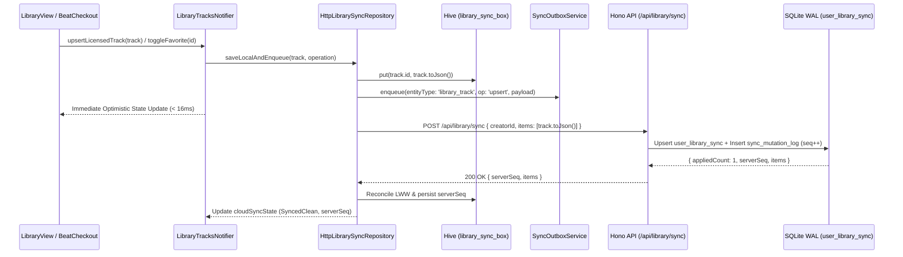

# Phase 59 — Full-Stack Backend API Convergence (`apps/vhunambi_api` & `apps/vhunambi_client`)
## Architectural Blueprint & Forensic System Specification

**Document ID**: `VH-ARCH-P59-FULLSTACK-CONVERGENCE`  
**Phase**: `59` (Full-Stack Backend API Convergence — Dynamic Cloud Sync, SQLite WAL Persistence & Live Data Feeds)  
**Status**: `ARGON-HARDENED SPECIFICATION (READY FOR EXECUTION)`  
**Engineering Standard**: All-Gemini Engineering Standard (`STD-ARCH-P59` / `STD-UIUX-001` / `STD-SYNC-039`)  
**Target Workspaces**:
- Backend API (`Hono` + `better-sqlite3` WAL): `apps/vhunambi_api/`
- Flutter Client (`Riverpod` + `Dio` + `Hive` + `EdgeSyncCoordinator`): `apps/vhunambi_client/`

---

## 1. Executive Overview & Visual North Star

Vhunambi's client UI, 64-bit C++ DSP engine, encrypted offline audio vault (Phase 08), and cryptographic beat licensing pipeline (Phase 58) operate at tier-1 production quality. However, a forensic audit of the client-server boundary between `apps/vhunambi_client` and `apps/vhunambi_api` exposes **five architectural disconnects** that keep the application behaving like an isolated single-device prototype rather than a connected full-stack cloud platform:

1. **Explore Discovery Feed Disconnect (`GET /api/explore`)**:
   - On the backend (`apps/vhunambi_api/src/db/vhunambi_db.ts`), the `explore_tracks` table is created in the schema (`lines 111–128`), **but `seedInitialDataIfEmpty()` never populates `explore_tracks`**, and `getExploreFeed()` only queries `kinetic_posts` while ignoring `options.genre` in its SQL `WHERE` clause (`lines 591–609`).
   - Furthermore, `apps/vhunambi_api/src/routes/explore_routes.ts` only mounts `GET /feed`, `POST /posts/:id/cosign`, and `POST /posts/:id/repost`. There is no root `GET /api/explore`, `GET /api/explore/tracks`, or `GET /api/explore/radio/:genre` endpoint returning a unified discovery payload (`tracks`, `posts`, `creators`, `radioStations`, `trendingRanks`, `serverSeq`).
   - On the client (`apps/vhunambi_client/lib/features/explore/presentation/providers/explore_providers.dart`), `ExploreTracksNotifier` (`line 150`) initializes exclusively from 8 hardcoded RAM tracks (`_seedTracks()`) with zero HTTP hydration, and `Track` (`lib/shared/models/track.dart`) lacks `toJson()` / `fromJson()` serialization.
2. **Library Cloud Delta Sync Disconnect (`GET/POST /api/library/sync`)**:
   - On the client (`apps/vhunambi_client/lib/features/library/domain/models/library_models.dart`), `LibraryTrack` has **no `toJson()` or `fromJson()`** methods, and `LibraryTracksNotifier` (`library_providers.dart:117`) is a volatile RAM `StateNotifier` seeded with `_seedTracks()`.
   - Calling `addTrack`, `upsertLicensedTrack` (Phase 58 beat vault injection), `deleteTrack` (soft-delete trash), `restoreTrack`, `purgeTrackPermanently`, `toggleFavorite`, or `incrementPlayCount` never persists to Hive (`library_sync_box`), never enqueues `SyncMutationRecord` entries into `SyncOutboxService`, and never reconciles with `GET /api/library/sync` or `POST /api/library/sync`.
   - On the backend (`vhunambi_db.ts:695–739`), `user_library_sync` lacks soft-delete tombstone columns (`is_deleted`, `deleted_at`, `version_seq`) and `applyMutationsBatch()` (`vhunambi_db.ts:363`) does not handle `entityType === 'library_track'`.
3. **Playlists Cloud CRUD & Sharing Disconnect (`GET/POST/PUT/DELETE /api/playlists`)**:
   - `vhunambi_db.ts` has **no `playlists` table**, and `apps/vhunambi_api/src/server.ts` mounts **no `/api/playlists` route**.
   - On the client, `PlaylistRepository` (`lib/features/playlists/data/repositories/playlist_repository.dart`) writes only to a local Hive box (`AppConstants.playlistsBoxKey`) with an in-memory fallback map. Playlists cannot be synced across devices, cannot be shared via cloud links (`POST /api/playlists/:id/share`), and do not enqueue `playlist` mutations into `SyncOutboxService`.
   - Additionally, `PlaylistsVaultView` (`playlists_vault_view.dart:167,170,203`) still contains 3 legacy stock Material icons (`Icons.search_rounded`, `Icons.clear_rounded`, `Icons.add_rounded`) violating `STD-UIUX-001`.
4. **Split-Brain South African Banking & Payout Gateway (`POST /api/wallet/payout`)**:
   - `PayoutDetailsSheet` (`lib/features/profile/presentation/widgets/payout_details_sheet.dart:38,206`) presents bank names `'Capitec Bank'`, `'FNB'`, `'Standard Bank'`, `'Nedbank'`, `'Absa Bank'`, and `'TymeBank'`. However, `vhunambi_db.ts:816` validates against `['ABSA', 'FNB', 'Standard Bank', 'Capitec', 'Nedbank', 'TymeBank']` — causing `'Capitec Bank'` and `'Absa Bank'` submissions from the UI to fail backend validation!
   - Worse, `HttpSocialRepository.requestPayout()` calls `POST /api/creators/:id/wallet/payout` (`social_routes.ts:235`, backed by volatile in-memory `social_service.ts`), whereas the durable SQLite WAL banking ledger lives at `POST /api/wallet/payout` (`wallet_routes.ts:25` $\to$ `vhunambiDb.requestPayout`).
5. **Un-Hydrated `EdgeSyncCoordinator` Delta Pulls (`GET /api/v1/sync/delta`)**:
   - `EdgeSyncCoordinator.syncNow()` (`lib/core/sync/edge_sync_coordinator.dart:260`) flushes outbox batches (`POST /api/v1/sync/batch`) and pulls delta pages (`GET /api/v1/sync/delta`), incrementing `lastServerSeq` and `lastDeltaChangesApplied`, **but discards the returned `changes` array without hydrating client repositories or Riverpod providers**.

### Visual North Star
Phase 59 converges `apps/vhunambi_api` and `apps/vhunambi_client` into a unified, offline-first, cloud-synchronized platform:
- **Dynamic African Genre Discovery (`GET /api/explore`)**: Live SQLite-backed catalog serving 12 African genres (`Amapiano`, `Afro-Tech`, `3-Step`, `Gqom`, `Afrobeats`, `Lekompo`, `Bacardi`, `Maskandi`, `Shangaan Electro`, `Kwaito`, `Deep House`, `Hip-Hop`), real-time trending score computation, discovery stage classification (`freshCrate`, `risingBreakout`, `mainstage`), and deterministic genre radio rotations (`GET /api/explore/radio/:genre`).
- **Bi-Directional Library Cloud Delta Sync (`GET/POST /api/library/sync`)**: Local Hive cache (`vhunambi_library_tracks_v1`) + `HttpLibrarySyncRepository` + SQLite `user_library_sync` table with LWW (Last-Write-Wins) timestamp and `serverSeq` reconciliation, preserving Phase 58 beat license deeds, play counts, favorites, and 30-day soft-delete tombstones across devices.
- **Cloud Playlists CRUD & Sovereign Share Links (`GET/POST/PUT/DELETE /api/playlists`)**: Full SQLite `playlists` persistence, `HttpPlaylistRepository` hybrid Hive + Dio sync, public share token generation (`vhunambi.za/p/:shareCode`), and Phosphor-compliant `PlaylistsVaultView` cloud sync controls.
- **Unified South African Banking & Instant Payout Gateway (`POST /api/wallet/payout`)**: Canonical SA bank normalization (`Capitec Bank` / `Capitec` $\to$ `470010`, `FNB` $\to$ `250655`, `Standard Bank` $\to$ `051001`, `Nedbank` $\to$ `198765`, `Absa Bank` / `ABSA` $\to$ `632005`, `TymeBank` $\to$ `678910`), multi-rail settlement (`Capitec Pay`, `Ozow Instant EFT`, `PayFast`, `Standard RTC EFT`), and unified SQLite ledger persistence across both `/api/wallet/payout` and `/api/creators/:id/wallet/payout`.

---

## 2. Forensic Post-Mortem Comparison Box

```
+====================================================================================================+
|                      PHASE 59 FORENSIC POST-MORTEM: ISOLATED CLIENT vs FULL-STACK                  |
+================================================+===================================================+
| LEGACY STATE (PRE-PHASE 59)                    | PHASE 59 CONVERGED ARCHITECTURE                   |
+------------------------------------------------+---------------------------------------------------+
| 1. EXPLORE FEED & GENRE RADIO                  | 1. EXPLORE FEED & GENRE RADIO                     |
| - `explore_tracks` SQLite table is empty;      | - `explore_tracks` seeded with 12 rich African    |
|   `getExploreFeed` ignores `genre` filter.     |   catalog tracks + dynamic trending ranker.       |
| - No root `GET /api/explore` endpoint.         | - `GET /api/explore`, `/api/explore/tracks`, and  |
| - `Track` model lacks `toJson`/`fromJson`.     |   `/api/explore/radio/:genre` live in Hono API.   |
| - `ExploreTracksNotifier` uses 8 RAM tracks.   | - `HttpExploreRepository` hydrates client + Hive. |
+------------------------------------------------+---------------------------------------------------+
| 2. LIBRARY CLOUD DELTA SYNC                    | 2. LIBRARY CLOUD DELTA SYNC                       |
| - `LibraryTrack` lacks JSON serialization.     | - Full `LibraryTrack.toJson()` / `fromJson()`     |
| - `LibraryTracksNotifier` is volatile RAM;     |   preserving Phase 58 license deeds & stems.      |
|   favorites, play counts, and soft-deletes     | - `HttpLibrarySyncRepository` persists to Hive    |
|   vanish on cold restart.                      |   and syncs deltas via `GET/POST /api/library/sync`|
| - `applyMutationsBatch` ignores `library_track`| - `applyMutationsBatch` handles `library_track`.  |
+------------------------------------------------+---------------------------------------------------+
| 3. PLAYLISTS CRUD & SHARING                    | 3. PLAYLISTS CRUD & SHARING                       |
| - Zero `playlists` table or `/api/playlists`   | - New `playlists` table in `VhunambiDatabase` +   |
|   routes in `apps/vhunambi_api`.               |   `GET/POST/PUT/DELETE /api/playlists` + `/share`.|
| - `PlaylistRepository` is local Hive only.     | - `PlaylistRepository` upgraded with Dio cloud    |
| - `PlaylistsVaultView` uses 3 stock `Icons.*`. |   sync, outbox queueing & Phosphor icons.         |
+------------------------------------------------+---------------------------------------------------+
| 4. SA BANKING & WALLET PAYOUT GATEWAY          | 4. SA BANKING & WALLET PAYOUT GATEWAY             |
| - `PayoutDetailsSheet` sends `'Capitec Bank'`  | - Canonical SA Bank & Rail normalizer maps all    |
|   & `'Absa Bank'`, rejected by `vhunambi_db.ts`|   SA banks (`Capitec`, `FNB`, `Standard Bank`,    |
| - Split-brain: `/api/creators/:id/wallet/payout|   `Nedbank`, `Absa`, `TymeBank`) + `Ozow` /       |
|   hits RAM mock while `/api/wallet/payout`     |   `PayFast` / `Capitec Pay` rails onto unified    |
|   hits SQLite `wallet_ledger`.                 |   SQLite WAL `requestPayout` transaction.         |
+------------------------------------------------+---------------------------------------------------+
| 5. EDGE SYNC COORDINATOR DELTA HYDRATION       | 5. EDGE SYNC COORDINATOR DELTA HYDRATION          |
| - `EdgeSyncCoordinator.syncNow()` pulls deltas | - `EdgeSyncCoordinator` dispatches pulled delta   |
|   from `/api/v1/sync/delta` but discards them. |   mutations to registered domain hydrators.       |
+================================================+===================================================+
```

---

## 3. 5-Layer Decoupled Full-Stack Architecture

```
+---------------------------------------------------------------------------------------------------+
| LAYER 5: SOVEREIGN PRESENTATION HUD (Flutter Views & Sheets — STD-UIUX-001 Compliant)             |
|  - ExploreView (Live Cloud Sync Pill, 12-Genre Filter, Discovery Stages, Genre Radio Station Bar) |
|  - LibraryView (Cloud Sync Status Indicator, 1-Tap Delta Sync Action, Offline/License Filters)    |
|  - PlaylistsVaultView (Phosphor Search/Create Bar, Cloud Sync Action, Share Link Copy Toast)      |
|  - PayoutDetailsSheet (6 SA Banks + Universal Branch Auto-Fill + Capitec Pay / Ozow / PayFast)    |
+---------------------------------------------------------------------------------------------------+
                                                 |
                                                 v
+---------------------------------------------------------------------------------------------------+
| LAYER 4: REACTIVE RIVERPOD STATE & EDGE SYNC HYDRATION CONTROLLER                                 |
|  - ExploreTracksNotifier + SocialFeedPostsNotifier (hydrates from HttpExploreRepository + deltas) |
|  - LibraryTracksNotifier (hydrates from Hive + HttpLibrarySyncRepository + enqueues mutations)    |
|  - PlaylistsNotifier (hydrates from PlaylistRepository + cloud share & delta reconciliation)      |
|  - CreatorWalletNotifier (unified PayoutReceipt + BankAccountProfile + live ledger refresh)       |
|  - EdgeSyncCoordinator (flushes Outbox -> pulls `/api/v1/sync/delta` -> invokes DeltaHydrators)   |
+---------------------------------------------------------------------------------------------------+
                                                 |
                                                 v
+---------------------------------------------------------------------------------------------------+
| LAYER 3: HYBRID CLIENT DATA REPOSITORIES (Dio HTTP + Local Hive Cache + Outbox Queueing)          |
|  - HttpExploreRepository (`GET /api/explore`, `/api/explore/tracks`, `/api/explore/radio/:genre`) |
|  - HttpLibrarySyncRepository (`GET /api/library/sync`, `POST /api/library/sync` + Hive box)       |
|  - PlaylistRepository (`GET/POST/PUT/DELETE /api/playlists`, `POST /api/playlists/:id/share`)     |
|  - HttpSocialRepository & WalletPayoutClient (`POST /api/wallet/payout` & `/creators/:id/wallet`) |
+---------------------------------------------------------------------------------------------------+
                                                 |
                                   HTTP / JSON REST + Idempotency Keys
                                                 |
                                                 v
+---------------------------------------------------------------------------------------------------+
| LAYER 2: HONO / NODE.JS REST & DELTA GATEWAY (`apps/vhunambi_api/src/routes/*.ts`)                |
|  - `explore_routes.ts`  -> `GET /`, `GET /feed`, `GET /tracks`, `GET /radio/:genre`, `POST /tracks`|
|  - `library_routes.ts`  -> `GET /`, `GET /sync`, `POST /sync`, `DELETE /:id`                      |
|  - `playlist_routes.ts` -> `GET /`, `GET /:id`, `POST /`, `PUT /:id`, `DELETE /:id`, `POST /share`|
|  - `wallet_routes.ts`   -> `GET /:creatorId`, `POST /credit`, `POST /payout`, `GET /banks`        |
|  - `sync_routes.ts`     -> `POST /batch`, `GET /delta`, `GET /status`                             |
+---------------------------------------------------------------------------------------------------+
                                                 |
                                                 v
+---------------------------------------------------------------------------------------------------+
| LAYER 1: SQLITE WAL PERSISTENCE ENGINE (`apps/vhunambi_api/src/db/vhunambi_db.ts`)                |
|  - Tables: `creators`, `explore_tracks`, `kinetic_posts`, `user_library_sync`, `playlists`,       |
|    `wallet_ledger`, `bank_accounts`, `sync_mutation_log`, `beat_listings`, `beat_licenses`,       |
|    `collab_bounties`, `cosign_events`, `sync_meta`                                                |
|  - Atomic `db.transaction(...)` across domain tables + monotonic `sync_mutation_log` (`seq`)      |
+---------------------------------------------------------------------------------------------------+
```

---

## 4. Domain Taxonomy, Endpoint Matrix & SQLite Schema Topology

### 4.1 Full-Stack Endpoint Matrix

| Domain | Method & Route | Request Contract | Response Contract | Persistence Table(s) |
| :--- | :--- | :--- | :--- | :--- |
| **Explore** | `GET /api/explore` | `?genre=&stage=&sort=&limit=30&cursor=` | `{ status, data: { tracks, posts, creators, radioStations, nextCursor, hasMore, serverSeq } }` | `explore_tracks`, `kinetic_posts`, `creators` |
| **Explore** | `GET /api/explore/tracks` | `?genre=&stage=&sort=&search=&limit=50` | `{ status, data: { items: ExploreTrackRow[], total: number, serverSeq: number } }` | `explore_tracks` |
| **Explore** | `GET /api/explore/radio/:genre` | `:genre` (`All` or specific genre), `?limit=20` | `{ status, data: { genre, stationTitle, seedBpm, rotation: ExploreTrackRow[], serverSeq } }` | `explore_tracks` |
| **Explore** | `POST /api/explore/tracks` | `ExploreTrackUpsertPayload` | `{ status: 'ok', data: ExploreTrackRow, serverSeq: number }` | `explore_tracks`, `sync_mutation_log` |
| **Library** | `GET /api/library/sync` | `?creatorId=usr_me&sinceSeq=0&includeDeleted=true` | `{ status: 'ok', data: { items: LibrarySyncItem[], serverSeq: number, syncedAt: string } }` | `user_library_sync` |
| **Library** | `POST /api/library/sync` | `{ creatorId, clientSeq, items: LibrarySyncItem[], deletedIds?: string[] }` | `{ status: 'ok', data: { appliedCount, items: LibrarySyncItem[], serverSeq, syncedAt } }` | `user_library_sync`, `sync_mutation_log` |
| **Playlists** | `GET /api/playlists` | `?creatorId=usr_me&includePublic=true` | `{ status: 'ok', data: { items: PlaylistRow[], total: number, serverSeq: number } }` | `playlists` |
| **Playlists** | `GET /api/playlists/:id` | Path `:id` | `{ status: 'ok', data: PlaylistRow }` | `playlists` |
| **Playlists** | `POST /api/playlists` | `PlaylistUpsertPayload` | `{ status: 'ok', data: PlaylistRow, serverSeq: number }` (`201 Created`) | `playlists`, `sync_mutation_log` |
| **Playlists** | `PUT /api/playlists/:id` | `Partial<PlaylistUpsertPayload>` | `{ status: 'ok', data: PlaylistRow, serverSeq: number }` | `playlists`, `sync_mutation_log` |
| **Playlists** | `DELETE /api/playlists/:id` | Path `:id`, `?creatorId=usr_me` | `{ status: 'ok', deletedId: string, serverSeq: number }` | `playlists`, `sync_mutation_log` |
| **Playlists** | `POST /api/playlists/:id/share` | `{ creatorId?: string }` | `{ status: 'ok', data: { playlistId, shareCode, shareUrl, isPublic: true, sharedAt } }` | `playlists`, `sync_mutation_log` |
| **Wallet** | `GET /api/wallet/:creatorId` | Path `:creatorId` | `{ status: 'ok', data: WalletSummary & { bankAccounts, supportedBanks, supportedRails } }` | `creators`, `wallet_ledger`, `bank_accounts` |
| **Wallet** | `POST /api/wallet/payout` | `{ creatorId, amountZar, bankName, accountNumber, branchCode?, paymentRail?, accountHolder? }` | `{ status: 'ok', data: PayoutClearanceReceipt }` (`201 Created`) | `creators`, `wallet_ledger`, `bank_accounts`, `sync_mutation_log` |
| **Wallet** | `POST /api/creators/:id/wallet/payout` | `{ amountZar, bankName, accountNumber, branchCode?, paymentRail? }` | `{ status: 'ok', data: PayoutClearanceReceipt, wallet: CreatorWalletJson }` | Unified alias to `vhunambiDb.requestPayout` |
| **Edge Sync** | `POST /api/v1/sync/batch` | `{ deviceId, mutations: SyncMutationInput[] }` | `{ status: 'ok', data: { appliedCount, ackedIds, serverSeq, conflicts } }` | All domain tables + `sync_mutation_log` |
| **Edge Sync** | `GET /api/v1/sync/delta` | `?sinceSeq=0&limit=100` | `{ status: 'ok', data: { sinceSeq, serverSeq, hasMore, count, mutations } }` | `sync_mutation_log` |

### 4.2 SQLite Schema Additions & Upgrades (`vhunambi_db.ts`)

1. **`playlists` Table (New)**:
   ```sql
   CREATE TABLE IF NOT EXISTS playlists (
     id TEXT PRIMARY KEY,
     creator_id TEXT NOT NULL DEFAULT 'usr_me',
     title TEXT NOT NULL,
     description TEXT NOT NULL DEFAULT '',
     cover_image_url TEXT,
     track_ids_json TEXT NOT NULL DEFAULT '[]',
     is_public INTEGER NOT NULL DEFAULT 0,
     share_code TEXT,
     share_url TEXT,
     created_at TEXT NOT NULL,
     updated_at TEXT NOT NULL
   );
   CREATE INDEX IF NOT EXISTS idx_playlists_creator ON playlists(creator_id, updated_at DESC);
   ```
2. **`explore_tracks` Table Upgrade & Seed**:
   - Retains existing columns (`id, title, artist, creator_id, genre, sub_genre, province, bpm, musical_key, audio_url, cover_url, duration_ms, likes_count, plays_count, cosigns_count, stems_available, song_dna_json, created_at`) and seeds **12 canonical South African & Pan-African tracks** across `Amapiano`, `Afro-Tech`, `3-Step`, `Gqom`, `Afrobeats`, `Lekompo`, `Bacardi`, `Shangaan Electro`, `Maskandi`, `Kwaito`, `Deep House`, and `Hip-Hop` inside `seedInitialDataIfEmpty()`.
3. **`user_library_sync` Table Upgrade**:
   - Stores rich `LibraryTrack` JSON inside `data_json` (including `id, title, artist, bpm, key, genre, duration, dateAdded, filePath, isStem, isFavorite, playCount, isDeleted, deletedAt, isMastered, lufs, licensePurchaseId, licenseTierId, licenseCertificateHash, producerHandle, stemFilePaths, updatedAtMs`).
4. **`bank_accounts` & `wallet_ledger` Upgrade**:
   - Normalizes South African bank names, universal branch codes, and payment rails (`eft`, `capitec_pay`, `ozow`, `payfast`), storing the gateway clearance reference (`reference_code`, `payment_rail`, `estimated_arrival`, `fee_zar`, `net_payout_zar`) inside `wallet_ledger.metadata_json`.

---

## 5. Finite State Machines

### 5.1 Library & Playlist Bi-Directional Cloud Sync State Machine



### 5.2 South African Banking & Gateway Clearance State Machine



---

## 6. Dual-Viewport Wireframes (Mobile `<600px` & Desktop `>=1024px`)

### 6.1 Explore Live Cloud Feed & Genre Radio Bar (`ExploreView`)

```
MOBILE (<600px)                                   DESKTOP (>=1024px)
+----------------------------------------------+  +------------------------------------------------------------------------+
| [Avatar] EXPLORE      [Cloud: LIVE] [Bell]   |  | [Avatar] EXPLORE DISCOVERY  [Search...] [Cloud: LIVE #142] [Radio] [B] |
+----------------------------------------------+  +------------------------------------------------------------------------+
| [All] [Amapiano] [3-Step] [Gqom] [Lekompo] > |  | [All] [Amapiano] [Afro-Tech] [3-Step] [Gqom] [Afrobeats] [Lekompo]     |
+----------------------------------------------+  +-----------------------------------+------------------------------------+
| [RADIO] Amapiano Pulse Radio (113 BPM) [Play]|  | LIVE GENRE RADIO ROTATION         | TRENDING VELOCITY LEADERBOARD      |
+----------------------------------------------+  | [Play] Amapiano Pulse (113 BPM)   | #1 Sovereign Groove (98.4 Score)   |
| [All Stages] [Fresh Crate] [Rising] [Main]   |  | 12 Cloud Tracks in Rotation       | #2 Lekompo Fire (94.1 Score)       |
+----------------------------------------------+  +-----------------------------------+------------------------------------+
| #1 Sovereign Groove - Kabza Spirit   [Cosign]|  | [Grid Card 1: Sovereign Groove]   | [Grid Card 2: Quantum Log Drum]    |
|    113 BPM | Fm | Gauteng | 14.2k Plays      |  | [Grid Card 3: Tzaneen Sun]        | [Grid Card 4: Durban 3-Step]       |
+----------------------------------------------+  +-----------------------------------+------------------------------------+
```

### 6.2 Library Cloud Sync Header & Playlists Share Bar (`LibraryView` & `PlaylistsVaultView`)

```
LIBRARY HEADER (MOBILE & DESKTOP)                 PLAYLISTS VAULT HEADER & CARD
+----------------------------------------------+  +------------------------------------------------------------------------+
| [Search tracks, artists, genres...]  [Sync]  |  | [Search playlists...]                  [Cloud Sync] [+ Create Playlist]|
| Cloud Status: Synced (Seq #48) | 14 Tracks   |  +------------------------------------------------------------------------+
+----------------------------------------------+  | +------------------------------+  +----------------------------------+ |
| [All (14)] [Beats] [Songs] [Offline] [Trash] |  | | Amapiano Late Night          |  | 3-Step Private Vault             | |
+----------------------------------------------+  | | 8 Tracks | Public            |  | 5 Tracks | Private               | |
| [Track 1] Sovereign Groove [LICENSED] [Fav]  |  | | [Share Link] [Edit] [Delete] |  | | [Publish & Share] [Edit] [Del] | |
+----------------------------------------------+  | +------------------------------+  +----------------------------------+ |
                                                  +------------------------------------------------------------------------+
```

### 6.3 South African Banking & Instant Payout Sheet (`PayoutDetailsSheet`)

```
+------------------------------------------------------------------+
|  [BankIcon] South African Bank Payout & Gateway Details          |
|  Connect your SA account for instant creator royalties           |
+------------------------------------------------------------------+
|  SELECT SOUTH AFRICAN BANK                                       |
|  [Capitec Bank (470010)] [FNB (250655)] [Standard Bank (051001)] |
|  [Nedbank (198765)]      [Absa Bank (632005)] [TymeBank (678910)]|
+------------------------------------------------------------------+
|  SETTLEMENT GATEWAY RAIL                                         |
|  (*) Capitec Pay / Instant RTC  ( ) Ozow EFT  ( ) PayFast        |
+------------------------------------------------------------------+
|  ACCOUNT HOLDER NAME            UNIVERSAL BRANCH CODE            |
|  [ Ndugelo Creator           ]  [ 470010 (Auto-Verified)      ]  |
|  ACCOUNT NUMBER (8-12 DIGITS)   PAYOUT AMOUNT (ZAR)              |
|  [ 1648291045                ]  [ R 850.00 (Max: R 1,850.00)  ]  |
+------------------------------------------------------------------+
|  [ShieldCheck] Masked KYC: ****1045 | Gateway Ref: CAPITEC-RTC   |
|  [        Save & Execute Instant Payout (R 850.00)            ]  |
+------------------------------------------------------------------+
```

---

## 7. Algorithmic Formulations & Reconciliation Math

### 7.1 Explore Trending Velocity & Discovery Stage Classifier
Every track in `explore_tracks` has a deterministic trending velocity score $S_{\text{trend}} \in [0, 100]$ computed on the backend and mirrored on the client:

$$S_{\text{trend}}(t) = \min\left(100,\; 18 \cdot \ln(1 + P_t) + 2.4 \cdot \sqrt{L_t} + 3.8 \cdot \sqrt{C_t} + B_{\text{stems}} + B_{\text{recency}}(t)\right)$$

where:
- $P_t$ is `plays_count`, $L_t$ is `likes_count`, $C_t$ is `cosigns_count`,
- $B_{\text{stems}} = 6.0$ if `stems_available == 1` else $0.0$,
- $B_{\text{recency}}(t) = \max\left(0,\; 15.0 - 0.5 \cdot \Delta_{\text{days}}(\text{now}, t.\text{created\_at})\right)$.

Discovery stage classification (`DiscoveryStage`) is derived deterministically:
- `mainstage`: $P_t \ge 8000$ or $C_t \ge 250$ or $S_{\text{trend}}(t) \ge 82.0$
- `risingBreakout`: $P_t \ge 1500$ or $C_t \ge 60$ or $S_{\text{trend}}(t) \ge 58.0$
- `freshCrate`: all newly uploaded or underground tracks below `risingBreakout` thresholds.

### 7.2 Library & Playlist LWW (Last-Write-Wins) Delta Merge Equation
Given a local record $R_L$ and a remote cloud record $R_C$ sharing primary key $k$:

$$\text{Winner}(R_L, R_C) = \begin{cases} R_C & \text{if } R_C.\text{updatedAtMs} > R_L.\text{updatedAtMs} \\ R_L & \text{if } R_L.\text{updatedAtMs} > R_C.\text{updatedAtMs} \\ R_C & \text{if } R_C.\text{updatedAtMs} == R_L.\text{updatedAtMs} \land R_C.\text{serverSeq} \ge R_L.\text{serverSeq} \end{cases}$$

with monotonic accumulation on cumulative counters when neither record is newly soft-deleted:
- $\text{playCount}_{\text{merged}} = \max(R_L.\text{playCount}, R_C.\text{playCount})$
- Phase 58 beat license metadata (`licensePurchaseId`, `licenseTierId`, `licenseCertificateHash`, `producerHandle`, `stemFilePaths`) is **non-destructively preserved** if present on either $R_L$ or $R_C$.

### 7.3 South African Banking Normalization & Gateway Fee Math
1. **Universal Branch Code Mapping (`SA_BANK_REGISTRY`)**:
   - `'Capitec'` / `'Capitec Bank'` $\to$ Canonical `'Capitec Bank'`, Branch `'470010'`
   - `'FNB'` / `'First National Bank'` $\to$ Canonical `'FNB'`, Branch `'250655'`
   - `'Standard Bank'` $\to$ Canonical `'Standard Bank'`, Branch `'051001'`
   - `'Nedbank'` $\to$ Canonical `'Nedbank'`, Branch `'198765'`
   - `'ABSA'` / `'Absa'` / `'Absa Bank'` $\to$ Canonical `'Absa Bank'`, Branch `'632005'`
   - `'TymeBank'` $\to$ Canonical `'TymeBank'`, Branch `'678910'`
2. **Gateway Rail Fee & Net Settlement**:
   - `capitec_pay`: Flat fee $F = \text{R } 2.50$, settlement `'Instant (< 60 sec)'`, ref prefix `'CAPITEC-'`
   - `ozow`: Flat fee $F = \text{R } 3.50$, settlement `'Instant Ozow RTC (< 2 min)'`, ref prefix `'OZOW-'`
   - `payfast`: Fee $F = \text{round}(\max(5.00, 0.015 \cdot A), 2)$, settlement `'Same-Day PayFast (< 4 hrs)'`, ref prefix `'PAYFAST-'`
   - `eft`: Fee $F = \text{R } 0.00$, settlement `'1-2 Business Days (SARB EFT)'`, ref prefix `'EFT-'`
   - Wallet ledger deducts gross `amountZar` ($A \ge 50.0$), records `feeZar` ($F$) and `netPayoutZar` ($A - F$), and returns a deterministic `PayoutClearanceReceipt`.

---

## 8. End-to-End Sequence Diagrams

### 8.1 Bi-Directional Library Sync & Phase 58 License Preservation



---

## 9. Verification Gates (`G-59-01` through `G-59-08`)

| Gate ID | Gate Name | Verification Criteria |
| :--- | :--- | :--- |
| `G-59-01` | **Explore API & Genre Radio Convergence** | `GET /api/explore`, `GET /api/explore/tracks?genre=Amapiano`, and `GET /api/explore/radio/Amapiano` return seeded SQLite tracks, posts, creators, and radio rotations with `trendingScore` and `discoveryStage`. |
| `G-59-02` | **Library JSON & Cloud Delta Sync** | `LibraryTrack.toJson()` / `fromJson()` round-trips 100% of fields (including Phase 58 license fields & soft-delete tombstones); `GET/POST /api/library/sync` persists and merges via LWW. |
| `G-59-03` | **Playlists Full-Stack CRUD & Cloud Share** | `GET/POST/PUT/DELETE /api/playlists` and `POST /api/playlists/:id/share` persist to SQLite `playlists` table; client `PlaylistRepository` syncs with Hive + HTTP and returns `shareUrl`. |
| `G-59-04` | **SA Banking & Gateway Unification** | Both `POST /api/wallet/payout` and `POST /api/creators/:id/wallet/payout` accept all 6 SA bank names (`Capitec Bank`, `Capitec`, `FNB`, `Standard Bank`, `Nedbank`, `Absa Bank`, `ABSA`, `TymeBank`) and 4 rails (`capitec_pay`, `ozow`, `payfast`, `eft`), debiting SQLite `wallet_ledger` atomically. |
| `G-59-05` | **EdgeSyncCoordinator Delta Hydration** | `EdgeSyncCoordinator.syncNow()` dispatches pulled `/api/v1/sync/delta` records (`track`, `post`, `library_track`, `playlist`, `payout`) to registered client hydrator callbacks. |
| `G-59-06` | **STD-UIUX-001 & Phosphor Icon Purity** | Zero stock Material `Icons.*` in `playlists_vault_view.dart` or any touched Phase 59 widget; zero raw emojis in UI text; 100% `AppColors` and `AppTypography` compliance. |
| `G-59-07` | **Backend & Client Automated Test Suites** | Backend API tests and Flutter unit/widget/integration tests pass 100% (`0` failures). |
| `G-59-08` | **Static Analysis & Format Gate** | `dart analyze` (`No issues found!`) and `dart format --output=none` (`0 changed`) across all touched Dart files, plus clean TypeScript compilation in `apps/vhunambi_api`. |

