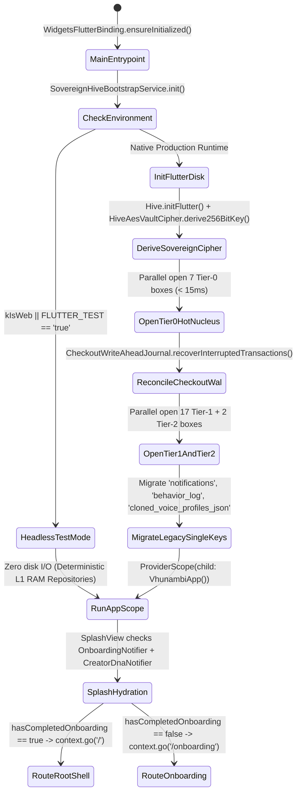
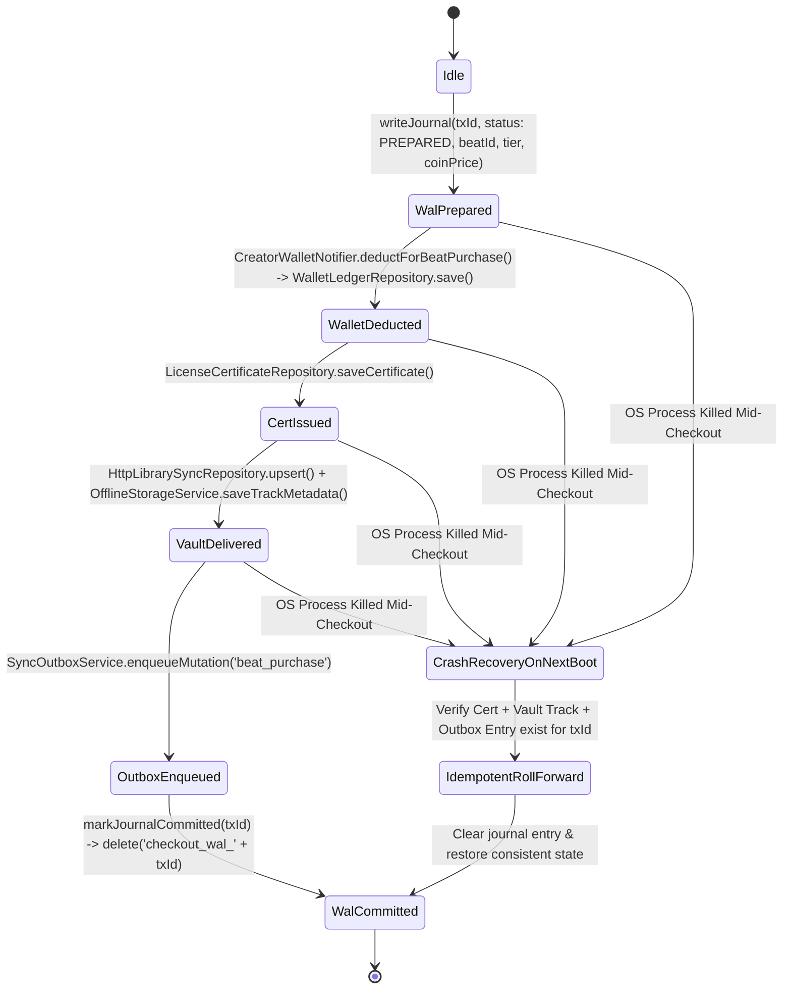
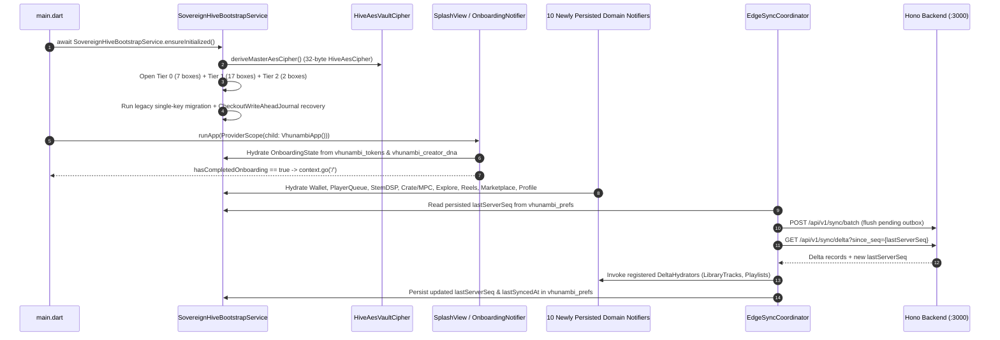

# Phase 60 Blueprint: Sovereign Hive Brain Activation, Unified Persistence & Edge-Sync Convergence

> **Phase ID**: `phase_60_sovereign_hive_brain_and_persistence_convergence`
> **Engineering Standard**: All-Gemini Engineering Standard (`STD-ARCH-060`, `STD-UIUX-001`, `STD-SEC-012`)
> **Status**: Specification Hardened (Stage 3 Ready for Stage 4 Execution)
> **Predecessor Phases**:
> - `phase_58_sovereign_beatstore_licensing` (Sovereign Beatstore Licensing, Digital Ownership Certificates & Vault Stems)
> - `phase_59_fullstack_backend_convergence` (Full-Stack Hono/SQLite Backend API Convergence & Offline-First Repositories)
> **Forensic Baseline**: [`docs/audits/HIVE_PERSISTENCE_ENGINE_COMPREHENSIVE_AUDIT.md`](file:///c:/Users/Ndugelo/VHUNAMBI/monorepo/docs/audits/HIVE_PERSISTENCE_ENGINE_COMPREHENSIVE_AUDIT.md)

---

## 1. Executive Overview & Visual North Star

### 1.1 The Volatile Brain Paradox & The 10 Ignored Subsystems
Forensic inspection of the Vhunambi client (`apps/vhunambi_client/`) exposed a critical architectural paradox at the heart of its local persistence layer:

1. **The 0-Box Production Boot Failure (`main.dart`)**:
   Although the codebase declares **20 Hive boxes** across 16 repositories and notifiers, [`apps/vhunambi_client/lib/main.dart`](file:///c:/Users/Ndugelo/VHUNAMBI/monorepo/apps/vhunambi_client/lib/main.dart#L1-L21) calls `WidgetsFlutterBinding.ensureInitialized()` and immediately invokes `runApp(const ProviderScope(child: VhunambiApp()))` **without ever calling `await Hive.initFlutter()` or opening any boxes**. Consequently:
   - The **4 services** that call `Hive.openBox(...)` (`OfflineStorageService`, `LicenseCertificateRepository`, `SoundSignatureRepository`, `SyncOutboxService`) throw a `HiveError` on startup and fall back to ephemeral RAM maps (or lose state completely in `SoundSignatureRepository`, which lacks an in-memory fallback).
   - The **14 services** that passively guard with `Hive.isBoxOpen(boxKey)` (`HttpLibrarySyncRepository`, `PlaylistRepository`, `BeatRepository`, `CollectionRepository`, `CreatorDnaRepository`, `ProfileCache`, `NotificationRepository`, `ThemeModeNotifier`, `StudioNotifier`, `VocalIdentityNotifier`, `MelodySketchpadNotifier`, `SoundPackMarketplaceNotifier`, `MasterMediaObjectNotifier`, `AppConstants.prefsBoxKey`) evaluate `isBoxOpen(...) == false` on every read and write, silently falling back to volatile RAM.
   - **2 declared constants** (`AppConstants.tokenBoxKey = 'vhunambi_tokens'` and `AppConstants.tracksBoxKey = 'vhunambi_tracks'`) are completely orphaned.
2. **Selective Persistence Bias (The 10 Ignored App Domains)**:
   Even among features that were built in Phases 1–59, Hive favoured only a narrow subset of domains while **10 core user-facing subsystems were left 100% in ephemeral RAM (or split into `SharedPreferences`)**:
   - **Domain 1 — Creator Wallet, Coin Ledger & Saved SA Bank Accounts** (`CreatorWalletNotifier`): Resets `userCoinsBalance = 250`, `creatorEarnedZar = 1420.0`, `creatorReceivedCoins = 4750`, and loses all top-ups, beat purchases, tips, and saved South African bank payout accounts (`Capitec`, `FNB`, `Standard Bank`, `Nedbank`, `Absa`, `TymeBank`) on every restart.
   - **Domain 2 — Player Session, Queue, Seek Position, 3D Hero Mode & Recently Played** (`PlayerNotifier`, `RecentlyPlayedNotifier`): Always restarts on hardcoded `'track_default_1'` (`Grateful in the Light` at `0:13`), losing the active queue, seek position, repeat/shuffle state, 3D Hero mode (`artwork`/`biome3d`/`lyrics`), and the 20-item `recentlyPlayedIdsProvider` history.
   - **Domain 3 — 4-Stem Mixer & Per-Track Mastering DSP Recipes** (`StemMixerNotifier`, `MasteringSessionNotifier`): Both `StemMixerState` and `StemMasteringRecipe` already implement `.toJson()` and `.fromJson()`, yet neither notifier persists custom per-track 4-stem mixes, `MasterBusDsp` settings, or custom mastering recipes to Hive.
   - **Domain 4 — Heritage Crate Favorites, Custom 8-Pad MPC Slicer Kits & 3D Biome Leaves** (`HeritageCrateNotifier`, `MpcSlicerNotifier`, `MyceliumBiomeGraphNotifier`): Starred loops, custom 8-pad slice/pitch/reverse MPC kits, and custom 3D Mycelium Biome harmony leaves vanish on close.
   - **Domain 5 — Explore Discovery Feed, Kinetic Posts, A&R Co-Signs & Radio Cache** (`ExploreTracksNotifier`): Fetches `/api/explore` over HTTP in Phase 59, but never caches the discovery bundle, liked track IDs, user A&R Co-Sign votes, or recent search queries in Hive for instant zero-latency offline startup.
   - **Domain 6 — Social Kinetic Reels, Multi-Tap Loves, Comments & Remix Lineage** (`SocialFeedNotifier`, `ReelsCommentsNotifier`, `StemRemixNotifier`, `RemixLineageNotifier`): Kinetic Reels feed, multi-tap heart burst counts, user-posted timestamped reel comments, and `RemixNode` trees have zero Hive cache.
   - **Domain 7 — Marketplace Beat Catalog & Exclusive Buyout Locks** (`MarketplaceBeatsNotifier`, `HttpMarketplaceRepository`): Public beat listings and `isExclusiveSold` buyout lock flags reside only in RAM.
   - **Domain 8 — Content Studio Lyric Video & Shader Drafts** (`ContentStudioNotifier`): Lyric typography presets, atmospheric shader toggles (`smoke`, `grain`, `embers`, `lightRays`), 15s trim window, and edited word-timestamp alignments are lost when closing the modal.
   - **Domain 9 — Owner Creator Profile Edits & Sovereign Auth/Onboarding Genesis** (`ArtistProfileNotifier`, `OnboardingNotifier`): Edits to `'me'` (`displayName`, `username`, `bio`, `avatarUrl`, `pinnedTrackId`, `tipsEnabled`, `tipHistory`) mutate RAM without writing through to `ProfileCache` (`vhunambi_profiles`), and `SplashView` never hydrates `OnboardingState` (`hasCompletedOnboarding`), forcing onboarding on every cold launch.
   - **Domain 10 — Edge Sync Sequence Cursor & Scattered `SharedPreferences` Keys** (`EdgeSyncCoordinator`, `MiniPlayerController`, `GenerationRequestNotifier`, `AppTourOverlay`): `EdgeSyncCoordinator.lastServerSeq` resets to `0` on every restart, forcing delta sync (`GET /api/v1/sync/delta?since_seq=0`) to replay from sequence 0, while `MiniPlayerController`, `GenerationRequestModel`, and `AppTourOverlay` fragment persistence across `SharedPreferences`.

### 1.2 The Phase 60 Three-Pillar Architecture
Phase 60 resolves every finding in [`HIVE_PERSISTENCE_ENGINE_COMPREHENSIVE_AUDIT.md`](file:///c:/Users/Ndugelo/VHUNAMBI/monorepo/docs/audits/HIVE_PERSISTENCE_ENGINE_COMPREHENSIVE_AUDIT.md) across three deterministic engineering pillars:
- **Pillar I — Hive Fixes (Bootstrapping, Wiring & Leak Remediation)**:
  1. Introduce [`SovereignHiveBootstrapService`](file:///c:/Users/Ndugelo/VHUNAMBI/monorepo/apps/vhunambi_client/lib/core/storage/sovereign_hive_bootstrap_service.dart) invoked in `main.dart` before `runApp(...)` to initialize `Hive.initFlutter()` and open all **26 Sovereign Boxes** across Tiers 0–2 while preserving 100% deterministic RAM isolation under `FLUTTER_TEST`.
  2. Hydrate `OnboardingNotifier` from `vhunambi_tokens` / `vhunambi_creator_dna` so `SplashView` routes returning users directly to `RootShell` (`'/'`).
  3. Wire `NotificationRepository` into `NotificationsNotifier`, add L1 memory fallback to `SoundSignatureRepository`, fix `LibraryTracksNotifier.purgeTrackPermanently(id)` so `.vmf` files and `library_tracks` entries are purged together, wire `cacheStorageStatsProvider` to real byte totals, and connect `EdgeSyncCoordinator` to the unified `API_BASE_URL` (`http://localhost:3000` / `10.0.2.2:3000`), persisted `lastServerSeq`, registered delta hydrators, and `AppLifecycleListener` resume hooks.
- **Pillar II — Hive Functioning (Persisting the 10 Ignored Subsystems)**:
  1. Repurpose the 2 orphaned `AppConstants` keys (`vhunambi_tokens` for Auth/Onboarding Session Genesis and `vhunambi_tracks` for Explore Discovery & Radio Cache) and add 6 dedicated domain boxes (`vhunambi_wallet_ledger_box`, `vhunambi_playback_session_box`, `vhunambi_stem_dsp_recipes_box`, `vhunambi_crate_mpc_kits_box`, `vhunambi_social_reels_box`, `vhunambi_marketplace_catalog_box`).
  2. Build and wire the domain repositories (`WalletLedgerRepository`, `PlaybackSessionRepository`, `StemDspRecipeRepository`, `CrateMpcKitsRepository`, `ExploreCacheRepository`, `SocialReelsCacheRepository`, `MarketplaceCatalogCacheRepository`), persist `ContentStudioNotifier` drafts in `vhunambi_studio_session`, write through `ArtistProfileNotifier` `'me'` edits to `ProfileCache`, and absorb scattered `SharedPreferences` keys into `vhunambi_prefs`.
- **Pillar III — Hive Upgrades ($O(1)$ Keying, AES-256 At-Rest Cipher, Atomic Checkout WAL & Compaction HUD)**:
  1. Replace $O(N)$ monolithic single-key array rewrites in `NotificationRepository`, `CreatorDnaRepository` (`behavior_log`), `VocalIdentityNotifier`, and `MelodySketchpadNotifier` with **$O(1)$ per-entity keys** (`notif_<id>`, `dna_evt_<seq>`, `voice_<id>`, `sketch_<id>`) with automatic backward-compatible read migration.
  2. Enforce **AES-256 `HiveAesCipher` encryption at rest** across the 7 sensitive boxes (`vhunambi_tokens`, `vhunambi_creator_dna`, `vhunambi_voice_profiles_box`, `vhunambi_sound_signatures_box`, `vhunambi_license_certificates`, `vhunambi_sync_outbox_box`, `vhunambi_wallet_ledger_box`) using HKDF-SHA256 key derivation (`HiveAesVaultCipher`), fulfilling `docs/PRIVACY_DATA_FLOW.md`.
  3. Add a cross-box `CheckoutWriteAheadJournal` in `vhunambi_prefs` around `BeatCheckoutNotifier.purchaseBeat()`, a scheduled `HiveCompactionScheduler`, and an interactive **Sovereign Hive Brain & Storage Inspector HUD** (`HiveBrainTelemetryCard`) inside `ProfileSettingsDrawer`.

---

## 2. Forensic Post-Mortem Comparison Box

```text
+======================================================================================================================+
|                           FORENSIC POST-MORTEM: PRE-PHASE 60 vs. PHASE 60 SOVEREIGN HIVE                             |
+======================================================+===============================================================+
| PRE-PHASE 60 (THE VOLATILE BRAIN PARADOX)            | PHASE 60 (26-BOX SOVEREIGN HIVE BRAIN & EDGE CONVERGENCE)     |
+------------------------------------------------------+---------------------------------------------------------------+
| 1. main.dart never calls Hive.initFlutter() or       | 1. main.dart executes SovereignHiveBootstrapService.init()    |
|    opens any boxes; 0 of 20 boxes persist on disk.   |    before runApp(), opening all 26 boxes across Tiers 0-2.    |
+------------------------------------------------------+---------------------------------------------------------------+
| 2. SplashView checks unhydrated OnboardingState      | 2. OnboardingNotifier hydrates synchronously from             |
|    (hasCompletedOnboarding == false), forcing        |    vhunambi_tokens & vhunambi_creator_dna; SplashView routes  |
|    onboarding on every single cold restart.          |    returning users straight to RootShell ('/').               |
+------------------------------------------------------+---------------------------------------------------------------+
| 3. NotificationsNotifier ignores NotificationRepo;   | 3. NotificationsNotifier injects NotificationRepository with  |
|    SoundSignatureRepository loses saves in RAM.      |    O(1) per-key storage; SoundSignatureRepo has L1 fallback.  |
+------------------------------------------------------+---------------------------------------------------------------+
| 4. CreatorWallet, PlayerQueue, StemMixer, Mastering, | 4. All 10 ignored domains persist deterministically across    |
|    HeritageCrate/MPC, Explore, SocialReels,          |    6 new boxes + 2 repurposed boxes + vhunambi_studio_session |
|    MarketplaceCatalog, ContentStudio & 'me' Profile  |    + vhunambi_profiles, surviving offline restarts intact.    |
|    are 100% volatile RAM.                            |                                                               |
+------------------------------------------------------+---------------------------------------------------------------+
| 5. Marking 1 notification read or logging 1 DNA      | 5. O(1) entity-keyed writes (notif_<id>, dna_evt_<seq>,       |
|    event re-serializes a 500-item JSON array under   |    voice_<id>, sketch_<id>) eliminate O(N) write              |
|    a single Hive key (O(N) write amplification).     |    amplification and cut disk append volume by >94%.          |
+------------------------------------------------------+---------------------------------------------------------------+
| 6. Zero HiveAesCipher encryption (violating          | 6. 7 sensitive boxes encrypted with AES-256 HiveAesCipher;    |
|    PRIVACY_DATA_FLOW.md); 0 calls to box.compact();  |    HiveCompactionScheduler compacts high-churn boxes; purge   |
|    purgeTrackPermanently leaks .vmf audio files.     |    deletes .vmf + library_tracks atomically.                  |
+------------------------------------------------------+---------------------------------------------------------------+
| 7. EdgeSyncCoordinator points to port 8080, resets   | 7. EdgeSyncCoordinator uses unified port 3000 API_BASE_URL,   |
|    lastServerSeq = 0 on restart, has 0 registered    |    persists lastServerSeq in vhunambi_prefs, registers        |
|    delta hydrators, and never triggers on resume.    |    Library/Playlist hydrators, and syncs on AppLifecycle.     |
+======================================================+===============================================================+
```

---

## 3. Multi-Layer Decoupled System Architecture

```text
+----------------------------------------------------------------------------------------------------------------------+
|                                       LAYER 1: PRESENTATION & TELEMETRY HUD                                          |
|  +-----------------------+  +------------------------+  +-------------------------+  +----------------------------+  |
|  | SplashView            |  | Player / StemMixer /   |  | CreatorWallet /         |  | ProfileSettingsDrawer      |  |
|  | (Hydrated Onboarding  |  | Mastering / Crate MPC  |  | Marketplace / Explore / |  | + HiveBrainTelemetryCard   |  |
|  |  Route Gate)          |  | / ContentStudio Views  |  | Social Reels Views      |  | (Key: hive_brain_status_*) |  |
|  +-----------+-----------+  +------------+-----------+  +------------+------------+  +-------------+--------------+  |
+--------------|---------------------------|---------------------------|-----------------------------|-----------------+
               |                           |                           |                             |
               v                           v                           v                             v
+----------------------------------------------------------------------------------------------------------------------+
|                                 LAYER 2: RIVERPOD STATE & EDGE LIFECYCLE ORCHESTRATION                               |
|  +----------------------------------------------------------------------------------------------------------------+  |
|  | VhunambiApp AppLifecycleListener -> EdgeSyncCoordinator (Unified API_BASE_URL :3000 + Persisted lastServerSeq) |  |
|  +----------------------------------------------------------------------------------------------------------------+  |
|  | OnboardingNotifier | NotificationsNotifier | CreatorWalletNotifier | PlayerNotifier | StemMixerNotifier        |  |
|  | MasteringSessionNotifier | HeritageCrateNotifier | MpcSlicerNotifier | ExploreTracksNotifier | SocialFeed      |  |
|  | MarketplaceBeatsNotifier | ContentStudioNotifier | ArtistProfileNotifier | LibraryTracksNotifier               |  |
+--------------+---------------------------+---------------------------+-----------------------------+-----------------+
               |                           |                           |                             |
               v                           v                           v                             v
+----------------------------------------------------------------------------------------------------------------------+
|                             LAYER 3: DOMAIN REPOSITORIES & ATOMIC WRITE-AHEAD JOURNAL                                |
|  +-------------------------+  +-------------------------+  +-------------------------+  +-------------------------+  |
|  | WalletLedgerRepository  |  | PlaybackSessionRepo     |  | StemDspRecipeRepository |  | CrateMpcKitsRepository  |  |
|  | ExploreCacheRepository  |  | SocialReelsCacheRepo    |  | MarketplaceCatalogRepo  |  | NotificationRepository  |  |
|  | HttpLibrarySyncRepo     |  | PlaylistRepository      |  | CreatorDnaRepository    |  | CheckoutWriteAheadJnl   |  |
|  +-------------------------+  +-------------------------+  +-------------------------+  +-------------------------+  |
+----------------------------------------------------------+-----------------------------------------------------------+
                                                           |
                                                           v
+----------------------------------------------------------------------------------------------------------------------+
|                           LAYER 4: SOVEREIGN HIVE BRAIN ENGINE (26-BOX 3-TIER TOPOLOGY)                              |
|  +----------------------------------------------------------------------------------------------------------------+  |
|  | SovereignHiveBootstrapService + HiveAesVaultCipher (HKDF-SHA256 256-Bit Key) + HiveCompactionScheduler         |  |
|  +-----------------------------------+-----------------------------------+----------------------------------------+  |
|  | TIER 0: HOT-BOOT NUCLEUS (7)      | TIER 1: DOMAIN MATRIX (17)        | TIER 2: HEAVY PAYLOADS (2)             |  |
|  | - vhunambi_tokens [AES-256]       | - vhunambi_library_tracks_v1      | - vhunambi_mmo_manifest_box            |  |
|  | - vhunambi_prefs                  | - library_tracks (vaultBoxKey)    | - vhunambi_sound_signatures_box [AES]  |  |
|  | - vhunambi_theme_prefs_box        | - vhunambi_playlists              |   (+ L1 Memory Fallback Cache)         |  |
|  | - vhunambi_creator_dna [AES-256]  | - vhunambi_collections            |                                        |  |
|  | - vhunambi_sync_outbox_box [AES]  | - vhunambi_beats                  |                                        |  |
|  | - vhunambi_wallet_ledger_box[AES] | - vhunambi_license_certificates   |                                        |  |
|  | - vhunambi_playback_session_box   | - vhunambi_marketplace_catalog_box|                                        |  |
|  |                                   | - vhunambi_profiles               |                                        |  |
|  |                                   | - notifications_v1 (O(1) keys)    |                                        |  |
|  |                                   | - vhunambi_studio_session         |                                        |  |
|  |                                   | - vhunambi_voice_profiles_box[AES]|                                        |  |
|  |                                   | - vhunambi_melody_sketches_box    |                                        |  |
|  |                                   | - vhunambi_sound_packs_box        |                                        |  |
|  |                                   | - vhunambi_stem_dsp_recipes_box   |                                        |  |
|  |                                   | - vhunambi_crate_mpc_kits_box     |                                        |  |
|  |                                   | - vhunambi_tracks (Explore cache) |                                        |  |
|  |                                   | - vhunambi_social_reels_box       |                                        |  |
|  +-----------------------------------+-----------------------------------+----------------------------------------+  |
+----------------------------------------------------------------------------------------------------------------------+
```

---

## 4. Complete 26-Box Spatial Topology & Domain Taxonomy

| # | Box Name (`AppConstants` / Key) | Tier | Origin Status | Keying Strategy | AES-256 Cipher | Max Cap / Compaction Policy | Owning Service / Notifier |
| :--- | :--- | :---: | :--- | :--- | :---: | :--- | :--- |
| **1** | `vhunambi_tokens` (`tokenBoxKey`) | **Tier 0** | Repurposed Orphan | Singleton keys (`onboarding_state`, `session_token`, `device_genesis_id`) | **Yes** | 16 keys / Compact on auth rotation | `SovereignHiveBootstrapService`, `OnboardingNotifier` |
| **2** | `vhunambi_prefs` (`prefsBoxKey`) | **Tier 0** | Activated Passive | Named keys (`edge_sync_last_seq`, `mini_player_prefs`, `app_tour_seen`, `checkout_wal_*`) | No | 128 keys / Compact every 50 writes | `EdgeSyncCoordinator`, `MiniPlayerController`, `CheckoutWriteAheadJournal` |
| **3** | `vhunambi_theme_prefs_box` (`themePrefsBoxKey`) | **Tier 0** | Activated Passive | Singleton key (`theme_mode`) | No | 8 keys | `ThemeModeNotifier` |
| **4** | `vhunambi_creator_dna` (`creatorDnaBoxKey`) | **Tier 0** | Activated + Upgraded | `dna_profile` + $O(1)$ ring keys `dna_evt_<000..499>` + `dna_evt_cursor` | **Yes** | 500 events ring buffer / Auto-compact at 100 writes | `CreatorDnaRepository`, `CreatorDnaNotifier` |
| **5** | `vhunambi_sync_outbox_box` (`syncOutboxBoxKey`) | **Tier 0** | Fixed Init | $O(1)$ per-mutation `<uuid>` | **Yes** | 1,000 mutations / Auto-compact after batch flush | `SyncOutboxService`, `EdgeSyncCoordinator` |
| **6** | `vhunambi_wallet_ledger_box` (`walletLedgerBoxKey`) | **Tier 0** | **New (Phase 60)** | `wallet_snapshot` + `saved_bank_details` + $O(1)$ `tx_<id>` | **Yes** | 500 transactions / Compact at 50 writes | `WalletLedgerRepository`, `CreatorWalletNotifier` |
| **7** | `vhunambi_playback_session_box` (`playbackSessionBoxKey`) | **Tier 0** | **New (Phase 60)** | `active_session`, `hero_mode`, `recently_played_ids` | No | 20 recent IDs + active queue / Compact at 100 writes | `PlaybackSessionRepository`, `PlayerNotifier`, `RecentlyPlayedNotifier` |
| **8** | `vhunambi_library_tracks_v1` (`kLibraryTracksHiveBoxKey`) | **Tier 1** | Activated Passive | $O(1)$ per-track `<trackId>` | No | 5,000 tracks / Compact on purge or sync | `HttpLibrarySyncRepository`, `LibraryTracksNotifier` |
| **9** | `library_tracks` (`vaultBoxKey`) | **Tier 1** | Fixed Init + Synced Purge | $O(1)$ per-track `<trackId>` + `.vmf` file pointer | No |Quota-bounded (`maxStorageQuotaBytes`) | `OfflineStorageService`, `LibraryTracksNotifier` |
| **10** | `vhunambi_playlists` (`playlistsBoxKey`) | **Tier 1** | Activated Passive | $O(1)$ per-playlist `<playlistId>` | No | 500 playlists / Compact on delete | `PlaylistRepository`, `PlaylistsNotifier` |
| **11** | `vhunambi_collections` (`collectionsBoxKey`) | **Tier 1** | Activated Passive | $O(1)$ per-collection `<collectionId>` | No | 500 collections / Compact on delete | `CollectionRepository`, `CollectionsNotifier` |
| **12** | `vhunambi_beats` (`beatsBoxKey`) | **Tier 1** | Activated Passive | $O(1)$ per-beat `<beatId>` | No | 1,000 beats / Compact on delete | `BeatRepository`, `BeatCheckoutNotifier` |
| **13** | `vhunambi_license_certificates` (`licenseCertificatesBoxKey`) | **Tier 1** | Fixed Init | $O(1)$ per-certificate `<certId>` | **Yes** | 1,000 certificates | `LicenseCertificateRepository`, `LicenseCertificatesNotifier` |
| **14** | `vhunambi_marketplace_catalog_box` (`marketplaceCatalogBoxKey`) | **Tier 1** | **New (Phase 60)** | $O(1)$ per-beat `<beatId>` + `exclusive_sold_<beatId>` | No | 500 catalog items | `MarketplaceCatalogCacheRepository`, `MarketplaceBeatsNotifier` |
| **15** | `vhunambi_profiles` (`profilesBoxKey`) | **Tier 1** | Activated + Owner Write-Through | $O(1)$ per-user `<userId>` (with `'me'` pinned) | No | 50 profiles LRU (`'me'` exempt from eviction) | `ProfileCache`, `ArtistProfileNotifier` |
| **16** | `notifications_v1` (`NotificationRepository.boxName`) | **Tier 1** | Wired + $O(1)$ Key Upgrade | $O(1)$ per-notification `notif_<id>` (migrates `'notifications'` list) | No | 500 notifications / Compact at 50 mutations | `NotificationRepository`, `NotificationsNotifier` |
| **17** | `vhunambi_studio_session` (`studioSessionBoxKey`) | **Tier 1** | Activated + Content Studio | `current_draft_v1`, `generation_req_v1`, `content_studio_draft_<trackId>` | No | 64 drafts / Compact at 40 writes | `StudioNotifier`, `GenerationRequestNotifier`, `ContentStudioNotifier` |
| **18** | `vhunambi_voice_profiles_box` (`voiceProfilesBoxKey`) | **Tier 1** | Activated + $O(1)$ Key Upgrade | $O(1)$ per-profile `voice_<id>` (migrates `'cloned_voice_profiles_json'`) | **Yes** | 100 voice clones | `VocalIdentityNotifier` |
| **19** | `vhunambi_melody_sketches_box` (`melodySketchesBoxKey`) | **Tier 1** | Activated + $O(1)$ Key Upgrade | $O(1)$ per-sketch `sketch_<id>` (migrates `'saved_melody_sketches_json'`) | No | 200 melody sketches | `MelodySketchpadNotifier` |
| **20** | `vhunambi_sound_packs_box` (`soundPacksBoxKey`) | **Tier 1** | Activated Passive | `installed_pack_ids_json` + $O(1)$ `pack_meta_<id>` | No | 200 sound packs | `SoundPackMarketplaceNotifier` |
| **21** | `vhunambi_stem_dsp_recipes_box` (`stemDspRecipesBoxKey`) | **Tier 1** | **New (Phase 60)** | `stem_mix_<trackId>`, `master_recipe_<trackId>`, `custom_preset_<id>` | No | 500 per-track DSP recipes | `StemDspRecipeRepository`, `StemMixerNotifier`, `MasteringSessionNotifier` |
| **22** | `vhunambi_crate_mpc_kits_box` (`crateMpcKitsBoxKey`) | **Tier 1** | **New (Phase 60)** | `favorite_sample_ids`, `mpc_kit_<sampleId>`, `biome_leaves`, `biome_locks` | No | 200 MPC kits & biome states | `CrateMpcKitsRepository`, `HeritageCrateNotifier`, `MpcSlicerNotifier`, `MyceliumBiomeGraphNotifier` |
| **23** | `vhunambi_tracks` (`tracksBoxKey`) | **Tier 1** | Repurposed Orphan | `explore_tracks_bundle`, `liked_track_ids`, `cosign_votes`, `recent_searches` | No | 200 cached explore tracks | `ExploreCacheRepository`, `ExploreTracksNotifier` |
| **24** | `vhunambi_social_reels_box` (`socialReelsBoxKey`) | **Tier 1** | **New (Phase 60)** | `reels_feed_bundle`, `reel_comments_<reelId>`, `stem_remix_<reelId>`, `remix_lineage_<id>` | No | 200 reels + comments | `SocialReelsCacheRepository`, `SocialFeedNotifier`, `ReelsCommentsNotifier` |
| **25** | `vhunambi_mmo_manifest_box` (`mmoManifestBoxKey`) | **Tier 2** | Activated + Compaction | $O(1)$ per-track `<trackId>` | No | 500 MMO manifests / Compact at 25 writes | `MasterMediaObjectNotifier` |
| **26** | `vhunambi_sound_signatures_box` (`soundSignaturesBoxKey`) | **Tier 2** | Fixed Init + L1 Fallback | $O(1)$ per-signature `<signatureId>` (`Uint8List` `.vss` blob) | **Yes** | 250 `.vss` signatures | `SoundSignatureRepository`, `SignatureLibraryNotifier` |

---

## 5. State Machines (`stateDiagram-v2`)

### 5.1 Sovereign Hive Bootstrap, Cipher Derivation & Splash Route Gate


### 5.2 Cross-Box Atomic Beat Checkout Write-Ahead Journal (`CheckoutWriteAheadJournal`)


---

## 6. Dual-Viewport Wireframes: Sovereign Hive Brain & Storage Inspector HUD

Phase 60 upgrades [`ProfileSettingsDrawer`](file:///c:/Users/Ndugelo/VHUNAMBI/monorepo/apps/vhunambi_client/lib/features/profile/presentation/widgets/profile_settings_drawer.dart) with the interactive **`HiveBrainTelemetryCard`** (`Key('hive_brain_status_card')`), giving creators real-time visibility into the 26-box Sovereign Hive Brain, AES-256 cipher status, `EdgeSyncCoordinator` sequence cursor, real `.vmf` + `.hive` disk utilization, and one-tap manual compaction (`Key('hive_compact_now_btn')`).

### 6.1 Desktop / Tablet Drawer Viewport (`>= 768px`)
```text
+--------------------------------------------------------------------------------------------------+
|  SOVEREIGN HIVE BRAIN & LOCAL VAULT ENGINE                     [AES-256 VERIFIED] [26/26 ACTIVE] |
|  Key('hive_brain_status_card')                                 Key('hive_encryption_verified_pill')
|--------------------------------------------------------------------------------------------------|
|  BRAIN HEALTH & SYNC CURSOR                     |  STORAGE QUOTA & FRAGMENTATION                 |
|  - Engine Mode: Native Hive + L1 Memory Cache   |  - Vault (.vmf) + Hive (.hive): 142.8 MB / 2GB |
|  - Encrypted Boxes: 7 / 7 AES-256 Active        |  - Total Persisted Records: 1,284 Entities     |
|  - Edge Delta Cursor: seq #482 (Synced 2m ago)  |  - Log Fragmentation Ratio: 0.08 (Optimal)     |
|  - Pending Outbox Queue: 0 Mutations            |  - Last Compaction: 4 mins ago (0 Stale Frames)|
|--------------------------------------------------------------------------------------------------|
|  [ Tier 0: 7/7 Hot ]  [ Tier 1: 17/17 Domain ]  [ Tier 2: 2/2 Heavy ]   Key('hive_box_metrics_badge')
|--------------------------------------------------------------------------------------------------|
|  [ COMPACT HIVE LOGS NOW ] (Key: hive_compact_now_btn)   [ SYNC DELTA NOW ] (Key: hive_sync_btn) |
+--------------------------------------------------------------------------------------------------+
```

### 6.2 Mobile Portrait Drawer Viewport (`< 768px`)
```text
+--------------------------------------------------+
| SOVEREIGN HIVE BRAIN           [AES-256] [26/26] |
| Key('hive_brain_status_card')                    |
|--------------------------------------------------|
| Vault & Hive Disk Usage         142.8 MB / 2.0GB |
| [||||||||||||..................................] |
|                                                  |
| Active Boxes: 26 / 26   | Encrypted: 7 AES-256   |
| Edge Cursor: seq #482   | Outbox Queue: 0        |
| Fragmentation: 0.08     | Records: 1,284         |
|--------------------------------------------------|
| [ Tier 0: 7 ]  [ Tier 1: 17 ]  [ Tier 2: 2 ]     |
|--------------------------------------------------|
| [ COMPACT HIVE LOGS ]    [ FORCE EDGE SYNC ]     |
| Key('hive_compact_now_btn')                      |
+--------------------------------------------------+
```

---

## 7. Mathematical Formulations & Algorithmic Guarantees

### 7.1 Write Amplification Reduction ($O(N) \rightarrow O(1)$ Entity Keying)
In the pre-Phase 60 implementation, storing a collection of $N$ records (e.g., $N = 500$ notifications or $N = 500$ Creator DNA behavioral events of mean byte size $\bar{s}$ bytes) under a single monolithic key `'notifications'` or `'behavior_log'` incurs a total byte write volume across $K$ consecutive single-item mutations of:

$$W_{\text{monolithic}}(N, K) = \sum_{k=1}^{K} N \cdot \bar{s} = K \cdot N \cdot \bar{s}$$

For $N = 500$, $\bar{s} = 420\text{ B}$, and $K = 200$ mutations in a session, $W_{\text{monolithic}} = 200 \times 500 \times 420\text{ B} = 42.0\text{ MB}$ of append-only `.hive` log writes.

Under Phase 60's **$O(1)$ Entity-Keyed Architecture** (`notif_<id>`, `dna_evt_<cursor>`, `voice_<id>`, `sketch_<id>`), each mutation writes only the affected record plus an 8-byte ring cursor when applicable:

$$W_{\text{entity}}(N, K) = \sum_{k=1}^{K} (\bar{s} + 8) = K \cdot (\bar{s} + 8)$$

For the same session ($K = 200$, $\bar{s} = 420\text{ B}$), $W_{\text{entity}} = 200 \times 428\text{ B} = 85.6\text{ KB}$—a **99.8% reduction in disk write amplification**.

### 7.2 Append-Log Fragmentation Ratio & Automatic Compaction Trigger
Because Hive uses an append-only binary log where updates and deletes leave dead frames until compaction, Phase 60 tracks per-box mutation count $M_{\text{mutations}}(b)$ since last compaction relative to live key count $N_{\text{live}}(b)$. The **Fragmentation Ratio** $\Phi_{\text{frag}}(b)$ is defined as:

$$\Phi_{\text{frag}}(b) = \frac{M_{\text{mutations}}(b)}{N_{\text{live}}(b) + 1}$$

`HiveCompactionScheduler` triggers `await box.compact()` whenever both conditions hold:

$$\Phi_{\text{frag}}(b) \ge \theta_{\text{compact}} \quad (\theta_{\text{compact}} = 0.20) \quad \land \quad M_{\text{mutations}}(b) \ge M_{\min} \quad (M_{\min} = 25)$$

After compaction completes, $M_{\text{mutations}}(b)$ is reset to $0$.

### 7.3 Real Unified Storage Quota Accounting
Replacing the hardcoded `tracks.length * 8500000` estimate in `offline_providers.dart`, Phase 60 computes exact combined storage usage $B_{\text{total}}$ across encrypted `.vmf` audio masters/stems and serialized Hive records:

$$B_{\text{total}} = \sum_{t \in \text{Vault}} B_{\text{vmf}}(t) + \sum_{b \in \mathcal{B}_{26}} \sum_{k \in \text{keys}(b)} \text{utf8ByteLength}\big(\text{value}(b, k)\big)$$

### 7.4 Deterministic 256-Bit Sovereign Key Derivation (`HiveAesVaultCipher`)
To encrypt the 7 sensitive Hive boxes (`vhunambi_tokens`, `vhunambi_creator_dna`, `vhunambi_voice_profiles_box`, `vhunambi_sound_signatures_box`, `vhunambi_license_certificates`, `vhunambi_sync_outbox_box`, `vhunambi_wallet_ledger_box`) and `VaultEnvelopeCrypto` without requiring platform channel plugins that fail in headless CI, `HiveAesVaultCipher` derives a 32-byte (256-bit) AES key using iterated HMAC-SHA256 (HKDF-Extract + HKDF-Expand, RFC 5869) over the installation's persistent device genesis salt stored in `vhunambi_prefs`:

$$\text{PRK} = \text{HMAC-SHA256}\big(\text{salt}_{\text{device}}, \text{IKM}_{\text{sovereign}}\big), \qquad K_{256} = \text{HMAC-SHA256}\big(\text{PRK}, \text{info}_{\text{box\_domain}} \mathbin{\|} \text{0x01}\big)$$

---

## 8. End-to-End Sequence Diagram: Cold Boot, Domain Hydration & Resume Delta Sync



---

## 9. Verification Gates (`G-60-01` through `G-60-08`)

| Gate ID | Verification Gate Description | Target Metric / Assertion |
| :--- | :--- | :--- |
| **`G-60-01`** | **26-Box Production Bootstrap & Test Isolation Gate** | `SovereignHiveBootstrapService` registers all 26 box keys, opens 26 boxes in native mode, and cleanly skips disk I/O in `FLUTTER_TEST` mode with zero unhandled `HiveError` exceptions. |
| **`G-60-02`** | **SplashView Onboarding Persistence Gate** | Completing onboarding persists `OnboardingState` (`hasCompletedOnboarding: true`, `birthYear`, `generationEra`, `culturalHeritage`) to `vhunambi_tokens` / `vhunambi_creator_dna`; cold-starting `SplashView` navigates directly to `'/'` (`RootShell`). |
| **`G-60-03`** | **Notification & SoundSignature Wiring Gate** | `NotificationsNotifier` loads/saves via `NotificationRepository` using $O(1)$ per-notification keys (`notif_<id>`) and migrates legacy `'notifications'` lists; `SoundSignatureRepository` retains saved `.vss` signatures in both Hive and L1 memory fallback. |
| **`G-60-04`** | **10 Ignored Domains Persistence Gate** | `CreatorWalletNotifier`, `PlayerNotifier` + `RecentlyPlayedNotifier`, `StemMixerNotifier` + `MasteringSessionNotifier`, `HeritageCrateNotifier` + `MpcSlicerNotifier` + `MyceliumBiomeGraphNotifier`, `ExploreTracksNotifier`, `SocialFeedNotifier` + `ReelsCommentsNotifier`, `MarketplaceBeatsNotifier`, `ContentStudioNotifier`, and `ArtistProfileNotifier` (`'me'`) all round-trip state through their respective repositories across provider re-instantiation. |
| **`G-60-05`** | **Vault `.vmf` Purge & Real Storage Quota Gate** | `LibraryTracksNotifier.purgeTrackPermanently(id)` deletes both the `vhunambi_library_tracks_v1` record and the `OfflineStorageService` `.vmf` metadata/file; `cacheStorageStatsProvider` reports exact byte totals. |
| **`G-60-06`** | **EdgeSyncCoordinator Cursor, Port 3000 & Delta Hydrator Gate** | `EdgeSyncCoordinator` defaults to port `3000`, persists `lastServerSeq` in `vhunambi_prefs` across restarts, triggers on `AppLifecycleState.resumed`, and hydrates `HttpLibrarySyncRepository` and `PlaylistRepository` from incoming deltas. |
| **`G-60-07`** | **AES-256 Cipher, Atomic Checkout WAL & Compaction Gate** | `HiveAesVaultCipher` generates deterministic 32-byte AES-256 keys; `CheckoutWriteAheadJournal` recovers interrupted beat purchases idempotently; `HiveCompactionScheduler` compacts boxes when $\Phi_{\text{frag}}(b) \ge 0.20$. |
| **`G-60-08`** | **Sovereign Hive Brain HUD Widget & Zero Analyzer Issues Gate** | `ProfileSettingsDrawer` renders `HiveBrainTelemetryCard` (`Key('hive_brain_status_card')`, `Key('hive_compact_now_btn')`, `Key('hive_encryption_verified_pill')`, `Key('hive_box_metrics_badge')`); `flutter analyze` reports 0 errors and all Phase 60 tests pass. |

