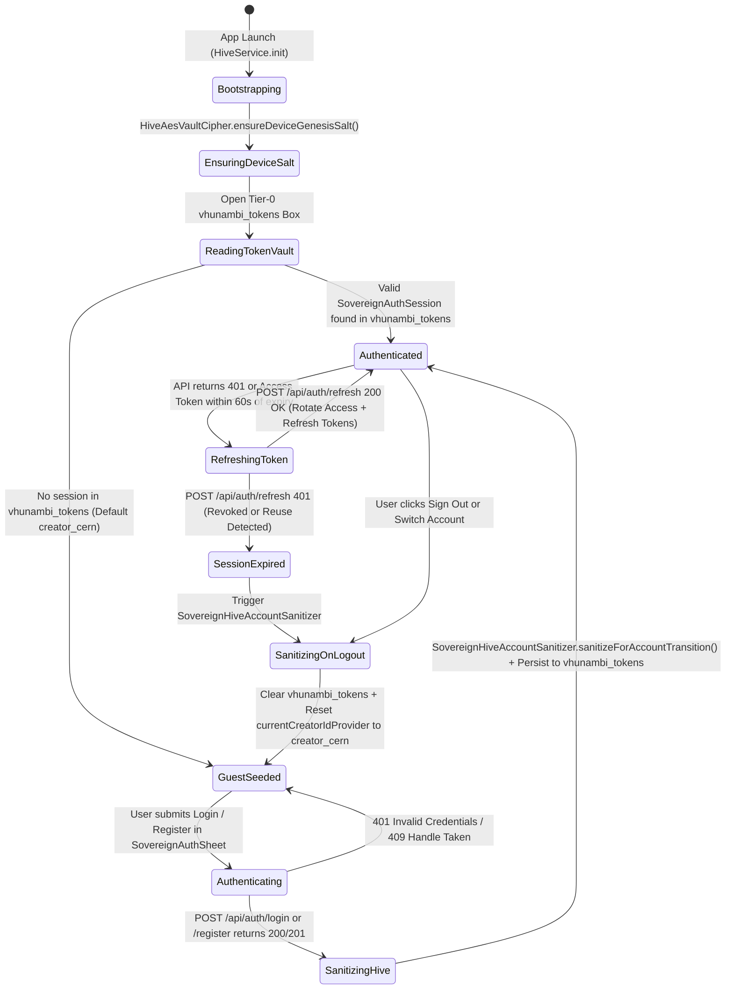
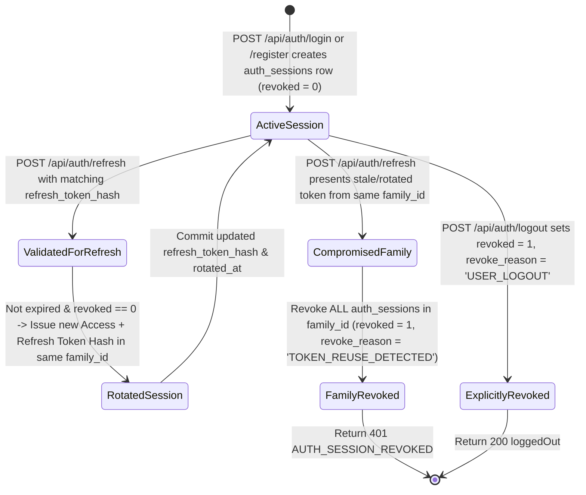
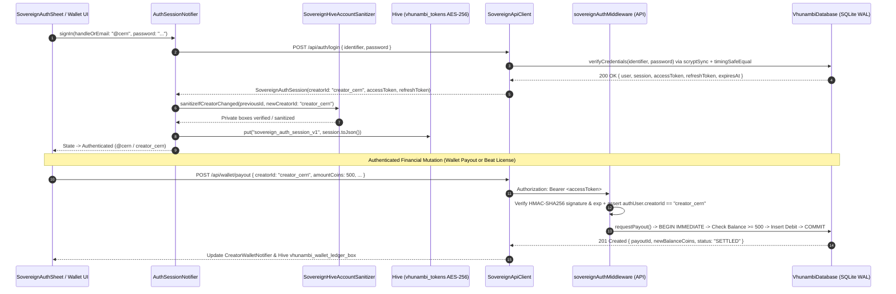

# Phase 61: Sovereign Identity, Authentication & Multi-Tenant Security Convergence — Architectural Blueprint

> **Document ID:** `VHUNAMBI-SPEC-P61-BLUEPRINT-V1`
> **Phase:** `61 — Sovereign Identity, Authentication & Multi-Tenant Security Convergence`
> **Engineering Standard:** `All-Gemini Engineering Standard (Gemini 4 Argon Browser Architect + Antigravity Gemini 3.8 Flash Draft/Executor + Antigravity Gemini 4 Argon Codebase Forensic Auditor)`
> **Status:** `HARDENED SPECIFICATION SUITE — READY FOR EXECUTION`
> **Audit Foundation:** `docs/audits/SOVEREIGN_IDENTITY_AUTH_AND_SECURITY_AUDIT.md`
> **Predecessor Phase:** `Phase 60 — Sovereign Hive Brain & Persistence Convergence`

---

## 1. Executive Overview & Visual North Star

Phase 59 (*Full-Stack Backend API Convergence*) and Phase 60 (*Sovereign Hive Brain & Persistence Convergence*) elevated Vhunambi into a 13-table Node.js SQLite cloud platform paired with a 15-box tiered Hive persistence brain. However, our forensic audit (`docs/audits/SOVEREIGN_IDENTITY_AUTH_AND_SECURITY_AUDIT.md`) revealed that the entire full-stack synchronization, wallet payout, marketplace licensing, and local Hive encryption architecture operates **without an authentication boundary, cryptographic tenant isolation, or unified client identity**:

1. **Zero Authentication & Unprotected Financial Endpoints (`F-01`, `F-02`)**: `apps/vhunambi_api` has zero `users` or `auth_sessions` tables, zero `/api/auth/*` endpoints, and zero JWT verification middleware. Any caller can invoke `POST /api/wallet/payout` or `GET /api/wallet/:creatorId` to inspect or drain another creator's ZAR balance into an arbitrary bank account (`Capitec`, `FNB`, `Standard Bank`, `Ozow`, `PayFast`). Furthermore, `VhunambiDatabase.requestPayout()` (`vhunambi_db.ts:2287–2455`) checks balance and inserts negative ledger rows without a `BEGIN IMMEDIATE` SQLite transaction lock, creating a Time-Of-Check to Time-Of-Use (TOCTOU) double-spend race condition.
2. **Free Beat License & Exclusive Buyout Exploit (`F-03`)**: In `marketplace_service.ts:424–425`, `enforceWalletBalance` defaults to `vhunambiDb.hasWalletActivity(buyerId)`. Any unseeded or fresh buyer ID (`'buyer_user'`, `'buyer_default'`, `'me'`, or a newly registered creator) has `hasWalletActivity === false`, causing `vhunambi_db.ts:2556–2641` to skip the buyer balance check and skip debiting the buyer while still crediting **85% real royalties** to the seller and permanently locking `EXCLUSIVE_RIGHTS` beats off the marketplace (`sold_exclusive = 1`).
3. **Global Multi-Tenant Delta-Sync Data Leak & Cross-Tenant Overwrites (`F-04`, `F-05`)**: `sync_mutation_log` (`vhunambi_db.ts:224–234`) lacks a `creator_id` column, and `GET /api/sync/delta` (`vhunambi_db.ts:1273–1312`) broadcasts every user's private library additions/deletions, playlists, and bank payout receipts (`bank_name`, `account_masked`, `amount_zar`, `payout_ref`) to every connected client. Meanwhile, `DELETE /api/library/:trackId` (`vhunambi_db.ts:1796–1800`) and `POST/PUT/DELETE /api/playlists` (`vhunambi_db.ts:2030–2126`) lack creator ownership checks.
4. **6-Way Client Identity Split-Brain (`F-06`)**: Across `apps/vhunambi_client`, the active user is simultaneously hardcoded as `'creator_cern'` (Library & Wallet), `'creator_makhadzi'` (Playlists & Content Studio), `'buyer_user'` / `'buyer_default'` (Marketplace Beat Checkout), `'me'` (Social Feed, Reels Comments & Profile Hive storage), and `'usr_me'` (Owner Profile fallback). Furthermore, `vhunambi_tokens` (Tier-0 encrypted Hive box) has **zero writers and zero readers**, and `HiveAesVaultCipher` (`hive_aes_vault_cipher.dart:28–39`) derives its AES-256 key from a static compile-time string without per-device CSPRNG entropy (`F-07`).

**Phase 61 (`Sovereign Identity, Authentication & Multi-Tenant Security Convergence`)** resolves all 10 audit findings across `apps/vhunambi_api` and `apps/vhunambi_client` with zero regressions across the existing 17 backend test suites and all Flutter test suites:

- **Zero-Dependency Cryptographic Auth Engine (`apps/vhunambi_api`)**: Built entirely on Node.js native `node:crypto` (`scryptSync`, `randomBytes`, `createHmac`, `createHash`, `timingSafeEqual`) and `node:sqlite` (`DatabaseSync`), adding `users` and `auth_sessions` tables, `/api/auth/register`, `/api/auth/login`, `/api/auth/refresh`, `/api/auth/logout`, `/api/auth/me`, and `/api/auth/sessions`, plus dual-gate `sovereignAuthMiddleware` that enforces strict `401`/`403` tenant isolation while preserving 100% compatibility with unauthenticated legacy test harnesses.
- **Transactional Financial Hardening & Exploit Elimination**: Wraps `requestPayout()` inside an atomic `BEGIN IMMEDIATE ... COMMIT` transaction lock with idempotency protection, eliminates the `hasWalletActivity === false` free beat license bypass on authenticated/enforced requests, scopes `sync_mutation_log` and `GET /api/sync/delta` by `creator_id`, and enforces strict row ownership on Library and Playlist mutations.
- **Unified Client Identity & Encrypted Token Vault (`apps/vhunambi_client`)**: Activates Tier-0 `vhunambi_tokens` with per-device CSPRNG entropy (`HiveAesVaultCipher.ensureDeviceGenesisSalt()`), introduces `SovereignAuthSession`, `SovereignAuthRepository`, `SovereignApiClient` (with single-flight `401` token refresh), `SovereignHiveAccountSanitizer` (preventing cross-account Hive cache contamination on logout/switch), and unifies all 6 split-brain client domains onto `currentCreatorIdProvider` (`'creator_cern'` canonical default).
- **Obsidian Tactile Identity HUD (`AccountIdentitySecurityCard` & `SovereignAuthSheet`)**: Embeds a responsive, `STD-UIUX-001`-compliant Identity & Session Security HUD in `ProfileSettingsDrawer` and a glassmorphic `SovereignAuthSheet` modal for seamless Sign In, Creator Registration, Account Switching, and Guest-to-Sovereign promotion.

---

## 2. Forensic Post-Mortem Comparison Box (Pre-Phase 61 vs. Phase 61)

```text
+==================================================================================================================+
|                    FORENSIC POST-MORTEM: PRE-PHASE 61 (AUDIT) vs. PHASE 61 (CONVERGED)                           |
+=======================================================+==========================================================+
| PRE-PHASE 61 BASELINE (VULNERABLE / SPLIT-BRAIN)      | PHASE 61 SOVEREIGN IDENTITY & SECURITY CONVERGENCE       |
+-------------------------------------------------------+----------------------------------------------------------+
| 1. Zero Auth Tables or Endpoints (F-01)               | 1. Native Node Crypto Auth & Session Engine              |
| - No `users` or `auth_sessions` tables in SQLite.     | - `users` (scrypt N=16384,r=8,p=1 + 16B random salt) &   |
| - No `/api/auth/*` routes; zero token issuance.       |   `auth_sessions` (SHA-256 refresh token family hash).   |
| - Seeded creators (`creator_cern`, `creator_makhadzi`)| - Full `/api/auth/{register,login,refresh,logout,me}`    |
|   have no login credentials or session bindings.      |   endpoints + deterministic test/dev seed credentials.   |
+-------------------------------------------------------+----------------------------------------------------------+
| 2. Unprotected Wallet IDOR & Payout TOCTOU (F-02)     | 2. Tenant-Scoped Wallet & Atomic `BEGIN IMMEDIATE` Lock  |
| - Any caller can read `GET /api/wallet/:creatorId` or | - Authenticated callers restricted to their own          |
|   drain funds via `POST /api/wallet/payout`.          |   `creatorId` (`403 TENANT_FORBIDDEN` on mismatch).      |
| - `requestPayout()` checks balance outside a SQLite   | - `requestPayout()` executes inside `BEGIN IMMEDIATE`    |
|   write lock -> concurrent double-spend race.         |   transaction lock with atomic balance re-verification.  |
+-------------------------------------------------------+----------------------------------------------------------+
| 3. Free Beat License & Buyout Exploit (F-03)          | 3. Mandatory Buyer Balance Enforcement                   |
| - `enforceWallet = req.enforceWalletBalance ??        | - Authenticated requests & `x-vhunambi-enforce-auth`     |
|   vhunambiDb.hasWalletActivity(buyerId)`.             |   always set `enforceBuyerWallet = true` and bind        |
| - New buyers (`hasWalletActivity == false`) get free  |   `buyerId = authUser.creatorId` (`403` on spoof).       |
|   licenses, mint 85% seller royalties, & lock         | - Insufficient balance strictly throws                   |
|   exclusive beats (`sold_exclusive = 1`) for 0 coins! |   `INSUFFICIENT_WALLET_BALANCE` (`402 Payment Required`).|
+-------------------------------------------------------+----------------------------------------------------------+
| 4. Global Delta-Sync Leak & Ownership Bypass (F-04/05)| 4. Tenant-Aware `sync_mutation_log` & Row Guards         |
| - `sync_mutation_log` has no `creator_id` column.     | - `sync_mutation_log` adds indexed `creator_id` column.  |
| - `GET /api/sync/delta` broadcasts all users' private | - `getDelta(sinceSeq, limit, viewerCreatorId)` filters   |
|   library deletes, playlists & bank payout receipts.  |   private mutations (`payout`, `library_track`, private  |
| - `DELETE /api/library/:id` & `POST /api/playlists`   |   `playlist`, `beat_license`) to the owning creator.     |
|   allow cross-tenant deletion and overwrites.         | - `library` & `playlist` routes enforce `403` ownership. |
+-------------------------------------------------------+----------------------------------------------------------+
| 5. 6-Way Client Identity Split-Brain (F-06)           | 5. Unified `currentCreatorIdProvider` & Canonical ID Map |
| - Library/Wallet use `'creator_cern'`.                | - `authSessionProvider` + `currentCreatorIdProvider`     |
| - Playlists/Studio use `'creator_makhadzi'`.          |   serve as single source of truth across all 6 domains.  |
| - Marketplace uses `'buyer_user'` / `'buyer_default'`.| - `canonicalizeCreatorId()` maps legacy aliases (`'me'`, |
| - Social/Reels/Profile use `'me'` / `'usr_me'`.       |   `'usr_me'`, `'buyer_user'`, `'buyer_default'`) cleanly.|
+-------------------------------------------------------+----------------------------------------------------------+
| 6. Dead `vhunambi_tokens` & Static Vault Salt (F-07/8)| 6. Active Tier-0 Token Vault & Per-Device CSPRNG Salt    |
| - `vhunambi_tokens` opened with AES-256 but 0 R/W.    | - `HiveAesVaultCipher.ensureDeviceGenesisSalt()` stores  |
| - `HiveAesVaultCipher` uses static compile-time string|   32-byte `Random.secure()` salt in `vhunambi_prefs`.    |
|   with zero per-device random entropy.                | - `SovereignAuthRepository` persists JWT + Refresh Token |
| - No `Authorization` header or Hive logout sanitizer. |   in `vhunambi_tokens`; `SovereignHiveAccountSanitizer`  |
|                                                       |   purges private boxes on account switch/logout.         |
+=======================================================+==========================================================+
```

---

## 3. Multi-Layer Decoupled System Architecture

```text
+==================================================================================================================+
|                        VHUNAMBI CLIENT (`apps/vhunambi_client` — Flutter / Riverpod)                             |
+==================================================================================================================+
|                                                                                                                  |
|  +----------------------------------------------------+   +---------------------------------------------------+  |
|  |         OBSIDIAN IDENTITY & SECURITY HUD           |   |         UNIFIED DOMAIN STATE NOTIFIERS            |  |
|  |  - `AccountIdentitySecurityCard` (Settings Drawer) |   |  - `LibraryTracksNotifier`                        |  |
|  |  - `SovereignAuthSheet` (Login / Register / Switch)|   |  - `PlaylistsNotifier` & `PlaylistRepository`     |  |
|  +-------------------------+--------------------------+   |  - `CreatorWalletNotifier`                        |  |
|                            |                              |  - `BeatCheckoutNotifier` & `licenseBeat()`       |  |
|                            v                              |  - `SocialFeedNotifier` & `ReelsCommentsNotifier` |  |
|  +----------------------------------------------------+   |  - `ContentStudioNotifier` & `ownerProfileProvider`|  |
|  |       `authSessionProvider` (`AuthSessionNotifier`)|<--+---------------------------------------------------+  |
|  |       + `currentCreatorIdProvider`                 |                                                          |
|  |       + `currentCreatorHandleProvider`             |                                                          |
|  +------------+----------------------------+----------+                                                          |
|               |                            |                                                                     |
|               v                            v                                                                     |
|  +----------------------------------+  +----------------------------------------------------------------------+  |
|  | `SovereignAuthRepository`        |  | `SovereignHiveAccountSanitizer`                                      |  |
|  | - Reads/Writes `vhunambi_tokens` |  | - Flushes/Quarantines `vhunambi_sync_outbox_box` before switch       |  |
|  |   (Tier-0 AES-256 Encrypted Box) |  | - Purges private boxes (`wallet`, `library`, `playlists`, `dna`,     |  |
|  | - Per-device CSPRNG HKDF-SHA256  |  |   `certificates`, `'profile_me'`, `edge_sync_last_seq`)              |  |
|  |   via `HiveAesVaultCipher`       |  | - Preserves public catalog (`vhunambi_tracks`, `marketplace_catalog`)|  |
|  +----------------+-----------------+  +----------------------------------------------------------------------+  |
|                   |                                                                                              |
|                   v                                                                                              |
|  +------------------------------------------------------------------------------------------------------------+  |
|  | `SovereignApiClient` (`lib/core/network/sovereign_api_client.dart`)                                        |  |
|  | - Unified base URL (`AppConstants.resolveApiRootUrl()`)                                                    |  |
|  | - Injects `Authorization: Bearer <accessToken>` & `X-Vhunambi-Creator-Id: <creatorId>`                     |  |
|  | - Single-Flight 401 Interceptor: calls `POST /api/auth/refresh`, rotates `vhunambi_tokens`, replays HTTP   |  |
|  +-----------------------------------------------------+------------------------------------------------------+  |
+========================================================|=========================================================+
                                                         | HTTPS / REST JSON
                                                         | `Authorization: Bearer <HS256_JWT>`
                                                         v
+==================================================================================================================+
|                         VHUNAMBI CLOUD API (`apps/vhunambi_api` — Hono + `node:sqlite`)                          |
+==================================================================================================================+
|                                                                                                                  |
|  +------------------------------------------------------------------------------------------------------------+  |
|  | `sovereignAuthMiddleware` (`src/middleware/auth_middleware.ts`)                                            |  |
|  | - Constant-time HMAC-SHA256 JWT verification (`timingSafeEqual`) + expiration & revocation check           |  |
|  | - Binds `c.set('authUser', { userId, creatorId, handle, role, sessionId })`                                |  |
|  | - Dual-Gate Enforcement:                                                                                   |  |
|  |   * Bearer token present -> strict JWT validation (`401` on invalid/expired) + tenant enforcement (`403`)  |  |
|  |   * `x-vhunambi-enforce-auth: true` or `VHUNAMBI_AUTH_MODE=strict` -> `401` if Bearer token missing        |  |
|  |   * Unauthenticated legacy test calls -> backwards-compatible fallback so 17 existing test suites pass     |  |
|  +--------------------+------------------------------------+--------------------------------------------------+  |
|                       |                                    |                                                     |
|                       v                                    v                                                     |
|  +----------------------------------------+  +----------------------------------------------------------------+  |
|  | `/api/auth/*` (`auth_routes.ts`)       |  | TENANT-ISOLATED DOMAIN ROUTES & ATOMIC SQLITE ENGINE           |  |
|  | - `POST /register` (scrypt + creator)  |  | - `wallet_routes.ts`: `assertCreatorAccess` + `BEGIN IMMEDIATE`|  |
|  | - `POST /login` (handle/email + pwd)   |  |   atomic payout lock in `VhunambiDatabase.requestPayout()`     |  |
|  | - `POST /refresh` (family rotation)    |  | - `marketplace_routes.ts`: `enforceBuyerWallet = true` when    |  |
|  | - `POST /logout` (session revocation)  |  |   authenticated/enforced; blocks 0-coin buyouts (`402`)        |  |
|  | - `GET  /me` & `GET /sessions`         |  | - `library_routes.ts` & `playlist_routes.ts`: row owner guards |  |
|  +----------------------------------------+  | - `sync_routes.ts`: tenant-scoped `getDelta(..., creatorId)`   |  |
|                                              +----------------------------------------------------------------+  |
+==================================================================================================================+
```

---

## 4. Identity Unification Topology & Security Domain Taxonomy

### 4.1 Client Identity Unification Map (Resolving the 6-Way Split-Brain)

| Domain / Feature | Pre-Phase 61 Hardcoded ID | Phase 61 Source of Truth | Guest / Seeded Default | Authenticated Behavior |
| :--- | :--- | :--- | :--- | :--- |
| **Library Sync (`LibraryTracksNotifier`)** | `'creator_cern'` | `ref.watch(currentCreatorIdProvider)` | `'creator_cern'` | Uses `authSession.creatorId` (`GET/POST/DELETE /api/library`) |
| **Playlists (`PlaylistsNotifier` / `PlaylistRepository`)** | `'creator_makhadzi'` | `ref.watch(currentCreatorIdProvider)` | `'creator_cern'` | Uses `authSession.creatorId` (`GET/POST/PUT/DELETE /api/playlists`) |
| **Creator Wallet (`CreatorWalletNotifier`)** | `'creator_cern'` | `ref.watch(currentCreatorIdProvider)` | `'creator_cern'` | Uses `authSession.creatorId` (`GET /api/wallet/:id`, `POST /api/wallet/payout`) |
| **Marketplace Licensing (`BeatCheckoutNotifier` / `licenseBeat`)** | `'buyer_user'` / `'buyer_default'` | `ref.watch(currentCreatorIdProvider)` | `'creator_cern'` | Uses `authSession.creatorId` as `buyerId` with mandatory wallet balance check |
| **Social Feed & Reels Comments (`SocialFeedNotifier` / `ReelsCommentsNotifier`)** | `'me'` / `'@vhunambi_user'` | `ref.watch(currentCreatorIdProvider)` + `currentCreatorHandleProvider` | `'creator_cern'` / `'@cern'` | Uses `authSession.creatorId` and `authSession.handle` |
| **Content Studio & Owner Profile (`ContentStudioNotifier` / `ownerProfileProvider`)** | `'creator_makhadzi'` / `'me'` / `'usr_me'` | `ref.watch(currentCreatorIdProvider)` | `'creator_cern'` | Uses `authSession.creatorId` and syncs active creator profile to `'profile_me'` |

### 4.2 Hive Multi-User Partition & Sanitization Taxonomy (`SovereignHiveAccountSanitizer`)

| Hive Box / Preference Key | Tier | Data Classification | Action on `signOut()` / `switchAccount()` | Rationale |
| :--- | :--- | :--- | :--- | :--- |
| `vhunambi_tokens` | Tier 0 (AES-256) | **Session Secret** | Clear `'sovereign_auth_session_v1'` (or overwrite with new account's session) | Prevents stale Bearer/Refresh tokens from remaining on disk. |
| `vhunambi_wallet_ledger_box` | Tier 0 (AES-256) | **Tenant Private (Financial)** | `box.clear()` | Prevents User B from seeing User A's coin balance, ledger transactions, or bank account masks. |
| `vhunambi_license_certificates` | Tier 0 (AES-256) | **Tenant Private (Legal)** | `box.clear()` | Prevents User B from viewing User A's purchased beat license SHA-256 certificates. |
| `vhunambi_creator_dna` | Tier 0 (AES-256) | **Tenant Private (Biometric/Telemetry)** | `box.clear()` | Prevents User A's Creator DNA vector and style affinity from polluting User B's recommendations. |
| `vhunambi_sync_outbox_box` | Tier 1 (Outbox) | **Tenant Private (Pending Mutations)** | Flush via `EdgeSyncOutboxWorker` before switch; if offline/unflushable, clear/quarantine | Prevents User A's queued mutations from being replayed under User B's Bearer token. |
| `vhunambi_library_tracks_v1` | Tier 2 (User Core) | **Tenant Private (Library)** | `box.clear()` | Prevents User A's saved tracks and offline library state from leaking into User B's library. |
| `vhunambi_playlists` | Tier 2 (User Core) | **Tenant Private (Playlists)** | `box.clear()` | Prevents User A's private playlists from appearing in User B's playlist list. |
| `vhunambi_profiles` (`'profile_me'`) | Tier 2 (User Core) | **Tenant Private (Active Profile)** | Delete key `'profile_me'` (preserve public cached creator profiles) | Resets active owner profile card while keeping public creator profile cache warm. |
| `vhunambi_prefs` (`'edge_sync_last_seq'`) | Tier 2 (User Core) | **Tenant Sync Cursor** | Reset `'edge_sync_last_seq'` to `0` | Ensures the newly authenticated creator pulls their full tenant-scoped delta stream from sequence `0`. |
| `vhunambi_prefs` (`'sovereign_device_genesis_salt_v61'`) | Tier 0 Bootstrap | **Device Hardware Entropy** | **PRESERVE (NEVER DELETE)** | Required to unlock Tier-0 encrypted boxes (`vhunambi_tokens`, `vhunambi_wallet_ledger_box`, etc.) across restarts. |
| `vhunambi_tracks`, `vhunambi_marketplace_catalog_box`, `vhunambi_sound_packs_box` | Tier 3 (Public Cache) | **Public Shared Catalog** | **PRESERVE** | Public Explore tracks, Marketplace beats, and Sound Packs are tenant-agnostic and safe to keep warm. |

---

## 5. State Machines (Auth Lifecycle & Token Rotation)

### 5.1 Client Sovereign Authentication & Session Lifecycle State Machine



### 5.2 Backend Refresh Token Family Rotation & Reuse Detection State Machine



---

## 6. Dual-Viewport Wireframes (`STD-UIUX-001` Compliant)

> [!IMPORTANT]
> In strict compliance with `STD-UIUX-001` and `app/globals.css` / `AppColors`, all UI surfaces use semantic tokens (`AppColors.obsidianCanvas`, `AppColors.obsidianSurface`, `AppColors.electricGold`, `AppColors.emeraldSuccess`, `AppColors.crimsonAlert`, `AppColors.mistWhite`, `AppColors.ashGrey`) and `PhosphorIcons` vector iconography (`PhosphorIcons.shieldCheck`, `PhosphorIcons.userSwitch`, `PhosphorIcons.key`, `PhosphorIcons.signOut`, `PhosphorIcons.lockKey`). Zero raw emojis are used anywhere in the UI.

### 6.1 `AccountIdentitySecurityCard` inside `ProfileSettingsDrawer` & `SovereignAuthSheet` (Desktop `>= 768px`)

```text
+------------------------------------------------------------------------------------------------------------------+
| [PhosphorIcons.slidersHorizontal] STUDIO & ACCOUNT SETTINGS                                   [PhosphorIcons.x]  |
+------------------------------------------------------------------------------------------------------------------+
|                                                                                                                  |
|  SOVEREIGN IDENTITY & CLOUD SECURITY                                                                             |
|  +------------------------------------------------------------------------------------------------------------+  |
|  | Key('auth_identity_security_card')                                                                         |  |
|  | +--------------------------------------------------+  +--------------------------------------------------+ |  |
|  | | [PhosphorIcons.shieldCheck] CERN                 |  |Key('auth_mode_badge_pill')                       | |  |
|  | | Key('auth_creator_handle_text') @cern            |  | [PhosphorIcons.lockKey] SOVEREIGN VERIFIED       | |  |
|  | | ID: creator_cern  |  AES-256 Vault: ACTIVE       |  | Session: ses_89f2...  |  Tenant Isolation: ON    | |  |
|  | +--------------------------------------------------+  +--------------------------------------------------+ |  |
|  |                                                                                                            |  |
|  | +----------------------------------+  +----------------------------------+  +----------------------------+ |  |
|  | | Key('auth_open_sheet_btn')       |  | Key('auth_switch_account_btn')   |  | Key('auth_sign_out_btn')   | |  |
|  | | [PhosphorIcons.key] Credentials  |  | [PhosphorIcons.userSwitch] Switch|  | [PhosphorIcons.signOut] Out| |  |
|  | +----------------------------------+  +----------------------------------+  +----------------------------+ |  |
|  +------------------------------------------------------------------------------------------------------------+  |
|                                                                                                                  |
|  +------------------------------------------------------------------------------------------------------------+  |
|  | MODAL OVERLAY: `SovereignAuthSheet` (`Key('sovereign_auth_sheet')`, max-width: 480px, centered glass card) |  |
|  | +--------------------------------------------------------------------------------------------------------+ |  |
|  | | [PhosphorIcons.shieldCheck] SOVEREIGN CREATOR IDENTITY                               [PhosphorIcons.x] | |  |
|  | | Cryptographic JWT Session & Multi-Tenant Hive Vault Binding                                            | |  |
|  | +--------------------------------------------------------------------------------------------------------+ |  |
|  | | [ Key('auth_tab_login') SIGN IN ]              [ Key('auth_tab_register') CREATE CREATOR ACCOUNT ]     | |  |
|  | +--------------------------------------------------------------------------------------------------------+ |  |
|  | | HANDLE OR EMAIL (`Key('auth_email_or_handle_input')`)                                                  | |  |
|  | | [ @cern or cern@vhunambi.co.za                                                                       ] | |  |
|  | |                                                                                                        | |  |
|  | | PASSWORD (`Key('auth_password_input')`)                                                                | |  |
|  | | [ ********************************                                           [PhosphorIcons.eyeSlash] ] | |  |
|  | |                                                                                                        | |  |
|  | | QUICK DEMO PRESETS:  [ Key('auth_preset_cern') @cern ]   [ Key('auth_preset_makhadzi') @makhadzi ]     | |  |
|  | |                                                                                                        | |  |
|  | | +----------------------------------------------------------------------------------------------------+ | |  |
|  | | | Key('auth_submit_primary_btn')     [PhosphorIcons.lockKey] AUTHENTICATE & BIND HIVE VAULT          | | |  |
|  | | +----------------------------------------------------------------------------------------------------+ | |  |
|  | | | Key('auth_continue_guest_btn')     Continue in Local Seeded Mode (@cern)                           | | |  |
|  | | +----------------------------------------------------------------------------------------------------+ | |  |
|  | +--------------------------------------------------------------------------------------------------------+ |  |
|  +------------------------------------------------------------------------------------------------------------+  |
+------------------------------------------------------------------------------------------------------------------+
```

### 6.2 Mobile Viewport (`< 768px`) — Bottom Sheet & Compact Settings Card

```text
+--------------------------------------------------+
| [PhosphorIcons.shieldCheck] SOVEREIGN IDENTITY   |
| Key('auth_identity_security_card')               |
|--------------------------------------------------|
| @cern (creator_cern)                             |
| Badge: [SOVEREIGN VERIFIED]  AES-256: ACTIVE     |
|--------------------------------------------------|
| [ Key('auth_open_sheet_btn') Manage / Sign In  ] |
| [ Key('auth_switch_account_btn') Switch ] [Out ] |
+--------------------------------------------------+

+--------------------------------------------------+
|           (Drag Handle Pill 40x4px)              |
| Key('sovereign_auth_sheet')                      |
| [PhosphorIcons.shieldCheck] SOVEREIGN IDENTITY   |
|--------------------------------------------------|
| [     SIGN IN     ] | [  CREATE ACCOUNT  ]       |
|--------------------------------------------------|
| Handle or Email (`Key('auth_email_or_handle_input')`)
| [ @cern                                        ] |
| Password (`Key('auth_password_input')`)          |
| [ ****************                             ] |
| Display Name (Register Tab Only)                 |
| [ Cern Sovereign                               ] |
|--------------------------------------------------|
| Presets: [ @cern ]  [ @makhadzi ]  [ @kabza ]    |
|--------------------------------------------------|
| [  AUTHENTICATE & BIND HIVE VAULT (Primary)    ] |
| [  Continue in Seeded Guest Mode               ] |
+--------------------------------------------------+
```

---

## 7. Mathematical & Cryptographic Formulations

### 7.1 Password Hashing via Memory-Hard `scrypt` (`node:crypto`)
To protect creator credentials against GPU/ASIC offline cracking without native C++ addon dependencies, password verification uses `node:crypto.scryptSync` with memory-hard parameters $(N = 16384, r = 8, p = 1, \text{keylen} = 64)$ and a unique 16-byte CSPRNG salt $S \leftarrow \text{CSPRNG}(16)$:

$$\text{DK} = \text{scrypt}\left(\text{UTF8}(\text{password}), S, N=2^{14}, r=8, p=1, L=64\right)$$

The stored `password_hash` string in `users.password_hash` follows the canonical self-describing format:

$$\text{Record} = \texttt{"scrypt\$16384\$8\$1\$"} \;\Vert\; \text{hex}(S) \;\Vert\; \texttt{"\$"} \;\Vert\; \text{hex}(\text{DK})$$

Verification re-computes $\text{DK}'$ with the stored salt $S$ and evaluates constant-time equality:

$$\text{Verify}(\text{password}, \text{Record}) \iff \text{timingSafeEqual}(\text{DK}, \text{DK}') = \text{true}$$

### 7.2 Stateless Access JWT (`HS256`) & Constant-Time Signature Verification
Access tokens are short-lived ($\Delta t_{\text{access}} = 3600\text{ s} = 1\text{ hour}$) RFC 7519 JSON Web Tokens signed with HMAC-SHA256 using the server secret $K_{\text{jwt}}$ (32+ bytes):

$$\text{Token} = \underbrace{\text{base64url}(\text{Header})}_{H} \;\Vert\; \texttt{"."} \;\Vert\; \underbrace{\text{base64url}(\text{Payload})}_{P} \;\Vert\; \texttt{"."} \;\Vert\; \underbrace{\text{base64url}\left(\text{HMAC-SHA256}(K_{\text{jwt}}, H \Vert \texttt{"."} \Vert P)\right)}_{\Sigma}$$

Where $\text{Payload} = \{\texttt{sub}: \text{userId}, \texttt{cid}: \text{creatorId}, \texttt{hdl}: \text{handle}, \texttt{sid}: \text{sessionId}, \texttt{role}: \text{role}, \texttt{iat}: t_0, \texttt{exp}: t_0 + 3600\}$. Signature validation converts both the expected signature $\Sigma'$ and presented signature $\Sigma$ into equal-length byte buffers and verifies:

$$\lvert \Sigma \rvert = \lvert \Sigma' \rvert \;\land\; \text{timingSafeEqual}(\Sigma, \Sigma') \;\land\; t_{\text{now}} < \text{Payload}.\texttt{exp}$$

### 7.3 Refresh Token Hashing & Family Rotation Invariant
Refresh tokens are high-entropy opaque tokens $R \leftarrow \text{base64url}(\text{CSPRNG}(32))$ ($\Delta t_{\text{refresh}} = 30\text{ days}$). The server **never** stores $R$ in plaintext; only its SHA-256 digest is persisted in `auth_sessions.refresh_token_hash`:

$$H(R) = \text{hex}\left(\text{SHA256}(\text{UTF8}(R))\right)$$

Each login creates a token family $F_{\text{id}}$. When $R_i$ is presented at `POST /api/auth/refresh`, if $H(R_i)$ matches `previous_token_hash` of a session in $F_{\text{id}}$ (indicating replay of an already-rotated token), all sessions in family $F_{\text{id}}$ are immediately revoked (`revoked = 1`).

### 7.4 Atomic Wallet Payout & Marketplace Licensing Serializability Invariant (`BEGIN IMMEDIATE`)
Under SQLite WAL concurrency, any financial debit operation $T_{\text{debit}}$ on `wallet_ledger` for creator $c$ with amount $\Delta > 0$ MUST execute inside an immediate write lock (`BEGIN IMMEDIATE ... COMMIT`) such that balance verification and ledger insertion are strictly serializable:

$$B(c, t) = \sum_{i \in \text{Ledger}(c, t)} \text{amount}_i \ge \Delta \implies \text{INSERT } (-\Delta) \implies B(c, t^+) = B(c, t) - \Delta \ge 0$$

If $B(c, t) < \Delta$, the transaction executes `ROLLBACK` and throws a deterministic domain error (`INSUFFICIENT_FUNDS` or `INSUFFICIENT_WALLET_BALANCE`).

### 7.5 Per-Device CSPRNG Key Derivation for Tier-0 Hive Encryption (`HiveAesVaultCipher`)
On first launch on a physical or desktop device, `HiveAesVaultCipher.ensureDeviceGenesisSalt()` generates a 32-byte cryptographically random device salt $S_{\text{device}} \leftarrow \text{Random.secure}(32)$ persisted in `vhunambi_prefs['sovereign_device_genesis_salt_v61']`. The 256-bit Hive AES key $K_{\text{vault}}$ is derived via two-stage HMAC-SHA256 (HKDF-Extract + HKDF-Expand):

$$\text{PRK} = \text{HMAC-SHA256}\left(S_{\text{device}}, \text{IKM}_{\text{app}}\right), \qquad K_{\text{vault}} = \text{HMAC-SHA256}\left(\text{PRK}, \texttt{"vhunambi\_hive\_tier0\_aes256\_v61"} \Vert \texttt{0x01}\right)$$

---

## 8. End-to-End Sequence Diagram



---

## 9. Verification Gates (`G-61-01` through `G-61-08`)

| Gate ID | Verification Gate Name | Target Layer | Pass Criterion |
| :--- | :--- | :--- | :--- |
| **`G-61-01`** | **Cryptographic Auth & Session Lifecycle Gate** | `apps/vhunambi_api` | `POST /api/auth/register`, `/login`, `/refresh`, `/logout`, and `GET /api/auth/me` pass 100% of unit/integration tests including `scrypt` hashing, `HS256` JWT validation, refresh token rotation, and reuse revocation. |
| **`G-61-02`** | **Cross-Tenant IDOR & `403` Isolation Gate** | `apps/vhunambi_api` | Authenticated requests for User A attempting to read/mutate User B's Wallet, Library, Playlists, or Beat Licenses deterministically return `403 FORBIDDEN` (`TENANT_FORBIDDEN`). |
| **`G-61-03`** | **Atomic Payout `BEGIN IMMEDIATE` & Zero-Coin Exploit Gate** | `apps/vhunambi_api` | `requestPayout()` runs inside `BEGIN IMMEDIATE ... COMMIT`; authenticated or enforced beat license requests with 0 coins fail with `402 INSUFFICIENT_WALLET_BALANCE` even if `hasWalletActivity(buyerId) === false`. |
| **`G-61-04`** | **Tenant-Scoped Delta-Sync Gate** | `apps/vhunambi_api` | `sync_mutation_log` records `creator_id`; `GET /api/sync/delta` filters private entity types (`payout`, `library_track`, private `playlist`, `beat_license`) so User A never receives User B's private mutations. |
| **`G-61-05`** | **100% Legacy Backend Test Suite Compatibility Gate** | `apps/vhunambi_api` | All 17 existing backend test files (`phase58`, `phase59`, `persistence_and_sync`, etc.) plus the new `phase61_sovereign_identity_auth_security.test.ts` pass `npm test` with 0 failures. |
| **`G-61-06`** | **Client 6-Way Identity Unification & Token Vault Gate** | `apps/vhunambi_client` | `currentCreatorIdProvider` unifies Library, Playlists, Wallet, Marketplace, Social/Reels, and Studio/Profile; `SovereignAuthRepository` persists sessions in encrypted `vhunambi_tokens` with per-device CSPRNG entropy. |
| **`G-61-07`** | **Multi-User Hive Sanitizer & Single-Flight Refresh Gate** | `apps/vhunambi_client` | Switching accounts or signing out clears private Hive boxes (`wallet`, `library`, `playlists`, `dna`, `certificates`, `'profile_me'`) while preserving public catalog boxes; `SovereignApiClient` transparently refreshes on `401`. |
| **`G-61-08`** | **Identity HUD & Zero-Analyzer-Issues Gate** | `apps/vhunambi_client` | `AccountIdentitySecurityCard` and `SovereignAuthSheet` pass widget tests across Desktop and Mobile viewports; `flutter analyze` reports **No issues found!**. |

