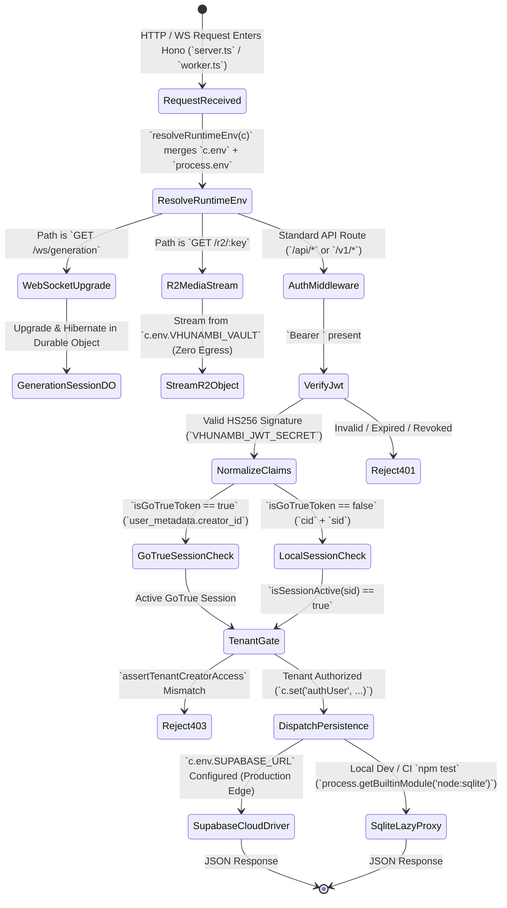
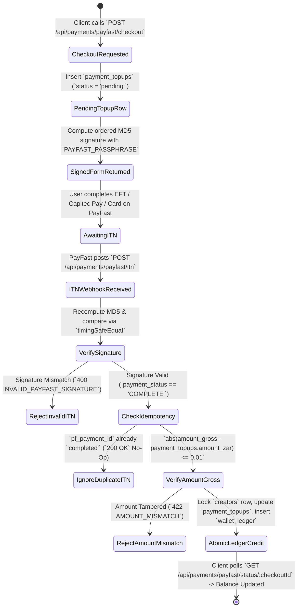
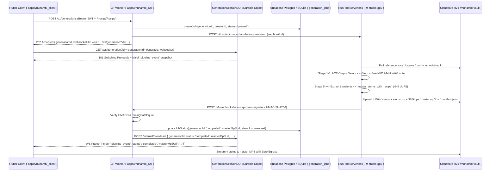

# Phase 62: Hybrid Cloud Stack Topology & Production Edge Convergence — Architectural Blueprint

> **Document ID:** `VHUNAMBI-SPEC-P62-BLUEPRINT-V1`
> **Phase:** `62 — Hybrid Cloud Stack Topology & Production Edge Convergence (Supabase + Cloudflare Workers/R2 + RunPod GPU)`
> **Engineering Standard:** `All-Gemini Engineering Standard (Gemini 4 Argon Browser Architect + Antigravity Gemini 3.8 Flash Draft/Executor + Antigravity Gemini 4 Argon Codebase Forensic Auditor)`
> **Status:** `HARDENED SPECIFICATION SUITE — READY FOR EXECUTION`
> **Audit Foundation:** `docs/audits/HYBRID_CLOUD_STACK_TOPOLOGY_PHASE62_AUDIT.md`
> **Predecessor Phase:** `Phase 61 — Sovereign Identity, Authentication & Multi-Tenant Security Convergence`

---

## 1. Executive Overview & Visual North Star

Phase 59 (*Full-Stack Backend API Convergence*), Phase 60 (*Sovereign Hive Brain & Persistence Convergence*), and Phase 61 (*Sovereign Identity, Authentication & Multi-Tenant Security Convergence*) established Vhunambi's 26-box AES-256 encrypted client persistence engine, cryptographic HS256 JWT identity layer, and 15-table SQLite backend test harness.

However, our deep forensic pre-spec audit (`docs/audits/HYBRID_CLOUD_STACK_TOPOLOGY_PHASE62_AUDIT.md`) across all **75 unique logical endpoints** (110 mounted HTTP path+method combinations across 14 route modules), [`vhunambi_db.ts`](../../../apps/vhunambi_api/src/db/vhunambi_db.ts), [`tools/zr-studio-gpu/`](../../../tools/zr-studio-gpu/handler.py), and [`apps/vhunambi_client/`](../../../apps/vhunambi_client/lib/core/constants/app_constants.dart) uncovered **23 concrete deployment blockers, monetary exploits, volatile RAM split-brain stores, and GPU container crash defects** that prevent Vhunambi from running on its target **Hybrid Cloud Production Topology (`Supabase Auth & PostgreSQL` + `Cloudflare Workers / Hyperdrive / R2 Zero-Egress Vault` + `RunPod Serverless GPU` + `PayFast ITN`)**:

1. **RunPod Serverless GPU Worker (`tools/zr-studio-gpu`) Crashes on Container Boot (`F-62-01`)**:
   - [`handler.py:33,218`](../../../tools/zr-studio-gpu/handler.py) imports a non-existent `master_stems_to_commercial_target` symbol with a flat recipe dictionary, whereas [`stem_mastering_worker.py:122`](../../../tools/zr-studio-gpu/stem_mastering_worker.py) defines `master_stems_with_recipe(stems, sr, recipe, transient_events)` expecting a nested recipe dictionary and Stage 5 `transient_events`.
   - [`Dockerfile:20-22`](../../../tools/zr-studio-gpu/Dockerfile) omits copying `stem_mastering_worker.py` and `seed_vc_worker.py`; [`requirements.txt`](../../../tools/zr-studio-gpu/requirements.txt) omits `pedalboard` and `pyloudnorm`; [`seed_vc_worker.py:82-118`](../../../tools/zr-studio-gpu/seed_vc_worker.py) returns metadata without writing `output_wav_path` to disk; and [`mmo_extractor.py:240-273`](../../../tools/zr-studio-gpu/mmo_extractor.py) ignores `master_wav_path`, leaving `master_mp3_url` (`audio_url`) permanently `null`.
2. **Cloudflare Workers Runtime Incompatibility (`F-62-02`)**:
   - `apps/vhunambi_api` has no `wrangler.toml`, no `src/worker.ts` `fetch(request, env, ctx)` entrypoint, and no Durable Object for `WS /ws/generation`.
   - [`vhunambi_db.ts:1-4,3490`](../../../apps/vhunambi_api/src/db/vhunambi_db.ts) eagerly executes static top-level `import { DatabaseSync } from 'node:sqlite'`, `fs.mkdirSync()`, and `new VhunambiDatabase()` at module load time, crashing Cloudflare's `workerd` runtime immediately.
   - [`env.ts`](../../../apps/vhunambi_api/src/config/env.ts), [`crypto_token.ts:28`](../../../apps/vhunambi_api/src/security/crypto_token.ts), and [`auth_middleware.ts:27`](../../../apps/vhunambi_api/src/middleware/auth_middleware.ts) freeze `process.env` at module import time rather than reading per-request Worker `c.env` bindings, while [`server.ts:38-39`](../../../apps/vhunambi_api/src/server.ts) calls Node-only `process.uptime()` and `process.memoryUsage()` without isolate guards.
3. **Unlimited Free ZAR/Coin Minting Exploits & Missing PayFast ITN (`F-62-03`)**:
   - `POST /api/wallet/topup` ([`wallet_routes.ts:39`](../../../apps/vhunambi_api/src/routes/wallet_routes.ts)) and `POST /api/sync/mutations` with `entityType === 'tip'` ([`vhunambi_db.ts:1316-1317`](../../../apps/vhunambi_api/src/db/vhunambi_db.ts)) blindly credit arbitrary ZAR and Coins to any authenticated account without payment gateway verification or sender balance deduction.
   - `POST /api/social/clips/:id/tip` credits the recipient in volatile RAM without debiting the sender; `POST /api/sync/mutations` (`beat_license`) trusts client-submitted `amountPaidCoins`; and zero PayFast checkout or MD5-verified Instant Transaction Notification (ITN) webhook exists.
4. **Supabase GoTrue JWT Rejection & Incomplete 6-of-19 Table Draft SQL (`F-62-04`, `F-62-05`)**:
   - [`verifyAccessJwt()`](../../../apps/vhunambi_api/src/security/crypto_token.ts) rejects Supabase GoTrue JWTs that lack top-level `cid` and `sid` claims (`401 AUTH_TOKEN_MALFORMED`), and [`sovereignAuthMiddleware`](../../../apps/vhunambi_api/src/middleware/auth_middleware.ts) checks local `public.auth_sessions`, rejecting all GoTrue sessions with `401 AUTH_SESSION_REVOKED`.
   - The initial draft Phase 62 SQL only defined 6 tables (`creators`, `users`, `auth_sessions`, `sync_mutation_log`, `wallet_ledger`, `bank_accounts`) with column drift on `creators` and `sync_mutation_log`, omitting **9 existing SQLite tables** (`explore_tracks`, `kinetic_posts`, `published_clips`, `reel_comments`, `marketplace_assets`, `beat_licenses`, `sound_signatures`, `user_library_sync`, `playlists`), **4 required tables for volatile RAM stores** (`generation_jobs`, `voice_clones`, `social_interactions`, `payment_topups`), and parent-row `SELECT ... FOR UPDATE` serialization in atomic ledger RPCs.
5. **Volatile Isolate RAM State, Split-Brain Wallets & Fragmented Client URLs (`F-62-06` .. `F-62-09`)**:
   - [`job_store.ts`](../../../apps/vhunambi_api/src/modules/jobs/job_store.ts), [`social_service.ts`](../../../apps/vhunambi_api/src/modules/social/social_service.ts), [`marketplace_service.ts`](../../../apps/vhunambi_api/src/modules/marketplace/marketplace_service.ts), and [`voice_catalog.ts`](../../../apps/vhunambi_api/src/modules/voices/voice_catalog.ts) store mutable state in process-local `Map`s that vanish across Cloudflare Worker isolates.
   - Flutter's `HttpSocialRepository` calls `GET /api/creators/:id/wallet` (volatile RAM) while SQLite `GET /api/wallet/:creatorId` is unused, and `licenseBeat()` double-credits royalties to both SQLite and volatile RAM.
   - In `apps/vhunambi_client`, **8 networking classes** ignore `--dart-define=API_BASE_URL` (hardcoding `localhost:3000`, `10.0.2.2:3000`, `api.vhunambi.com`, or stale `zaniaexplore.co.za/v1`), **4 HTTP services** omit `authDioInterceptorProvider`, and 300+ lines reference non-existent domains (`r2.vhunambi.com`, `cdn.vhunambi.com`, `cdn.vhunambi.za`).

**Phase 62 (`Hybrid Cloud Stack Topology & Production Edge Convergence`)** resolves all 23 audit findings across `supabase/`, `apps/vhunambi_api`, `tools/zr-studio-gpu`, and `apps/vhunambi_client` while preserving **100% offline test execution speed** across all 18+ backend test suites and 1,497+ Flutter tests.

---

## 2. Forensic Post-Mortem Comparison Box (Pre-Phase 62 vs. Phase 62 Converged)

```text
+==================================================================================================================+
|                  FORENSIC POST-MORTEM: PRE-PHASE 62 (AUDIT) vs. PHASE 62 (HYBRID CLOUD STACK)                    |
+=======================================================+==========================================================+
| PRE-PHASE 62 BASELINE (AUDIT DEFECTS)                 | PHASE 62 HYBRID CLOUD STACK CONVERGENCE                  |
+-------------------------------------------------------+----------------------------------------------------------+
| 1. Eager `node:sqlite` & `fs` Crash on Workers        | 1. Lazy `process.getBuiltinModule` + Dual-Driver Engine  |
| - `vhunambi_db.ts` runs static `import 'node:sqlite'` | - Loads `node:sqlite` & `node:fs` lazily on demand via   |
|   and `new VhunambiDatabase()` at module import time. |   `process.getBuiltinModule` behind a transparent Proxy. |
| - `env.ts` freezes `process.env` via `dotenv.config`. | - `SupabaseCloudDriver` bridges Workers `c.env` to       |
| - Zero `wrangler.toml` or `src/worker.ts` entrypoint. |   Supabase Postgres/GoTrue with 0 external npm packages. |
+-------------------------------------------------------+----------------------------------------------------------+
| 2. Incomplete 6-Table SQL & Volatile Isolate RAM      | 2. Complete 19-Table Schema & 0 Volatile RAM Maps        |
| - Draft SQL omitted 9 SQLite tables (`beat_licenses`, | - Full 19-table migration (`supabase/migrations/...sql`) |
|   `playlists`, `marketplace_assets`, etc.).           |   mirrored 1:1 in SQLite `VhunambiDatabase.migrate()`.   |
| - `job_store`, `social_service`, `marketplace_service`| - `generation_jobs`, `voice_clones`, `payment_topups`,   |
|   & `voice_catalog` mutate ephemeral in-memory `Map`s.|   & `social_interactions` persisted in SQLite/Postgres.  |
+-------------------------------------------------------+----------------------------------------------------------+
| 3. GoTrue JWT Rejection & `@blackcoffee` ID Drift     | 3. Unified Sovereign + GoTrue JWT Homomorphism           |
| - `verifyAccessJwt` rejects tokens without `cid`/`sid`| - `verifyAccessJwt` normalizes both Sovereign JWTs and   |
| - `auth_middleware.ts` rejects GoTrue `session_id`s   |   GoTrue claims (`user_metadata`/`app_metadata`).        |
|   absent from local `public.auth_sessions` (`401`).   | - `canonicalizeCreatorId` bridges `creator_black_coffee` |
| - `creator_black_coffee` vs `creator_blackcoffee`.    |   and `creator_blackcoffee` across API and Flutter.      |
+-------------------------------------------------------+----------------------------------------------------------+
| 4. Free ZAR/Coin Minting & Split-Brain Wallets        | 4. PayFast ITN Verification & Unified Wallet Ledger      |
| - `POST /api/wallet/topup` & `sync/mutations` (`tip`) | - Strict mode blocks unverified `/wallet/topup` (`403`). |
|   mint unlimited ZAR/Coins without payment proof.     | - `POST /api/payments/payfast/{checkout,itn}` verifies   |
| - `GET /api/creators/:id/wallet` reads RAM while      |   MD5 signature + `pf_payment_id` idempotency.           |
|   `GET /api/wallet/:id` reads SQLite; double royalty. | - `sendCulturalTipAtomic` debits sender before credit;   |
|                                                       |   both wallet routes read unified `wallet_ledger`.       |
+-------------------------------------------------------+----------------------------------------------------------+
| 5. RunPod `zr-studio-gpu` Container Boot Crash        | 5. Repaired 5-Stage GPU Pipeline & R2 Master Upload      |
| - `ImportError: master_stems_to_commercial_target`.   | - `stem_mastering_worker.py` exposes compatible adapter  |
| - `Dockerfile` omits `seed_vc` & `stem_mastering`.    |   with Stage 5 transients extracted prior to Stage 4.    |
| - `seed_vc_worker.py` never writes WAV to disk.       | - `seed_vc_worker.py` writes 24-bit PCM WAV to disk.     |
| - `mmo_extractor.py` never uploads `master.mp3` to R2.| - `mmo_extractor.py` encodes 320kbps MP3 & uploads to R2.|
+-------------------------------------------------------+----------------------------------------------------------+
| 6. Missing `WS /ws/generation` & Fragmented Client URL| 6. `GenerationSessionDO` WS & Unified `AppConstants`     |
| - No WebSocket server exists for `/ws/generation`.    | - `GenerationSessionDO` Durable Object handles WS `PING` |
| - 8 Flutter repositories hardcode `localhost:3000` or |   / `PONG` and broadcasts `/v1/webhooks/ace-step` events.|
|   `api.vhunambi.com`; 4 omit `authDioInterceptor`.    | - All Flutter services derive URLs from `API_BASE_URL`   |
| - 300+ dead `r2.vhunambi.com`/`cdn.vhunambi.com` URLs.|   & rewrite legacy CDN URLs via `normalizeCloudMediaUrl`.|
+=======================================================+==========================================================+
```

---

## 3. Multi-Layer Decoupled System Architecture

```text
+==================================================================================================================+
|                      VHUNAMBI CLIENT (`apps/vhunambi_client` — Flutter Android / iOS / Desktop)                  |
+==================================================================================================================+
|                                                                                                                  |
|  +------------------------------------------------------------------------------------------------------------+  |
|  | `AppConstants` Unified Cloud Origin & Media Resolver (`lib/core/constants/app_constants.dart`)             |  |
|  | - `resolveApiRootUrl()` -> reads `--dart-define=API_BASE_URL` (strips trailing `/v1`, fallback `:3000`)    |  |
|  | - `apiBaseUrl`          -> `${resolveApiRootUrl()}/v1`                                                     |  |
|  | - `resolveWsUrl()`      -> converts `https://` -> `wss://` (`wss://<worker>.workers.dev/ws/generation`)    |  |
|  | - `normalizeCloudMediaUrl()` -> rewrites `r2.vhunambi.com` / `cdn.vhunambi.*` / `/mock-storage/*` -> R2    |  |
|  +-------------------------+-------------------------------------------------------+--------------------------+  |
|                            |                                                       |                             |
|                            v                                                       v                             |
|  +----------------------------------------------------+  +----------------------------------------------------+  |
|  | 100% AUTH-INTERCEPTED REST REPOSITORIES (`Dio`)    |  | REALTIME WS & PAYFAST CHECKOUT SERVICES            |  |
|  | - `SovereignAuthRepository` (`/api/auth/*`)        |  | - `GenerationSocketService` (`WS /ws/generation`)  |  |
|  | - `EdgeSyncCoordinator` (`/api/v1/sync/*`)         |  | - `CreatorWalletNotifier.initiatePayFastTopUp()`   |  |
|  | - `HttpExploreRepository` (+ `authDioInterceptor`) |  |   (`/api/payments/payfast/checkout`)               |  |
|  | - `HttpLibrarySyncRepository` & `PlaylistRepo`     |  | - `CloudVideoExportService` (`/v1/vision/render`)  |  |
|  | - `HttpMarketplaceRepository` & `HttpSocialRepo`   |  | - `MasteringSessionNotifier` (+ Bearer token)      |  |
|  | - `HttpGenerationSubmissionService` (+ Interceptor)|  +----------------------------------------------------+  |
|  | - `HttpLyricsGenerationService` (+ Interceptor)    |                                                          |
|  +-------------------------+--------------------------+                                                          |
+============================|=====================================================================================+
                             | HTTPS REST + WSS (`Authorization: Bearer <Supabase_or_Sovereign_JWT>`)
                             v
+==================================================================================================================+
|               CLOUDFLARE EDGE GATEWAY (`apps/vhunambi_api` — Hono on Cloudflare Workers + R2 + DO)               |
+==================================================================================================================+
|                                                                                                                  |
|  +------------------------------------------------------------------------------------------------------------+  |
|  | `src/worker.ts` (`fetch(request, env, ctx)`) + `resolveRuntimeEnv(c)`                                      |  |
|  | - Injects `c.env` (`SUPABASE_URL`, `VHUNAMBI_JWT_SECRET`, `VHUNAMBI_VAULT`, `HYPERDRIVE`, `GENERATION_DO`) |  |
|  | - Routes `GET /ws/generation` -> `GenerationSessionDO` Durable Object (WebSocket `PING`/`PONG` + Push)     |  |
|  | - Routes `GET /r2/:key{.*}`   -> Zero-Egress R2 Object Stream (`env.VHUNAMBI_VAULT.get`) with Range support|  |
|  +-------------------------+-------------------------------------------------------+--------------------------+  |
|                            |                                                       |                             |
|                            v                                                       v                             |
|  +----------------------------------------------------+  +----------------------------------------------------+  |
|  | `sovereignAuthMiddleware` + GoTrue Claim Bridge    |  | EDGE AI ORCHESTRATION & WEBHOOK RECEIVERS          |  |
|  | - Validates HS256 JWT (`cid ?? user_metadata`)     |  | - `POST /v1/generations` -> `generation_jobs` +    |  |
|  | - Proxies `/api/auth/*` to GoTrue when configured  |  |   RunPod `/v2/<id>/run`                            |  |
|  | - Enforces `assertTenantCreatorAccess` across      |  | - `POST /v1/webhooks/ace-step` -> `timingSafeEqual`|  |
|  |   Wallet, Library, Playlists, Marketplace, Social, |  |   + DB update + `GenerationSessionDO` broadcast    |  |
|  |   Explore Writes, Sync, Generations, Voices, Lyrics|  | - `POST /api/payments/payfast/{checkout,itn}`      |  |
|  +-------------------------+--------------------------+  +-------------------------+--------------------------+  |
+============================|=======================================================|=============================+
                             |                                                       |
         +-------------------+-------------------+                                   | HTTPS + S3 Presigned URLs
         | 1. Auth & 19-Table ACID Persistence   | 2. Zero-Egress Media              v
         v                                       v                        +----------------------------------------+
+------------------------------------+  +------------------------------+  | RUNPOD SERVERLESS (`zr-studio-gpu`)    |
| SUPABASE (AUTH & POSTGRESQL)       |  | CLOUDFLARE R2 (`vhunambi-    |  | - `handler.py`: 5-stage synthesis      |
| - GoTrue Auth + Custom Token Hook  |  |   vault`)                    |  | - `seed_vc_worker.py`: 24-bit WAV write|
| - 19 ACID Tables + RLS Policies    |  | - 4-Stem WAVs & 320kbps MP3  |  | - `stem_mastering_worker.py`: -9.5 LUFS|
| - 4 Atomic `FOR UPDATE` RPCs:      |  | - `.vhusig` Voice Signatures |  | - `mmo_extractor.py`: FFmpeg MP3 encode|
|   * `execute_atomic_payout`        |  | - Beat ZIPs & Cover Art      |  |   + Boto3 upload to `vhunambi-vault`   |
|   * `record_beat_license_atomic`   |  | - AWS4 S3 Presigned PUT/GET  |  |   + HMAC webhook callback to Worker    |
|   * `send_cultural_tip_atomic`     |  +------------------------------+  +----------------------------------------+
|   * `apply_sync_mutations_batch`   |
+------------------------------------+
```

---

## 4. Hybrid Cloud Endpoint Topology & 19-Table Persistence Taxonomy

### 4.1 Complete 19-Table Persistence Taxonomy (`SQLite` $\leftrightarrow$ `Supabase PostgreSQL`)

| # | Table Name | Primary Key | Tenant Owner Column | Replaces Volatile RAM? | Atomic RPC / Security Gate |
| :-: | :--- | :--- | :--- | :---: | :--- |
| 1 | `creators` | `id TEXT` | `id` | No | Locked via `SELECT ... FOR UPDATE` in all financial RPCs |
| 2 | `users` | `user_id TEXT` | `creator_id` | No | Linked to `auth.users(id)` via `auth_uid UUID UNIQUE` |
| 3 | `auth_sessions` | `session_id TEXT` | `creator_id` | No | Family-wide refresh token reuse revocation |
| 4 | `sync_mutation_log` | `seq BIGSERIAL` | `creator_id` | No | Indexed `(creator_id, seq)` SQL delta visibility filter |
| 5 | `wallet_ledger` | `id TEXT` | `creator_id` | Yes (`creatorWallets`) | Append-only ledger; write-locked to atomic RPCs & verified ITN |
| 6 | `bank_accounts` | `id TEXT` | `creator_id` | No | Deterministic key `'bank_' \|\| creator_id \|\| '_' \|\| bank_code` |
| 7 | `explore_tracks` | `id TEXT` | `creator_id` | No | Public read; `sovereignAuthMiddleware` required for `POST` |
| 8 | `kinetic_posts` | `id TEXT` | `creator_id` | No | Public read; auth required for `cosign` and `repost` |
| 9 | `published_clips` | `id TEXT` | `creator_id` | Yes (`clips` Map) | Persists Reels feed, DNA JSON, and remix lineage (`remixed_from_clip_id`) |
| 10 | `reel_comments` | `id TEXT` | `user_id` | Yes (`commentsByClip`) | Persists comments & gift celebration badges |
| 11 | `marketplace_assets` | `id TEXT` | `producer_id` | Yes (`marketplaceBeats`) | Enforces `producer_id === authUser.creatorId` on `POST`/`DELETE` |
| 12 | `beat_licenses` | `certificate_id TEXT` | `buyer_id` | Yes (`userLicenses`) | Minted exclusively via `record_beat_license_atomic` (`FOR UPDATE`) |
| 13 | `sound_signatures` | `id TEXT` | `creator_id` | Yes (`soundSignatureStore`) | Uses real AWS4 `getPresignedPutUrl` & R2 object cleanup on `DELETE` |
| 14 | `user_library_sync` | `(id, creator_id)` | `creator_id` | No | LWW timestamp resolution + monotonic `play_count` |
| 15 | `playlists` | `id TEXT` | `creator_id` | No | Row owner check + Worker share link `/p/:shareCode` |
| 16 | `generation_jobs` | `generation_id TEXT` | `creator_id` | Yes (`job_store.ts`) | Tracks RunPod `provider_task_id`, stems, MMO manifest, and master URL |
| 17 | `voice_clones` | `voice_id TEXT` | `creator_id` | Yes (`clonedVoiceStore`) | Persists zero-shot vocal profiles & R2 reference keys |
| 18 | `social_interactions` | `(interaction_type, target_id, actor_creator_id)` | `actor_creator_id` | Yes (`following`, `isLikedByMe`) | Per-user `clip_like`, `comment_like`, and `creator_follow` edges |
| 19 | `payment_topups` | `checkout_id TEXT` | `creator_id` | Yes (New Ledger) | PayFast/Ozow checkout state + `provider_payment_id UNIQUE` idempotency |

### 4.2 Route-Module Cloud & Security Convergence Matrix

| Route Module | Mounted Prefix(es) | Unique Endpoints | Phase 62 Persistence Target | Phase 62 Auth & Cloud Hardening |
| :--- | :--- | :---: | :--- | :--- |
| `server.ts` + `worker.ts` | `/health`, `/v1/health`, `/r2/*`, `/ws/generation` | 4 | R2 `VHUNAMBI_VAULT` + `GenerationSessionDO` | Isolate-safe `/health`; zero-egress `/r2/:key{.*}` stream; Durable Object WS server |
| `auth_routes.ts` | `/v1/auth`, `/api/auth`, `/api/v1/auth` | 6 | `users`, `creators`, `auth_sessions` / GoTrue | GoTrue REST proxy when `SUPABASE_URL` set; `@handle` $\to$ email lookup; canonical IDs |
| `explore_routes.ts` | `/api/explore`, `/api/v1/explore` | 7 | `explore_tracks`, `kinetic_posts` | Public `GET` catalog; `sovereignAuthMiddleware` on `POST /tracks`, `cosign`, `repost` |
| `library_routes.ts` | `/api/library`, `/api/v1/library` | 4 | `user_library_sync`, `sync_mutation_log` | Tenant-isolated LWW sync; R2 media URL normalization |
| `playlist_routes.ts` | `/api/playlists`, `/api/v1/playlists` | 6 | `playlists`, `sync_mutation_log` | Owner guards + Worker-relative share URL (`${origin}/p/${shareCode}`) |
| `wallet_routes.ts` | `/api/wallet`, `/api/v1/wallet` | 4 | `wallet_ledger`, `bank_accounts` | Strict mode blocks unverified `/wallet/topup` (`403`); atomic `execute_atomic_payout` |
| `payment_routes.ts` *(NEW)* | `/api/payments`, `/api/v1/payments` | 3 | `payment_topups`, `wallet_ledger` | `POST /payfast/checkout`, `POST /payfast/itn` (MD5 verify), `GET /payfast/status/:id` |
| `sync_routes.ts` | `/api/sync`, `/api/v1/sync` | 2 | `sync_mutation_log` + domain tables | `tip` mutation debits sender (`402` on low balance); `beat_license` uses catalog price |
| `marketplace_routes.ts` | `/api/marketplace`, `/api/v1/marketplace` | 8 | `marketplace_assets`, `beat_licenses` | DB-backed beats; owner check on `POST`/`DELETE /beats`; no double royalty credit |
| `social_routes.ts` | `/api`, `/api/v1` | 12 | `published_clips`, `reel_comments`, `social_interactions`, `wallet_ledger` | Deduplicate `remixes` (5$\to$1); unify `/creators/:id/wallet`; atomic `sendCulturalTipAtomic` |
| `generation_routes.ts` | `/v1/generations` | 5 | `generation_jobs` + RunPod + R2 | DB-backed jobs; dynamic `websocketUrl`; auth middleware; `waitUntil` mock fallback |
| `webhook_routes.ts` | `/v1/webhooks/ace-step` | 1 | `generation_jobs` + `GenerationSessionDO` | `timingSafeEqual` HMAC verification; updates DB; broadcasts `pipeline_event` to DO WS |
| `lyrics_routes.ts` | `/v1/lyrics` | 3 | Pure TS + Anthropic Claude / xAI Grok | Auth middleware; live `GROK_API_KEY` (`api.x.ai`) branch; LLM-backed `/refine` |
| `vision_routes.ts` | `/v1/vision` | 4 | `generation_jobs` + ComfyUI + R2 | Adds `GET /v1/vision/:id` & `GET /v1/vision/render-video/:id` status polling |
| `voice_routes.ts` | `/v1/voices` | 9 | `voice_clones`, `sound_signatures` + R2 | Real `getPresignedPutUrl` on `/signatures`; R2 object delete on `DELETE` |
| `melody_routes.ts` | `/v1/melodies` | 3 | R2 `VHUNAMBI_VAULT` + static presets | Uploads rendered reference WAV to R2; rewrites `cdn.vhunambi.com` sound pack URLs |

---

## 5. Hybrid Cloud State Machines

### 5.1 Dual-Driver Auth & Persistence Routing State Machine



### 5.2 PayFast Checkout & Verified ITN Settlement State Machine



---

## 6. Dual-Viewport Cloud Checkout & Pipeline HUD Wireframes

### 6.1 Desktop / Tablet Viewport ($\ge 600\text{dp}$) — PayFast Sovereign Coin Top-Up & Live Edge Telemetry

```text
+----------------------------------------------------------------------------------------------------------+
|  VHUNAMBI SOVEREIGN WALLET & CLOUD VAULT TOP-UP                     [EDGE: WORKERS + SUPABASE]   [X]     |
+----------------------------------------------------------------------------------------------------------+
|  ACTIVE CREATOR: @cern (creator_cern)          CURRENT BALANCE: R 280.00  |  1,420 VHUNAMBI COINS        |
+------------------------------------------------------------------+---------------------------------------+
|  SELECT ZAR COIN PACK (SOUTH AFRICAN INSTANT CHECKOUT)           |  PAYFAST / CAPITEC PAY GATEWAY        |
|  +------------------+ +------------------+ +------------------+  |  Checkout ID: chk_pf_20261110_89a1    |
|  | STARTER CRATE    | | PRODUCER VAULT   | | STUDIO MOGUL     |  |  Merchant:    Vhunambi ZA (10000100)  |
|  | 500 Coins        | | 1,500 Coins      | | 5,000 Coins      |  |  Amount Due:  R 150.00 ZAR            |
|  | R 55.00 ZAR      | | R 150.00 ZAR [*] | | R 450.00 ZAR     |  |  Signature:   MD5 Verified (Locked)   |
|  +------------------+ +------------------+ +------------------+  |                                       |
|                                                                  |  [ PROCEED TO PAYFAST CHECKOUT -> ]   |
|  RECENT LEDGER TRANSACTIONS (`wallet_ledger` ACID)               |  [ VERIFY SETTLEMENT STATUS       ]   |
|  - wtx_lic_901 | Beat License Royalty (85%)    | +425 Coins      |                                       |
|  - wtx_tip_442 | Cultural Tip Sent (@makhadzi) | -50 Coins       |  Status: Awaiting ITN Confirmation    |
+------------------------------------------------------------------+---------------------------------------+
```

### 6.2 Mobile Portrait Viewport ($< 600\text{dp}$) — Studio Generation Durable Object WebSocket HUD

```text
+--------------------------------------------------+
|  VHUNAMBI STUDIO PIPELINE     [WSS: CONNECTED]   |
+--------------------------------------------------+
|  Job ID: gen_amapiano_2026_91f                   |
|  Worker: zr-studio-gpu (RunPod L40S -> R2 Vault) |
|                                                  |
|  [=====================>        ] 72%            |
|  Stage 4/5: Stem Mastering (-9.5 LUFS Target)    |
|                                                  |
|  4-STEM ZERO-EGRESS R2 VAULT STATUS:             |
|  [x] drums.wav   (r2://vhunambi-vault/audio/...) |
|  [x] bass.wav    (Log-Drum Sub Boost +2.5 dB)    |
|  [x] vocals.wav  (Seed-VC 24-bit PCM Converted)  |
|  [.] other.wav   (Extracting Transients...)      |
|                                                  |
|  [ CANCEL ]            [ OPEN IN 4-STEM MIXER ]  |
+--------------------------------------------------+
```

---

## 7. Mathematical, Cryptographic & Concurrency Formulations

### 7.1 PayFast ITN Ordered MD5 Signature Verification (`REQ-P62-PAY-02`)

Given an ordered sequence of non-empty key-value pairs $\mathcal{P} = \{(k_1, v_1), (k_2, v_2), \dots, (k_n, v_n)\}$ (excluding `signature`) and an optional merchant passphrase $S_{\text{pass}}$, the canonical URL-encoded serialization string $\Sigma(\mathcal{P}, S_{\text{pass}})$ is defined as:

$$\Sigma(\mathcal{P}, S_{\text{pass}}) = \bigoplus_{i=1}^{n} \left( k_i \mathbin{\Vert} \text{"="} \mathbin{\Vert} \operatorname{urlEncode}(v_i) \mathbin{\Vert} \text{"\&"} \right) \mathbin{\Vert} \begin{cases} \text{"passphrase="} \mathbin{\Vert} \operatorname{urlEncode}(S_{\text{pass}}) & \text{if } |S_{\text{pass}}| > 0 \\ \varnothing & \text{otherwise} \end{cases}$$

where $\operatorname{urlEncode}(x)$ encodes RFC-3986 reserved characters in uppercase hexadecimal with spaces replaced by `'+'`. The expected signature digest is:

$$D_{\text{expected}} = \operatorname{hex}\!\left(\operatorname{MD5}\!\left(\Sigma(\mathcal{P}, S_{\text{pass}})\right)\right)$$

Verification succeeds if and only if constant-time byte comparison holds:

$$\operatorname{timingSafeEqual}\!\left(\operatorname{Buffer}(D_{\text{expected}}),\ \operatorname{Buffer}(D_{\text{received}})\right) = \text{true} \quad \land \quad \left| A_{\text{gross}} - A_{\text{checkout}} \right| \le 0.01\text{ ZAR}$$

### 7.2 PostgreSQL Parent-Row `FOR UPDATE` Serialization Invariant (`REQ-P62-DB-03`)

Because `public.wallet_ledger` is an append-only ledger where a creator's balance at time $t$ is the aggregate sum:

$$B_{\text{coins}}(c, t) = \sum_{r \in \text{ledger}(c, t)} r.\text{amount\_coins}, \qquad B_{\text{zar}}(c, t) = \sum_{r \in \text{ledger}(c, t)} r.\text{amount\_zar}$$

a naive `SELECT SUM(amount_coins) FROM wallet_ledger WHERE creator_id = c` under PostgreSQL `READ COMMITTED` isolation allows two concurrent Cloudflare Worker isolates $T_1, T_2$ to read the same snapshot balance $B_0$ and insert two debit rows $d_1, d_2$ such that $B_0 - d_1 - d_2 < 0$.

To guarantee strict serializability across all concurrent payouts, beat license purchases, and cultural tips for creator $c$, every debit RPC (`execute_atomic_payout`, `record_beat_license_atomic`, `send_cultural_tip_atomic`) **MUST** first acquire a row-level exclusive lock on the parent `public.creators` tuple:

$$\operatorname{LOCK}(c) \equiv \texttt{SELECT id FROM public.creators WHERE id = } c \texttt{ FOR UPDATE;}$$

Because every creator has exactly one row in `public.creators`, transaction $T_2$ blocks on $\operatorname{LOCK}(c)$ until $T_1$ commits its `INSERT INTO public.wallet_ledger`, ensuring $T_2$'s subsequent `SUM(amount_coins)` includes $T_1$'s debit and deterministically rejects any overdraft with `INSUFFICIENT_FUNDS`.

### 7.3 GoTrue-to-Sovereign JWT Claim Homomorphism (`REQ-P62-AUTH-01`)

Let $\mathcal{C}_{\text{raw}}$ be a verified HS256 JWT payload signed with `VHUNAMBI_JWT_SECRET`. The claim normalization morphism $\Phi(\mathcal{C}_{\text{raw}}) \to \text{SovereignJwtClaims}$ is defined as:

$$\Phi(\mathcal{C}_{\text{raw}}) = \begin{cases}
\text{sub} &= \mathcal{C}_{\text{raw}}.\text{sub} \\
\text{cid} &= \operatorname{canonicalizeCreatorId}\!\left(\mathcal{C}_{\text{raw}}.\text{cid} \ ??\ \mathcal{C}_{\text{raw}}.\text{app\_metadata}.\text{creator\_id} \ ??\ \mathcal{C}_{\text{raw}}.\text{user\_metadata}.\text{creator\_id}\right) \\
\text{hdl} &= \operatorname{normalizeHandle}\!\left(\mathcal{C}_{\text{raw}}.\text{hdl} \ ??\ \mathcal{C}_{\text{raw}}.\text{app\_metadata}.\text{handle} \ ??\ \mathcal{C}_{\text{raw}}.\text{user\_metadata}.\text{handle}\right) \\
\text{sid} &= \mathcal{C}_{\text{raw}}.\text{sid} \ ??\ \mathcal{C}_{\text{raw}}.\text{session\_id} \ ??\ (\text{"gotrue\_"} \mathbin{\Vert} \mathcal{C}_{\text{raw}}.\text{sub}) \\
\text{role} &= \mathcal{C}_{\text{raw}}.\text{app\_metadata}.\text{vhunambi\_role} \ ??\ (\mathcal{C}_{\text{raw}}.\text{role} = \text{"authenticated"} \ ?\ \text{"creator"} : \mathcal{C}_{\text{raw}}.\text{role})
\end{cases}$$

---

## 8. End-to-End Hybrid Cloud Synthesis & Webhook Sequence



---

## 9. Verification Gates (`G-62-01` through `G-62-08`)

| Gate ID | Gate Name | Verification Target | Pass Condition |
| :--- | :--- | :--- | :--- |
| **`G-62-01`** | **19-Table Schema & Lazy SQLite Proxy Gate** | `supabase/migrations/20261110000001_phase62_hybrid_cloud_schema.sql` & `vhunambi_db.ts` | All 19 tables & 4 atomic operations exist in both SQL migration and `VhunambiDatabase`; `vhunambi_db.ts` uses `process.getBuiltinModule` with zero eager import crash. |
| **`G-62-02`** | **Cloudflare Workers & Durable Object WS Gate** | `wrangler.toml`, `src/worker.ts`, `env.ts` | `worker.fetch(request, env, ctx)` handles REST routes, `/r2/:key` streaming, and `GenerationSessionDO` WebSocket `PING`/`PONG` + `pipeline_event` broadcasts. |
| **`G-62-03`** | **GoTrue JWT & `@handle` Auth Convergence Gate** | `crypto_token.ts`, `auth_middleware.ts`, `auth_routes.ts` | `verifyAccessJwt` validates both Sovereign and GoTrue JWT payloads; `@blackcoffee` resolves identically across `creator_black_coffee` / `creator_blackcoffee`. |
| **`G-62-04`** | **Zero Volatile RAM & Unified Wallet Gate** | `job_store.ts`, `marketplace_service.ts`, `social_service.ts`, `voice_catalog.ts` | 100% of jobs, beats, clips, comments, likes, follows, clones, and signatures persist in DB; `/creators/:id/wallet` & `/wallet/:id` return identical ledger snapshots. |
| **`G-62-05`** | **PayFast ITN & Monetary Exploit Closure Gate** | `payment_routes.ts`, `wallet_routes.ts`, `sync_routes.ts`, `social_routes.ts` | Unverified `/wallet/topup` rejected in strict mode (`403`); `sync/mutations` (`tip`) and `/clips/:id/tip` debit sender (`402` if low balance); PayFast ITN verifies MD5 & credits once. |
| **`G-62-06`** | **RunPod `zr-studio-gpu` & Vision/Grok Repair Gate** | `tools/zr-studio-gpu/*`, `vision_routes.ts`, `voice_routes.ts`, `llm_handler.ts` | `handler.py` imports `master_stems_to_commercial_target` cleanly; `seed_vc_worker.py` writes WAV; `mmo_extractor.py` uploads `master.mp3`; `/v1/vision/:id` and `/v1/voices/signatures` presign work. |
| **`G-62-07`** | **Flutter Unified Cloud Origin & Interceptor Gate** | `app_constants.dart` + 10 networking services/providers | `resolveApiRootUrl()`, `resolveWsUrl()`, and `normalizeCloudMediaUrl()` unify all 8 hardcoded services; `Explore`, `Generation`, `Lyrics`, and `Mastering` attach auth headers. |
| **`G-62-08`** | **Full-Stack Zero-Regression Test Gate** | `apps/vhunambi_api` (`19` suites) & `apps/vhunambi_client` (`flutter analyze` + tests) | All 18 existing backend suites + `phase62_hybrid_cloud_topology.test.ts` pass; `flutter analyze` reports 0 issues; `phase62_hybrid_cloud_client_test.dart` passes 100%. |

