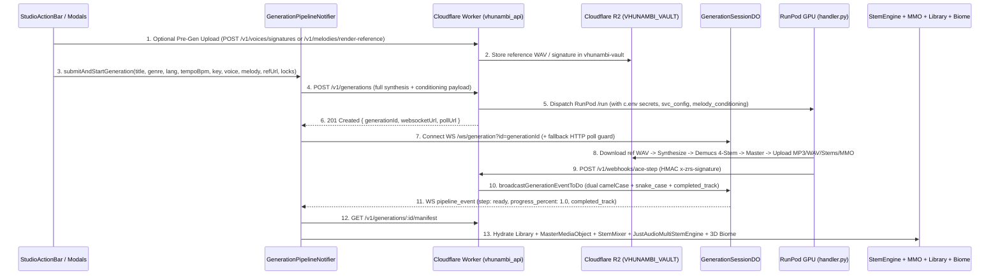
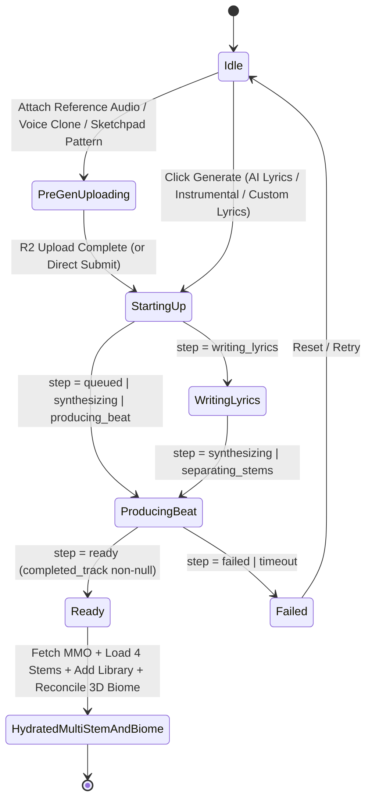

# Phase 63: End-to-End Studio-to-Cloud Execution Loop, `workerd` Persistence Bridge, PayFast & Vision Live Wiring, and 5-Pillar Preflight Cockpit — Architectural Blueprint

> **Document ID:** `VHUNAMBI-SPEC-P63-BLUEPRINT-V1`
> **Phase:** `63 — End-to-End Studio-to-Cloud Execution Loop, workerd Persistence Bridge, PayFast & Vision Live Wiring, and 5-Pillar Preflight Cockpit`
> **Engineering Standard:** `All-Gemini Engineering Standard (Gemini 4 Argon Browser Architect + Antigravity Gemini 3.8 Flash Draft/Executor + Antigravity Gemini 4 Argon Codebase Forensic Auditor)`
> **Status:** `HARDENED SPECIFICATION SUITE — READY FOR STAGE 4 EXECUTION`
> **Audit Foundation:** `docs/audits/PHASE63_E2E_CLOUD_PIPELINE_AND_PREFLIGHT_AUDIT.md`
> **Predecessor Phase:** `Phase 62 — Hybrid Cloud Stack Topology & Production Edge Convergence`

---

## 1. Executive Overview & Visual North Star

Phase 62 (`Hybrid Cloud Stack Topology & Production Edge Convergence`) established the 19-table Supabase PostgreSQL migration (`20261110000001_phase62_hybrid_cloud_schema.sql`), the Cloudflare Worker entrypoint (`src/worker.ts`), the `GenerationSessionDO` Durable Object WebSocket coordinator, the PayFast MD5 signature verifier (`payment_routes.ts`), and the RunPod GPU container boot repairs (`tools/zr-studio-gpu`).

However, our pre-dashboard static forensic audit ([`PHASE63_E2E_CLOUD_PIPELINE_AND_PREFLIGHT_AUDIT.md`](../../audits/PHASE63_E2E_CLOUD_PIPELINE_AND_PREFLIGHT_AUDIT.md)) across the entire Studio-to-Cloud execution loop uncovered **10 concrete end-to-end execution breakpoints across 5 operational pillars** that would cause `workerd` isolate crashes, silent Studio UI stalls, WebSocket decoding failures, zero-balance wallet responses, and unpersisted media URLs the moment live cloud credentials are pasted:

1. **Breakpoint 1 — Cloudflare `workerd` Unguarded SQLite Crashes (`Pillar 1`)**:
   - Seven route modules (`explore_routes.ts`, `library_routes.ts`, `playlist_routes.ts`, `sync_routes.ts`, `wallet_routes.ts`, `marketplace_routes.ts`, `social_routes.ts`) invoke `vhunambiDb.*` directly without checking `isNodeSqliteAvailable()`. On Cloudflare Workers (`workerd`), `process.getBuiltinModule('node:sqlite')` is `undefined`, causing `VhunambiDatabase` to throw `SQLITE_UNAVAILABLE_IN_EDGE_ISOLATE` (`HTTP 500`).
   - Meanwhile, six guarded modules (`job_store.ts`, `payment_routes.ts`, `vision_routes.ts`, `voice_catalog.ts`, `marketplace_service.ts`, `social_service.ts`) plus `auth_routes.ts` and `auth_middleware.ts` degrade into volatile isolate RAM `Map`s, skip buyer wallet debits/royalties, skip `POST /auth/logout` session revocation, or return hardcoded `0` wallet balances.
2. **Breakpoint 2 — SQLite $\leftrightarrow$ PostgreSQL Column & Sign Convention Drift (`Pillar 1`)**:
   - Six tables (`wallet_ledger`, `beat_licenses`, `user_library_sync`, `sync_mutation_log`, `playlists`, `marketplace_assets`) have divergent column names, primary keys, timestamp types (`TEXT` vs `BIGINT`), or opposite payout sign conventions (positive `'payout'` in SQLite vs negative `-ABS(amount_zar)` `'payout_withdrawal'` in PostgreSQL).
   - `SupabaseCloudDriver` (`supabase_cloud_driver.ts`) is only imported in `auth_routes.ts` and lacks `insertRow`, `patchRows`, `deleteRows`, and domain normalizers.
3. **Breakpoint 3 — Missing `PUT /r2/:key` Proxy, Per-Request `c.env` Loss & Unwrapped Mock Timers (`Pillar 1`)**:
   - `server.ts` mounts `GET /r2/:key{.*}` without a corresponding `PUT /r2/:key{.*}` handler, causing presigned fallback PUT URLs (`${R2_PUBLIC_BASE_URL}/${key}?presigned=put`) to fail with `404`.
   - `runpod_adapter.ts` and `comfyui_adapter.ts` read module-level `env` instead of per-request `c.env`, losing Worker secrets in production, and `checkRunPodJobStatus` drops `stem_urls` and `manifest_url`.
   - `mock_worker.ts` runs bare `setTimeout` chains without `c.executionCtx?.waitUntil(...)` and never broadcasts progress/completion frames to `GenerationSessionDO`.
4. **Breakpoint 4 — Instrumental & Custom-Lyrics Studio Generation Stall (`Pillar 2`)**:
   - In `StudioActionBar._handleGenerate` (`studio_action_bar.dart:186-189`), when `formState.isInstrumental == true` or `formState.lyricsMode != LyricsMode.aiWrite`, the handler calls `formNotifier.triggerGeneration()` and returns immediately **without calling `generationProgressProvider.notifier.submitAndStartGeneration(...)`**, leaving `GenerationPipelineCard` stuck on `_PipelineSkeletonLoader` indefinitely.
   - `LyricsReviewModal` and `SongDnaNodeTreeModal` also omit `tempoBpm`, `musicalKey`, vocal identity, melody conditioning, reference audio, and stem locks when calling `submitAndStartGeneration(...)`.
5. **Breakpoint 5 — Production WebSocket Disabled & `GenerationSessionDO` $\leftrightarrow$ `PipelineSocketEvent` Dialect Clash (`Pillar 2`)**:
   - `GenerationPipelineNotifier.submitAndStartGeneration` (`generation_pipeline_providers.dart:94`) checks `if (socket is! GenerationSocketService)`, explicitly disabling real WebSocket connections in production!
   - `GenerationSessionDO` emits camelCase payloads (`generationId`, `progressPct`, `step: 'queued' | 'synthesizing' | 'separating_stems' | 'ready'`), whereas `PipelineSocketEvent.fromJson` reads snake_case (`generation_id`, `progress_percent`, `completed_track`) and its `stepFromString` maps `'queued'`, `'synthesizing'`, and `'separating_stems'` to `PipelineStep.failed`!
6. **Breakpoint 6 — Unwired Pre-Gen R2 Uploads & RunPod Conditioning (`Pillar 2`)**:
   - `ReferenceAudioDropzone`, `SoundSignatureRepository`, `VocalIdentityNotifier`, and `MelodySketchpadNotifier` only mutate local state/Hive without uploading reference audio to R2 or calling `/v1/voices/*` and `/v1/melodies/render-reference`.
   - Backend `POST /v1/melodies/render-reference` returns a URL without writing synthesized WAV bytes to R2, and RunPod `handler.py` / `seed_vc_worker.py` ignore `melody_conditioning` and R2 vocal reference downloads.
7. **Breakpoint 7 — Broken Post-Completion Hydration Loop (`_onGenerationComplete`, `Pillar 2`)**:
   - When synthesis completes, `_onGenerationComplete` only plays the single stereo MP3 URL; it never fetches `GET /v1/generations/:id/manifest`, never loads the 4 discrete stems into `JustAudioMultiStemEngine` or `StemMixerNotifier`, never updates `MasterMediaObjectNotifier`, never adds the track to `libraryTracksProvider`, and never triggers `MyceliumBiomeGraphNotifier` 3D biome reconciliation.
8. **Breakpoint 8 — PayFast SKU Drift, Missing `sandbox-settle`, Local Coin Minting & Raw Emoji (`Pillar 3`)**:
   - Backend `SOVEREIGN_COIN_PACKS` (`500 / R55`, `1500 / R150`, `5000 / R450`) disagrees with `SubscriptionUpgradeModal` (`100 / R45`, `300 / R120`, `1000 / R350`).
   - `SubscriptionUpgradeModal` calls local `topUpCoins()` directly and renders a raw Unicode emoji (`'🪙'` at line 304, violating `STD-UIUX-001`), `CreatorWalletNotifier.loadWallet()` ignores remote coin balances, and `payment_routes.ts` lacks a controlled `POST /api/payments/payfast/sandbox-settle/:checkoutId` endpoint for deterministic sandbox testing.
9. **Breakpoint 9 — Synthetic Vision & Video Export Stubs (`Pillar 4`)**:
   - `GET /v1/vision/:id` fails to ingest completed RunPod ComfyUI PNGs into `VHUNAMBI_VAULT` R2; `POST /v1/vision/render-video` returns a synchronous fake URL without job persistence; `videoExportServiceProvider` binds `LocalVideoExportService` instead of `CloudVideoExportService`; and five Flutter callers use fake 80–600ms delays and un-normalized `r2.vhunambi.com` / `cdn.vhunambi.com` URLs.
10. **Breakpoint 10 — Missing 5-Pillar Cloud Stack Preflight Probe & Live Diagnostic Cockpit (`Pillar 5`)**:
    - Neither `GET /api/system/preflight` (including `WEBHOOK_BASE_URL` loopback detection when `RUNPOD_API_KEY` is active) nor a live `CloudStackDiagnosticCard` in `ProfileSettingsDrawer` exists.

**Phase 63 (`End-to-End Studio-to-Cloud Execution Loop, workerd Persistence Bridge, PayFast & Vision Live Wiring, and 5-Pillar Preflight Cockpit`)** eliminates all 10 breakpoints across `apps/vhunambi_api`, `tools/zr-studio-gpu`, and `apps/vhunambi_client` while preserving **100% deterministic offline unit/widget test execution**.

---

## 2. Forensic Post-Mortem Comparison Box (Pre-Phase 63 vs. Phase 63 Converged)

```text
+==================================================================================================================+
|                FORENSIC POST-MORTEM: PRE-PHASE 63 (10 BREAKPOINTS) vs. PHASE 63 CONVERGED LOOP                   |
+=======================================================+==========================================================+
| PRE-PHASE 63 BASELINE (AUDIT DEFECTS)                 | PHASE 63 END-TO-END CONVERGED ARCHITECTURE               |
+-------------------------------------------------------+----------------------------------------------------------+
| 1. `workerd` SQLite Crash & Volatile RAM Fallbacks    | 1. `EdgePersistenceBridge` + Seeded Edge Isolate Engine  |
| - 7 routes call `vhunambiDb.*` -> crash on `workerd`. | - `vhunambiDb` Proxy falls back to a full seeded         |
| - 6 modules drop into RAM or return `0` balances.     |   in-isolate engine when `isNodeSqliteAvailable()==false`|
| - `SupabaseCloudDriver` only used in `auth_routes.ts` | - `EdgePersistenceBridge` + `SupabaseCloudDriver` provide|
|   and lacks `insertRow`/`patchRows`/`deleteRows`.     |   full PostgREST CRUD + 6-table schema/sign normalizers. |
+-------------------------------------------------------+----------------------------------------------------------+
| 2. Missing `PUT /r2/:key` & Lost `c.env` Secrets      | 2. Full `PUT`/`GET /r2/:key` Vault & `c.env` Propagation |
| - `server.ts` has `GET /r2/:key` but no `PUT /r2/:key`| - `PUT /r2/:key{.*}` writes bytes to `VHUNAMBI_VAULT`    |
| - `runpod_adapter` & `comfyui_adapter` ignore `c.env`.|   (plus in-memory R2 store in dev/test mode).            |
| - `mock_worker` lacks `waitUntil` & DO broadcast.     | - `c.env` passed to all adapters; `waitUntil` + DO wired.|
+-------------------------------------------------------+----------------------------------------------------------+
| 3. Instrumental Stall & Broken WebSocket Dialect      | 3. Unified Studio Submit & Dual-Dialect DO WebSockets    |
| - `StudioActionBar` returns early when `!reviewLyrics`| - All Studio modes invoke `submitAndStartGeneration()`   |
| - `GenerationPipelineNotifier` blocks real WS (`L94`).|   with voice, melody, ref audio, tempo, key & stem locks.|
| - `GenerationSessionDO` camelCase frames map to       | - `GenerationSessionDO` emits camelCase + snake_case;    |
|   `PipelineStep.failed` in `PipelineSocketEvent`.     |   `stepFromString` maps all lifecycle states cleanly.    |
+-------------------------------------------------------+----------------------------------------------------------+
| 4. Unwired R2 Pre-Gen Uploads & Post-Gen Stems/Biome  | 4. R2 Pre-Gen Uploads + 4-Stem, MMO, Library & Biome     |
| - Dropzone, Voice Clone, Signatures & Sketchpad local.| - Presigned R2 PUT + `/v1/melodies/render-reference` WAV.|
| - `_onGenerationComplete` only plays stereo MP3;      | - `_onGenerationComplete` hydrates `StemMixerNotifier`,  |
|   skips 4-Stem Engine, MMO, Library & 3D Biome.       |   `JustAudioMultiStemEngine`, MMO, Library & 3D Biome.   |
+-------------------------------------------------------+----------------------------------------------------------+
| 5. PayFast SKU Drift, Vision Stubs & No Preflight     | 5. Live PayFast Sandbox/ITN, R2 Vision & 5-Pillar HUD    |
| - Coin packs mismatch (`100/300/1000` vs `500/1500/   | - Unified `500/1500/5000` SKUs, `sandbox-settle` route,  |
|   5000`), raw `'🪙'` emoji, `loadWallet` skips coins. |   `PhosphorIconsBold.coins`, & `userCoinsBalance` sync.  |
| - Vision/Video stubs & zero `/api/system/preflight`.  | - R2 PNG/MP4 persistence + `CloudStackDiagnosticCard`.   |
+=======================================================+==========================================================+
```

---

## 3. Multi-Layer End-to-End Studio-to-Cloud Architecture

```text
+==================================================================================================================+
|                      VHUNAMBI CLIENT (`apps/vhunambi_client` — Studio, Player, Wallet & HUD)                     |
+==================================================================================================================+
|                                                                                                                  |
|  +------------------------------------------------------------------------------------------------------------+  |
|  | 1. PRE-GEN R2 CONDITIONING & UNIFIED STUDIO SUBMISSION                                                     |  |
|  | - `ReferenceAudioDropzone` / `SoundSignatureRepository` -> `POST /v1/voices/signatures` -> `PUT /r2/:key`  |  |
|  | - `VocalIdentityNotifier`  -> `POST /v1/voices/clone` (+ R2 vocal sample URL)                              |  |
|  | - `MelodySketchpadNotifier`-> `POST /v1/melodies/render-reference` -> `r2ReferenceUrl`                     |  |
|  | - `StudioActionBar` (AI Lyrics + Instrumental + Custom Lyrics) + `LyricsReviewModal` + `SongDnaModal`      |  |
|  |   -> `generationProgressProvider.notifier.submitAndStartGeneration(...)`                                   |  |
|  +-------------------------+-------------------------------------------------------+--------------------------+  |
|                            |                                                       |                             |
|                            v                                                       v                             |
|  +----------------------------------------------------+  +----------------------------------------------------+  |
|  | 2. LIVE DO WEBSOCKET + ADAPTIVE HTTP POLLING       |  | 3. POST-COMPLETION CONVERGENCE (`_onGeneration...`)|  |
|  | - `GenerationSocketService` (`WS /ws/generation`)  |  | - Fetch `GET /v1/generations/:id/manifest`         |  |
|  | - `PipelineSocketEvent.fromJson` (camel + snake)   |  | - `libraryTracksProvider.notifier.addTrack(...)`   |  |
|  | - Automatic fallback to `pollGenerationProgress`   |  | - `masterMediaObjectProvider(dna).updateManifest()`|  |
|  | - `CloudStackDiagnosticCard` (`/system/preflight`) |  | - `stemMixerProvider` + `JustAudioMultiStemEngine` |  |
|  | - `SubscriptionUpgradeModal` (PayFast + Sandbox)   |  | - `myceliumBiomeGraphProvider.reconcileWith...()`  |  |
|  +-------------------------+--------------------------+  +-------------------------+--------------------------+  |
+============================|=======================================================|=============================+
                             | HTTPS REST + WSS + Presigned R2 PUT/GET               |
                             v                                                       v
+==================================================================================================================+
|          CLOUDFLARE WORKER GATEWAY (`apps/vhunambi_api` — `EdgePersistenceBridge` + `VHUNAMBI_VAULT` + DO)       |
+==================================================================================================================+
|  - `EdgePersistenceBridge`: Routes to `vhunambiDb` (Node SQLite) OR `EdgeIsolateEngine` + `SupabaseCloudDriver`  |
|  - `PUT /r2/:key{.*}` & `GET /r2/:key{.*}`: Streams/writes binary objects in `c.env.VHUNAMBI_VAULT` + mem cache  |
|  - `GenerationSessionDO`: Emits dual camelCase + snake_case `pipeline_event` + `completed_track` frames          |
|  - `POST /api/payments/payfast/{checkout,itn,sandbox-settle/:id}` & `GET /api/system/preflight`                  |
+==================================================================================================================+
```

---

## 4. End-to-End Sequence Diagram: Studio Submit $\to$ R2 $\to$ RunPod $\to$ DO WebSocket $\to$ 4-Stem & 3D Biome Hydration



---

## 5. Generation Pipeline & Preflight State Machine (`stateDiagram-v2`)



---

## 6. Verification Gates (`G-63-01` – `G-63-06`)

| Gate ID | Gate Name | Verification Target | Pass Criterion |
| :--- | :--- | :--- | :--- |
| **`G-63-01`** | **`workerd` Edge Persistence & Schema Parity Gate** | `supabase_cloud_driver.ts`, `edge_persistence_bridge.ts`, `vhunambi_db.ts`, 7 route files | `setSimulateEdgeIsolateMode(true)` (`isNodeSqliteAvailable() === false`) executes Explore, Library, Playlists, Sync, Wallet, Marketplace, Social, Auth, Jobs, and Payments routes with `0` `SQLITE_UNAVAILABLE_IN_EDGE_ISOLATE` errors and `100%` SQLite $\leftrightarrow$ Postgres DTO parity. |
| **`G-63-02`** | **R2 `PUT /r2/:key` Proxy, `c.env` & `waitUntil` Gate** | `server.ts`, `r2_storage.ts`, `runpod_adapter.ts`, `comfyui_adapter.ts`, `mock_worker.ts` | `PUT /r2/voices/test.wav` stores bytes in `VHUNAMBI_VAULT` (and dev memory store) and `GET /r2/voices/test.wav` streams exact bytes back; `mock_worker` broadcasts to `GenerationSessionDO`. |
| **`G-63-03`** | **Studio-to-Multi-Stem & 3D Biome Loop Gate** | `studio_action_bar.dart`, `generation_pipeline_providers.dart`, `generation_pipeline_state.dart`, `generation_session_do.ts`, `handler.py` | Instrumental and custom-lyrics clicks trigger `submitAndStartGeneration`; `PipelineSocketEvent.fromJson` decodes both camelCase DO events and snake_case events; `_onGenerationComplete` hydrates `libraryTracksProvider`, `masterMediaObjectProvider`, `stemMixerProvider`, `JustAudioMultiStemEngine`, and `myceliumBiomeGraphProvider`. |
| **`G-63-04`** | **Live PayFast Checkout, `sandbox-settle` & Wallet Coin Sync Gate** | `payment_routes.ts`, `subscription_upgrade_modal.dart`, `http_social_repository.dart`, `creator_wallet_provider.dart` | `POST /api/payments/payfast/sandbox-settle/:checkoutId` credits `500`/`1500`/`5000` coins atomically in both SQLite and edge isolate modes; `SubscriptionUpgradeModal` uses `500/1500/5000` SKUs and `PhosphorIconsBold.coins` (zero raw `'🪙'`); `loadWallet()` updates `userCoinsBalance`. |
| **`G-63-05`** | **Cloud Vision R2 Ingestion & Async Video Export Gate** | `vision_routes.ts`, `cloud_video_export_service.dart`, `content_studio_provider.dart`, `content_studio_dock_view.dart` | `GET /v1/vision/:id` ingests completed image bytes into R2; `POST /v1/vision/render-video` persists job and returns normalized R2 URL; `CloudVideoExportService` executes HTTP render + poll with offline test fallback. |
| **`G-63-06`** | **5-Pillar Preflight Probe & Diagnostic Cockpit Gate** | `system_routes.ts`, `cloud_stack_diagnostic_card.dart`, `profile_settings_drawer.dart` | `GET /api/system/preflight` returns 6-component status (`supabase`, `r2Vault`, `runpodAudio`, `runpodVision`, `paymentAndLlm`, `webhookCallback`) with zero leaked secrets; `CloudStackDiagnosticCard` renders in `ProfileSettingsDrawer` and passes widget tests. |

