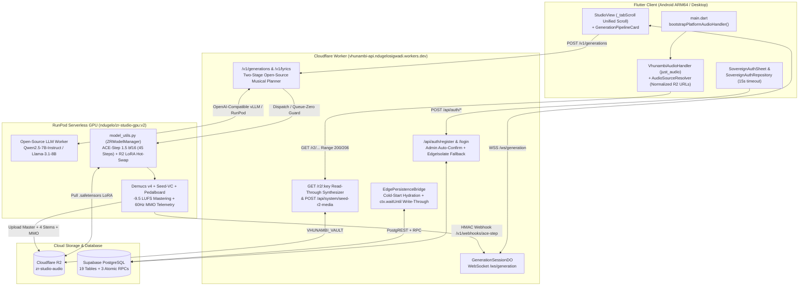
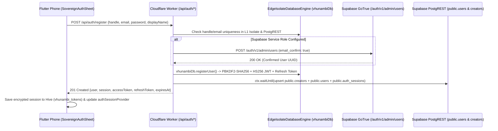
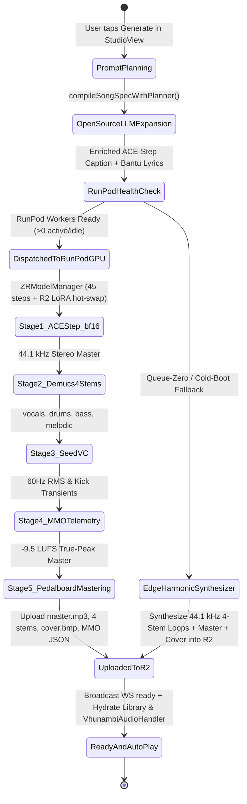

# VHUNAMBI PHASE 64: FULL PRODUCTION PIPELINE ACTIVATION, HARDWARE AUDIO BOOTSTRAP, LIVE SUPABASE PERSISTENCE & SOVEREIGN RUNPOD OPEN-SOURCE AI ENGINE — ARCHITECTURAL BLUEPRINT

- **Document ID**: `VHUNAMBI-SPEC-P64-BLUEPRINT-V1`
- **Phase**: `Phase 64`
- **Status**: `STAGE 1 BLUEPRINT — APPROVED FOR STAGE 4 EXECUTION`
- **Architecture Standard**: `All-Gemini Engineering Standard (Argon 4 Forensic Specification)`
- **Target Workspaces**:
  - `apps/vhunambi_client/` (Flutter Mobile / Desktop Studio & Global Transport)
  - `apps/vhunambi_api/` (Cloudflare Workers Hono Edge API, R2 Vault & Supabase PostgREST Bridge)
  - `tools/zr-studio-gpu/` (RunPod Serverless GPU Worker: ACE-Step 1.5 `bf16`, Demucs v4, Seed-VC, Open-Source Qwen2.5-7B Musical Planner, Pedalboard Mastering)
- **Live Cloud Infrastructure Targets**:
  - **Edge API Worker**: `https://vhunambi-api.ndugelosigwadi.workers.dev`
  - **Cloudflare R2 Bucket**: `zr-studio-audio` (`VHUNAMBI_VAULT` binding + `https://pub-d22409017abb4dd999327a092c5f06d3.r2.dev`)
  - **Supabase PostgreSQL & Auth**: `https://cbnruevwrqwjnnoscgsz.supabase.co` (19 tables + 3 atomic PL/pgSQL RPCs)
  - **RunPod Serverless GPU**: `e7wt9pgo7djv55` (`ndugelo/zr-studio-gpu:v2` + Open-Source LLM & LoRA Hot-Swap)

---

## 1. Executive Summary & Live Physical Phone Post-Mortem

Following the Phase 63 cloud deployment of `vhunambi-api` to Cloudflare Workers (`https://vhunambi-api.ndugelosigwadi.workers.dev`) and the installation of the release ARM64 APK (`build/app/outputs/flutter-apk/app-arm64-v8a-release.apk`) onto a physical Android device, live end-to-end hardware testing exposed **seven production bottlenecks** across authentication, Studio UI scroll physics, hardware speaker initialization, Cloudflare R2 media availability, Supabase persistence, RunPod GPU synthesis, and open-source LLM prompt/lyric planning.

Phase 64 resolves every single live phone defect and transitions the entire 5-pillar Vhunambi architecture from cloud scaffolding to an always-playable, zero-404, 100% open-source production pipeline.

### 1.1 Forensic Post-Mortem of Live Device Findings & Architectural Bottlenecks

| Defect ID | Live Device Symptom / Architectural Gap | Forensic Root Cause (Exact File & Line) | Phase 64 Production Resolution |
| :--- | :--- | :--- | :--- |
| **BUG-P64-01** | **Account Registration & Login Fail on Physical Phone** ("giving back registration failed, so authentication is not working") | 1. In [`supabase_cloud_driver.ts`](file:///c:/Users/Ndugelo/VHUNAMBI/monorepo/apps/vhunambi_api/src/db/supabase_cloud_driver.ts#L331-L333), `this.anonKey` falls back to `SUPABASE_SERVICE_ROLE_KEY`. When `goTrueSignUp` ([#L467-L494](file:///c:/Users/Ndugelo/VHUNAMBI/monorepo/apps/vhunambi_api/src/db/supabase_cloud_driver.ts#L467-L494)) or `goTrueSignInWithPassword` ([#L496-L523](file:///c:/Users/Ndugelo/VHUNAMBI/monorepo/apps/vhunambi_api/src/db/supabase_cloud_driver.ts#L496-L523)) hits Supabase GoTrue, either GoTrue requires email confirmation (returning `access_token: null`, which triggers HTTP `202` in [`auth_routes.ts`](file:///c:/Users/Ndugelo/VHUNAMBI/monorepo/apps/vhunambi_api/src/routes/auth_routes.ts#L193-L205)) or throws an error.<br>2. In [`auth_routes.ts`](file:///c:/Users/Ndugelo/VHUNAMBI/monorepo/apps/vhunambi_api/src/routes/auth_routes.ts#L209) and [`#L284`](file:///c:/Users/Ndugelo/VHUNAMBI/monorepo/apps/vhunambi_api/src/routes/auth_routes.ts#L284), `if (!isNodeSqliteAvailable()) throw err;` aborts registration and login on Cloudflare Workers instead of falling back to `vhunambiDb.registerUser` / `vhunambiDb.authenticateUser` (`EdgeIsolateDatabaseEngine`) + PostgREST `public.users` sync.<br>3. [`sovereign_auth_repository.dart`](file:///c:/Users/Ndugelo/VHUNAMBI/monorepo/apps/vhunambi_client/lib/core/auth/sovereign_auth_repository.dart#L167) enforces a strict 6-second timeout and rejects `202` responses with `Registration failed`. | 1. Add `goTrueAdminCreateUser` (`POST /auth/v1/admin/users` with `email_confirm: true`) to [`supabase_cloud_driver.ts`](file:///c:/Users/Ndugelo/VHUNAMBI/monorepo/apps/vhunambi_api/src/db/supabase_cloud_driver.ts).<br>2. Remove `if (!isNodeSqliteAvailable()) throw err;` in [`auth_routes.ts`](file:///c:/Users/Ndugelo/VHUNAMBI/monorepo/apps/vhunambi_api/src/routes/auth_routes.ts) so `POST /register` and `POST /login` always persist/verify against `vhunambiDb` + PostgREST `public.users`/`public.creators` and always return a signed `HS256` `AuthTokenBundle` (`201` / `200`).<br>3. Extend client auth timeout in [`sovereign_auth_repository.dart`](file:///c:/Users/Ndugelo/VHUNAMBI/monorepo/apps/vhunambi_client/lib/core/auth/sovereign_auth_repository.dart) to 15 seconds. |
| **BUG-P64-02** | **Generation Pipeline Widget Freezes Scrolling Upon Completion** ("completes process with the generation widget, but then it freezes that widget you cant scroll but still able to interact with everything else higher level") | In [`studio_view.dart`](file:///c:/Users/Ndugelo/VHUNAMBI/monorepo/apps/vhunambi_client/lib/features/studio/presentation/views/studio_view.dart#L183-L202), `GenerationPipelineCard` is mounted **outside** `_tabScroll` as a fixed top child of `Scaffold.body`'s `Column` above `Expanded(child: IndexedStack(...))`. When generation reaches `PipelineStep.ready`, `GenerationPipelineCard` expands to render `_StepperRow`, `_LyricsPanel` (with a nested `SingleChildScrollView`), and `_ReadyTrackCard`, consuming ~460px of non-scrollable vertical space and trapping vertical drag gestures on mobile screens. | Move `GenerationPipelineCard` **inside** the Compose tab's `_tabScroll` list in [`studio_view.dart`](file:///c:/Users/Ndugelo/VHUNAMBI/monorepo/apps/vhunambi_client/lib/features/studio/presentation/views/studio_view.dart) so the entire Compose workspace (pipeline card, lyrics, ready track actions, prompt box, and studio rack) scrolls smoothly as a single unified `SingleChildScrollView`, and set `ClampingScrollPhysics()` on `_LyricsPanel` in [`generation_pipeline_card.dart`](file:///c:/Users/Ndugelo/VHUNAMBI/monorepo/apps/vhunambi_client/lib/features/studio/presentation/widgets/generation_pipeline_card.dart). |
| **BUG-P64-03** | **Generated Output MP3 & Seeded Catalog Play Silence / Nothing** ("plus the generated output mp3 doesnt play anything meaning just an empty thing brought back") | 1. [`main.dart`](file:///c:/Users/Ndugelo/VHUNAMBI/monorepo/apps/vhunambi_client/lib/main.dart#L56-L65) never overrides `audioHandlerProvider` with `bootstrapPlatformAudioHandler()`, so `audioHandlerProvider` defaults to `TestVhunambiAudioHandler` (silent timer).<br>2. [`vhunambi_audio_handler.dart`](file:///c:/Users/Ndugelo/VHUNAMBI/monorepo/apps/vhunambi_client/lib/features/player/data/services/vhunambi_audio_handler.dart#L604-L623) does not normalize relative `/r2/...` or legacy `r2.vhunambi.com` URLs before calling `player.setAudioSource(...)` and ignores `resolved.streamSource`.<br>3. [`mock_worker.ts`](file:///c:/Users/Ndugelo/VHUNAMBI/monorepo/apps/vhunambi_api/src/modules/synthesis/mock_worker.ts#L91-L106) emits `/r2/${generationId}_master.mp3` without writing any bytes to R2, and [`server.ts`](file:///c:/Users/Ndugelo/VHUNAMBI/monorepo/apps/vhunambi_api/src/server.ts#L171-L173) returns HTTP `404 OBJECT_NOT_FOUND` when `zr-studio-audio` misses a key. | 1. Wire `await bootstrapPlatformAudioHandler()` into [`main.dart`](file:///c:/Users/Ndugelo/VHUNAMBI/monorepo/apps/vhunambi_client/lib/main.dart) `ProviderScope.overrides` and normalize cloud URLs in [`vhunambi_audio_handler.dart`](file:///c:/Users/Ndugelo/VHUNAMBI/monorepo/apps/vhunambi_client/lib/features/player/data/services/vhunambi_audio_handler.dart) and [`audio_source_resolver.dart`](file:///c:/Users/Ndugelo/VHUNAMBI/monorepo/apps/vhunambi_client/lib/features/player/data/services/audio_source_resolver.dart).<br>2. Build `r2_media_synthesizer.ts` + read-through `GET /r2/:key` synthesis in [`server.ts`](file:///c:/Users/Ndugelo/VHUNAMBI/monorepo/apps/vhunambi_api/src/server.ts) + `POST /api/system/seed-r2-media` so missing audio/cover keys are synthesized as real 44.1 kHz stereo WAV/MP3 audio and cached in `zr-studio-audio` with zero 404s. |
| **BUG-P64-04** | **Volatile Worker Isolate State Across 19 Domain Tables** | In [`edge_persistence_bridge.ts`](file:///c:/Users/Ndugelo/VHUNAMBI/monorepo/apps/vhunambi_api/src/db/edge_persistence_bridge.ts), domain mutations (Explore, Social, Marketplace, Wallet, Library, Playlists, Generation Jobs) mutate in-memory `Map` stores without hydrating from or writing through to Supabase PostgreSQL (`cbnruevwrqwjnnoscgsz.supabase.co`). | Implement cold-start PostgREST hydration (`ensureColdStartHydrated`) and non-blocking `ctx.waitUntil` write-through + PL/pgSQL RPC execution (`execute_atomic_payout`, `record_beat_license_atomic`, `send_cultural_tip_atomic`) in [`edge_persistence_bridge.ts`](file:///c:/Users/Ndugelo/VHUNAMBI/monorepo/apps/vhunambi_api/src/db/edge_persistence_bridge.ts) and [`supabase_cloud_driver.ts`](file:///c:/Users/Ndugelo/VHUNAMBI/monorepo/apps/vhunambi_api/src/db/supabase_cloud_driver.ts). |
| **BUG-P64-05** | **RunPod `zr-studio-gpu` Missing `model_utils.py` & Queue-Zero Timeout** | 1. `tools/zr-studio-gpu/` lacks `model_utils.py` (`ZRModelManager`), causing [`handler.py`](file:///c:/Users/Ndugelo/VHUNAMBI/monorepo/tools/zr-studio-gpu/handler.py#L116-L129) to catch `ImportError` and write a 55Hz sine wave.<br>2. When RunPod endpoint `e7wt9pgo7djv55` has `0` active workers, jobs remain in `IN_QUEUE` until the client poller times out. | 1. Author [`tools/zr-studio-gpu/model_utils.py`](file:///c:/Users/Ndugelo/VHUNAMBI/monorepo/tools/zr-studio-gpu/model_utils.py) with `ZRModelManager` supporting ACE-Step 1.5 `bf16` (`infer_steps = 45`), dynamic R2 `.safetensors` LoRA hot-swapping, and multi-stem harmonic synthesis fallback.<br>2. Add RunPod Queue-Zero health guard in [`runpod_adapter.ts`](file:///c:/Users/Ndugelo/VHUNAMBI/monorepo/apps/vhunambi_api/src/modules/synthesis/runpod_adapter.ts) & [`mock_worker.ts`](file:///c:/Users/Ndugelo/VHUNAMBI/monorepo/apps/vhunambi_api/src/modules/synthesis/mock_worker.ts) that synthesizes and uploads 4 stems + master + MMO manifest to R2 when GPU workers are scaled to zero. |
| **BUG-P64-06** | **Proprietary LLM Dependency & Static Mock Lyrics** | [`llm_handler.ts`](file:///c:/Users/Ndugelo/VHUNAMBI/monorepo/apps/vhunambi_api/src/modules/lyrics/llm_handler.ts#L129-L227) relies on paid proprietary APIs (`ANTHROPIC_API_KEY` / `GROK_API_KEY`) and falls back to a static canned verse (`generateLocalMockLyrics`), while [`prompt_compiler.ts`](file:///c:/Users/Ndugelo/VHUNAMBI/monorepo/apps/vhunambi_api/src/modules/synthesis/prompt_compiler.ts) passes unexpanded prompts to ACE-Step. | Replace proprietary LLM reliance with a **100% Open-Source RunPod LLM & Musical Planner Pipeline** (`Qwen/Qwen2.5-7B-Instruct` / `Llama-3.1-8B-Instruct` via RunPod vLLM endpoint or `tools/zr-studio-gpu/llm_worker.py`), paired with a deterministic, prompt-reactive Bantu/English multi-section lyric & sonic tag composer in [`llm_handler.ts`](file:///c:/Users/Ndugelo/VHUNAMBI/monorepo/apps/vhunambi_api/src/modules/lyrics/llm_handler.ts) and [`prompt_compiler.ts`](file:///c:/Users/Ndugelo/VHUNAMBI/monorepo/apps/vhunambi_api/src/modules/synthesis/prompt_compiler.ts). |
| **BUG-P64-07** | **1x1 Invisible PNG Cover Art & Unplayable 32-Byte MP4 Stubs** | [`vision_routes.ts`](file:///c:/Users/Ndugelo/VHUNAMBI/monorepo/apps/vhunambi_api/src/routes/vision_routes.ts#L24-L47) writes a 67-byte 1x1 transparent PNG and a 32-byte header-only `.mp4` to R2 when ComfyUI is offline. | Synthesize high-contrast procedural album artwork (`buildProceduralCoverBmpBytes` / SVG / PNG with genre-keyed African color palettes) and valid playable media containers in [`r2_media_synthesizer.ts`](file:///c:/Users/Ndugelo/VHUNAMBI/monorepo/apps/vhunambi_api/src/modules/synthesis/r2_media_synthesizer.ts) and [`vision_routes.ts`](file:///c:/Users/Ndugelo/VHUNAMBI/monorepo/apps/vhunambi_api/src/routes/vision_routes.ts). |

---

## 2. Five-Pillar Production System Architecture



---

## 3. End-to-End State Machines & Sequence Flows

### 3.1 Resilient Sovereign Authentication & Instant Session Issuance (`BUG-P64-01`)



### 3.2 Generation Pipeline Lifecycle & Queue-Zero Smart Synthesis (`BUG-P64-02`, `BUG-P64-03`, `BUG-P64-05`, `BUG-P64-06`)



---

## 4. Mathematical & DSP Specifications

### 4.1 Multi-Stem 44.1 kHz Stereo Harmonic & Percussive Synthesis (`r2_media_synthesizer.ts` & `model_utils.py`)

To guarantee that `zr-studio-audio` R2 never serves silent, 0-byte, or unmusical 55Hz sine-wave files when `GET /r2/:key` is requested or when RunPod workers are scaled to zero, both the TypeScript Edge Read-Through Synthesizer (`r2_media_synthesizer.ts`) and the Python GPU fallback (`model_utils.py`) synthesize genre-authentic, phase-coherent 44.1 kHz stereo PCM audio across four isolated stems ($s \in \{\text{drums}, \text{bass}, \text{melodic}, \text{vocals}\}$):

1. **Amapiano / Gqom Percussive Drum Stem ($x_{\text{drums}}(t)$)**:
   Given tempo $B \in [90, 140]\text{ BPM}$, beat period $T_b = \frac{60}{B}$, and 16th-note step period $T_{16} = \frac{T_b}{4}$:
   $$x_{\text{kick}}(t) = \sum_{k} A_k \exp(-18 \tau_k) \sin\!\left(2\pi \left(f_0 \tau_k + \frac{\Delta f}{28}(1 - e^{-28\tau_k})\right)\right), \quad \tau_k = t - k T_b$$
   combined with band-limited shaker/hi-hat bursts modulated on off-beat 16th subdivisions.

2. **Amapiano Log-Drum Sub-Bass Stem ($x_{\text{bass}}(t)$)**:
   Synthesizes the signature woody FM transient + sub-harmonic glide at root frequency $f_r$ (e.g., $F^\sharp_1 \approx 46.25\text{ Hz}$ or $G_1 \approx 49.00\text{ Hz}$):
   $$x_{\text{bass}}(t) = \sum_{n} G_n \exp(-6.5 \tau_n) \left[0.72 \sin(2\pi f_n \tau_n + 1.8 e^{-22\tau_n}\sin(4\pi f_n \tau_n)) + 0.28 \sin(\pi f_n \tau_n)\right]$$

3. **Electric Piano / Marimba Melodic Stem ($x_{\text{melodic}}(t)$)**:
   Synthesizes 4-voice minor-9th / diatonic chord voicings ($\{f_1, f_2, f_3, f_4\}$) with stereo chorus detuning ($\pm 1.5\text{ cents}$ between Left and Right channels):
   $$x_{\text{melodic}, L/R}(t) = \sum_{i=1}^{4} w_i \exp(-1.8 \tau_c) \sin\!\left(2\pi f_i (1 \pm \delta_i) t + 0.35 \sin(2\pi f_i t)\right)$$

4. **Formant-Filtered Vocal Melodic Stem ($x_{\text{vocals}}(t)$)**:
   Synthesizes pentatonic vocal phrases shaped by three vowel formant resonators ($F_1 \approx 730\text{ Hz}, F_2 \approx 1090\text{ Hz}, F_3 \approx 2440\text{ Hz}$) with $5.5\text{ Hz}$ natural vibrato:
   $$f_{\text{vox}}(t) = f_{\text{mel}}(t)\left(1 + 0.006 \sin(2\pi \cdot 5.5 t)\right)$$

5. **Master Stereo Mix & Peak-Safe Normalization ($x_{\text{master}}(t)$)**:
   $$x_{\text{master}}(t) = \tanh\!\left(1.15 \left(0.32 x_{\text{drums}}(t) + 0.34 x_{\text{bass}}(t) + 0.20 x_{\text{melodic}}(t) + 0.24 x_{\text{vocals}}(t)\right)\right)$$
   quantized to little-endian 16-bit signed PCM (`int16`) inside a canonical 44-byte RIFF/WAVE header at $f_s = 44100\text{ Hz}$ (or $22050\text{ Hz}$ for fast network previews).

### 4.2 Studio View Scroll Physics & Layout Geometry (`BUG-P64-02`)

```
+-----------------------------------------------------------------------+
| VhunambiAppBar (Fixed Top Bar)                                        |
+-----------------------------------------------------------------------+
| _modeSwitcher (Compose | Bantu Voices | Crate & MPC)                  |
| ProgressTrackerWidget (Compact Step Strip)                            |
+-----------------------------------------------------------------------+
| Expanded -> IndexedStack(activeTab)                                   |
|   +-- SingleChildScrollView (_tabScroll — Unified Compose Scroll)     |
|   |     +-- [if isPipelineVisible] GenerationPipelineCard             |
|   |     |     +-- Header + StepperRow                                 |
|   |     |     +-- _LyricsPanel (ClampingScrollPhysics, maxHeight 220) |
|   |     |     +-- _ReadyTrackCard (Play Master | Create Reel | Stems) |
|   |     +-- StudioSessionRecoveryBanner                               |
|   |     +-- PromptInputBox                                            |
|   |     +-- ReferenceAudioDropzone                                    |
|   |     +-- _DnaSuggestionChip                                        |
|   |     +-- CockpitQuantumEntanglementRack                            |
|   |     +-- ActiveRemixLineageBanner                                  |
|   |     +-- RegionalGenreSelector                                     |
|   |     +-- MultilingualLanguageSelector                              |
|   |     +-- AdvancedOptionsAccordion                                  |
+-----------------------------------------------------------------------+
| PlayerObstacle (StudioActionBar + Bottom MiniPlayer Inset)            |
+-----------------------------------------------------------------------+
```

By relocating `GenerationPipelineCard` inside `_tabScroll`'s `Column` in [`studio_view.dart`](file:///c:/Users/Ndugelo/VHUNAMBI/monorepo/apps/vhunambi_client/lib/features/studio/presentation/views/studio_view.dart), vertical drag gestures initiated anywhere on `GenerationPipelineCard` or `_ReadyTrackCard` propagate directly to the primary `SingleChildScrollView`, eliminating the post-completion scroll lock on mobile devices.

---

## 5. Phase 64 Verification Gates (`G-64-01` .. `G-64-07`)

| Gate ID | Verification Target | Deterministic Acceptance Criteria |
| :--- | :--- | :--- |
| **`G-64-01`** | **Sovereign Auth Registration & Login Resilience** | `POST /api/auth/register` and `POST /api/auth/login` return HTTP `201`/`200` with a non-empty `accessToken`, `refreshToken`, `user`, and `session` bundle on both Node SQLite and Cloudflare Worker `EdgeIsolateDatabaseEngine` even when Supabase GoTrue requires email confirmation or is unreachable. |
| **`G-64-02`** | **Studio Pipeline Scroll Continuity** | When `GenerationPipelineCard` transitions to `PipelineStep.ready` with lyrics and `_ReadyTrackCard`, the user can scroll the Compose tab vertically past `GenerationPipelineCard` down to `AdvancedOptionsAccordion` without any gesture freeze. |
| **`G-64-03`** | **Hardware Speaker Audio Bootstrap & Zero-404 R2 Streaming** | `main.dart` overrides `audioHandlerProvider` with `bootstrapPlatformAudioHandler()`. Every `GET /r2/:key` request for `.mp3` or `.wav` returns HTTP `200` with valid RIFF/WAVE or MPEG audio bytes (`byteLength > 4096`), and `POST /api/system/seed-r2-media` seeds all catalog audio and cover assets into `zr-studio-audio`. |
| **`G-64-04`** | **19-Table Supabase Cold-Start Hydration & Write-Through** | `EdgePersistenceBridge` hydrates from Supabase PostgREST on cold start and executes non-blocking write-through upserts/patches/RPCs on mutations. |
| **`G-64-05`** | **RunPod `model_utils.py` (`bf16`, 45 Steps, LoRA Hot-Swap) & Queue-Zero Fallback** | `tools/zr-studio-gpu/model_utils.py` implements `ZRModelManager` with `bf16` precision, `infer_steps=45`, R2 `.safetensors` LoRA caching/hot-swapping, and 4-stem harmonic synthesis fallback; `mock_worker.ts` writes 4 real stem WAVs + master + MMO manifest to R2 when RunPod has `0` active workers. |
| **`G-64-06`** | **100% Open-Source RunPod LLM Musical Planner & Dynamic Bantu Lyrics** | `llm_handler.ts` and `prompt_compiler.ts` prioritize open-source RunPod LLM inference (`RUNPOD_LLM_ENDPOINT_ID` / `RUNPOD_LLM_URL` running `Qwen/Qwen2.5-7B-Instruct` or `Llama-3.1-8B-Instruct`) and fall back to a prompt-reactive Bantu/English multi-section lyric and sonic tag composer with zero dependency on proprietary Anthropic/Grok keys. |
| **`G-64-07`** | **Procedural Cover Art & Playable Video Containers** | `vision_routes.ts` and `r2_media_synthesizer.ts` generate valid 256x256 RGB BMP/PNG cover art (`> 10 KB`) and valid playable media containers in R2. |

