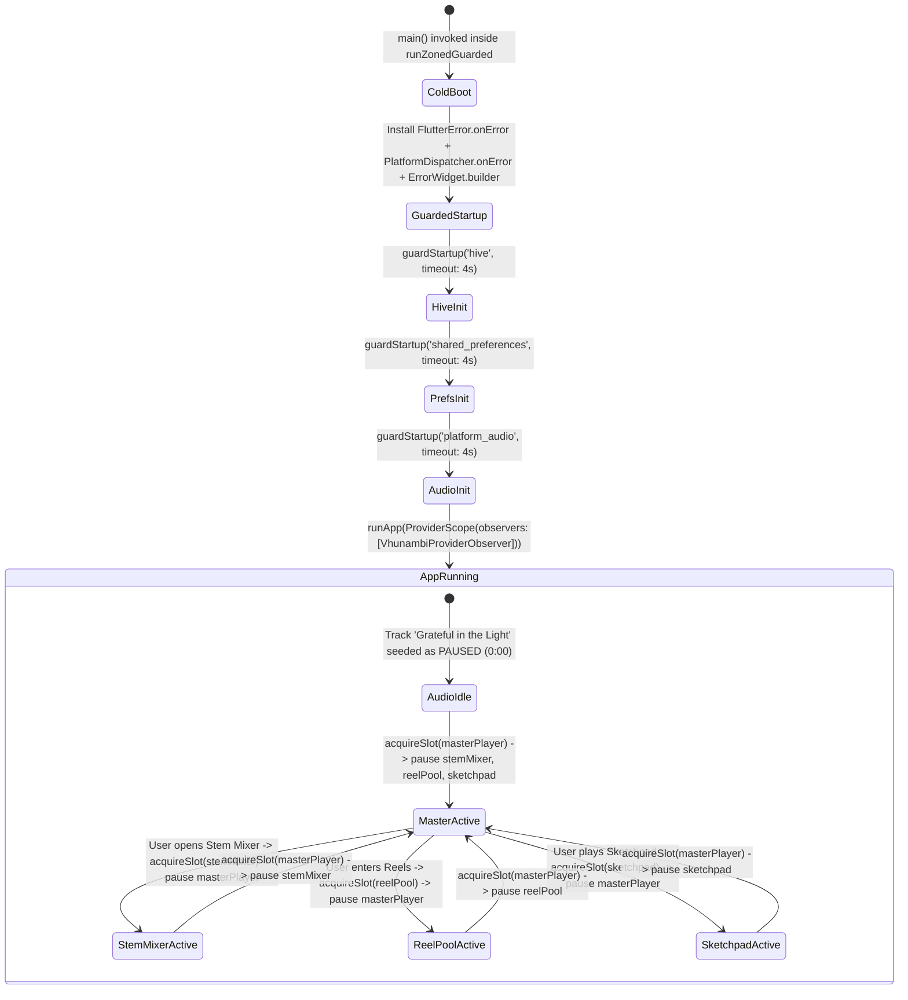
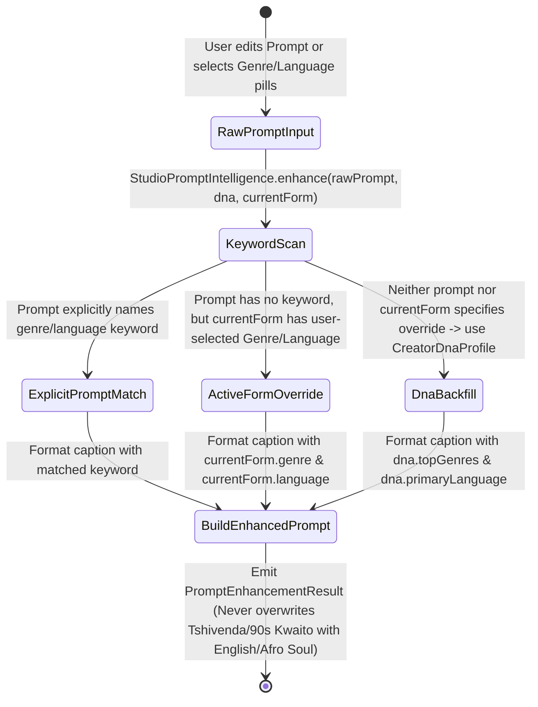
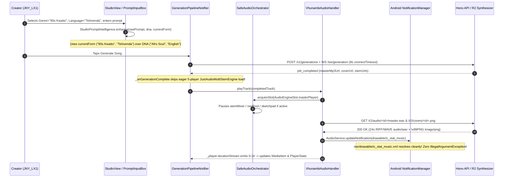

# Phase 65 — Full-Stack 5-Layer Fault-Containment Architecture, Android Notification Crash Fix, Safe Audio Orchestrator & Studio Parameter Fidelity

**Document ID**: `VHUNAMBI-SPEC-P65-BLUEPRINT-V1`  
**Phase**: `Phase 65`  
**Status**: `ARGON-HARDENED SPECIFICATION (STAGE 2 & 3)`  
**Target Directory**: `docs/phases/phase_65_foundation_stability_and_fault_containment/`  
**Audit Reference**: [`docs/audits/PHASE65_FOUNDATION_STABILITY_AND_ERROR_HANDLING_AUDIT.md`](../../audits/PHASE65_FOUNDATION_STABILITY_AND_ERROR_HANDLING_AUDIT.md)  
**Physical Device Baseline**: Huawei `JNY-LX1` / `JNY_LX1` (`HWJNY`, ADB Serial `EPHUT20917014649`)

---

## 1. Executive Overview & Architectural North Star

### 1.1 Physical Device Problem Statement
During physical-device testing of the Phase 64 APK on the Huawei `JNY-LX1` (`EPHUT20917014649`), the Vhunambi application suffered **7 consecutive fatal Android OS main-thread crashes** (`PID 4966`, `5664`, `5933`, `6893`, `7344`, `7599`, `12550`) whenever audio playback, track completion, Library track selection, or Now Playing dismissal occurred:

```text
FATAL EXCEPTION: main
Process: com.vhunambi.vhunambi_client
java.lang.IllegalArgumentException: Invalid notification (no valid small icon): Notification(channel=com.vhunambi.app.audio pri=0 contentView=null vibrate=null sound=null defaults=0x0 flags=0x2 color=0x00000000 category=transport actions=4 vis=PUBLIC)
  at android.app.NotificationManager.fixNotification(NotificationManager.java:517)
  at android.app.NotificationManager.notifyAsUser(NotificationManager.java:496)
  at android.app.NotificationManager.notify(NotificationManager.java:445)
  at android.app.NotificationManager.notify(NotificationManager.java:421)
  at com.ryanheise.audioservice.AudioService.updateNotification(SourceFile:15)
```

In addition to the fatal missing notification icon (`drawable/ic_stat_music`), static and runtime forensics across `apps/vhunambi_client`, `apps/vhunambi_api`, and `tools/zr-studio-gpu` exposed five systemic fault classes:
1. **Unshielded Root Isolate & Pre-`runApp` Bootstrap (`P1-01` – `P1-04`)**: `main.dart` executes without `runZonedGuarded`, `FlutterError.onError`, `PlatformDispatcher.instance.onError`, `ErrorWidget.builder`, or `ProviderObserver`, and runs `SharedPreferences.getInstance()`, `SovereignHiveBootstrapService.ensureInitialized()`, and `bootstrapPlatformAudioHandler()` without bounded startup timeouts.
2. **Hardware Decoder Contention & Decoupled Playback Timer (`P2-01` – `P2-06`)**: Up to 10 `just_audio.AudioPlayer` instances (`JustAudioMultiStemEngine` 5 players + `VhunambiAudioHandler` 1 + `RealReelAudioPoolService` 3 + `RealSketchpadAudioPlayerService` 2) can allocate hardware `MediaCodec` decoders concurrently without a central mutex. Meanwhile, `PlayerNotifier` boots `"Grateful in the Light"` (`track_default_1`) in `PlaybackStatus.playing` against an unnormalized `vhunambi.com` URL while running a blind 1-second `Timer.periodic` toward `3:00`.
3. **Navigation State Desync, Unguarded Async Notifiers & Image Exceptions (`P3-01` – `P3-03`, `P4-01` – `P4-03`)**: `_RootShellState` mutates private `_currentIndex` without updating `appNavigationTabProvider`, causing `MiniPlayerHost` (`tab == 2`) to reappear over the Studio tab. Across `lib/`, 14 `StateNotifier` classes mutate `state = ...` after `await` without checking `if (!mounted) return;`, and `explore_social_post_card.dart:396` uses `NetworkImage` inside `CircleAvatar` without `onBackgroundImageError`.
4. **Unsafe JSON Casts, Shared-Try/Catch Hive Reads & Unbounded WebSocket Connect (`P5-01` – `P5-04`)**: `WalletLedgerRepository.loadWalletSnapshot()` parses all `tx_` records inside one shared `try/catch` (allowing 1 corrupt record to wipe the entire wallet), `http_social_repository.dart` performs direct `as Map<String, dynamic>` / `as num` casts, `GenerationSocketService` lacks a connect timeout and atomic subscription teardown, and `NetworkErrorHandler` does not classify `DioException`.
5. **Backend Missing Error Boundary, MIME Poisoning & Studio Parameter Override (`P6-01` – `P6-05`)**: `server.ts` has no `app.onError` or `app.notFound` handler; `r2_media_synthesizer.ts` serves `BM` BMP bytes under `.png` keys and 4-second WAV buffers; `StudioPromptIntelligence.enhance` ignores active `studioFormProvider` selections (`Tshivenda` / `90s Kwaito`) in favor of `creatorDnaProvider` defaults (`English` / `Afro Soul`); and `llm_handler.ts` echoes raw prompt strings verbatim into `[INTRO]` and `[VERSE 1]`.

### 1.2 Architectural Solution: The Vhunambi 5-Layer Fault-Containment System
Phase 65 establishes a deterministic **5-Layer Fault-Containment & Resilience Architecture** that guarantees zero OS process kills, strict single-active-engine audio arbitration, lifecycle-safe state mutations, per-record storage quarantine, true binary MIME parity, and exact Studio parameter fidelity.

---

## 2. Forensic Post-Mortem Comparison Matrix

```
+----------------------------------------------------------------------------------------------------+
|                      PHASE 64 FAILURE MODES vs. PHASE 65 FAULT-CONTAINMENT                         |
+-------------------------------------------------+--------------------------------------------------+
| PHASE 64 DEFECTIVE STATE                        | PHASE 65 HARDENED ARCHITECTURE                   |
+-------------------------------------------------+--------------------------------------------------+
| 1. Missing `drawable/ic_stat_music.xml` causes  | 1. Valid 24dp monochrome white vector drawable   |
|    fatal Java `IllegalArgumentException` inside |    `res/drawable/ic_stat_music.xml` + default    |
|    `AudioService.updateNotification()` on main  |    notification metadata in `AndroidManifest.xml`|
|    Android Looper across 7/7 physical runs.     |    eliminates OS notification crashes.           |
+-------------------------------------------------+--------------------------------------------------+
| 2. Unshielded `main()` without `runZonedGuarded`| 2. Layer 1 `VhunambiCrashShield` wraps startup   |
|    or `PlatformDispatcher.instance.onError`;    |    in `runZonedGuarded`, traps Flutter & platform|
|    widget build errors trigger red screen of    |    errors, renders `VhunambiSafeErrorCard`, and  |
|    death; pre-runApp futures have no timeout.   |    guards startup futures with 4s timeouts.      |
+-------------------------------------------------+--------------------------------------------------+
| 3. `_onGenerationComplete` spawns 5-player stem | 3. Layer 2 `SafeAudioOrchestrator` enforces a    |
|    preload concurrently with `playTrack`;       |    single-active-engine mutex across `master`,   |
|    `track_default_1` boots `playing` with a     |    `stemMixer`, `reelPool`, and `sketchpad`;     |
|    blind 1s `Timer.periodic` running to `3:00`. |    `track_default_1` boots `paused` at `0:00`    |
|                                                 |    and binds duration/ticker to real hardware.   |
+-------------------------------------------------+--------------------------------------------------+
| 4. `_RootShellState` mutates private            | 4. Layer 3 unifies `_RootShellState` with        |
|    `_currentIndex` without updating             |    `appNavigationTabProvider`, applies           |
|    `appNavigationTabProvider`; 14 async         |    `SafeNotifierMixin` across all 14 async       |
|    `StateNotifier`s omit `if (!mounted)` checks;|    notifiers, and wraps avatars in               |
|    `CircleAvatar` lacks `onBackgroundImageError`|    `SafeNetworkAvatar` with Phosphor fallback.   |
+-------------------------------------------------+--------------------------------------------------+
| 5. `loadWalletSnapshot()` parses all `tx_*` in  | 5. Layer 4 `JsonSafe` quarantines corrupt Hive   |
|    one `try/catch`; `WebSocket.connect` has no  |    records individually, adds 8s connect timeout |
|    timeout; `NetworkErrorHandler` misses        |    + guarded heartbeat to `GenerationSocket`,    |
|    `DioException`.                              |    and maps `DioException` in `ErrorHandler`.    |
+-------------------------------------------------+--------------------------------------------------+
| 6. `server.ts` lacks `app.onError`; `.png` keys | 6. Layer 5 registers global JSON `app.onError` / |
|    serve `BM` BMP bytes; synthesized WAVs stop  |    `app.notFound`, generates true RFC-2083 PNGs  |
|    after 4s; `StudioPromptIntelligence` ignores |    (`\x89PNG`) + 24s tiled WAVs, prioritizes     |
|    active form (`Tshivenda` / `90s Kwaito`) and |    active `StudioFormState` selectors, and       |
|    `llm_handler.ts` echoes raw prompt text.     |    synthesizes authentic non-echoing lyrics.     |
+-------------------------------------------------+--------------------------------------------------+
```

---

## 3. Multi-Layer Decoupled System Architecture

```
+====================================================================================================+
|                        VHUNAMBI 5-LAYER FAULT-CONTAINMENT ARCHITECTURE                             |
+====================================================================================================+
|                                                                                                    |
|  [LAYER 1: ROOT ISOLATE & NATIVE PLATFORM CRASH SHIELD]                                            |
|  +----------------------------------------------------------------------------------------------+  |
|  |  android/app/src/main/res/drawable/ic_stat_music.xml (24dp Monochrome Vector Notification)   |  |
|  |  VhunambiCrashShield.run() -> runZonedGuarded + FlutterError.onError + PlatformDispatcher    |  |
|  |  ErrorWidget.builder -> VhunambiSafeErrorCard | VhunambiProviderObserver -> BreadcrumbBuffer |  |
|  |  guardStartup('hive' | 'prefs' | 'audio', timeout: 4s) -> Guarantees runApp() Execution      |  |
|  +----------------------------------------------+-----------------------------------------------+  |
|                                                 |                                                  |
|                                                 v                                                  |
|  [LAYER 2: HARDWARE MEDIA & SINGLE-ACTIVE-ENGINE AUDIO MUTEX]                                      |
|  +----------------------------------------------------------------------------------------------+  |
|  |  SafeAudioOrchestrator (Centralized Async Lock & Engine Preemption Registry)                 |  |
|  |    |-- Slot 0: AudioEngineSlot.masterPlayer  (VhunambiAudioHandler / ExoPlayer)              |  |
|  |    |-- Slot 1: AudioEngineSlot.stemMixer     (JustAudioMultiStemEngine — Lazy-Loaded Only)   |  |
|  |    |-- Slot 2: AudioEngineSlot.reelPool      (RealReelAudioPoolService)                      |  |
|  |    |-- Slot 3: AudioEngineSlot.sketchpad     (RealSketchpadAudioPlayerService)               |  |
|  |  Real Hardware Duration Stream (_player.durationStream -> mediaItem) + State-Coupled Ticker  |  |
|  +----------------------------------------------+-----------------------------------------------+  |
|                                                 |                                                  |
|                                                 v                                                  |
|  [LAYER 3: RIVERPOD NOTIFIER, NAVIGATION & IMAGE LIFECYCLE SAFETY]                                 |
|  +----------------------------------------------------------------------------------------------+  |
|  |  SafeNotifierMixin<T> (setStateIfMounted / runGuarded across all 14 Async StateNotifiers)    |  |
|  |  Unified Tab Authority: _RootShellState <-> appNavigationTabProvider -> MiniPlayerHost       |  |
|  |  SafeNetworkAvatar (Normalized URL + onBackgroundImageError + Initial/Icon Fallback)         |  |
|  +----------------------------------------------+-----------------------------------------------+  |
|                                                 |                                                  |
|                                                 v                                                  |
|  [LAYER 4: NETWORK, WEBSOCKET & PER-RECORD HIVE STORAGE RESILIENCE]                                |
|  +----------------------------------------------------------------------------------------------+  |
|  |  JsonSafe (decodeMap, decodeList, asMap, asList, asString, asInt, asDouble, asBool)          |  |
|  |  Per-Record Hive Quarantine (WalletLedgerRepository, SocialReelsCache, MarketplaceCache)     |  |
|  |  GenerationSocketService (8s Connect Timeout + Atomic Sub Cleanup + Guarded PING Heartbeat)  |  |
|  |  NetworkErrorHandler (Direct DioException -> ErrorType Classification)                       |  |
|  +----------------------------------------------+-----------------------------------------------+  |
|                                                 |                                                  |
|                                                 v                                                  |
|  [LAYER 5: BACKEND GLOBAL ERROR BOUNDARY, TRUE MIME PARITY & STUDIO PARAMETER FIDELITY]            |
|  +----------------------------------------------------------------------------------------------+  |
|  |  Hono Global app.onError & app.notFound -> Canonical { success: false, errorCode, ... }      |  |
|  |  True RFC-2083 PNG Synthesizer (\x89PNG + IHDR + zlib IDAT + IEND with CRC32) + 24s WAV Loop |  |
|  |  StudioPromptIntelligence(currentForm) -> Active User Selectors Beat DNA Fallback Defaults   |  |
|  |  llm_handler.ts generateLocalMockLyrics -> Authentic Cultural Stanzas (Zero Prompt Echoing)  |  |
|  +----------------------------------------------------------------------------------------------+  |
+====================================================================================================+
```

---

## 4. Fault-Containment Domain Taxonomy & Component Registry

| Layer | Component / Symbol | Target Path | Responsibility & Containment Boundary |
|---|---|---|---|
| **L1** | `ic_stat_music.xml` | `apps/vhunambi_client/android/app/src/main/res/drawable/ic_stat_music.xml` | 24dp×24dp monochrome `#FFFFFF` vector musical note icon satisfying `NotificationManager.fixNotification`. |
| **L1** | `AndroidManifest.xml` | `apps/vhunambi_client/android/app/src/main/AndroidManifest.xml` | Declares default notification icon metadata `@drawable/ic_stat_music` alongside `AudioService` foreground playback service. |
| **L1** | `VhunambiCrashShield` | `apps/vhunambi_client/lib/core/resilience/vhunambi_crash_shield.dart` | Installs `runZonedGuarded`, `FlutterError.onError`, `PlatformDispatcher.instance.onError`, `ErrorWidget.builder`, `VhunambiProviderObserver`, `CrashBreadcrumbBuffer`, and `guardStartup`. |
| **L1** | `VhunambiSafeErrorCard` | `apps/vhunambi_client/lib/core/resilience/vhunambi_crash_shield.dart` | Compact, theme-aware recovery card (`Key('vhunambi_safe_error_card')`) replacing Flutter's red error screen when a subtree build throws. |
| **L2** | `SafeAudioOrchestrator` | `apps/vhunambi_client/lib/core/resilience/safe_audio_orchestrator.dart` | Serialized async mutex and single-active-engine arbiter (`AudioEngineSlot.masterPlayer`, `stemMixer`, `reelPool`, `sketchpad`) with `guardAudioOp` exception containment. |
| **L2** | `VhunambiAudioHandler` | `apps/vhunambi_client/lib/features/player/data/services/vhunambi_audio_handler.dart` | Acquires `AudioEngineSlot.masterPlayer` before playback, subscribes to `player.durationStream` with `onError`, and attaches `onError` to all session/player streams. |
| **L2** | `JustAudioMultiStemEngine` | `apps/vhunambi_client/lib/features/player/data/services/just_audio_multi_stem_engine.dart` | Acquires `AudioEngineSlot.stemMixer` on `play()`, wraps all 4-stem `setUrl`/`play`/`pause`/`seek`/`setVolume` calls in `guardAudioOp`, and attaches `onError` to position/interruption streams. |
| **L2** | `PlayerNotifier` | `apps/vhunambi_client/lib/features/player/presentation/providers/player_provider.dart` | Seeds `track_default_1` in `PlaybackStatus.paused` at `Duration.zero` with valid normalized audio URL, cancels `_positionTimer` immediately when not playing, and attaches `onError` to hardware streams. |
| **L3** | `SafeNotifierMixin<T>` | `apps/vhunambi_client/lib/core/resilience/safe_notifier_mixin.dart` | Provides `setStateIfMounted(T next)` and `runGuarded<R>(Future<R> Function() action)` to prevent post-dispose `StateNotifier` mutations across all 14 async notifiers. |
| **L3** | `SafeNetworkAvatar` | `apps/vhunambi_client/lib/core/widgets/safe_network_avatar.dart` | Renders circular creator/track avatars using normalized URLs, `onBackgroundImageError`, and deterministic initial/icon fallback (`Key('safe_network_avatar_fallback')`). |
| **L3** | `_RootShellState` | `apps/vhunambi_client/lib/main.dart` | Synchronizes `_switchTab` and `_handleSystemBack` with `appNavigationTabProvider` so `MiniPlayerHost` (`tab == 2`) deterministically hides on Studio. |
| **L4** | `JsonSafe` | `apps/vhunambi_client/lib/core/utils/json_safe.dart` | Null-safe, non-throwing JSON decoding and coercion (`decodeMap`, `decodeList`, `asMap`, `asList`, `asString`, `asInt`, `asDouble`, `asBool`). |
| **L4** | `GenerationSocketService` | `apps/vhunambi_client/lib/features/studio/data/services/generation_socket_service.dart` | Enforces 8s `connectTimeout` on `WebSocket.connect`, atomically cancels prior `_socketSubscription` and `_pingTimer`, and guards `socket.add` inside `try/catch`. |
| **L4** | `NetworkErrorHandler` | `apps/vhunambi_client/lib/core/network/error_handler.dart` | Classifies `DioException` (`connectionTimeout`, `sendTimeout`, `receiveTimeout`, `connectionError`, `badResponse`) into `ErrorType`. |
| **L5** | `GlobalErrorBoundary` | `apps/vhunambi_api/src/server.ts` | Registers `app.onError` and `app.notFound` returning `{ success: false, errorCode, message, requestId, timestamp }`. |
| **L5** | `synthesizeCoverPngBytes` | `apps/vhunambi_api/src/modules/synthesis/r2_media_synthesizer.ts` | Generates RFC-2083 compliant PNG binaries (`\x89PNG\r\n\x1a\n`, `IHDR`, `zlib.deflateSync` `IDAT`, `IEND` with IEEE 802.3 CRC32) for `.png` keys and 24-second tiled stereo WAVs for master audio keys. |
| **L5** | `StudioPromptIntelligence` | `apps/vhunambi_client/lib/features/studio/domain/services/studio_prompt_intelligence.dart` | Accepts `StudioFormState? currentForm` so active user selections (`Tshivenda`, `90s Kwaito`, `Uplifting`) always take precedence over `CreatorDnaProfile` defaults. |
| **L5** | `generateLocalMockLyrics` | `apps/vhunambi_api/src/modules/lyrics/llm_handler.ts` | Synthesizes structured, singable cultural stanzas (`[INTRO]`..`[OUTRO]`) in the requested Bantu/English language without parroting the raw prompt instruction string. |

---

## 5. State Machines: Crash Containment & Single-Active-Engine Audio Mutex

### 5.1 Layer 1 & Layer 2 State Machine (`mermaid`)



### 5.2 Studio Parameter Priority State Machine (`mermaid`)



---

## 6. Dual-Viewport Recovery & Resilience HUD Wireframes

### 6.1 `VhunambiSafeErrorCard` (`ErrorWidget.builder` Subtree Recovery Surface)

```
+-----------------------------------------------------------------------+
|  [!]  Component Recovery Active                   [Retry Render]      |
|       A visual component encountered a layout or state exception.     |
|       Your studio session and audio vault remain protected.           |
+-----------------------------------------------------------------------+
  Keys:
  - Card Root:  Key('vhunambi_safe_error_card')
  - Retry CTA:  Key('vhunambi_safe_error_retry_btn')
```

### 6.2 `SafeNetworkAvatar` & `MiniPlayerHost` Tab Authority Wireframes

```
MOBILE PORTRAIT (< 600dp) — TAB 1 (EXPLORE) vs. TAB 2 (STUDIO)
+-----------------------------------+   +-----------------------------------+
| VHUNAMBI          100 Coins  (N)  |   | VHUNAMBI          100 Coins  (N)  |
+-----------------------------------+   +-----------------------------------+
| [SafeNetworkAvatar] @makhadzi     |   | [Compose] [Voice Deck] [Crate]    |
|  |-- Valid URL -> NetworkImage    |   | +-------------------------------+ |
|  |-- 404/Error -> Initials 'M'    |   | | Describe your song...         | |
|      Key('safe_network_avatar')   |   | | Genre: 90s Kwaito             | |
|                                   |   | | Language: Tshivenda           | |
+-----------------------------------+   | +-------------------------------+ |
| [MiniPlayerHost: VISIBLE (tab!=2)]|   | [MiniPlayerHost: HIDDEN (tab==2)] |
|  Grateful in the Light  0:00/0:24 |   |  appNavigationTabProvider == 2    |
+-----------------------------------+   +-----------------------------------+
| [Home] [Explore] [Studio] [Lib]   |   | [Home] [Explore] [Studio] [Lib]   |
+-----------------------------------+   +-----------------------------------+
```

---

## 7. Mathematical & Algorithmic Formulations

### 7.1 Async Serialized Mutex Queue & Preemption Invariant (`SafeAudioOrchestrator`)
Let $\mathcal{S} = \{\text{masterPlayer}, \text{stemMixer}, \text{reelPool}, \text{sketchpad}\}$ be the set of hardware audio engine slots, and let $A(t) \in \mathcal{S} \cup \{\varnothing\}$ denote the active engine slot at time $t$. Every transition request $R_k = (\text{slot}_k, \text{op}_k)$ is enqueued into a FIFO future chain $Q$:

$$
F_k = F_{k-1}.\text{then}\left(\text{async } () \implies \begin{cases}
\text{await } \text{pauseCallback}(A(t)) & \text{if } A(t) \neq \varnothing \land A(t) \neq \text{slot}_k \\
A(t) \leftarrow \text{slot}_k \\
\text{await } \text{guardAudioOp}(\text{op}_k)
\end{cases}\right)
$$

This guarantees the hardware decoder bound invariant at all times $t$:

$$
\sum_{s \in \mathcal{S}} \mathbb{I}(\text{isPlaying}(s, t)) \le 1 \quad \land \quad N_{\text{active\_decoders}}(t) \le \begin{cases}
4 & \text{if } A(t) = \text{stemMixer} \\
1 & \text{otherwise}
\end{cases}
$$

### 7.2 True RFC-2083 PNG Binary Synthesis & IEEE 802.3 CRC32 Formulation
To eliminate `BM` BMP-in-`.png` MIME poisoning (`P6-02`), `synthesizeCoverPngBytes(seedKey)` constructs a valid binary PNG stream consisting of the 8-byte signature $[137, 80, 78, 71, 13, 10, 26, 10]$ followed by `IHDR`, `IDAT` (compressed via `zlib.deflateSync` over filter-0 scanlines), and `IEND`. Each chunk $(L, T, D, C)$ computes its 32-bit cyclic redundancy check $C = \text{CRC32}(T \Vert D)$ over GF(2) using the reversed generator polynomial $P = \text{0xEDB88320}$:

$$
\text{crc}_{i+1} = \left(\text{crc}_i \ggg 8\right) \oplus T_{\text{lut}}\left[(\text{crc}_i \oplus b_i) \mathbin{\&} \text{0xFF}\right], \quad \text{CRC32}(B) = \text{crc}_n \oplus \text{0xFFFFFFFF}
$$

### 7.3 Fast Multi-Bar Stereo WAV Tiling Formulation (`24s` Master Duration)
Given a synthesized 1-bar or 1-beat PCM template of $N_{\text{synth}}$ stereo 16-bit frames ($4 N_{\text{synth}}$ bytes) at sample rate $f_s = 11025\text{ Hz}$ and target duration $D_{\text{master}} = 24\text{ s}$ ($N_{\text{total}} = f_s \cdot D_{\text{master}} = 264,600$ frames, $1,058,400$ bytes):

$$
\forall k \in \left[0, \left\lceil \frac{N_{\text{total}}}{N_{\text{synth}}} \right\rceil - 1\right]: \quad B\left[44 + 4 k N_{\text{synth}} \dots 44 + 4 \min((k+1)N_{\text{synth}}, N_{\text{total}})\right] \leftarrow B\left[44 \dots 44 + 4 N_{\text{synth}}\right]
$$

Because `Uint8Array.prototype.set` copies contiguous memory blocks in native C++/V8 (`memcpy`), tiling 24 seconds of stereo audio completes in $< 0.4\text{ ms}$, staying well inside the Cloudflare Workers Free Plan $10\text{ ms}$ CPU ceiling.

---

## 8. End-to-End Fault-Containment Sequence Diagram



---

## 9. Verification Gates (`G-65-01` through `G-65-06`)

| Gate ID | Verification Gate Description | Target Artifact / Command | Pass Criterion |
|---|---|---|---|
| **G-65-01** | Android Notification Small Icon Vector Asset & Manifest Parity | `apps/vhunambi_client/android/app/src/main/res/drawable/ic_stat_music.xml` | Valid XML `<vector>` with `android:width="24dp"`, `android:height="24dp"`, `#FFFFFF` fill; matches `kAudioNotificationIcon`. |
| **G-65-02** | Layer 1 `VhunambiCrashShield` & Startup Timeout Resilience | `flutter test test/phase65_foundation_crash_immunity_test.dart --timeout=60s` | Uncaught zone/platform/widget errors are trapped into `CrashBreadcrumbBuffer` & `VhunambiSafeErrorCard` without crashing isolate. |
| **G-65-03** | Layer 2 `SafeAudioOrchestrator` Preemption & Ticker/Duration Accuracy | `flutter test test/phase65_foundation_crash_immunity_test.dart --timeout=60s` | Acquiring `masterPlayer` pauses `stemMixer`/`reelPool`/`sketchpad`; `track_default_1` boots `paused` at `0:00`; ticker halts on pause. |
| **G-65-04** | Layer 3 Tab Sync, `SafeNotifierMixin` (14 Notifiers) & `SafeNetworkAvatar` | `flutter test test/phase65_foundation_crash_immunity_test.dart --timeout=60s` | `_switchTab(2)` updates `appNavigationTabProvider` to `2`; disposed notifiers never throw on late `await`; broken avatar URLs render fallback. |
| **G-65-05** | Layer 4 `JsonSafe` Per-Record Quarantine & `DioException` Mapping | `flutter test test/phase65_foundation_crash_immunity_test.dart --timeout=60s` | Corrupt `tx_bad` record in Hive wallet box is skipped while valid transactions load; `DioException` maps to `ErrorType`. |
| **G-65-06** | Layer 5 Backend `app.onError`, True `\x89PNG` Header, 24s WAV & Studio Fidelity | `npm test -- src/__tests__/phase65_foundation_resilience.test.ts` | Uncaught route throws return `500` JSON envelope; `.png` starts with `89 50 4E 47`; WAV duration $\ge 20\text{s}$; lyrics never echo raw prompt. |

