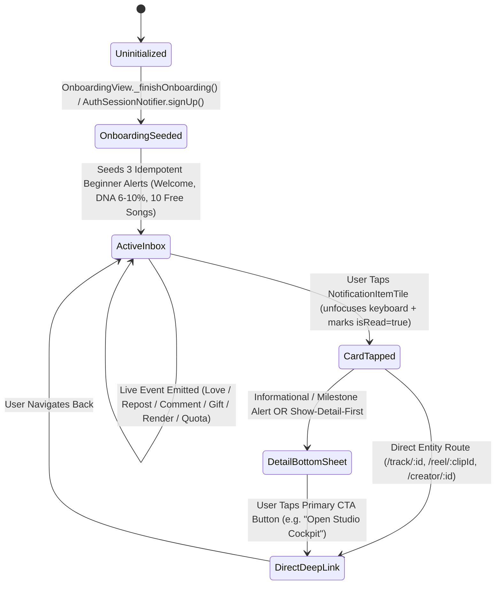
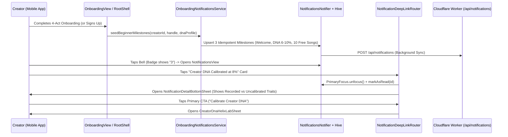

# Phase 67 Blueprint: Notifications Center Two-Pass Overhaul (Pass 1: Refined LODA Glow UI, Mock Purge & Onboarding Milestones | Pass 2: Detail Sheet, Deep-Link Router, 10-Song Quota & Live Event Wiring)

**Document ID:** `VHUNAMBI-SPEC-P67-BLUEPRINT-V1`  
**Phase:** `Phase 67` (`phase_67_notifications_center_two_pass_overhaul`)  
**Standard:** Vhunambi All-Gemini Engineering Standard (`STD-UIUX-001` / Argon-Hardened 4-Doc Suite)  
**Predecessor Audit:** [`docs/audits/PHASE67_NOTIFICATIONS_CENTER_OVERHAUL_AUDIT.md`](file:///c:/Users/Ndugelo/VHUNAMBI/monorepo/docs/audits/PHASE67_NOTIFICATIONS_CENTER_OVERHAUL_AUDIT.md)  
**Target Packages:** `apps/vhunambi_client`, `apps/vhunambi_api`, `supabase/migrations`

---

## 1. Executive Overview & Visual North Star

Physical-device screen recordings (`video_1.mp4` and `video_2.mp4`) and the Phase 67 forensic audit ([`PHASE67_NOTIFICATIONS_CENTER_OVERHAUL_AUDIT.md`](file:///c:/Users/Ndugelo/VHUNAMBI/monorepo/docs/audits/PHASE67_NOTIFICATIONS_CENTER_OVERHAUL_AUDIT.md)) exposed why Vhunambi's Notifications Center currently fails production trust:
1. **Self-Respawning Demo Mocks (`N-01`, `N-02`)**: `RootShell.initState` (`main.dart#L148-L150`) and `NotificationsView.build` (`notifications_view.dart#L31-L41`) invoke `seedDemoAlerts()`, force-feeding 10 fabricated alerts (`@makhadzi` Open Stems, `@fifi` Open-Verse Remix, `trk_pipeline_001`) into every empty inbox. Meanwhile, `SubscriptionUpgradeModal` (`#L257-L270`) fabricates unverified `"Coins Credited! (R450)"` alerts locally on tap.
2. **Dead Taps & The `"Unknown Melody (@fifi)"` Trap (`N-03`, `N-04`)**: `NotificationsView.openNotification` (`#L48-L58`) returns early whenever `targetTrackId` is null, making System, Social, Wallet, and Video Export cards dead taps. When `targetTrackId` *is* present, `TrackDetailNotifier._lookupInitialTrack` (`track_providers.dart#L202-L219`) only checks the static 6-track `seededTrackDetails` list—ignoring `libraryTracksProvider` and `exploreTracksProvider`—and falls back to hardcoded `"Unknown Melody"` by `@fifi`.
3. **Zero Live Event Producers, Badge-Less Home Bell & Inflated 20% Starter DNA (`N-05`, `N-06`, `N-07`)**: Loving a reel (`"Loved 2x!"`), reposting (`"Reposted @ndugelo's post!"`), commenting, following, and cultural gifting emit zero notifications; `HomeDashboardView` (`#L310-L333`) renders a bare `PhosphorIcon(AppIcons.bell)` with no unread badge; `OnboardingView._finishOnboarding` (`#L85`) hardcodes `completeness: 1.0` (inflating initial DNA to ~20% instead of `6%–10%`); and no backend `notifications` or `creator_quotas` (`10 free songs/month`) tables exist.
4. **Flat Monotone Cards, Stock Icons & Keyboard Occlusion (`N-08`, `N-09`)**: Every card uses an identical flat `#141418` fill with an always-orange unread dot, 14 stock Material `Icons.*` sites violate `STD-UIUX-001`, `Discovery` clips off-screen in `NotificationCategoryRail`, and missing `FocusManager.instance.primaryFocus?.unfocus()` leaves the soft keyboard covering 45% of the viewport when tapping filter chips or cards.

### The Two-Pass Overhaul Strategy

Phase 67 executes a disciplined **Two-Pass Overhaul** so visual/mock cleanup can be verified on physical hardware before full-stack deep-linking and backend event wiring:
- **Overhaul Pass 1 (`M67.1` – `M67.2`)**: Purges all 10+ hardcoded mocks and auto-seed hooks, calibrates starter Creator DNA dynamically to `6%–10%`, seeds the **3 authentic beginner notifications** (`Welcome to Vhunambi`, `Creator DNA Calibrated at <X>%`, `10 Free Monthly Song Generations Ready`), upgrades cards with the **Refined LODA Directional Glow System** (3px left accent bar + 12% directional wash, 5 semantic colors, in-card category pill, category-tinted timestamp dot, trailing `›` chevron), migrates 100% of icons to Phosphor (`STD-UIUX-001`), adds rail fade/auto-scroll, and unfocuses the keyboard on chip/card/scroll interactions.
- **Overhaul Pass 2 (`M67.3` – `M67.5`)**: Introduces the universal **`NotificationDetailBottomSheet`** + **`NotificationDeepLinkRouter`** (`/studio`, `/creator-dna`, `/wallet`, `/track/:id`, `/reel/:clipId`, `/creator/:id`), fixes `TrackDetailNotifier` to resolve real Library and Explore tracks (eradicating `"Unknown Melody (@fifi)"`), upgrades `HomeDashboardView` to `NotificationBellButton`, provisions the backend `notifications` + `creator_quotas` (`10 free songs/month`) tables and `/api/notifications` routes, and wires real event producers across Reels, Reposts, Comments, Follows, Gifts, Studio Generations, and Quota milestones.

---

## 2. Forensic Post-Mortem Comparison Box

```
┌───────────────────────────────────────────────┬──────────────────────────────────────────────────────┐
│ LEGACY NOTIFICATIONS CENTER (video_1 & 2)     │ PHASE 67 SOVEREIGN NOTIFICATIONS ARCHITECTURE        │
├───────────────────────────────────────────────┼──────────────────────────────────────────────────────┤
│ • 10 fake Phase 40 mocks respawn on boot &    │ • Zero demo mocks in production + automatic Hive     │
│   whenever the user clears their inbox        │   disk scrubber purging legacy `notif_p40_*` &       │
│                                               │   `notif_seed_*` keys on upgrade boot                │
│ • Static initState-only seeding misses live   │ • Reactive `currentCreatorIdProvider` listener in    │
│   sign-ups & account switches in RootShell    │   `RootShell.build` + 3 idempotent beginner alerts   │
│ • Starter DNA hardcoded completeness=1.0 ->   │ • Dynamic starter completeness (0.15–0.28) lands     │
│   artificial 20% DNA on brand-new accounts    │   initial Creator DNA naturally at 6%–10%            │
│ • Uniform flat #141418 cards, stock Icons.*,  │ • Obsidian #121215/#17171C cards + 3px left bar +    │
│   orange-only unread dots, no category pill   │   12% directional glow + 5 semantic colors + pill + ›│
│ • Tapping System/Social/Wallet cards is a     │ • Every card opens NotificationDetailBottomSheet or  │
│   silent no-op; unseeded tracks open @fifi    │   deep-links via NotificationDeepLinkRouter          │
│ • Home bell has no badge; Love/Repost/Comment │ • Unified NotificationBellButton on all 5 tabs +     │
│   emit zero notifications; no backend table   │   live event emitters + SQLite/Postgres sync         │
│ • Keyboard stays open on chip/card tap;       │ • Automatic primaryFocus.unfocus() on chip/card/drag │
│   Discovery chip clips off-screen on 360dp    │   + ShaderMask fade & Scrollable.ensureVisible rail  │
└───────────────────────────────────────────────┴──────────────────────────────────────────────────────┘
```

---

## 3. 5-Layer Decoupled System Architecture

```
┌──────────────────────────────────────────────────────────────────────────────────────────────────┐
│ LAYER 5: PRESENTATION & INTERACTIVE SURFACES (Flutter / Riverpod)                                │
│  • NotificationsView + NotificationCategoryRail (ShaderMask + ensureVisible + auto-unfocus)      │
│  • NotificationItemTile (3px Left Accent Bar + 12% Directional Wash + Category Pill + › Chevron) │
│  • NotificationDetailBottomSheet (Trait/Quota/Track Breakdown + Primary CTA Button)              │
│  • NotificationBellButton (Unified across Home, Explore, Studio, Library, Marketplace)           │
├────────────────────────────────────────────────┬─────────────────────────────────────────────────┤
│                                                ▼                                                 │
│ LAYER 4: DEEP-LINK ROUTING & EVENT ORCHESTRATION                                                 │
│  • NotificationDeepLinkRouter (/studio, /creator-dna, /wallet, /track/:id, /reel/:id, /creator)  │
│  • OnboardingNotificationsService (3 Idempotent Starter Alerts + 6%–10% DNA Calibration Math)    │
│  • Real Event Producers (Reel Love, Repost, Comment, Follow, Gift, Studio Render, Quota Alert)   │
├────────────────────────────────────────────────┬─────────────────────────────────────────────────┤
│                                                ▼                                                 │
│ LAYER 3: CLIENT STATE & O(1) HIVE VAULT PERSISTENCE                                              │
│  • NotificationsNotifier (SafeNotifierMixin, Unread Invariant, Cloud Delta Sync)                 │
│  • NotificationRepository (notifications_v1 Hive box, notif_<id> O(1) keys, 500-item ceiling)    │
├────────────────────────────────────────────────┬─────────────────────────────────────────────────┤
│                                                ▼                                                 │
│ LAYER 2: CLOUDFLARE WORKER GATEWAY & QUOTA ENGINE (apps/vhunambi_api)                            │
│  • /api/notifications (GET, POST, PATCH /:id/read, POST /mark-all-read, DELETE /:id)             │
│  • /api/wallet/allowance (GET 10 Free Monthly Songs quota status + auto-reset cycle)             │
│  • /v1/generations hook (Decrements free_monthly_songs_remaining & emits render/quota alerts)    │
├────────────────────────────────────────────────┬─────────────────────────────────────────────────┤
│                                                ▼                                                 │
│ LAYER 1: DUAL-ENGINE PERSISTENCE (node:sqlite + Supabase Postgres via EdgePersistenceBridge)     │
│  • public.notifications (id, user_id, category, subtype, target_route, metadata_json, is_read)   │
│  • public.creator_quotas (user_id, plan_tier, free_monthly_songs_limit=10, used, cycle_reset_at) │
└──────────────────────────────────────────────────────────────────────────────────────────────────┘
```

---

## 4. Semantic Category & Subtype Color Taxonomy

To achieve instant visual scannability without harsh neon glare, Phase 67 maps every notification's `category` and optional `subtype` to one of **5 Semantic Studio Accents** from [`AppColors`](file:///c:/Users/Ndugelo/VHUNAMBI/monorepo/apps/vhunambi_client/lib/core/theme/app_colors.dart):

| Semantic Domain | `NotificationCategory` | `subtype` Values | Accent Token & Hex | Phosphor Glyph (`AppIcons` / `PhosphorIcons`) | In-Card Pill Label |
| :--- | :--- | :--- | :--- | :--- | :--- |
| **1. System & Free Quota** | `system` | `'welcome'`, `'monthly_quota'`, `'credits'`, `'security'` | `AppColors.coinGold` (`#F59E0B` Warm Amber Gold) | `PhosphorIconsFill.shieldCheck` / `AppIcons.coin` | `System • Welcome` / `Free Tier Quota` / `Credits & Plan` |
| **2. Creator DNA & Milestones** | `system` / `algorithmic` | `'dna_calibration'`, `'dna_milestone'` | `AppColors.success` (`#10B981` Emerald Teal) | `AppIcons.dna` (`PhosphorIconsFill.dna`) | `Creator DNA` |
| **3. Studio & Render Activity** | `creatorActivity` | `'studio_render'`, `'reel_render'`, `'stem_split'`, `'license_sold'` | `AppColors.brandPrimary` (`#F97316` Ember Orange) | `AppIcons.sparkle` (`PhosphorIconsFill.sparkle`) | `Studio Render` / `Reel Export` / `Studio Activity` |
| **4. Social & Collaborations** | `social` | `'reel_love'`, `'repost'`, `'comment'`, `'follow'`, `'gift'`, `'collab'` | `AppColors.accentElectric` (`#8B5CF6` Amethyst Violet) | `PhosphorIconsFill.usersThree` / `AppIcons.heart` | `Social` / `Social • Love` / `Social • Repost` |
| **5. Discovery & Drops** | `algorithmic` | `'regional_trend'`, `'fresh_drop'`, `'ar_cosign'` | `AppColors.badgeCyan` (`#22D3EE` Electric Cyan) | `AppIcons.analytics` (`PhosphorIconsRegular.chartLineUp`) | `Discovery` |

---

## 5. Lifecycle & Deep-Link State Machine



---

## 6. Dual-Viewport HUD Wireframes (`NotificationsView` & `NotificationDetailBottomSheet`)

### 6.1 Mobile Portrait `< 600dp` (`NotificationsView` with Refined LODA Glow Cards)

```
┌──────────────────────────────────────────────────────────┐
│ [ < ]  Notifications                     [✓✓ Mark all]   │ <- 56dp VhunambiTopBarSurface (Phosphor icons)
├──────────────────────────────────────────────────────────┤
│ ( All 3 ) ( Social ) ( System 3 ) ( Activity ) ( Disc..▸ │ <- 52dp Rail + Right ShaderMask Fade + Unfocus
├──────────────────────────────────────────────────────────┤
│ [ 🔍 Search alerts...                              [✕] ] │ <- 48dp Search Bar (unfocuses on chip/card tap)
├──────────────────────────────────────────────────────────┤
│ ┃▓░░░░░░░░░░░░░░░░░░░░░░░░░░░░░░░░░░░░░░░░░░░░░░░░░░░░░┃ │
│ ┃▓ [🪙]  10 Free Monthly Song Generations Ready   1m • ┃ │ <- 3px Gold Left Bar + 12% Directional Wash
│ ┃▓       Your Free Creator account includes 10...   ›  ┃ │    + 28% Gold Unread Border + Gold Dot + ›
│ ┃▓       [ Free Tier Quota ]                           ┃ │ <- Compact Semantic Category Pill Badge
│ ┗━━━━━━━━━━━━━━━━━━━━━━━━━━━━━━━━━━━━━━━━━━━━━━━━━━━━━━┛ │
│ ┃▓░░░░░░░░░░░░░░░░░░░░░░░░░░░░░░░░░░░░░░░░░░░░░░░░░░░░░┃ │
│ ┃▓ [🧬]  Creator DNA Calibrated at 8%             1m • ┃ │ <- 3px Emerald Left Bar + 12% Emerald Wash
│ ┃▓       Your foundational sound identity is...     ›  ┃ │    + 28% Emerald Unread Border + Emerald Dot
│ ┃▓       [ Creator DNA ]                               ┃ │ <- Emerald Category Pill Badge
│ ┗━━━━━━━━━━━━━━━━━━━━━━━━━━━━━━━━━━━━━━━━━━━━━━━━━━━━━━┛ │
│ ┃▓░░░░░░░░░░░░░░░░░░░░░░░░░░░░░░░░░░░░░░░░░░░░░░░░░░░░░┃ │
│ ┃▓ [🛡️]  Welcome to Vhunambi, @ndugelo            1m • ┃ │ <- 3px Gold Left Bar + 12% Gold Wash
│ ┃▓       Your sovereign African music studio...     ›  ┃ │
│ ┃▓       [ System • Welcome ]                          ┃ │
│ ┗━━━━━━━━━━━━━━━━━━━━━━━━━━━━━━━━━━━━━━━━━━━━━━━━━━━━━━┛ │
└──────────────────────────────────────────────────────────┘
```

### 6.2 Universal `NotificationDetailBottomSheet` Wireframe

```
┌──────────────────────────────────────────────────────────┐
│                        ━━━━━                             │ <- 40x4dp Drag Handle
│  [🧬]  [ Creator DNA ]                         1m ago    │ <- Semantic Badge + Pill + Timestamp
│                                                          │
│  Creator DNA Calibrated at 8%                            │ <- AppTypography.titleLarge
│  Your foundational sound identity is recorded. Complete  │ <- AppTypography.bodyMedium
│  vocal calibration and add reference tracks to unlock    │
│  deeper personalization.                                 │
│                                                          │
│  ┌────────────────────────────────────────────────────┐  │
│  │ CALIBRATION BREAKDOWN (8% STRENGTH)                │  │ <- Structured Metadata Context Card
│  │ ▓▓░░░░░░░░░░░░░░░░░░░░░░░░░░░░░░░░░░░░░░  8 / 100% │  │
│  │ ✓ Recorded: Producer • Amapiano, Afro House • ve   │  │
│  │ ○ Uncalibrated: Zero-Shot Vocal Clone, Reference   │  │
│  │   Track Audio, Playback & Generation Telemetry     │  │
│  └────────────────────────────────────────────────────┘  │
│                                                          │
│  [         🧬 Calibrate Creator DNA          ]           │ <- 50dp Primary CTA Button (Accent Fill)
│  [                   Close                   ]           │ <- Secondary Dismiss Button
└──────────────────────────────────────────────────────────┘
```

---

## 7. Mathematical Formulations

### 7.1 Dynamic Starter Creator DNA Calibration (`6%–10%` Target Band)
In [`CreatorDnaProfile.strengthPercent`](file:///c:/Users/Ndugelo/VHUNAMBI/monorepo/apps/vhunambi_client/lib/features/creator_dna/domain/entities/creator_dna_profile.dart#L116-L128):
$$\text{strengthPercent} = \text{round}\!\left(100 \times \left(0.60 \cdot \min\!\left(1, \frac{E}{200}\right) + 0.25 \cdot \min\!\left(1, \frac{W_{>0.5}}{30}\right) + 0.15 \cdot C_{\text{onboard}}\right)\right)$$
For a newly onboarded user ($E = 0$), let $G = |\text{selectedGenres}|$, $L = |\text{selectedLanguages}|$, and $M = |\text{selectedMoods}|$. Instead of passing hardcoded $C_{\text{onboard}} = 1.0$ (which adds $+15\%$ and forces starter DNA to $\ge 19\%$), starter completeness $C_{\text{starter}}$ measures only the foundational survey fraction prior to vocal cloning and reference audio calibration:
$$C_{\text{starter}} = \text{clamp}\!\left(0.10 + 0.02 \cdot \min(G, 3) + 0.02 \cdot \min(L, 2) + 0.02 \cdot \min(M, 2),\ 0.14,\ 0.26\right)$$
With typical starter selections ($W_{>0.5} \in [4, 7] \implies 0.25 \cdot W_{>0.5}/30 \in [0.033, 0.058]$ and $0.15 \cdot C_{\text{starter}} \in [0.021, 0.039]$):
$$\text{strengthPercent}_{\text{starter}} = \text{round}\!\left(100 \times (0.033..0.058 + 0.021..0.039)\right) \in [6\%, 10\%]$$

### 7.2 Unread Counter Partition Invariant
At every state transition $S_t$ of `notificationsProvider`:
$$\text{unreadNotificationsCount} = \sum_{c \in \text{NotificationCategory.values}} \text{unreadCountByCategory}[c] = \left|\{n \in S_t \mid \neg n.\text{isRead}\}\right|$$

### 7.3 Monthly Free Song Generation Allowance Math
For a creator on `plan_tier = 'free'` with `free_monthly_songs_limit = 10` and `free_monthly_songs_used` $= U \in [0, 10]$:
$$\text{freeSongsRemaining} = \max(0, 10 - U)$$
When `now >= cycle_reset_at`, the quota engine atomically resets $U \leftarrow 0$ and advances `cycle_reset_at` by $+30\text{ days}$.

---

## 8. End-to-End Entanglement & Event Sequence



---

## 9. Verification Gates (`G-01` – `G-06`)

| Gate ID | Overhaul Pass | Verification Gate Description | Target Pass Criteria |
| :--- | :---: | :--- | :--- |
| **`G-01`** | **Pass 1** | **Zero Demo Mocks & Idempotent 3-Milestone Onboarding Seed** | `phase40SeededNotifications` & `seedDemoAlerts` purged; new/onboarded user gets exactly 3 alerts (`Welcome`, `DNA 6%–10%`, `10 Free Songs`) with zero duplicates on remount. |
| **`G-02`** | **Pass 1** | **Refined LODA Glow Card, 5 Semantic Accents & `STD-UIUX-001` Icons** | 3px left bar + 12% directional wash, category pill, `›` chevron, category-colored dot, and 0 stock `Icons.*` across `features/notifications/`. |
| **`G-03`** | **Pass 1** | **Keyboard Unfocus & Unclipped Category Rail** | Tapping any filter chip, card, or scrolling dismisses keyboard; `Discovery` chip has `ShaderMask` fade and scrolls into view on selection. |
| **`G-04`** | **Pass 2** | **Universal Detail Sheet, Deep-Link Router & Zero `@fifi` Fallback** | Every card opens `NotificationDetailBottomSheet` or navigates to target route; generated/Library tracks open real track details in `TrackDetailView`. |
| **`G-05`** | **Pass 2** | **Backend `notifications` + `creator_quotas` (`10 Songs/Month`)** | SQLite & Postgres schemas + `/api/notifications` & `/api/wallet/allowance` pass `tsc --noEmit` and node tests; generation decrements free song quota. |
| **`G-06`** | **Pass 2** | **Live Social/Studio Event Producers & Unified Home Bell Badge** | Loving a reel, reposting, commenting, following, gifting, and rendering emit real notifications and increment the Home `NotificationBellButton` badge. |
