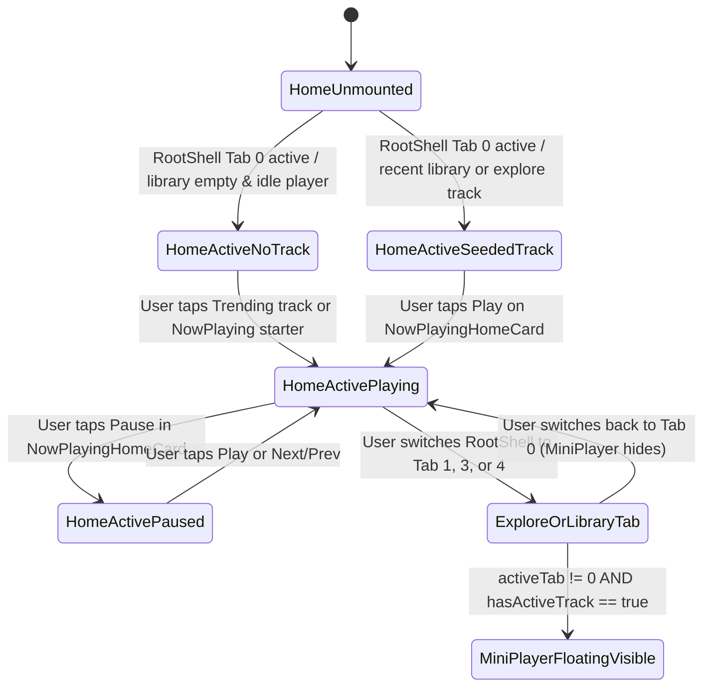
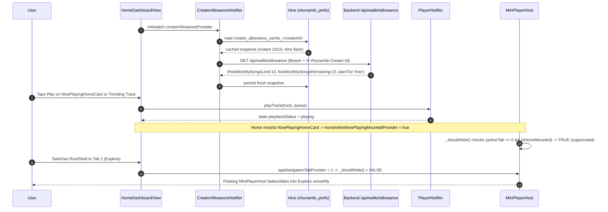

# Phase 68 — Home Dashboard "Main Room & Studio Utility" Overhaul Blueprint

> **Document ID:** `VHUNAMBI-SPEC-P68-BLUEPRINT-V1`  
> **Classification:** Phase 68 Architectural Blueprint (Stage 2 + Stage 3 Argon-Hardened Spec)  
> **Source Forensic Audit:** [`docs/audits/PHASE68_HOME_DASHBOARD_OVERHAUL_AUDIT.md`](../../audits/PHASE68_HOME_DASHBOARD_OVERHAUL_AUDIT.md)  
> **Zania Reference Inspiration:** `C:\Users\Ndugelo\Zania-Explore-v2.5\Zania-Explore` (`mobile-dashboard.tsx`, `mobile-widget-now-playing.tsx`, `dashboard-quick-stats.tsx`, `mobile-music-hero.tsx`, `cover-art.ts`)  
> **Predecessor Foundation:** Phase 67 Notifications Center & Creator Quota (`10 Free Monthly Songs`, `/api/wallet/allowance`, `NotificationBellButton`)

---

## 1. Executive Overview & Visual North Star

Physical device captures (`video_1.mp4` Dark Mode, `video_2.mp4` Light Mode) confirmed that Vhunambi's current **Home Dashboard** (`home_dashboard_view.dart`) feels like an overcrowded developer prototype rather than a high-clarity **"Main Room & Studio Utility"** (our Zania Explore architectural North Star):

1. **Above-the-Fold Redundancy (~650dp Wasted Height):** A `~190dp` inline *"What are you feeling today?"* prompt card embeds a fake `TextField` that triggers soft-keyboard transitions on Home only to jump to **Tab 2 (Studio)**, immediately followed by a duplicate **`AI Studio`** tile in the 6-tile hub AND **`TrendingReelsShelf()`** (`~275dp` of orange 9:16 blocks copied from Explore).
2. **Double-Player Overlap on Mobile Tab 0:** Launching a track from **Jump Back In** leaves a `~145dp` playback card on screen *while simultaneously* spawning the floating `MiniPlayerHost` pill directly above the bottom navigation bar.
3. **Ten Bundled Artworks Left Unused:** `apps/vhunambi_client/assets/artwork/` ships **10 rich African heritage studio artworks**, yet every seeded track in `explore_providers.dart` and `library_providers.dart` leaves `coverUrl == null`, causing *Jump Back In*, *Trending in Your Genres*, and the *Now Playing* dock to fall back identically to flat orange `AppGradients.forGenre` blocks.
4. **Hardcoded Dark Surfaces & Un-scrimmed Neon Gradients:** Direct references to `AppColors.surfaceCanvas`, `surfaceElevated`, `surfaceSecondary`, `textPrimary`, `textSecondary`, raw hex literals (`0xFFEC4899`, `0xFF8B5CF6`, `0xFF10B981`, `0xFF3B82F6`), and full-bleed un-scrimmed `AppGradients.forGenre` banners produce washed-out neon orange (`#FF6B00`) in Dark Mode and harsh royal blue (`#4F46E5`) in Light Mode.
5. **Invisible Creator Monthly Allowance (`10/10` Free Songs):** Phase 67 added `GET /api/wallet/allowance` and seeded the *"You Have 10 Free Monthly Songs"* onboarding notification, yet Home shows only `Streak` + `Coins`—forcing new creators to dig into Notifications or paywalls to see remaining free generations.
6. **`STD-UIUX-001` Emoji & Stock Icon Leakage:** Raw unicode emojis (`✨`, `☀️`, `🌙`, `🎯`, `🧬`) and stock Material `Icons.*` remain active in `african_greeting_resolver.dart`, `dna_insight_card.dart`, `home_dashboard_view.dart`, `subscription_upgrade_modal.dart`, and `cross_module_synergy_deck.dart` (`Icon(PhosphorIcons...)` instead of `PhosphorIcon(...)`).

Phase 68 reorganizes Home into a disciplined **5-Zone Main Room**, executed across a clean **Two-Pass Overhaul**:
- **Overhaul Pass 1 (`M68.1` – `M68.2`):** Purge legacy mocks (`seed-01 Ndo Mufuna Matibe @Fifi`), wire the **Unified Artwork Pipeline** (`VhunambiTrackArtwork` + 10 bundled assets mapped to seeded Explore & Library tracks), enforce 100% `*Of(context)` dual-theme adaptation, purge raw emojis & stock `Icons.*`, declutter Home by removing the redundant prompt wrapper and `TrendingReelsShelf()`, and introduce **Zone 1.5 (DNA & Pipeline Strip)** + **Zone 3 (148px Square Artwork `Trending in Your Genres` Shelf)** + **Zone 2 (`NowPlayingHomeCard` starter shell)**.
- **Overhaul Pass 2 (`M68.3` – `M68.4`):** Connect **`creatorAllowanceProvider`** (`GET /api/wallet/allowance` + encrypted/Hive offline cache) and the compact **`10/10 Free` Header Allowance Pill**, upgrade **`NowPlayingHomeCard`** with interactive scrub bar, prev/next/play/polish controls, and Tab-0 floating **`MiniPlayerHost` auto-suppression** (`homeInlineNowPlayingMountedProvider`), replace the 6-tile grid with the slim **`Create in Studio` top CTA + 4-Tool Studio Launch Strip** (`Voice Clone`, `Sketchpad`, `Beats Market`, `Asset Vault`), and upgrade **Zone 5 (`EditorialRhythmSpotlightCard`)** with dark editorial artwork + dual-stop scrims.

---

## 2. Forensic Post-Mortem Comparison Box

```
+---------------------------------------------------------------------------------------------------+
| PHASE 68 FORENSIC POST-MORTEM: CURRENT PROTOTYPE DEFECTS vs. MAIN ROOM & STUDIO UTILITY          |
+----------------------------+------------------------------------+---------------------------------+
| Audit ID & Area            | Pre-Phase 68 Production Failure    | Phase 68 Main Room Architecture |
+----------------------------+------------------------------------+---------------------------------+
| H-01 / H-02: Fake Prompt   | ~190dp prompt box + TextField +    | Purged. Single compact 44dp     |
| & Duplicate AI Studio Tile | duplicate AI Studio tile both just | Create-in-Studio CTA capsule +  |
| (`L448-561`, `L887-893`)   | switch to Tab 2; triggers soft IME | clean 4-tool strip (zero dup).  |
+----------------------------+------------------------------------+---------------------------------+
| H-03: Explore Feed Leak    | TrendingReelsShelf (~275dp) baked  | Purged from Home (remains on    |
| (`L632-634`)               | into Home, copying Tab 1 Explore.  | Tab 1 Explore where reels live).|
+----------------------------+------------------------------------+---------------------------------+
| H-04 / H-05 / H-08: Blank  | 10 artworks idle in assets/artwork | VhunambiTrackArtwork resolves   |
| Orange Track Squares       | while coverUrl == null on seeded   | asset:/http/local/genre art +   |
| (`L1062-1213`)             | tracks -> identical orange tiles.  | backfills Explore & Library.    |
+----------------------------+------------------------------------+---------------------------------+
| H-06 / H-07: Static Tokens | Direct AppColors.surfaceElevated + | 100% *Of(context) adapters +    |
| & Raw Gradient Bleed       | raw hexes + un-scrimmed neon box   | scrimmed artwork cards cleanly  |
| (`L224-273`, `L645-650`)   | in Light & Dark modes.             | legible in Mist & Night themes. |
+----------------------------+------------------------------------+---------------------------------+
| H-09: Legacy Mock Track    | Hardcoded 'seed-01 Ndo Mufuna      | Purged. Real library/explore    |
| (`L155-163`)               | Matibe' (@Fifi) shown when empty.  | track or honest Empty State CTA.|
+----------------------------+------------------------------------+---------------------------------+
| H-10 / STD-UIUX-001: Raw   | Emojis in greeting/DNA/View-All +  | 100% PhosphorIcon(...) glyphs + |
| Emojis & Stock Material    | Icons.close_rounded, Icons.check,  | 48dp minimum touch targets on   |
| Icons (`african_greeting`) | Icon(PhosphorIcons...) wrappers.   | all pills, View all, close btns.|
+----------------------------+------------------------------------+---------------------------------+
| H-11: Double Player UI on  | Large Jump Back In card + floating | Unified NowPlayingHomeCard on   |
| Mobile Tab 0 (`main.dart`) | MiniPlayerHost pill stacked on Tab0| Home; MiniPlayerHost suppresses |
|                            | overlapping ~230dp of viewport.    | on Tab 0 when inline mounted.   |
+----------------------------+------------------------------------+---------------------------------+
| H-12: Missing Free Quota   | Header displays Streak + Coins;    | Header adds compact `10/10`     |
| Readout (`M67.4` backend)  | monthly song quota hidden away.    | Creator Allowance Pill (live).  |
+---------------------------------------------------------------------------------------------------+
```

---

## 3. Multi-Layer Decoupled System Architecture

```
+===================================================================================================+
| LAYER 1: EXTERNAL & PERSISTED DATA SOURCES                                                        |
|  * Backend REST (`GET /api/wallet/allowance` via SovereignApiClient + JWT auto-refresh)           |
|  * Local Tier-0 Hive Cache (`AppConstants.prefsBoxKey` -> `creator_allowance_cache_<creatorId>`)   |
|  * Local Catalogs (`exploreTracksProvider`, `libraryTracksProvider`, `appNavigationTabProvider`)   |
|  * Runtime Engines (`playerStateProvider`, `generationProgressProvider`, `creatorDnaProvider`)    |
+================================================+==================================================+
                                                 |
                                                 v
+===================================================================================================+
| LAYER 2: RIVERPOD STATE & DOMAIN RESOLVERS (Pure Dart Logic + Resilient Caching)                  |
|  * `CreatorAllowanceNotifier` (`creatorAllowanceProvider`)                                        |
|    - Hydrates from Hive on startup (zero flash), syncs live from `/api/wallet/allowance`,         |
|      derives `remaining`, `limit`, `planTier`, `isUnlimited`, `isLowQuota`.                       |
|  * `AppAssets.resolveGenreCoverAsset(genre)` & `AppAssets.resolveTrackCoverAsset(track)`          |
|    - Deterministic 10-asset mapping covering Amapiano, Gqom, Afrobeats, Afro House, Maskandi, etc.  |
|  * `AfricanGreetingResolver` (`GreetingIconType` enum — zero raw unicode emojis)                  |
|  * `AfricanRhythmMatrix` (7-day cultural presets feeding Spotlight + Studio + Sketchpad)          |
+================================================+==================================================+
                                                 |
                                                 v
+===================================================================================================+
| LAYER 3: SHARED PRESENTATION PRIMITIVES                                                           |
|  * `VhunambiTrackArtwork` (Single source of truth for track/genre art: HTTP -> asset: -> genre)   |
|  * `NotificationBellButton` (Shared Phase 67 badge bell)                                          |
|  * `MiniPlayerHost` (Guarded by `activeTab == 0 && homeInlineNowPlayingMountedProvider`)           |
+================================================+==================================================+
                                                 |
                                                 v
+===================================================================================================+
| LAYER 4: HOME DASHBOARD 5-ZONE MAIN ROOM (`HomeDashboardView`)                                    |
|  [Zone 1  ] Top Utility Header (Avatar + Greeting + Theme + Streak + `10/10` Quota + Coins + Bell)|
|  [Zone 1.5] Conditional Pipeline Telemetry Banner OR Compact DNA Strength Strip (`8%` -> Helix)  |
|  [Zone 2  ] Unified `NowPlayingHomeCard` (Zania-style inline art, title, seek bar, transport)     |
|  [Zone 3  ] `Trending in Your Genres` Horizontal Square Artwork Carousel (`148dp` cards)          |
|  [Zone 4  ] Compact `Create in Studio` Pill CTA + 4-Tool Studio Launch Strip (no duplicate tile)  |
|  [Zone 5  ] `EditorialRhythmSpotlightCard` (Scrimmed bundled artwork + "Try Rhythm in Studio")    |
+===================================================================================================+
```

---

## 4. Spatial Topology, Pass Split & Bundled Artwork Registry

### 4.1 Two-Pass Overhaul Execution Partition

| Overhaul Pass | Milestones | Architectural Scope |
| :--- | :--- | :--- |
| **Pass 1** | `M68.1` – `M68.2` | Register all 10 `assets/artwork/*.png` files in `AppAssets` + build `VhunambiTrackArtwork`; backfill seeded Explore & Library tracks so zero `coverUrl` entries fall back blindly; purge `seed-01` mock, fake prompt card, `AI Studio` duplicate, and `TrendingReelsShelf` from Home; tokenize `*Of(context)` surfaces; mount `MainRoomHeader` (without quota pill yet OR prep layout), `TelemetryAndDnaBanner`, and `HorizontalGenreTrackShelf`. |
| **Pass 2** | `M68.3` – `M68.4` | Implement `CreatorAllowanceNotifier` (`/api/wallet/allowance` + Hive cache) + Header `10/10` Allowance Pill; build interactive `NowPlayingHomeCard` + wire Tab-0 `MiniPlayerHost` de-duplication (`homeInlineNowPlayingMountedProvider`); build compact `Create in Studio` + 4-tool `CreationLaunchStrip`; upgrade `EditorialRhythmSpotlightCard` with scrimmed artwork; complete `STD-UIUX-001` emoji/icon purge across `AfricanGreetingResolver`, `DnaInsightCard`, `CrossModuleSynergyDeck`, and `SubscriptionUpgradeModal`; realign tests. |

### 4.2 Canonical 10-Asset Bundled Artwork Registry (`apps/vhunambi_client/assets/artwork/`)

Every bundled PNG under `assets/artwork/` is mapped deterministically to Vhunambi genres and archetypes so Explore, Library, Jump Back In, and Spotlight cards present cohesive African studio art offline and online:

| Asset Constant (`AppAssets`) | Exact File Path (`assets/artwork/...`) | Primary Genre / Domain Assignment |
| :--- | :--- | :--- |
| `heritageCrateCover` | `assets/artwork/heritage_crate_cover.png` | `Heritage`, `Isicathamiya`, `Mbaqanga`, Heritage Crate |
| `splashHero` | `assets/artwork/splash_hero.png` | Default Studio Fallback, `Afro Soul`, `Gospel` |
| `timbreElder` | `assets/artwork/timbre_elder.png` | `Maskandi`, `Mbube`, `Acoustic`, Cultural Spotlight |
| `timbrePoet` | `assets/artwork/timbre_poet.png` | `Spoken Word`, `Bongo Flava`, `Alt-Afro`, Lyrics Focus |
| `timbreCrooner` | `assets/artwork/timbre_crooner.png` | `Afrobeats`, `Afro R&B`, `Highlife`, Melodic Vocals |
| `timbreCantor` | `assets/artwork/timbre_cantor.png` | `Tshivenḓa Folk`, `Shangaan Electro`, `Kwaito` |
| `timbreProducer` | `assets/artwork/timbre_producer.png` | `Gqom`, `Bacardi`, `3-Step`, Beatmaking / Stem Lab |
| `sunsetMelodiesCover` | `assets/artwork/Vhunambi_ African Sunset Melodies.png` | `Amapiano`, `Afro House`, `Private School Piano` |
| `fiveVoicesCover` | `assets/artwork/Vhunambi_ Five Voices, One Vision.png` | `Ensemble`, `Choir`, Multi-Vocal Collaborations |
| `musicFeelEscapeCover` | `assets/artwork/Vhunambi_ Music, Feel, Escape.png` | `Editorial Spotlight`, `Chill Afro`, `Lo-Fi` |

*(Scheme convention: Seeded domain records use `asset:assets/artwork/<file>.png` when referencing bundled assets via `Track.coverUrl` / `LibraryTrack.coverUrl`, and `VhunambiTrackArtwork` strips the `asset:` prefix for `Image.asset(...)` while passing `http(s)://` directly to `Image.network(...)` with graceful error builder fallback to `AppAssets.resolveGenreCoverAsset(genre)`.)*

---

## 5. State Machines & Tab-0 Player Suppression



### 5.1 Mini-Player Suppression Invariant (Zero Test Regression Guard)
Isolated widget tests (`mini_player_host_test.dart`, `phase33_adaptive_mini_player_test.dart`) mount `MiniPlayerHost` inside standalone `Scaffold`s where `appNavigationTabProvider` defaults to `0`. Therefore `MiniPlayerHost._shouldHide(...)` MUST require **both**:
1. `activeTab == 0` (`appNavigationTabProvider`), AND
2. `homeInlineNowPlayingMountedProvider == true` (managed via `NowPlayingHomeCard`'s post-frame mount & dispose callbacks).

---

## 6. Dual-Viewport Wireframes (Mobile Portrait & Desktop Responsive)

### 6.1 Mobile Portrait Viewport (`< 600dp`, Target ~`390x844` Physical Huawei / Android)

```
+---------------------------------------------------+
| [ND]  Monatshe ndi wavhudi    (sun)  [5] [10/10]  | <- Zone 1: Compact Utility Bar (56dp + top inset)
|       Madekwana @ndugelo             [250] [bell] |    (Overflow-safe Wrap/Row spacing, >=48dp taps)
+---------------------------------------------------+
| [dna-icon] Creator DNA 8% calibrated   Explore >  | <- Zone 1.5: 48dp DNA Strip (or live Pipeline pill)
+---------------------------------------------------+
| NOW PLAYING / JUMP BACK IN                        | <- Zone 2: Zania-Inspired Compact Playback Card
| +-------+  Khomani Soul Anthem          [v / ^ ]  |    (64dp square VhunambiTrackArtwork, no raw orange)
| |  ART  |  Ndugelo * Amapiano  01:12 / 04:00      |    Interactive Slider scrub track + 48dp controls:
| +-------+  (<<)   ( [>/||] )   (>>)   [Stems]     |    Prev | Play/Pause | Next | Polish/Stems pill
| ================o------------------------         |
+---------------------------------------------------+
| Trending in Your Genres               View all >  | <- Zone 3: Horizontal Artwork Rail (~198dp tall)
| +-------------+  +-------------+  +-------------+ |
| |   ARTWORK   |  |   ARTWORK   |  |  ARTWORK    | |    148x148 rounded artwork + genre tag badge
| |  [Amapiano] |  |   [Gqom]    |  | [Afro Hse]  | |    Title (1 line) + Creator @handle (1 line)
| +-------------+  +-------------+  +-------------+ |
| Midnite LogDrum  Durban Bounce    Sunset Vibes    |
+---------------------------------------------------+
| [sparkle] Open AI Creation Studio  ->             | <- Zone 4: Slim 48dp Studio Launch Capsule
| +-------+ +-------+ +---------+ +-------+         |    4 Clean Studio Tool Cards (NO AI Studio dup):
| | Voice | |Sketch | |  Beats  | | Asset |         |    All *Of(context) tinted Phosphor icons
| | Clone | |  pad  | | Market  | | Vault |         |
| +-------+ +-------+ +---------+ +-------+         |
+---------------------------------------------------+
| +-----------------------------------------------+ | <- Zone 5: Scrimmed Editorial Spotlight Card
| | [DARK SCRIM OVER BUNDLED GENRE ARTWORK]       | |    Zero neon bleed in Dark or Light mode!
| | DAILY RHYTHM SPOTLIGHT * TUESDAY              | |    Primary high-contrast white type over scrim
| | Durban Gqom Broken Beat                       | |    48dp [ Try Rhythm in Studio -> ] CTA
| +-----------------------------------------------+ |
+---------------------------------------------------+
|   (Home)   (Explore)   (Studio)   (Vault)  (Mkt)  | <- Bottom Nav Dock (NO floating MiniPlayer on Tab 0)
+---------------------------------------------------+
```

### 6.2 Desktop / Tablet Viewport (`>= 600dp`, Target `1280x800`)

```
+---------------------------------------------------------------------------------------------------+
| [ND]  Ndi matsheloni, Madekwana  | [5d Streak] [10/10 Free] [250 Coins] [Theme] [Notifications]   |
+---------------------------------------------------------------------------------------------------+
| [Zone 1.5 Telemetry / Creator DNA Bar: Full-width compact 52dp strip across 12-col maxContentWidth] |
+------------------------------------------------------------+--------------------------------------+
| LEFT PRIMARY COLUMN (~62% width)                           | RIGHT UTILITY COLUMN (~38% width)    |
|  * Zone 2: NowPlayingHomeCard (expanded waveform spacing)  |  * Zone 4: Create-in-Studio Hero CTA |
|  * Zone 3: Trending in Your Genres (wider scroll viewport) |  * Zone 4: 2x2 Creation Tool Grid    |
|                                                            |  * Zone 5: Editorial Spotlight Card  |
+------------------------------------------------------------+--------------------------------------+
```

---

## 7. Entanglement Sequence (`M68.3` Allowance + Player Lifecycle)



---

## 8. Theme Tokenization & `STD-UIUX-001` Compliance Matrix

| Target Component | Pre-Phase 68 Token Defect | Phase 68 Mandatory Compliant Replacement |
| :--- | :--- | :--- |
| `HomeDashboardView` | `AppColors.surfaceCanvas`, `surfaceElevated`, `surfaceSecondary`, `textPrimary`, `textSecondary`, raw hexes (`0xFFEC4899`, `0xFF8B5CF6`, `0xFF10B981`, `0xFF3B82F6`), stock `Icon(...)` | `AppColors.surfaceCanvasOf(context)`, `surfaceElevatedOf(context)`, `surfaceSecondaryOf(context)`, `borderSubtleOf(context)`, `textPrimaryOf(context)`, `textSecondaryOf(context)`, semantic `AppColors.*` (`accentElectric`, `brandPrimary`, `coinGold`, `badgeCyan`, `success`), `PhosphorIcon(...)`. |
| `AfricanGreetingResolver` | `'✨'`, `'☀️'`, `'🌙'` in `TimeAwareGreeting.iconEmoji` | `GreetingIconType` enum (`sparkles`, `sun`, `sunHorizon`, `moonStars`) mapped to `PhosphorIcon` glyphs in header; emoji fields deprecated/removed. |
| `DnaInsightCard` | `'✨'`, `'🎯'`, `'🧬'`, `Icon(Icons.close)` | `PhosphorIcon(PhosphorIconsFill.dna / sparkle / target)` + `PhosphorIcon(PhosphorIconsBold.x)` with 48dp hit target. |
| `CrossModuleSynergyDeck` | `Icon(PhosphorIcons...)` (`L46, 167, 208, 241`) | `PhosphorIcon(...)` uniformly across all 4 call sites + `*Of(context)` surfaces. |
| `SubscriptionUpgradeModal` | `Icon(Icons.close_rounded)` (`L80`), `Icon(Icons.check_circle_rounded)` (`L436-437`) | `PhosphorIcon(PhosphorIconsBold.x)` + `PhosphorIcon(PhosphorIconsFill.checkCircle)` + `minimumSize: Size(48, 48)` on close button. |

---

## 9. Existing Test Impact & Verification Gates

Because Phase 68 intentionally purges `'What are you feeling today?'`, `'Create ✨'`, and `'AI Studio'` (`home_hub_ai_studio`), existing tests asserting those deprecated strings/keys must be realigned deterministically in `M68.4`:
- `apps/vhunambi_client/test/features/home/home_dashboard_view_test.dart`: Update expectations from `'What are you feeling today?'`, `'Create ✨'`, and `'AI Studio'` to `Key('home_create_studio_cta')`, `Key('home_allowance_pill')`, `Key('home_now_playing_card')`, and `Key('home_hub_beats_market')`.
- `apps/vhunambi_client/test/features/home/phase31_home_dashboard_convergence_test.dart`: Update Finding `HOME-003 & 004` (`home_hub_ai_studio` -> `home_create_studio_cta` + 4 tool tiles) and preserve all other keys (`home_streak_pill`, `home_coins_pill`, `home_notifications_btn`, `home_jump_back_master_btn`, `home_hub_voice_clone`, `home_hub_melody_sketchpad`, `home_hub_beats_market`, `home_hub_asset_vault`, `home_try_rhythm_btn`, `home_pipeline_progress_card`).

### Phase 68 Release Verification Gates
| Gate | Description | Target Verification |
| :--- | :--- | :--- |
| **`G-01`** | Static analysis zero errors | `flutter analyze` -> `No issues found!` |
| **`G-02`** | Pass 1 unit & widget coverage | Artwork resolver (`10/10` assets), `VhunambiTrackArtwork`, `AfricanGreetingResolver` emoji-free, header & horizontal genre shelf tests green (`--timeout=60s`). |
| **`G-03`** | Pass 2 quota & player coverage | `CreatorAllowanceNotifier` HTTP + Hive cache unit tests, `NowPlayingHomeCard` scrub/transport tests, `MiniPlayerHost` Tab-0 suppression + standalone overlay compatibility verified. |
| **`G-04`** | Realigned Home convergence suite | `home_dashboard_view_test.dart`, `phase31_home_dashboard_convergence_test.dart`, `phase33_adaptive_mini_player_test.dart`, `mini_player_host_test.dart` 100% green. |
| **`G-05`** | Light & Dark visual parity + `STD-UIUX-001` | Zero raw unicode emojis in Home/DNA/Upgrade UI, zero stock `Icons.*`, zero un-scrimmed neon gradients, zero RenderFlex overflows across `360x780`, `390x844`, and `1280x800`. |
| **`G-06`** | Physical device parity (`EPHUT20917014649`) | Release APK smoke-tested on Huawei JNY-LX1 across Light & Dark themes and cold offline startup. |
